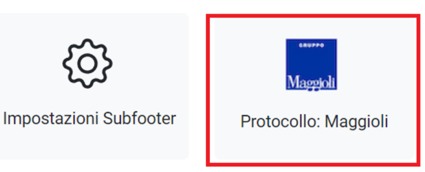

# Integrazione con il software di Protocollo Maggioli

```{include} /_snippets/funzionalita-aggiuntiva.md
```

Nel caso l’Ente abbia acquistato l’integrazione con il protocollo Maggioli, le pratiche che vengono sottomesse dal Cittadino acquisiranno come riferimento un numero di protocollo staccato dal software ufficiale dell’Ente, anzichè un numero univoco casuale generato da io-Cittadino.

Lato cittadino e lato operatore l’integrazione è trasparente e non ha sostanzialmente differenze rispetto al comportamento standard di io-Cittadino:

- alla pratica verrà attribuito il numero di protocollo, che comparirà nelle comunicazioni (mail) e nei messaggi ufficiali (area personale)
- Lato operatore, il numero di protocollo comparirà in riferimento al **N° Pratica** all’interno dell’area operatore

## Configurazione

L’accesso alle configurazione per l’integrazione è ad uso esclusivo degli amministratori dell’Ente, e si accede da un pannello di controllo riservato presente nella sezione di configurazione dei prodotti aggiuntivi **https://nome sito>t/api/@@overview-controlpanel**

La compilazione delle informazioni per il collegamento al sistema Maggioli è riservato al personale preposto, dietro supervisione di RedTurtle.


