# Integrazione con io-Comune

Una modello pratica è lo strumento con cui, da un Servizio di io-Comune, si crea la rappresentazione digitale della pratica, attraverso la quale il cittadino può sottomettere le sue richieste.

Una pratica è sostanzialmente una sorta di form online, suddiviso in step, attraverso il quale vengono sottomessi i dati che poi vengono elaborati dagli operatori del Comune che li riceve.

Un esempio di pratica online è la “richiesta di iscrizione ad una graduatoria”, oppure una “richiesta di pass per la ZTL”, ecc.

## Attori coinvolti nel processo

I principali attori coinvolti nella costruzione, utilizzo e manutenzione delle pratiche sono:

- **Redattore** : colui che crea le nuove pratiche (form), grazie agli appositi strumenti redazionali
- **Cittadino:** colui che utilizza le pratiche online, sottomette i dati e controlla lo stato di avanzamento delle pratiche stesse sottoposte all’Ente
- **Operatore:** utente o gruppo di utenti dell’Ente che si occupa della gestione delle pratiche in tutti i suoi step di avanzamento, fino alla conclusione.

### Gestione del gruppo “Operatori Pratiche”

Questo gruppo comprende gli utenti o i gruppi di utenti dell'Ente che sono responsabili della gestione e dell'avanzamento delle pratiche in tutti i loro stati, dalla ricezione alla conclusione.

**Ruoli e operatività:**

- **Assegnazione delle pratiche:** Gli operatori possono assegnare le pratiche ad altri specifici operatori, garantendo una distribuzione efficiente del carico di lavoro.
- **Modifica dello stato della pratica:** Sono autorizzati a modificare lo stato di una pratica (es. "In elaborazione", "Sospesa", "Annullata", "Completata"), riflettendo l'avanzamento del processo.
- **Comunicazione con il cittadino:** Possono inviare messaggi ai cittadini in relazione alle loro pratiche, fornendo aggiornamenti, richieste di integrazioni o comunicazioni ufficiali.
- **Accesso ai dati della pratica:** Hanno accesso completo ai dati compilati nelle pratiche, sia in bozza che finalizzate, per la lavorazione e la verifica.

**Configurazione e gestione:**

La gestione del gruppo "Operatori Pratiche" avviene tramite le funzionalità di amministrazione del CMS Plone. Gli amministratori di sistema possono:

- Creare e modificare il gruppo "Operatori Pratiche".
- Assegnare singoli utenti a questo gruppo.

**Visibilità delle pratiche:**

Gli operatori hanno una dashboard dedicata che consente loro di visualizzare e gestire tutte le pratiche pervenute, filtrate per stato, data, tipo di pratica e assegnazione. Questa dashboard fornisce una panoramica completa del flusso di lavoro delle pratiche.

Di default, gli appartenenti al gruppo “ **Operatori pratiche** ” gestiscono qualsiasi pratica, per le operatività descritte sopra. Tuttavia, è possibile, sul singolo Modello Pratica, definire singoli operatori (che devono appartenere al gruppo “Operatori pratiche”) responsabili della gestione di quel particolare modello, e la visibilità di quella tipologia di Modello Pratica sarà riservata esclusivamente a loro. Tali utenti sono definiti in un apposito campo del Modello pratica (si veda l’apposita sezione)

Nel caso in cui nessun utente sia definito nel campo, tutti gli utenti appartenenti al gruppo “Operatori pratiche” sono abilitati alla consultazione e gestione di quel modello pratica.

## Content-type “Modello pratica”

Essendo la pratica la rappresentazione digitale di un servizio, è di fatto un tipo di contenuto del CMS aggiungibile soltanto all’interno di un CT servizio.

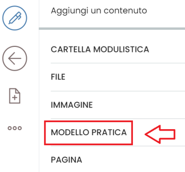

Il CT Modello Pratica consiste nei seguenti campi:

- **Tab “Default”**
  - **Titolo** : il titolo della pratica (es. “Richiesta di occupazione del suolo pubblico”)
  - **Descrizione:** campo descrittivo
  - **Modello:** lista di valori precaricata con modelli pratica già implementati, di fatto riutilizzabili (sarà poi sempre possibile modificare il form a seconda delle proprie necessità specifiche), oppure “Custom” nel caso si intenda disegnare la form ex-novo
  - **Servizi collegati:** eventuali link ad altri servizi sul portale, per i quali si vuole porre in evidenza la loro correlazione (es. se la pratica riguarda l’iscrizione all’asilo, e il sito istituzionale contiene anche il servizio di iscrizione alla scuola elementare, può essere utile porre la correlazione tra la pratica a tale servizio, in modo da mettere in evidenza e facilitare la navigazione dell’utente verso tali servizi al momento della finalizzazione della pratica - ultimo step di conferma di inserimento)
  - **Prossimi passi:** consentono di evidenziare una timeline riassuntiva, al momento della finalizzazione della pratica (step finale), che mostra la successione degli eventi temporali che accadranno. Questa timeline, per indicazioni AgID, deve rispecchiare le indicazioni dei “tempi e scadenze” impostate sul servizio di riferimento della pratica nell’apposito campo. E’ possibile inserire un qualsivoglia numero di step

  - **Messaggio al cambio di stato della pratica:** campo precompilato in cui è possibile personalizzare il messaggio della mail che giunge all’operatore al cambio di stato delle pratiche (secondo le indicazioni mostrate nell’helptext del campo), con alcuni campi dinamici
  - **Email notifica:** indirizzi email a cui notificare la creazione di nuove pratiche. Possono essere inseriti più indirizzi email. Rappresentano di fatto gli indirizzi email degli operatori pratiche a cui notificare la creazione di nuove pratiche

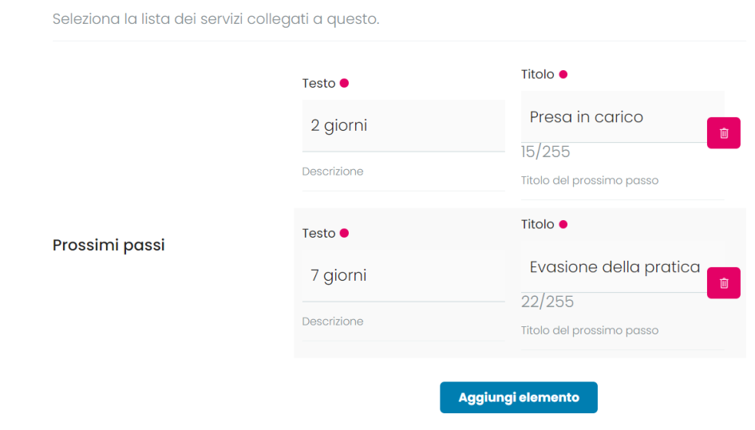

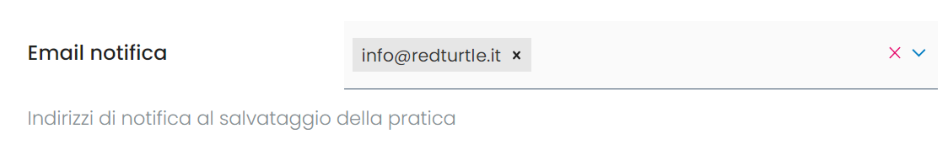

  - **Firma Email:** campo di testo multilinea che viene inserito alla fine delle mail di notifica, ad esempio

  - **Numero massimo di pratiche aperte per cittadino:** campo che consente di definire quanto pratiche di quel tipo il cittadino loggato può aprire, dipendentemente dal fatto che le pratiche precedenti abbiano concluso l’iter. Il default è “1”, il che significa che il cittadino non può aprire la stessa pratica la seconda volta senza che la prima sia stata completata dagli operatori. Aumentando tale valore, si definisce sino a che numero è possibile aprire la stessa pratica
  - **Operatore predefinito:** campo che consente di specificare un utente definito nel gruppo Operatori Pratiche, in modo che alla creazione della pratica essa sia automaticamente assegnata
- **Tab “Ricevuta PDF”**
  - **Testo nel footer della ricevuta PDF:** campo di testo multilinea che viene inserito, se specificato, nel piè di pagina del PDF pratica prodotto. Se omesso, viene riportato l’indirizzo dell’ufficio collegato

NB: Il CT Modello pratica, una volta finalizzato, deve essere nello stato di workflow “ **Pubblicato”:** nonostante lo stato pubblicato di un elemento, di default, dovrebbe rendere visibile il contenuto agli utenti anonimi, per i CT Modello Pratica esiste un controllo che ne permette l’accesso solo attraverso autenticazione (SPID nel caso di un cittadino, oppure classica, nel caso di utente operatore/redattore).

## Creazione della form del Modello pratica

La creazione del modello pratica necessita del “disegno” vero e proprio della form. Per la composizione della form si utilizza una libreria apposita, denominata [SurveyJS.](https://surveyjs.io/) Per accedere allo strumento di creazione della form è presente l’apposito pulsante sul modello pratica

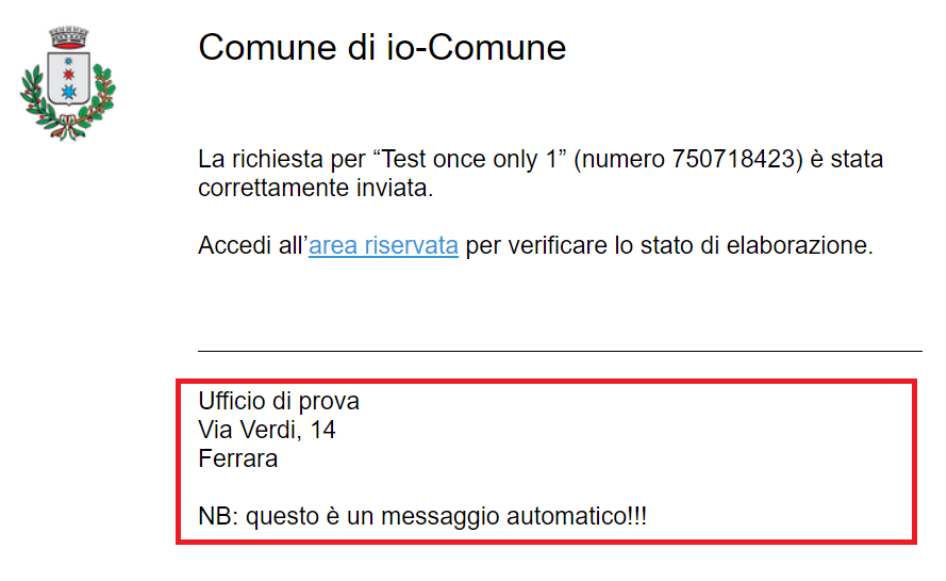

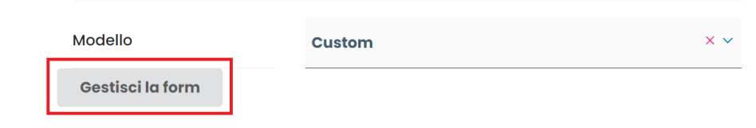

**NB: per visualizzare il pulsante “Gestisci la form” è necessario aver salvato il modello pratica.** **Rientrando in modifica il pulsante compare e sarà possibile interagire con SurveyJS sui campi del** **modello.**

Nel caso venga utilizzato il modello “Custom”, la form verrà creata da zero, mentre potrà essere possibile precaricare un modello già in gran parte impostato, selezionandolo tra quelli presenti

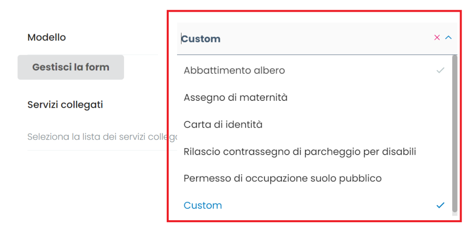

### Utilizzo dell’editor di form SurveyJS

La pratica è composta da step, ciascuno step può racchiudere uno o più gruppi di campi (di diversa natura e formato) all’interno delle **Pagine** messe a disposizione di default dall’Editor

Idealmente la struttura di una form è la seguente

- **Pagina** : rappresenta ciascuna “tab” o “step” della pratica, come ad esempio:

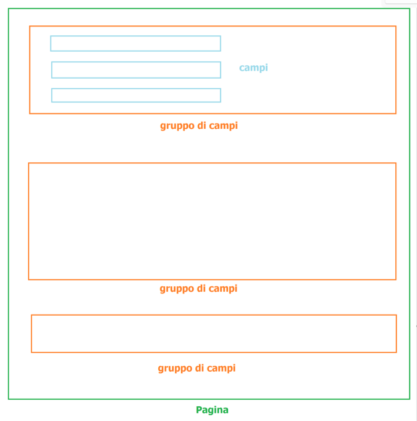

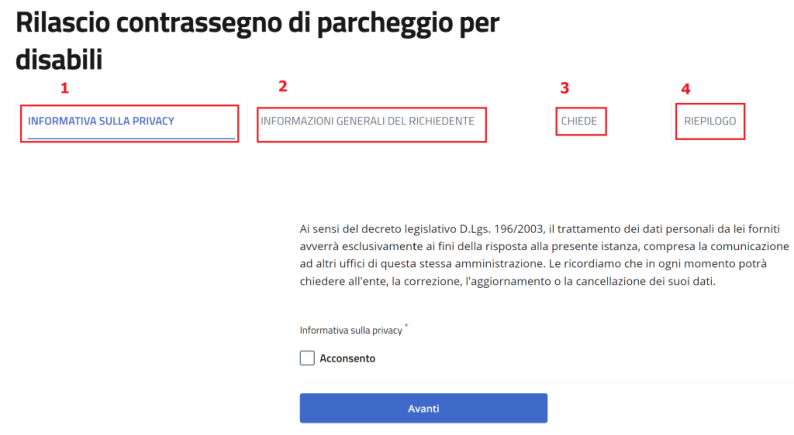

Una pagina è aggiungibile:

- cliccando al di fuori di tutti i campi, sulla form generale
- si attiva il pannello in figura, cliccare sul pulsante ‘+’ per inserire una nuova pagina

- inserire l'identificativo della pagina **(1)** e il nome **(2)** : quest’ultimo dato è un semplice valore mnemonico.

Andando poi sulle proprietà della pagina, sarà possibile stabilire la voce che comparirà nella tab di navigazione dell’utente finale

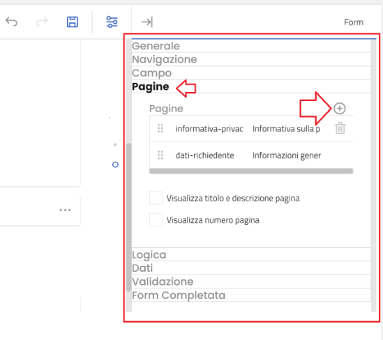

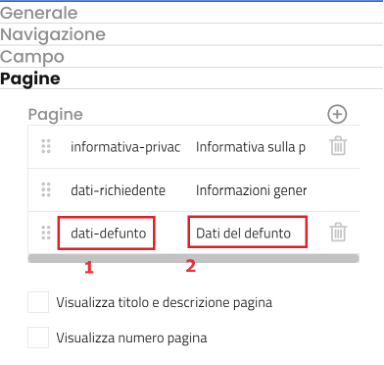

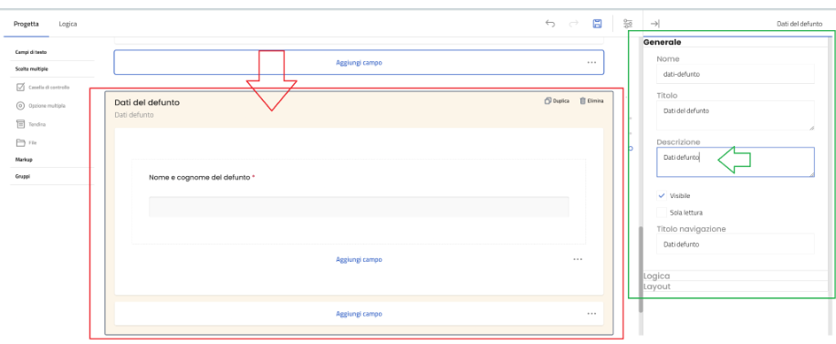

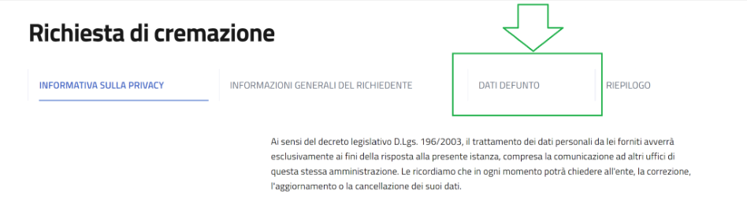

Gli step sono rappresentati in figura dai numeri (1,2,3,4): tipicamente il passaggio da uno step al successivo avviene soltanto se lo step precedente è stato completato, e sono navigabili soltanto attraverso gli appositi pulsanti “Avanti” e “Indietro”. Ciascuno di essi è una **pagina.**

#### Gruppo di campi

- Gruppo di campi : all’interno di ciascuna pagina si possono raggruppare più campi (che

intuitivamente devono comparire nello stesso blocco, come ad esempio i dati del richiedente Nome, Cognome, Data di nascita ecc…)

  - Ogni gruppo di campi rappresenta l’aggregazione dei campi (area grigia) della form online

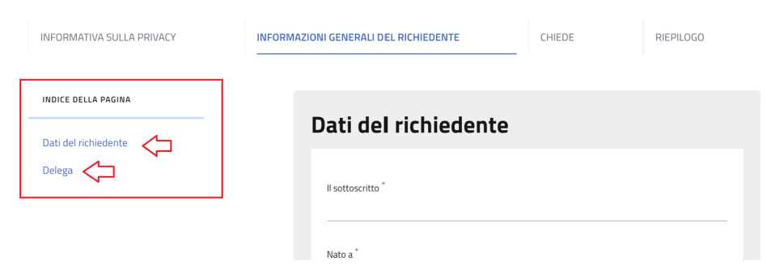

Ciascuno step (ad esempio, “Informativa sulla privacy”[^n1]) si realizza con SurveyJS utilizzando un “ **Gruppo**

**di campi** ”

Un gruppo di campi si traduce graficamente sulla form con un pannello di sfondo grigio, con titolo e descrizione, che racchiude una serie di campi ad esempio:

La configurazione del gruppo di campi, affinché vengano mostrate le label degli step, sono

- **“Nome del campo”** **(1)** : è l’identificativo, che può essere riferito per eventuali espressioni condizionali, deve essere univoco
- **“Titolo del campo”** **(2)**

[^n1]: La pagina dell’”Informativa sulla privacy” viene tipicamente proposta automaticamente anche per le form Custom, perchè di fatto è sempre la prima e deve essere sempre presente come primo step.

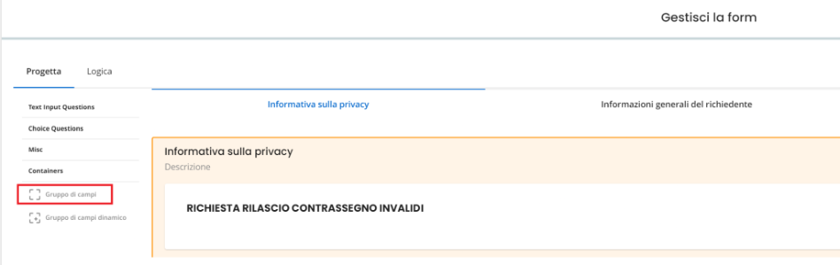

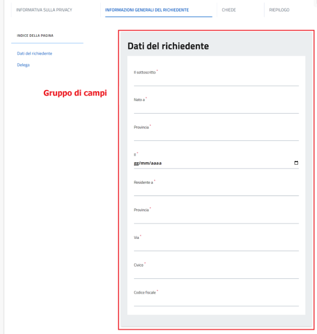

- **“Titolo navigazione”** **(3):** compare come nome della Tab/Step della pratica lato cittadino,

Come si può notare, il **Titolo di navigazione** impostato diventa il nome della tab riproposto nella visualizzazione della pratica sul sito

Il **Titolo** invece viene riproposto come identificativo del campo

NOTA BENE: lo step finale di **RIEPILOGO** viene sempre creato automaticamente dal sistema

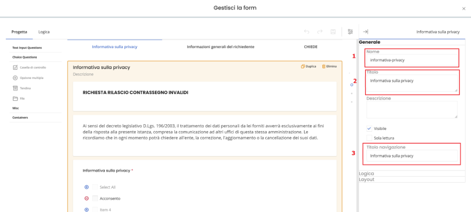

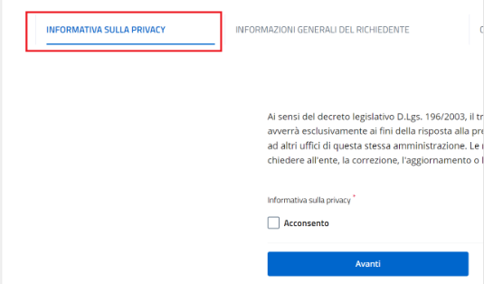

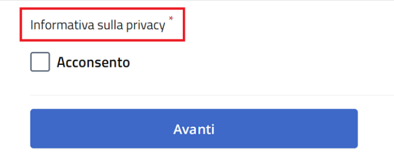

#### Tab “Informativa sulla privacy”

Queste istruzioni consentono di realizzare il primo step della pratica, ovvero la sezione “ **Informativa** **sulla privacy** ”. Questo step iniziale è sempre richiesto da AgID per il prosieguo degli step successivi

Ad esempio, per impostare la sezione “Informativa sulla privacy” con la casella di controllo per l’accettazione bisogna procedere come segue:

- Creare un “Gruppo di campi”
  - Nel tab “Generale”

impostare

- **Nome** (univoco, ad esempio “informativa-privacy”)
- **Titolo** (compare a livello di presentazione della pagina)

- Inserire un campo di tipo “Casella di controllo”, dopo aver premuto “ **Aggiungi campo** ” all’interno del contenitore “Gruppo di campi”

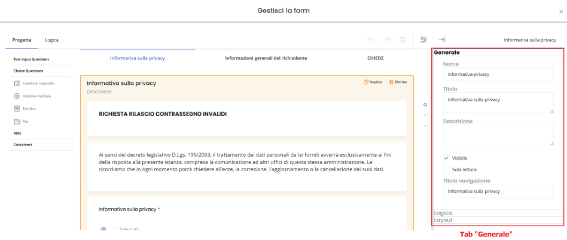

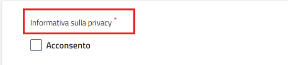

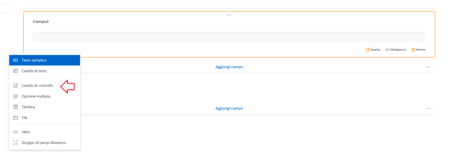

- Eliminare le opzioni non necessarie (pulsante **(-)** ) dai valori proposti nella casella di controllo
- Modificare la label, rendere il campo obbligatorio

A questo punto, terminata la configurazione del campo “Accettazione”, è necessario:

- Gestire il messaggio di errore in caso di omissione del valore (sezione “Validazione”)
- **Salvare** con l’apposito pulsante evidenziato dalla freccia

In ogni caso, come detto precedentemente, questo primo step viene sempre creato automaticamente dal sistema, anche in caso di creazione ex-novo di una pratica.

#### Tab “Informazioni generali del richiedente”

Procediamo quindi con il secondo tab “ **Informazioni generali del richiedente** ”

NB: alcuni campi destinati a raccogliere i dati del richiedente, come il nome e cognome e l’email, sono già proposti automaticamente nella seconda tab (alcuni in sola lettura) perchè vengono recuperati direttamente dall’autenticazione con SPID. E’ comunque possibile da parte dell’editor modificare tali campi a propria discrezione.

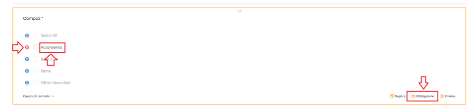

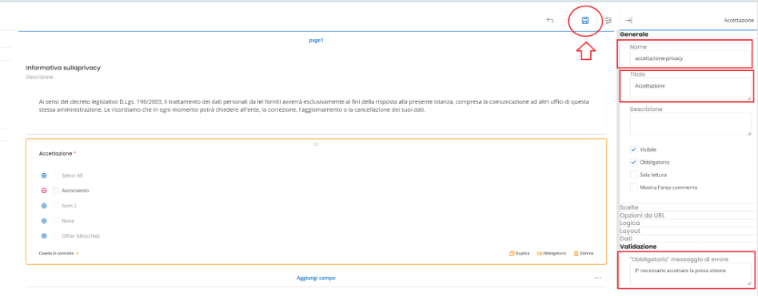

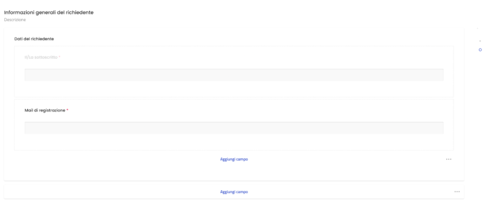

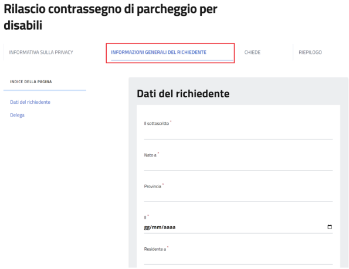

Come visto in precedenza sarà necessario:

- creare un “Gruppo di campi”, per ogni “raggruppamento logico” di campi (evidenziati dallo sfondo grigio), seguendo le indicazioni dei campi nella tab “generale” già spiegate

Ad esempio, i campi testuali come “Il sottoscritto” vengono creati utilizzando “Aggiungi campo” e scegliendo un “Campo di testo semplice”

Anche per questo tipo di campo, è possibile gestirne l’obbligatorietà con l’apposito flag

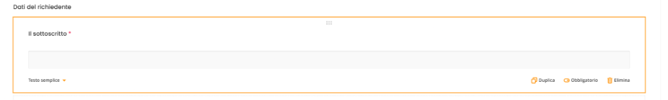

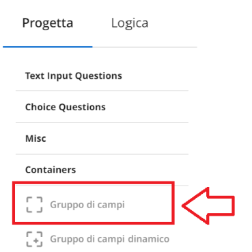

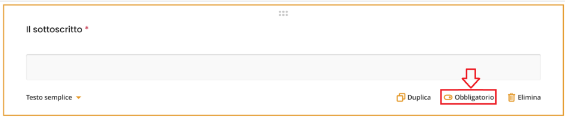

Nel caso si necessiti di inserire campi di natura diversa (ad esempio un campo di richiesta “Data di nascita”), si può modificare il tipo di campo utilizzando l’apposita sezione “ **Tipo di inserimento** ”

Su ogni campo è possibile impostare poi diverse proprietà, come il tipo di inserimento (numerico, testuale, intervallo, ecc.), e in caso di campo obbligatorio, personalizzare il messaggio da esporre in caso di mancata compilazione (sezione “ **Validazione** ”)

##### Gestione campi particolari, specifici per le pratiche

Se ad esempio fosse necessario inserire un campo testuale che deve ricevere un **codice fiscale**, è possibile impostare un criterio di validazione (REGEXP), nell’apposita sezione “ **Validazione** ” del campo

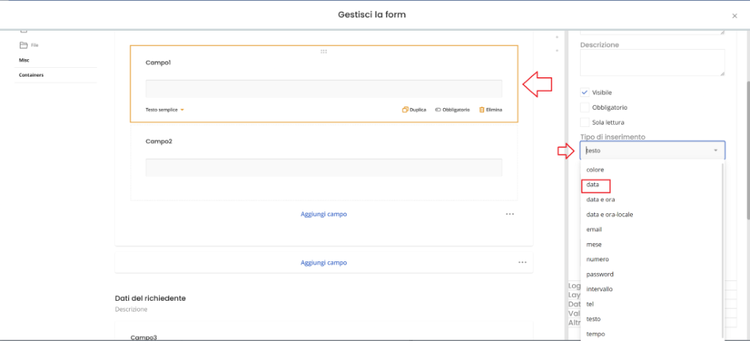

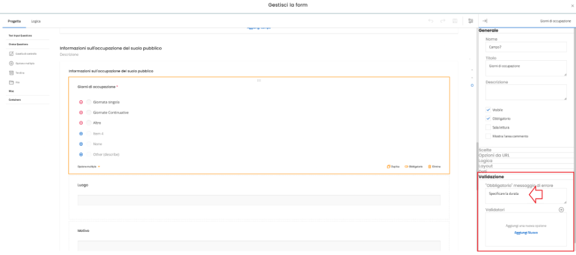

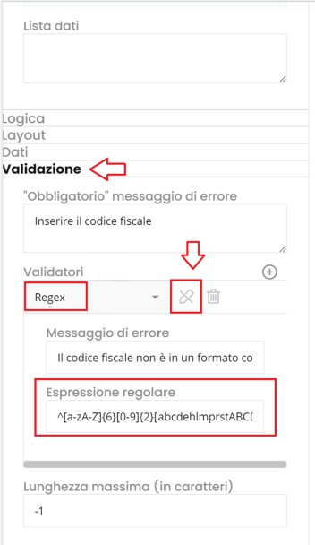

L’esempio di regexp da inserire per la validazione del formato del codice fiscale è la seguente (anche nel nuovo formato che comprende l’identificazione fiscale):

_^(TINIT-)?[A-Za-z][A-Za-z][A-Za-z][A-Za-z][A-Za-z][A-Za-z]\d\d[A-Za-z]\d\d[A-Za-z]\d\d\d[A-Za-z]_

Se ad esempio fosse necessario inserire un campo numerico che deve ricevere un numero per la “ **marca da bollo** ” (che deve rispettare il formato numerico esattamente di 14 digit), è possibile impostare un criterio di validazione (REGEXP), nell’apposita sezione “ **Validazione** ” del campo:

_^[0-9]{14}$_

In questo caso però non utilizzare un campo numerico, ma un campo testuale. Questo permetterà di accettare anche marche da bollo con numero seriale che inizia con il numero 0.

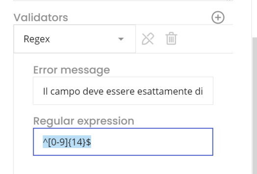

##### Gestione dei campi HTML

Nel caso in cui si vogliano inserire testi statici tra campi, compresi link ipertestuali ad altre pagine, è necessario utilizzare il **tipo di campo HTML**, che presuppone la conoscenza del codice HTML di base, per la formattazione del testo (utilizzo dei tag [\<strong>](https://www.w3schools.com/tags/tag_strong.asp) [per il bold, \<ul>\<li>](https://www.w3schools.com/tags/tag_ul.asp) per la creazione di elenchi puntati, l’utilizzo del tag [\<a> per la creazione di link ipertestuali)](https://www.w3schools.com/tags/tag_a.asp)

Un esempio di campo HTML potrebbe essere il seguente

Nella toolbar laterale, è presente il campo dove descrivere il codice HTML da mostrare

#### Altre tab della pratica

Tutte le altre tab della pratica possono essere create seguendo le indicazioni esposte in precedenza.

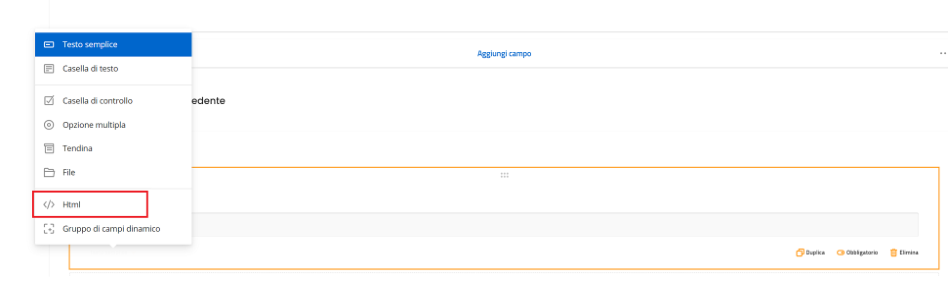

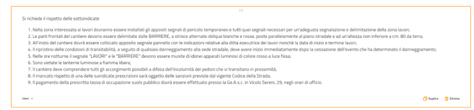

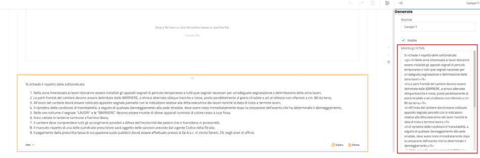

#### Collegamento dei campi ai dati SPID

Dal momento che le pratiche sono fruibili da parte dei cittadini soltanto attraverso l’autenticazione SPID, per il principio del _once-only_, i dati che possono essere recuperati da SPID vengono automaticamente riproposti nella form di compilazione. Per predisporre i campi è necessario inserire opportuni nomi identificativi nei campi (sezione “ **Dati** ”) e particolari opzioni

Ad esempio

- **Nome e cognome** (completo)
  - Si ottiene specificando il nome _fullname_ nel valore del campo

  - Impostare la proprietà “ _sola lettura_ ” per evitare che si possa sovrascrivere il valore recuperato da spid

Gli altri campi presi automaticamente da SPID che possono essere utilizzati sono i seguenti:

|Dato|Identificativo (case sensitive)|
|---|---|
|Nome della persona|nome|
|Cognome della persona|cognome|
|Nome e cognome in un unico campo|fullname|
|Codice fiscale|fiscalNumber[^n2]|
|Numero di telefono|mobile|

[^n2]: Potrebbe essere necessario, a seconda del tipo di autenticazione, specificare il placeholder “ `userid` ” oppure “ `id` ” al posto di “fiscalNumber”

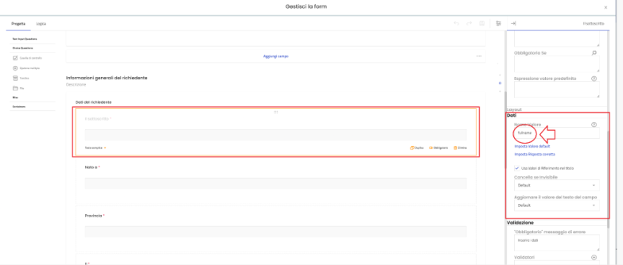

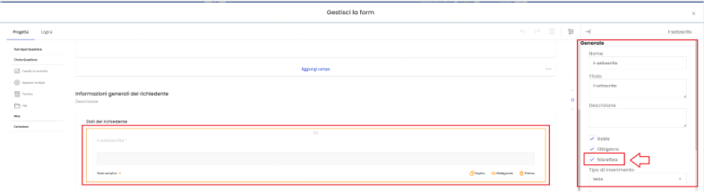

|Sesso|gender|
|---|---|
|Data di nascita|dateOfBirth|
|Luogo di nascita|placeOfBirth[^n3]|
|Luogo di nascita (nome)|placeOfBirthName|
|Luogo di nascita (codice ISTAT)|placeOfBirthIstatCode|
|Provincia di nascita|countyOfBirth|
|Indirizzo di residenza|address|
|Indirizzo digitale|digitalAddress|
|Indirizzo mail|email|
|Codice Carta Identità|idCard|
|Data di scadenza credenziali<br>|expirationDate|

Verificare il mapping dei campi dall’immagine seguente[^n4]:

Impostazioni dei campi per la gestione del principio “ _once-only_ ”

Come definito nel paragrafo precedente, il principio “once-only” consente di recuperare automaticamente i dati dell’utente durante la compilazione dei dati della form, per evitare che se l’utente li ha già inseriti nella stessa form pratica, oppure in un’altra form che richiede lo stesso dato, debba necessariamente reinserirli.

[^n3]: SPID restituisce un valore in codice, che dovrebbe essere transcodificato nel luogo secondo una mappatura delle tabelle ministeriali. Si consiglia di mantenere questo campo editabile, anziché automatico

[^n4]: [https://docs.italia.it/italia/spid/spid-regole-tecniche/it/stabile/attributi.html](https://docs.italia.it/italia/spid/spid-regole-tecniche/it/stabile/attributi.html) [https://www.agid.gov.it/sites/default/files/repository_files/spid-avviso-n25-nuova-codifica-domicilio_fisico.pdf](https://www.agid.gov.it/sites/default/files/repository_files/spid-avviso-n25-nuova-codifica-domicilio_fisico.pdf)

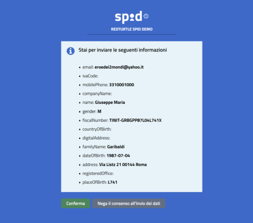

Questo aspetto riguarda due tipologie di campi della form:

- quelli che arrivano dall’autenticazione SPID
- qualsiasi altro campo che l’operatore pratiche (colui che disegna le form) ritiene necessario memorizzare, perché comuni a pratiche differenti

Per implementare questo comportamento, è necessario utilizzare per un determinato campo, al momento del disegno della form della pratica, l’attributo “ **Nome valore** ” nella sezione “ **Dati** ”

Sostanzialmente all’interno di quel campo è possibile definire un nome qualsiasi a proprio piacimento, per riutilizzarlo poi nelle successive pratiche[^n5].

Un esempio reale: due pratiche diverse richiedono il campo ISEE all’utente (ad esempio per “l’iscrizione al servizio scolastico” e per “l’iscrizione al servizio mensa”, ovvero in due diverse pratiche). Se l’utente compila la prima pratica, specificando il campo ISEE, è verosimile che lo stesso utente che compila la seconda pratica non debba voler reinserire a mano lo stesso valore per il campo ISEE.

Quello che è necessario fare è specificare un nome per il campo ISEE della prima pratica, ed utilizzare poi lo stesso nome per il campo ISEE della seconda pratica, ad esempio:

[^n5]: Il principio del once-only non è legato ad un determinato modello pratica, ma viene mantenuto anche tra modelli pratica differenti. Quindi due modelli che utilizzano un campo analogo, per il quale si vuole riproporre lo stesso dato già immesso, possono usare la stessa label del campo “dati” per sfruttare tale automatismo

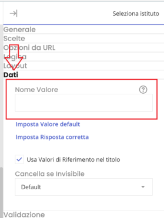

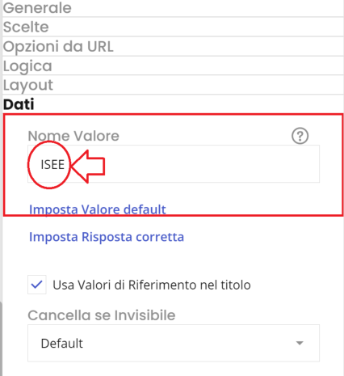

**NB: la label “ISEE” è puramente indicativa, e a discrezione di chi disegna la form.**

In questo caso, al salvataggio dei dati da parte del cittadino sulla prima pratica, il sistema è istruito per memorizzare sul suo profilo utente il valore immesso. Se tale attributo (“ISEE”) è specificato in un altro campo della seconda pratica, il cittadino che vi accede se lo ritroverà compilato automaticamente.

Il numero di campi definibili per la gestione in modalità “once-only” è illimitato, richiede però estrema attenzione da parte di chi costruisce la form pratica, nell’utilizzare la stessa nomenclatura.

Chiaramente il sistema funziona con lo stesso principio anche se il cittadino compila più volte la stessa pratica, non necessariamente per pratiche differenti.

Indicazioni sui campi da sottoporre al principio del “ _once-only_ ”

AgID fornisce le indicazioni precise su quali campi delle form delle diverse pratiche sottoporre al principio:

- **Dati anagrafici** : nome, cognome, luogo di nascita, data di nascita, codice fiscale; _(dove possibile, si suggerisce di utilizzare il valore corrispondente ai campi SPID)_
- **Residenza** : Comune, Provincia, Indirizzo (ed eventuale numero civico), CAP; _(dove possibile, si suggerisce di utilizzare il valore corrispondente ai campi SPID)_
- **Dati di contatto** : numero di telefono, email, PEC; _(dove possibile, si suggerisce di utilizzare il valore corrispondente ai campi SPID)_
- **Composizione del nucleo familiare** : numero componenti del nucleo familiare, nominativi completi dei componenti del nucleo familiare, anno di nascita dei componenti del nucleo familiare;
- **Indicatori di situazione economica** : ISEE;
- **Indicatori catastali per ciascun immobile** : Comune catastale, numero di particella, subalterno, sezione, foglio;
- **Informazioni per ciascun autoveicolo** : tipo veicolo, modello veicolo, targa veicolo;

- **Informazioni finanziarie** : IBAN;
- **Informazioni aziendali** : denominazione sociale, P.IVA, numero REA, indirizzo sede legale, recapiti (telefono, mail, PEC).

## Pratica lato cittadino - collegamento al Servizio

Una volta creato il Modello Pratica, sarà necessario collegarla al servizio di riferimento, inserendo il link alla stessa all’interno del Servizio di io-Comune

Questo collegamento, di fatto, si traduce nel pulsante di accesso dal dettaglio del servizio

Un esempio di modello pratica presentata al cittadino è la seguente:

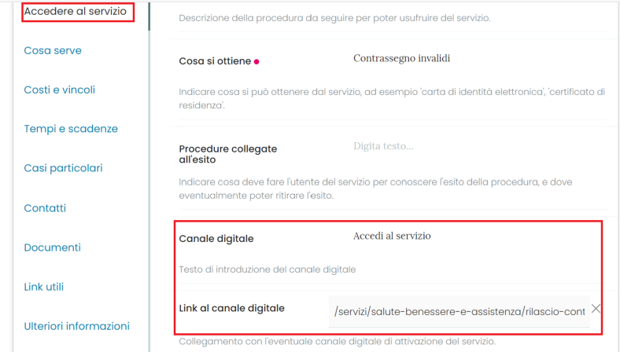

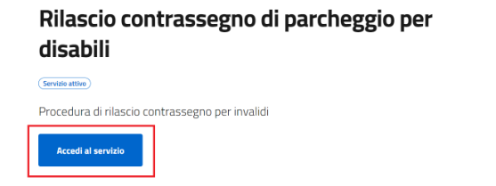

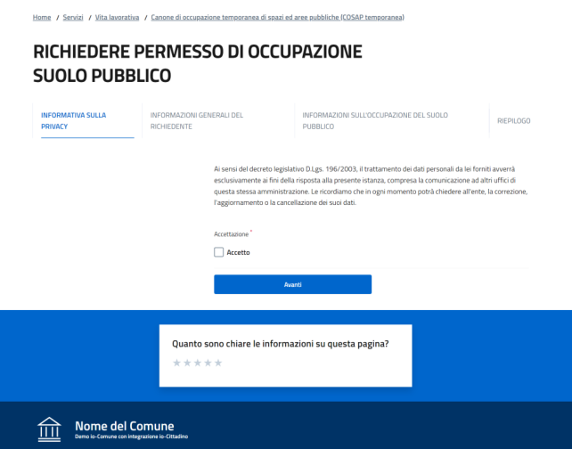

Per accedere alla pratica, il cittadino deve autenticarsi preventivamente attraverso SPID, accedendo dall’apposito pulsante in alto a destra del portale, oppure dalla pagina di accesso che viene proposta nel momento in cui si tenta di accedere alla pratica senza essersi autenticati

Il cittadino dovrà utilizzare il pulsante “ **Accedi con Spid** ” ed espletare le operazioni di login. A questo punto, il cittadino si trova loggato con le sue credenziali, può accedere alla sua area personale

ed eventualmente compilare una pratica attraverso il pulsante “Accedi al servizio” presente sul Servizio

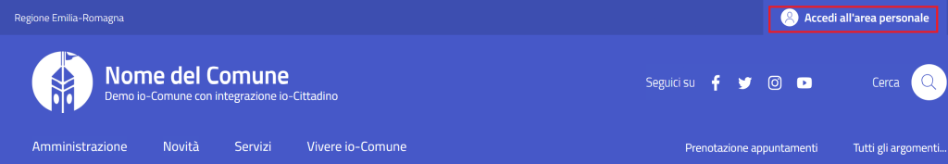

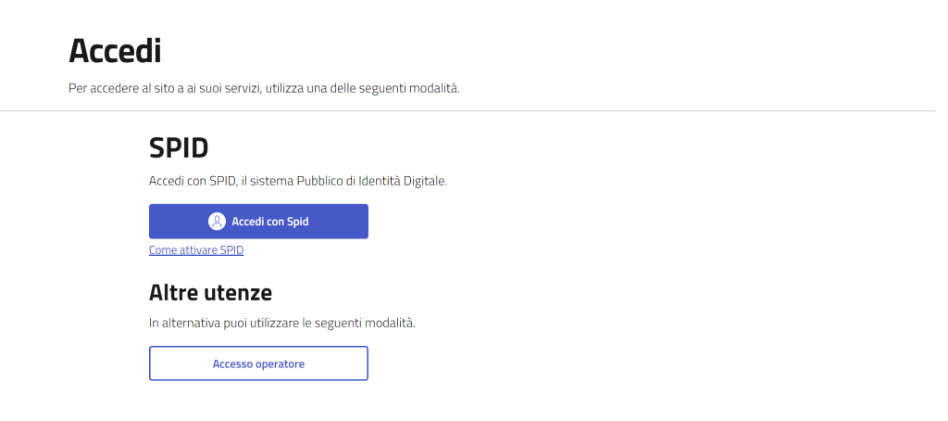

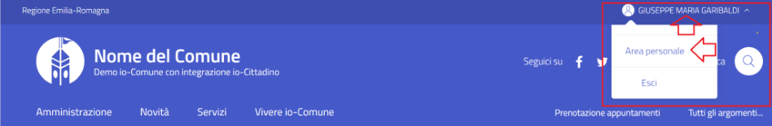

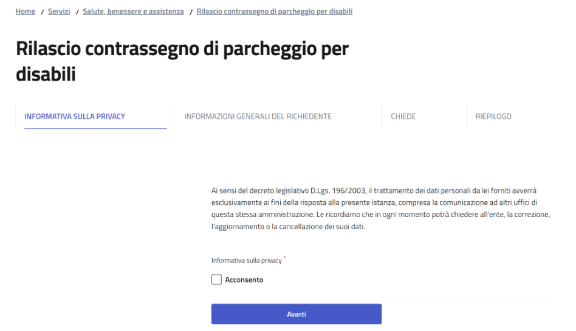

In ogni momento, nei vari step della pratica, il cittadino può salvare la sua pratica in uno stato temporaneo, in attesa di finalizzarla o completarla successivamente, attraverso l’apposito pulsante “ **Salva bozza** ”.

NOTA BENE: se un cittadino ha già una pratica di un certo tipo già instradata verso l’ente, in un qualche stato che non sia “Annullata” o “Completata”, quindi anche in “Bozza”, non potrà presentare un’ulteriore pratica di quel tipo.[^n6]

Il cittadino potrà in ogni momento tornare ad uno step precedente della pratica (pulsante “ **Indietro** ”), a patto che lo step precedente sia stato completato in ogni suo dato obbligatorio.

Prima della finalizzazione della pratica, viene presentato uno step di “ **Riepilogo** ”, che consente al cittadino di verificare i dati inseriti, ed eventualmente ritornare direttamente ad una sezione dei vari step per modificare i dati inseriti (pulsanti “ **Modifica** ”)

[^n6]: Si rimanda alla sezione degli “Stati della pratica”

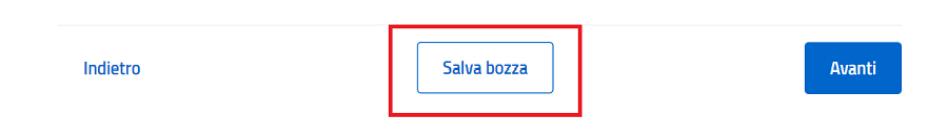

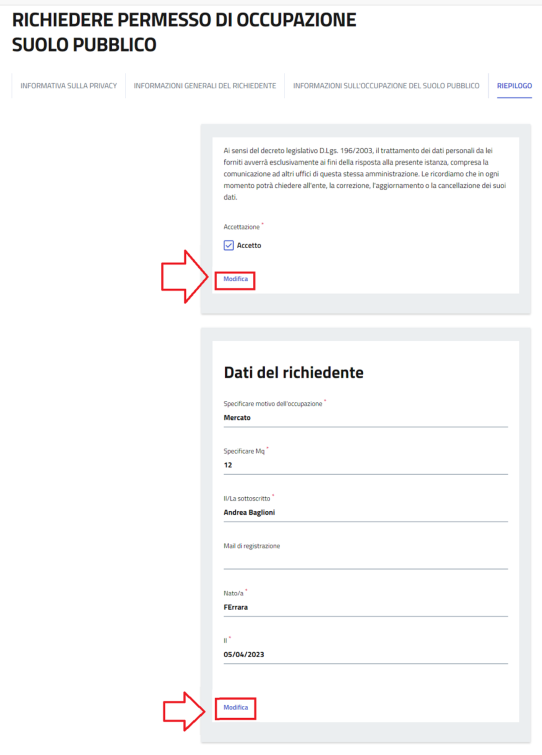

### Stati della pratica

Gli stati attribuiti ad una pratica sono i seguenti:

- **In bozza** (quando una pratica è in fase di compilazione da parte del cittadino, che la salva temporaneamente prima di finalizzarla con il pulsante “ **Salva bozza** ”) È consultabile/visibile dal cittadino nella sua area personale nello stato “ **da completare** ”

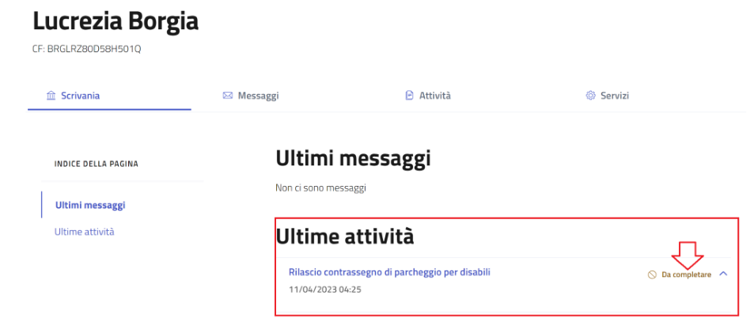

  - Il cittadino può entrare nella pratica per finalizzarla attraverso l’apposito pulsante, espandendo la linguetta “Da completare” e accedendo attraverso il pulsante “ **Finalizza** **la pratica** ”

  - Lato operatore pratiche, è consultabile dall’operatore pratiche, che può accedere in sola visualizzazione nella dashboard delle pratiche pervenute (sezione “ **in bozza** ” **(1)** ), con la possibilità di vedere i dati compilati fino a quel momento **(2)**

- **In elaborazione** (quando una pratica è stata correttamente inviata dal cittadino all’Ente, ovvero la pratica è stata completata in tutti i suoi step)

  - È consultabile/visibile dal cittadino nella sua area personale nello stato “in elaborazione”

  - È consultabile dall’operatore pratiche, che può accedere in visualizzazione nella dashboard delle pratiche pervenute (sezione “ **In elaborazione** ”), con la possibilità di vedere i dati compilati finalizzati (cliccando sul link della pratica)
  - L’operatore a questo punto lavora la pratica in back-office, e può decidere di:
    - Assegnare quella pratica ad un operatore specifico


    - Modificare lo stato della pratica (Completata, Annullata, Sospesa, In bozza[^riporta-in-bozza])

- **Completata:** (quando una pratica è stata elaborata in ogni sua parte dagli operatori all’Ente idealmente significa che la pratica è **conclusa** )

  - È consultabile/visibile dal cittadino nella sua area personale nello stato “Conclusa”


  - In nessun modo un operatore può portare in uno stato differente una pratica conclusa
  - Il cittadino riceve sia l’email di conferma della pratica completata, sia la notifica di un messaggio nella sua Area Personale
- **Sospesa:** (quando una pratica viene sospesa da un operatore dell’Ente, ad esempio perchè la pratica non è stata compilata correttamente o necessita di integrazioni di ulteriori informazioni)

  - La sospensione della pratica obbliga l’operatore ad inserire una motivazione della sospensione, che verrà comunicata attraverso un messaggio sull’area personale del cittadino ed eventualmente attraverso una notifica email che riporterà la motivazione della sospensione stessa (l’invio della mail è facoltativo da parte dell’operatore)
  - È consultabile/visibile dal cittadino nella sua area personale nello stato “Sospesa”
  - Il cittadino, a completamento della pratica, la riporta allo stato “in elaborazione”
- **Annullata:** (quando una pratica viene annullata da un operatore dell’Ente, ad esempio perchè la pratica è stata inserita per errore. E’ uno stato che, per motivi di trasparenza dell’Ente nei confronti dei cittadini, evita la cancellazione fisica della pratica)

  - La pratica può essere eventualmente riportata nello stato “in bozza”

#### Tabella degli stati pratica, delle azioni possibili e degli eventi conseguenti

```{include} /_snippets/io-cittadino-tabella-stati.md
```

### Esportazione delle pratiche

```{include} /_snippets/funzionalita-aggiuntiva.md
```

#### Esportazione della vista pratiche

Tramite il “Pannello di controllo pratiche” è possibile esportare l’elenco delle pratiche visualizzate a browser. Impostando quindi degli specifici filtri, e cliccando sul pulsante “Scarica i dati della tabella”, verrà generato un file csv con le medesime informazioni ottenute nella tabella visualizzata:

#### Esportazione dei dati pratiche

Selezionando in “Filtra per” l’opzione “Pratica”, e selezionando successivamente una tipologia di pratica specifica, è possibile esportare in csv l’elenco delle pratiche ottenute, comprensive dei dati inseriti.


Per lanciare l’esportazione è sufficiente cliccare sul pulsante “Scarica i dati delle pratiche”:

### Area personale cittadino

L’area personale del cittadino consente al cittadino stesso di verificare lo stato delle pratiche che ha sottomesso, e gli eventuali messaggi pervenuti da parte dell’ente.

L’accesso all'area personale del cittadino si ha in seguito alla procedura di login tramite SPID.[^n8]

Il pulsante di accesso a tale area è presente nell’area riservata ai dato del cittadino loggato

[^n8]: Nel caso di installazioni agganciate ad uno SPID di test fornito da AgID, la base dati utenti per le prove è presente a [questo link](https://spid-demo.endor.redturtle.it/demo/users)


#### Dashboard

La dashboard del cittadino presenta i seguenti elementi:

- Tab “ **Scrivania** ”
  - Riassume sia le pratiche dell’utente “Ultime attività”, sia i messaggi (“Ultimi messaggi”) che sono stati inviati dagli operatori dell’ente
  - E’ possibile, cliccando sui link, accedere sia ai messaggi che alle informazioni sulla pratica
- Tab “ **Messaggi**
  - Mostra soltanto i messaggi pervenuti
- Tab “ **Attività** ”
  - Mostra soltanto le pratiche che il cittadino ha inviato
- Tab “ **Servizi** ”
  - Mostra i servizi che riguardano le pratiche sottomesse dal cittadino

### Area personale operatore

La dashboard operatori è il cruscotto che permette agli operatori di back-office di gestire le pratiche; presenta i seguenti elementi:


Essi rappresentano:

- Filtri per stato della pratica **(1)**
- Ulteriori filtri per le pratiche **(2)** :
  - **Pratica:** nome della pratica
  - **Servizio:** il servizio di riferimento della pratica
  - **Numero pratica:** assegnato automaticamente dal sistema (oppure altro valore, ad esempio un numero di Protocollo, nel caso sia stata implementata una integrazione con l’applicativo verticale dell’Ente per la gestione del Protocollo)[^n9]

  - **Data:** la data di sottomissione della pratica
  - **Assegnazione:** l’operatore a cui è stata assegnata la pratica
- Elenco delle pratiche **(3):** ordinate per data di sottomissione decrescente (dalla più recente pervenuta, alla più vecchia)

  - È possibile agire sui campi:
    - **Assegnato a:** per specificare a chi assegnare la pratica tra gli Operatori Pratiche
    - **Stato:** per modificare lo stato della pratica
  - E’ possibile inviare messaggi all’utente che ha sottomesso la pratica attraverso l’apposito pulsante, comprensivo di eventuali file allegati.


[^n9]: Si rimanda all’apposita sezione per l’integrazione con i protocolli esterni (es, Protocollo Maggioli)

Il caso d’uso tipico è quello dell’operatore che ad esempio, a pratica completata, invia il PDF con il pass ZTL finale al cittadino che lo ha richiesto attraverso la pratica online. Il cittadino troverà il messaggio nella propria area personale, con la possibilità di scaricare gli eventuali allegati, così come nella propria casella di posta elettronica

Sempre nella stessa vista operatori, sarà possibile visualizzare per ciascuna pratica il numero di messaggi inviati per ciascuna di esse

e cliccando sul dettaglio, visualizzare l’elenco dei messaggi, compresi eventuali allegati inviati dagli operatori al cittadino


