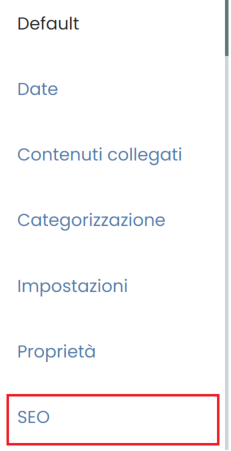
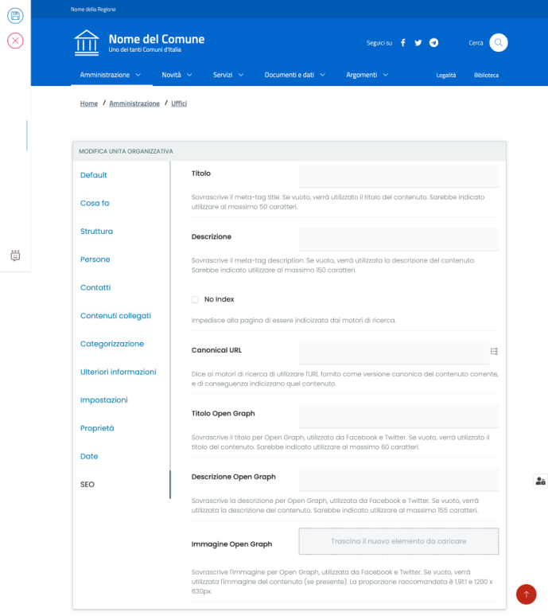
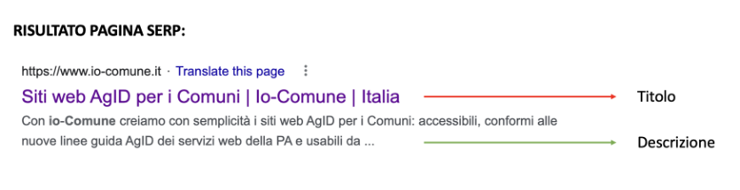
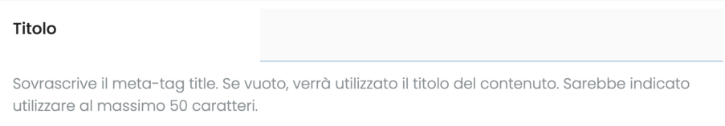
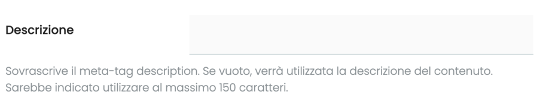
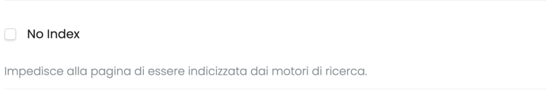
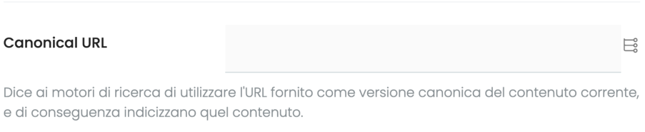
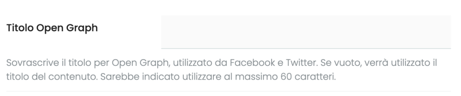
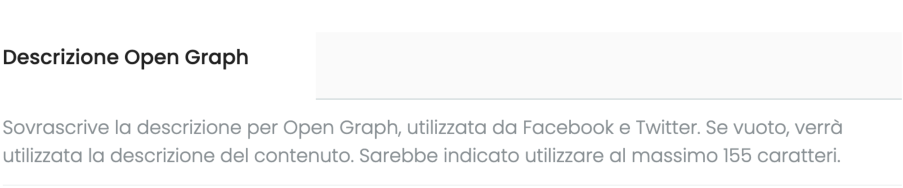
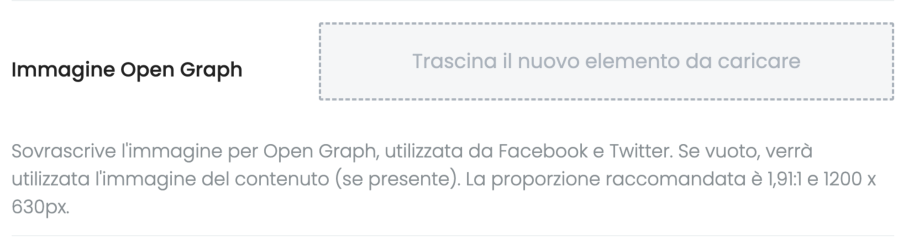

# Appendice

## Campi speciali per la SEO

Ogni content-type ha una tab particolare denominata SEO, solitamente in ultima posizione tra le tab disponibili, oppure nella sidebar di destra, nel caso di tipi di contenuto a blocchi (es. Pagine)

In tale tab sono racchiusi tutti i campi speciali che consentono di inserire gli attributi, le keywords, i dati per l’integrazione con la condivisione social (OpenGraph) riferiti a ciascun contenuto. La sezione è ad uso e consumo del personale specializzato nella gestione SEO del sito.

Sulla parte SEO delle pagine in Io-Comune, come ad esempio gli “uffici”, si trovano i seguenti:

- Titolo
- Descrizione
- No Index
- Canonical URL
- Titolo Open Graph
- Descrizione Open Graph
- Immagine Open Graph

I primi 4 campi:

### ● Titolo ● Descrizione ● No Index

- Canonical URL

indicano ai motori di ricerca cosa dovrebbero mostrare nei loro risultati di ricerca (SERP).

ESEMPIO:

### Titolo

**Cos’è:** questo è il titolo della pagina che di default è usato durante la creazione della pagina. Il titolo indica ai motori di ricerca qual è il titolo e cioè l’argomento trattato nella pagina (è quindi importante che il titolo sia rappresentativo del contenuto della pagina).

**A cosa serve:** usando questo campo si sovrascrive il meta-tag title (cioè il titolo dato alla pagina). Se vuoto, verrà utilizzato il titolo della pagina. Sarebbe indicato utilizzare al massimo 50 caratteri.

### Descrizione

**Cos’è:** questa è la descrizione del contenuto della pagina che indica ai motori di ricerca di cosa tratta il contenuto della pagina (meta-title e meta-description puntano quindi allo stesso obiettivo e devono essere coerenti fra di loro nei contenuti).

**A cosa serve:** usando questo campo si sovrascrive il meta-tag description. Se vuoto, verrà utilizzata la descrizione del contenuto che potrebbe quindi risultare tagliata se lunga. Sarebbe infatti indicato utilizzare al massimo 150 caratteri.

### No Index

**Cos’è:** Il No Index indica ai motori di ricerca che la pagina non deve essere indicizzata e serve quindi per non farla comparire nella SERP (la pagina dei risultati della ricerca effettuata per esempio su Google).

Attenzione: il No Index è più un’indicazione ed i risultati possono non essere immediati. La frequenza della “scansione” della pagina da parte dei motori di ricerca declina nel tempo se quest’indicazione rimane; ma se una pagina è già stata indicizzata, potrebbero passare anche 2-3 mesi prima che la “scansione” riavvenga per verificare che la pagina può o meno essere indicizzata.

**A cosa serve:** Impedisce alla pagina di essere indicizzata dai motori di ricerca.

### Canonical URL

**Cos’è:** il Canonical URL indica al motore di ricerca che due URL sono in realtà la stessa “risorsa”. Può infatti capitare che su uno stesso sito coesistano, per diversi motivi, più pagine che trattano lo stesso tipo di contenuto o sono proprio identiche. I contenuti duplicati non piacciono ai motori di ricerca, che non possono “capire” quale dei due contenuti è valido e di conseguenza rischia di far perdere il posizionamento di questi contenuti. Usando il Canonical URL si indica al motore di ricerca quale contenuto/pagina deve tenere in considerazione come contenuto prioritario di quell’argomento.

**Come usare il campo “canonical URL”:**

- Scegliere fra le pagine di contenuto identico quale deve essere la principale ed inserire l’URL della pagina principale nel campo “canonical URL” delle altre pagine;
- Per scegliere quale deve essere la pagina principale, considerare quella ritenuta più importante e che potrebbe aiutare ad aumentare le visite al sito;
- Considerare anche quale pagina ha più traffico e più link al suo interno.

Attenzione: il canonical è un suggerimento/segnale ai motori di ricerca i quali, per motivi diversi, potrebbero comunque continuare a prediligere uno degli altri URL rispetto a quello indicato come “canonico”.

**A cosa serve:** Dice ai motori di ricerca di utilizzare l’URL fornito come versione canonica del contenuto corrente e di conseguenza indicizzano quel contenuto.

### Open Graph

L’Open Graph indica ai social (es. Facebook e Twitter) quali informazioni mostrare quando un utente condivide un link del sito. In assenza di Open Graph il sistema dovrà “indovinare” quale contenuto è importante da mostrare, questo potrebbe rendere le pubblicazioni di condivisioni incomplete o poco rappresentative.

#### Titolo Open Graph

**Cos’è:** come il meta-title, il titolo dell’Open Graph indica il titolo da mostrare.

**A cosa serve:** usando questo campo si sovrascrive il titolo per Open Graph, utilizzato da Facebook e Twitter. Se vuoto verrà utilizzato il titolo del contenuto. Sarebbe indicato utilizzare al massimo 60 caratteri.

#### Descrizione Open Graph

**Cos’è:** come la meta-description, la descrizione Open Graph indica la descrizione da mostrare. Anche in questo caso la descrizione deve essere rilevante al contenuto.

**A cosa serve:** usando questo campo si sovrascrive la descrizione per Open Graph, utilizzato da Facebook e Twitter. Se vuoto, verrà utilizzata la descrizione del contenuto. Sarebbe indicato utilizzare al massimo 155 caratteri.

#### Immagine Open Graph

**Cos’è:** l’immagine Open Graph indica quale immagine mostrare quando si condivide il link della pagina.

**Descrizione:** usando questo campo si sovrascrive l’immagine per Open Graph, utilizzata da Facebook e Twitter. Se vuoto, verrà utilizzata l’immagine del contenuto (se presente). La proporzione raccomandata è 1,91:1 e 1200 x 630 px.

