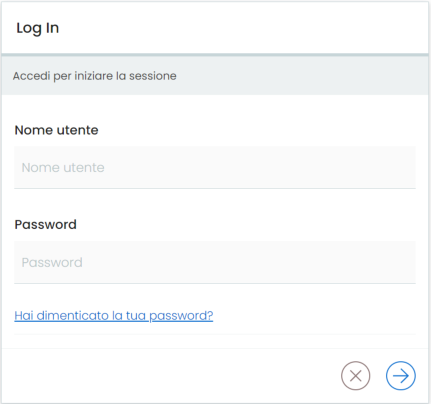
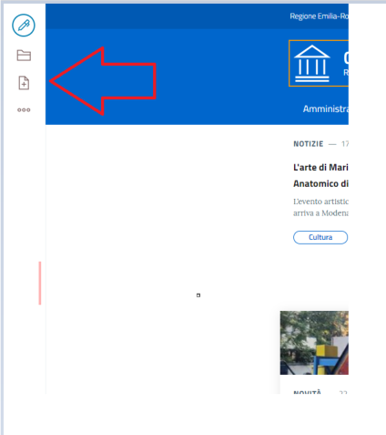
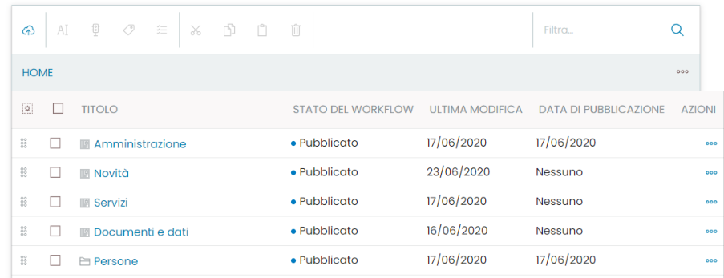
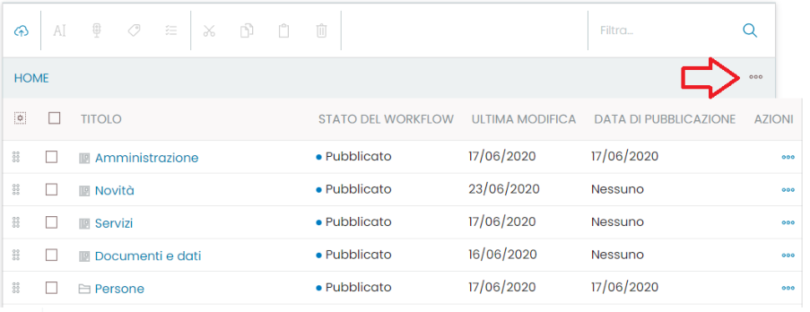
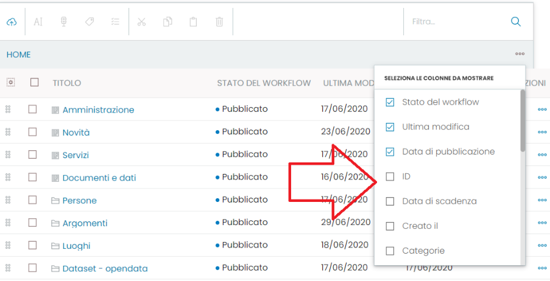
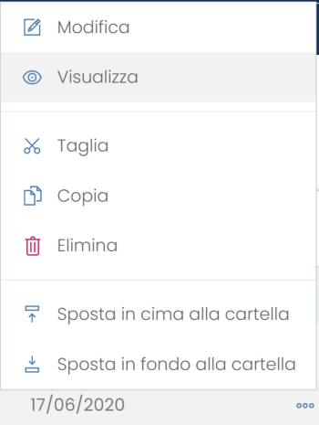
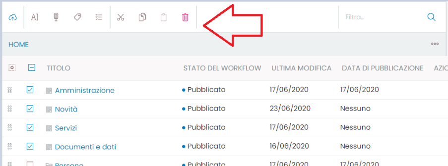
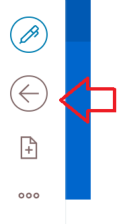
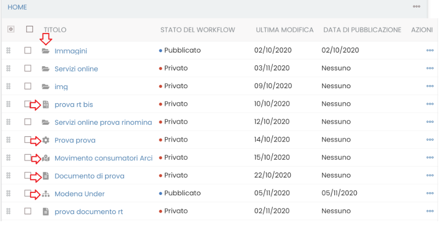

# Autenticazione e interfaccia di backend

All’interfaccia di backend si accede attraverso l’autenticazione.

Per autenticarsi all'area riservata è sufficiente digitare **/login** alla fine della url, e digitare l'utente/password di accesso.

Il fatto che ci si sia autenticati è riconoscibile dal fatto che nella parte sinistra della pagina compare la barra degli strumenti

I pulsanti che si vedono sono i seguenti (dall'alto verso il basso)

1.  pulsante di **edit** della pagina
2.  pulsante di **navigazione** del Piano Editoriale (folder_contents)
3.  pulsante di **aggiunta** di un tipo di contenuto
4.  pulsante di **impostazione** di alcune proprietà della pagina in questione

## Edit della pagina

Attraverso il primo pulsante della barra degli strumenti, una volta loggati sul sistema, è possibile andare in modalità modifica (edit) della pagina in cui ci si trova. NB: la modifica è contestuale all'elemento che si vede in quel momento nel browser, quindi se si preme il pulsante quando si è su una determinata pagina o altro elemento, si modifica quella pagina o quell'elemento. Quando si è in modifica di un elemento compare contestualmente il pulsante di salvataggio per salvare le modifiche impostate, oppure il pulsante per annullare le

modifiche effettuate.

## Navigazione del piano editoriale

Questa modalità permette di avere una rappresentazione ad albero degli elementi e della struttura di io-Comune ( **folder_contents** )

A partire dalla radice del sito, il portale è organizzato in cartelle e/o altri oggetti: le **cartelle** tipicamente sono dei contenitori di servizio che vengono utilizzati per includere altri oggetti: in verità qualsiasi oggetto del sistema è a sua volta un oggetto contenitore, pur avendo esso stesso un suo layout grafico.

Ad esempio, una **pagina** è un oggetto che ha un titolo, una descrizione e altri campi accessori, che permettono di definirne il contenuto informativo, ma all'interno della pagina è possibile inserire ulteriori elementi quali per esempio altre pagine, file, collegamenti ecc. (che sono essi stessi _tipi di_ _contenuto o “content-type”_ di io-Comune)

### La foldercontents

La folder_contents mostra la lista degli oggetti presenti in una determinata posizione del piano editoriale. Si presenta come una tabella che mostra le caratteristiche degli elementi, quali titolo, stato del workflow, ultima modifica, data di pubblicazione, azioni. I dati da visualizzare possono essere personalizzati attraverso l'apposito pulsante

che consente di selezionare gli altri campi.

Il pulsante presente nella colonna “Azioni” mostra un set di operazioni che possono essere fatte singolarmente sull’elemento della lista

Sempre in questa vista sono presenti delle checkbox per selezionare determinati elementi ed agire in maniera massiva su di essi per effettuare certe operazioni, quali per esempio tagliare/copiare elementi ( per poi spostarli/incollarli in un'altra posizione del piano editoriale), cambiare lo stato degli elementi ( ad esempio per pubblicarli), cancellare elementi, modificarne l'ordine (attraverso drag-and-drop) ecc.

NB: l'ordinamento degli elementi nella cartella determina anche l’ordine in cui saranno visualizzati dall’utente anonimo.

Sulla selezione degli elementi attraverso le checkbox, viene attivata una barra di pulsanti in alto che consentono le operazioni suddette

Passiamo in rassegna i pulsanti e le relative operatività

1.  permette di uploadare file in maniera massiva, dal file system del proprio PC, all'interno dell’elemento del CMS in cui ci si trova (ad esempio serve per caricare massivamente un set di immagini di servizio prese dal file system all’interno di un oggetto “cartella”o “pagina”!). Non vi è limite al numero di elementi che possono essere uploadati, ma si raccomanda di utilizzare un numero di file non troppo elevato.
2.  consente di rinominare il titolo e il nome breve degli elementi selezionati ( ricordiamo che il nome breve è quello che compare nella URL per un determinato elemento)
3.  permette di cambiare lo stato degli elementi selezionati ( si veda a tal proposito la sezione “ **workflow** ”)
4.  consente di applicare tag ( etichette) anche elementi selezionati: le etichette sono utili per categorizzare gli elementi e gestire poi eventuali criteri di selezione ad esempio nella creazione dei blocchi elenco (si veda l’apposita successiva)
5.  consente di modificare alcune proprietà degli elementi selezionati, come ad esempio la data di pubblicazione, la data di scadenza, gli autori dei documenti, e la possibilità di escludere dalla navigazione l'elemento selezionato (quest’ultimo, utile nel caso si voglia che una determinata risorsa sia disponibile=pubblicata, ma non navigabile dall’utente caso tipico, le cartelle di servizio con le immagini utilizzate nel portale, che sono soltanto risorse a disposizione del redattore per la sua attività, ma non oggetti realmente navigabili)
6.  consente di tagliare gli elementi dalla posizione in cui si è: essi restano memorizzati nella clipboard, con la possibilità di incollarli in una posizione differente del piano editoriale
7.  consente di copiare gli elementi nella posizione in cui si è: essi restano memorizzati nella clipboard, con la possibilità di incollarli in una posizione differente del piano editoriale
8.  consente di incollare gli elementi che sono stati precedentemente tagliati o copiati
9.  consente di cancellare gli elementi selezionati (attenzione che la cancellazione potrebbe rompere eventuali referenze a tale oggetto, nel caso siano state inserite in altre pagine, ad esempio attraverso dei link interni)
10.  consente di filtrare gli elementi che sono visualizzati nella folder_contents, in modo tale da effettuare una ricerca rapida soltanto degli elementi che soddisfano il criterio di filtro (iniziando a digitare si potrà vedere che la folder_content viene via via “scremata”, mostrando soltanto gli elementi che soddisfano la ricerca)

Dalla modalità folder_content si esce attraverso l'apposito pulsante presente nella barra degli strumenti

In questo caso si ritorna nella modalità di visualizzazione dell'elemento.

E’ comunque possibile utilizzare l'apposito pulsante per aggiungere eventualmente altri elementi all'interno dell'elemento in cui ci si trova.

Per modificare le proprietà dell'elemento in cui si è posizionati, utilizzare il pulsante nella barra degli strumenti di sinistra. In questo caso è possibile modificare proprietà quali lo Stato dell'elemento (workflow), la vista per la visualizzazione dell'elemento stesso, visualizzarne la cronologia (log delle azioni fatte), impostare i criteri di condivisione dell'elemento ( si vede l'apposita sezione relativa agli account e permessi degli utenti), oppure assegnare URL alternativi alla risorsa (URL Management), oltre a quella già impostata (questa sezione è ad uso e consumo dei tecnici RedTurtle)

NB: nella modalità folder_contents, ogni oggetto è rappresentato da un'icona specifica che ne evidenzia la tipologia

Tale tipologia è visibile anche posizionandosi e rimanendo fermi qualche istante con il cursore sull’icona.

