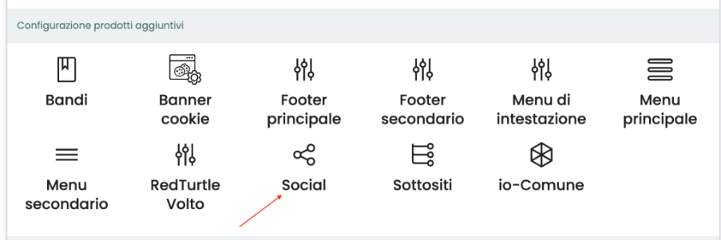
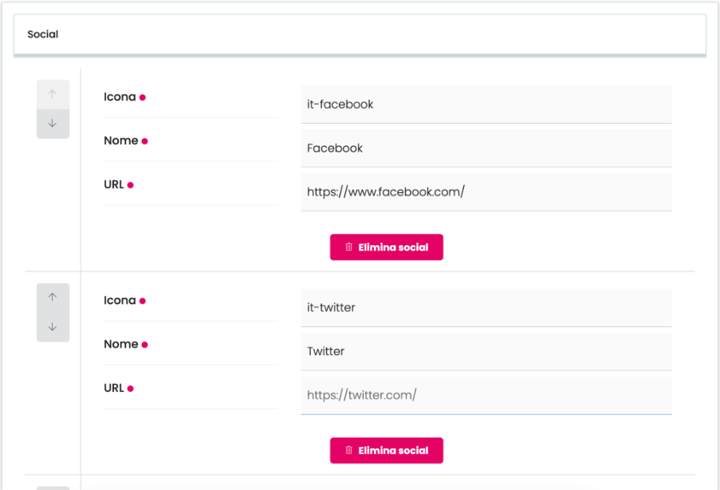
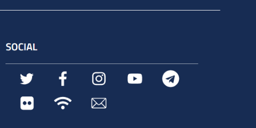
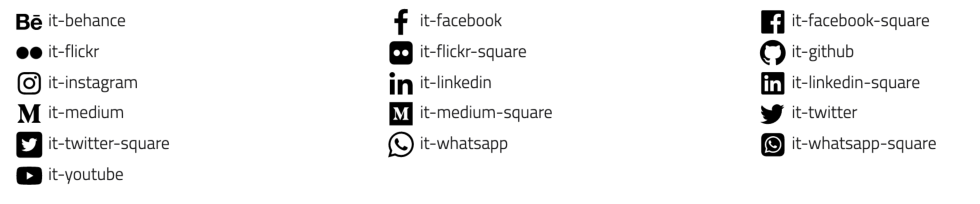

# Configuratore dei social (testata e footer)

La configurazione dei social del sito è possibile attraverso l’apposito pannello di configurazione, raggiungibile da parte dell’amministratore del sito nella sezione:

E’ possibile abilitare un numero di social a piacimento, ordinandoli nella maniera desiderata attraverso le apposite frecce. E’ necessario specificare:

- Nome icona:
  - [se si tratta di una icona di un social, l’icona deve essere presa da questo(https://italia.github.io/bootstrap-italia/docs/utilities/icone/) elenco di icone, e](https://italia.github.io/bootstrap-italia/docs/utilities/icone/) deve essere preceduto da ‘it-’. Ad esempio, se volessi usare l’icona di facebook che nell’elenco di icone si chiama ‘facebook’, nel campo ‘Nome’ dovrò scrivere

‘it-facebook’.
  - Se si tratta di una qualsiasi altra icona (come ad esempio anche quella per Telegram), devono essere pescate da [questo](https://fontawesome.com/icons?d=gallery) elenco [(https://fontawesome.com/v5/search?o=r&m=free&s=solid). Non bisogna](https://fontawesome.com/v5/search?o=r&m=free&s=solid) precedere il nome dell’icona con ‘it-’.
- Nome del social
- Url a cui deve puntare il link sull’icona social I social configurati vengono automaticamente impostati anche nella testata del sito, secondo le medesime impostazioni di ordinamento e configurazione

**HEADER**

**FOOTER**

## Lista icone social

Le icone social utilizzabili sono quelle di seguito. **I nomi vanno riportati con “it-”.** E’ comunque possibile usare tutto il set di icone previste e disponibile qui [https://italia.github.io/bootstrap-italia/docs/utilities/icone/](https://italia.github.io/bootstrap-italia/docs/utilities/icone/)

