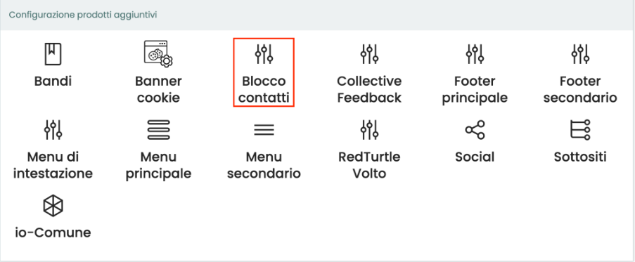
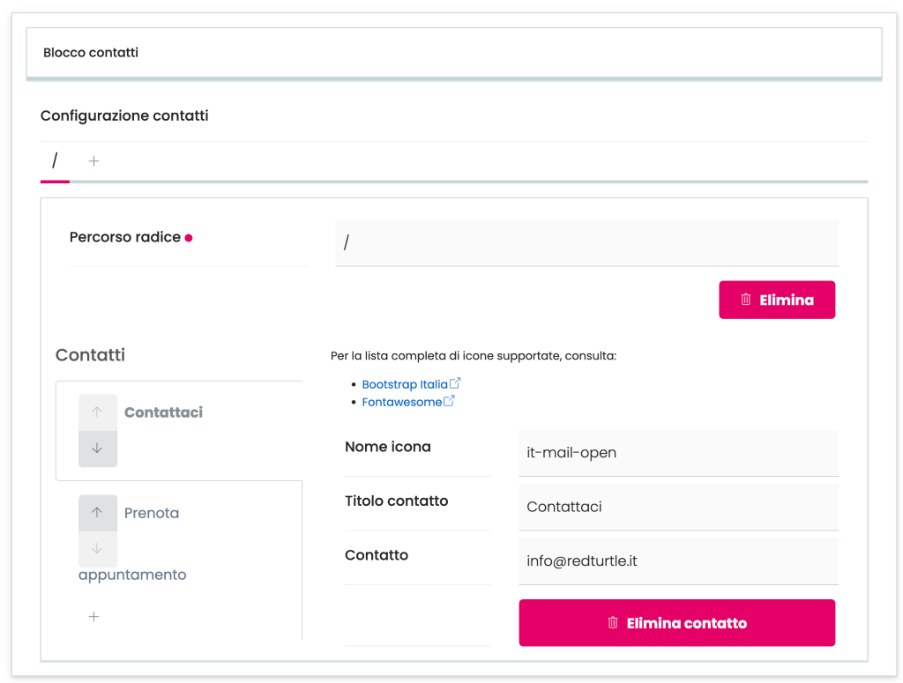
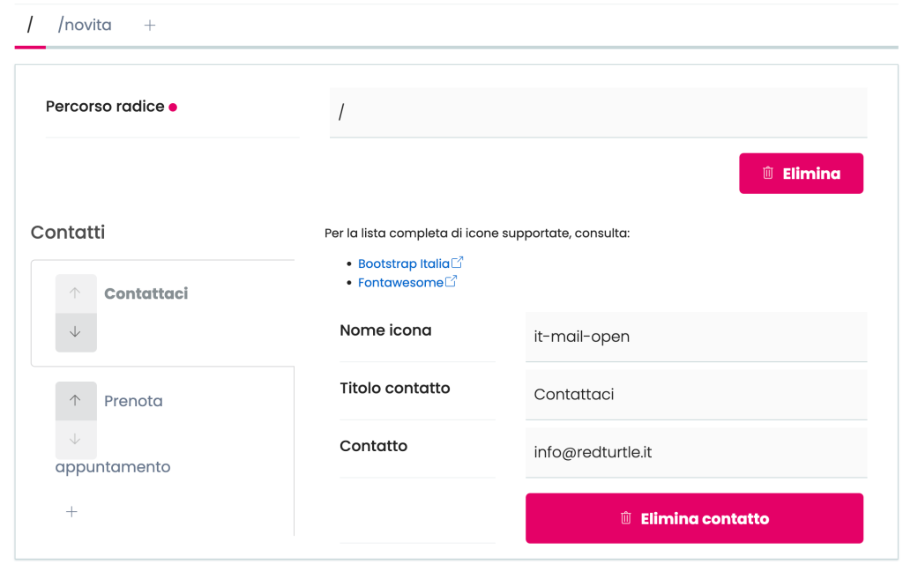
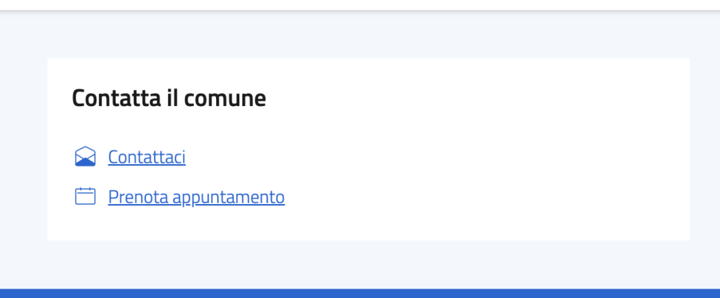
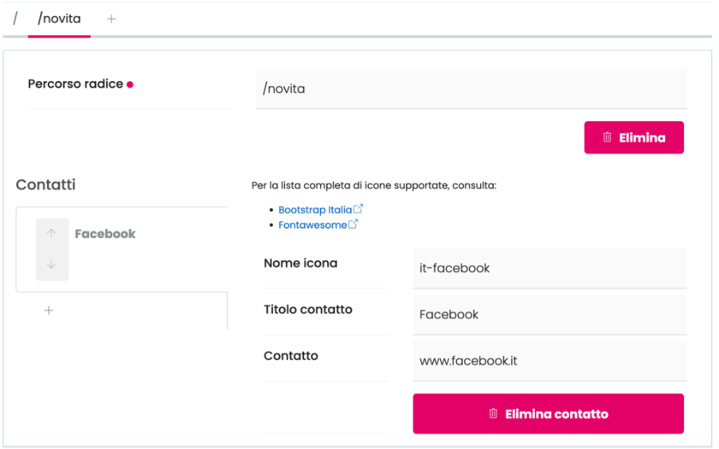
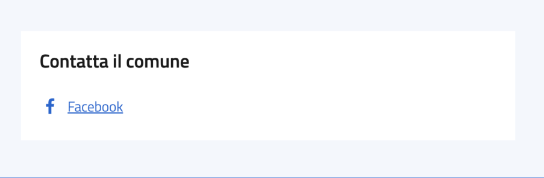

# Configuratore del blocco contatti

```{include} /_snippets/funzionalita-aggiuntiva.md
```

È possibile attivare il widget “Contatta il comune” posizionato in tutte le pagine del sito nel pre-footer.

Tramite il pannello di configurazione è possibile impostare le singole voci, personalizzando icone e titolo del contatto:





Cliccando sul bottone “+” è possibile inserire una rotta del sito per cui impostare dei contatti diversi.

Es. Rotta principale:

Rotta /novita:









Se interessati, per richiedere l’attivazione di questa funzionalità contattare il proprio referente.
