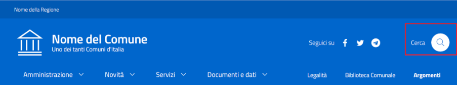
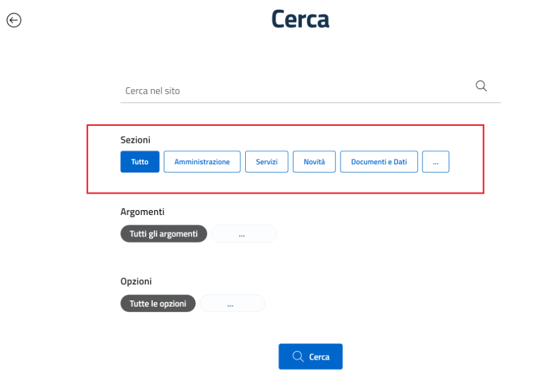
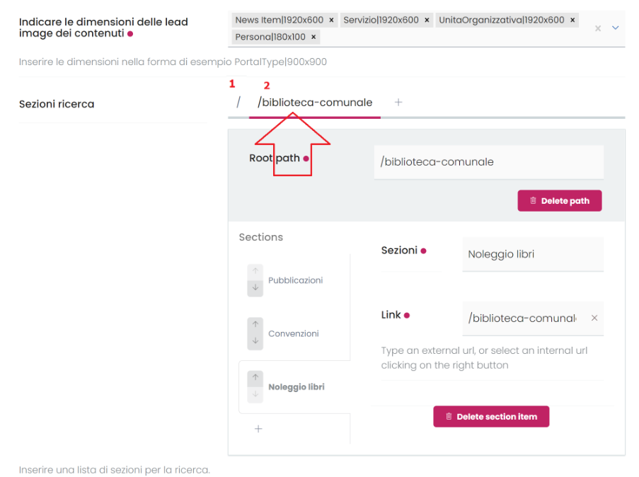
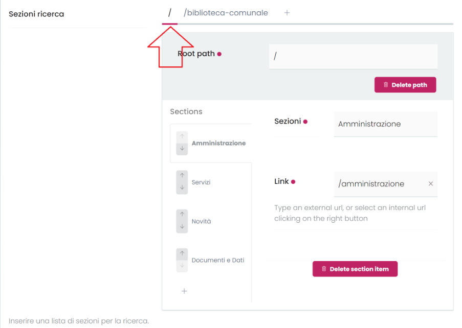
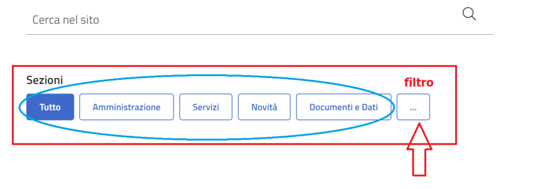
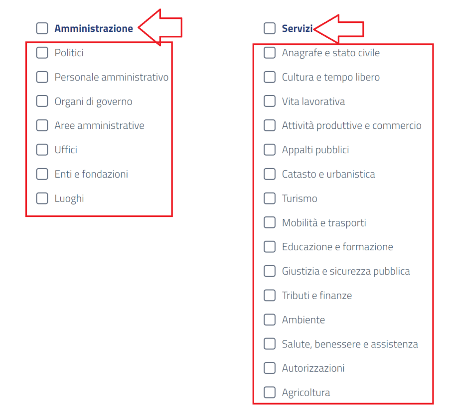
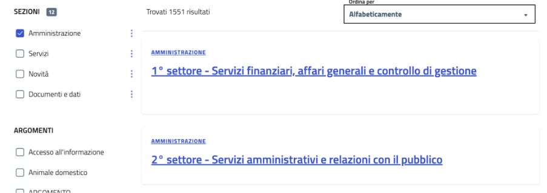
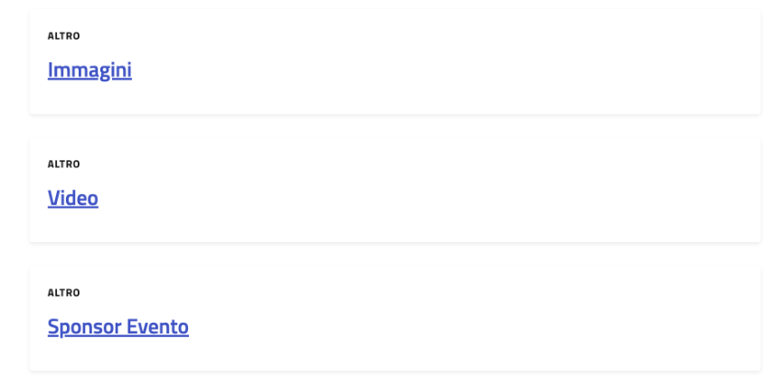

# Configurazione dei blocchi di ricerca

**NB: questa attività è da farsi una tantum, ma in generale è da aggiornare sempre quando si** **aggiungono voci al menu principale del sito, o quando si aggiungono o aggiornano** **sottositi con** **le proprie voci di menu personalizzate.**

La ricerca all’interno del sito avviene per testo libero, ma c’è la possibilità di definire anche una o particolari sezioni dove ricercare.

Cliccando sulla ricerca in testata

si atterra sulla pagina di ricerca, che mostra anche le diverse sezioni nelle quali restringere le ricerche (tipicamente le sezioni sono le voci di primo livello del navigatore)

Nel caso in cui siano configurate voci di navigatore differenti, oppure si sia all’interno di un sottosito (e quindi si desideri chiaramente sfruttare la lente di ricerca della testata del sottosito per cercare soltanto in esso), è necessario configurare tali sezioni.

Ricordiamo che ogni sottosito ha un suo URL ben specifico (è un oggetto che viene creato al pari degli altri tipi di contenuto, ed il suo URL viene generato automaticamente a partire dal nome ad esso attribuito - se ad esempio il sottosito si chiama **Biblioteca** ed è creato sotto la radice del sito, allora il suo percorso sarà **https://\<sito>/biblioteca** ) Per configurare i blocchi di ricerca del sito o del sottosito è necessario accedere con privilegi di amministrazione all’indirizzo **https://\<sito>/controlpanel/design-plone-settings**

Viene presentata una maschera come la seguente, in cui nella parte inferiore è disponibile il plugin per la configurazione:

Nell’esempio **(2)**, viene mostrata la configurazione dei blocchi di ricerca da mostrare per un sottosito creato all’indirizzo **/biblioteca-comunale** Questo significa che i blocchi selezionabili per restringere la ricerca nel sottosito saranno **Pubblicazioni, Convenzioni e Noleggio libri**

Nell’esempio del sito principale, la configurazione **(1)** sarà:

e questo corrisponde nella sezione di ricerca a rendere disponibili i blocchi evidenziati in azzurro:

Si noti inoltre che cliccando sull’espansione delle voci di “ **filtro”** ciascun blocco avrà disponibile la selezione dei rispettivi figli di primo livello, per affinare ulteriormente la ricerca

Effettuando una ricerca, sulle card dei risultati verrà visualizzato il nome inserito come titolo della sezione per tutti i contenuti all’interno del percorso specificato. Per gli altri contenuti, sarà invece presente la dicitura “Altro”. Es.:

