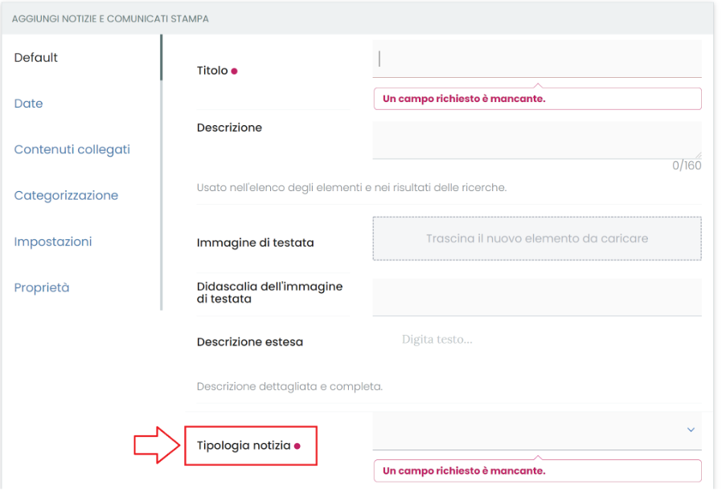

# Configurazione dei vocabolari

Alcuni content-type hanno dei vocabolari controllati che propongono di default dei valori. Ad esempio, per il CT “ **Notizie e comunicati stampa** ”, viene mostrato il campo “ **Tipologia notizia** ”

Altri CT che hanno dei vocabolari controllati sono:

- **Unità organizzativa** (campo “ **Tipologia organizzazione** ”)
- **Documento** (campo “ **Tipologia del documento** ”)
- **Persona** (campo “ **Tipologia persona** ” e “ **Ruoli Persona** ”)

