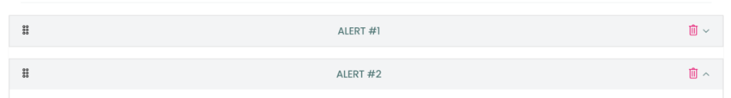
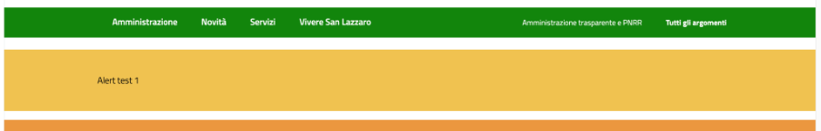
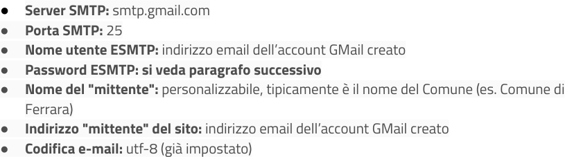
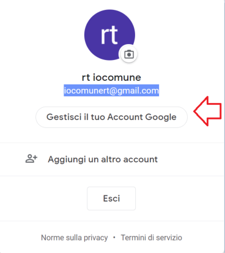
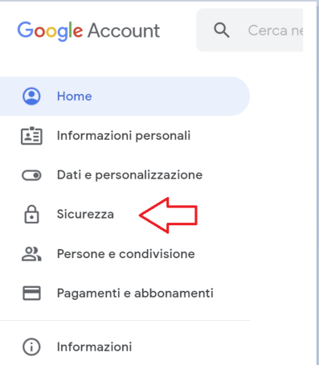
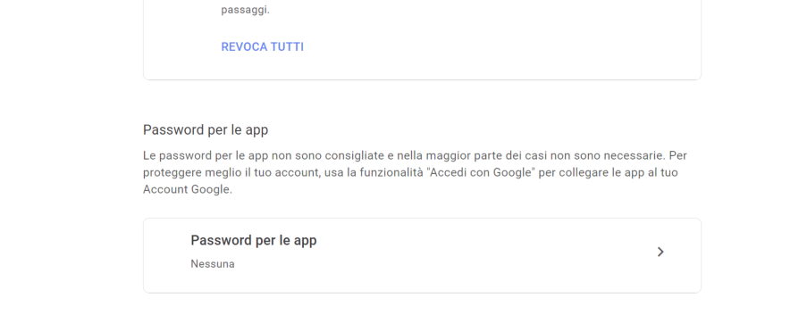
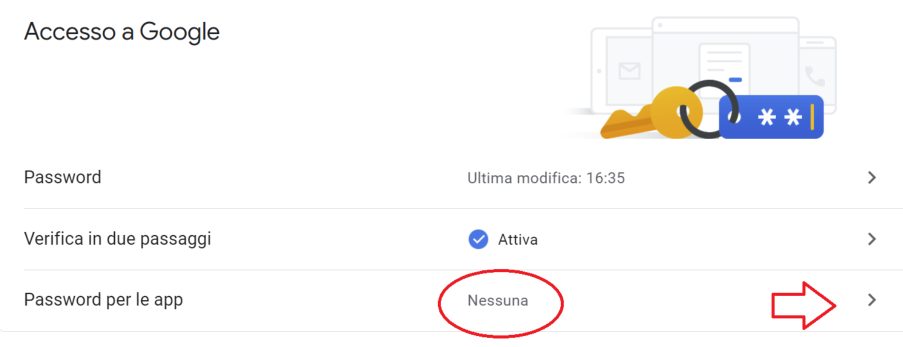
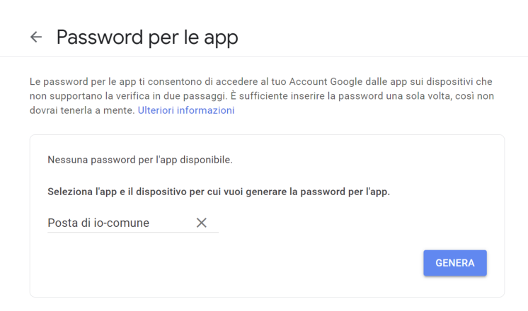
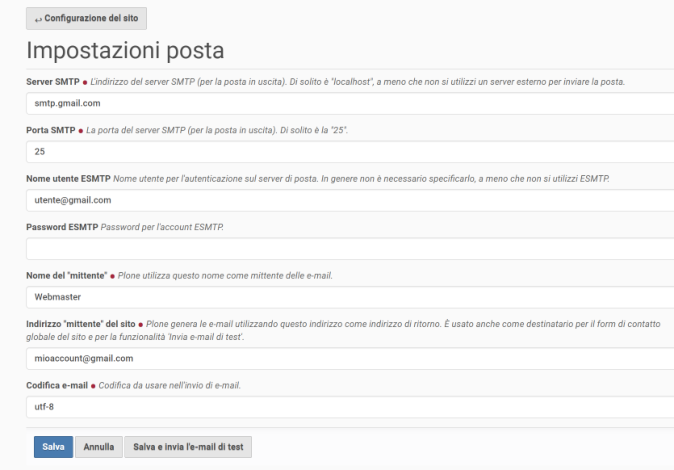

# Configurazioni varie

## Geolocalizzazione mappe

In diversi content-type, è possibile configurare le coordinate che riguardano la posizione (il “dove rivolgersi”) Tipicamente il PIN della mappa è già preimpostato su una coordinata specifica, che dovrebbe essere quella del Comune in questione.

Per modificare la posizione di default, è necessario configurare l’indirizzo qui:

**http:/\<SITO>/api/@@geolocation-defaults**

L’impostazione di questo parametro è riservata agli amministratori del sito.

## Impostazioni per l’invio della posta attraverso SMTP del portale

**DISCLAIMER: la seguente sezione potrebbe necessitare di supporto da parte di RedTurtle.** **Qualsiasi utilizzo improprio o errata configurazione è a carico dell'Ente.**

Il sistema utilizza un suo sistema SMTP interno per inviare la posta (quali invio per recupero password, notifiche verso il Comune da parte dei cittadini per le segnalazioni sul sito ecc), anche se, non essendo un server SMTP certificato, molto spesso le mail inviate arrivano al destinatario nello spam. Per ovviare a questo, si consiglia di inserire le credenziali di un server SMTP a disposizione dell’Ente. Se non si è in possesso di un server certificato, è possibile creare un account GMail per l’Ente, e utilizzare poi l’SMTP di Google (si consiglia di verificare eventuali limitazioni sugli invii - ad esempio è sconsigliato per l’invio di Newsletter).

Per accedere alle configurazioni della posta, accedere all’indirizzo:

**http:/\<SITO>/api/@@mail-controlpanel** e impostare i parametri:

- **Server SMTP:** smtp.gmail.com
- **Porta SMTP:** 25
- **Nome utente ESMTP:** indirizzo email dell’account GMail creato
- **Password ESMTP:** si veda paragrafo successivo
- **Nome del "mittente":** personalizzabile, tipicamente è il nome del Comune (es. Comune di Ferrara)
- **Indirizzo "mittente" del sito:** indirizzo email dell’account GMail creato
- **Codifica e-mail:** utf-8 (già impostato)

### Generazione della password per l’account GMail

Una volta creato l’account GMail:

1.  Entrare nelle impostazioni del proprio account (cliccando sulla propria immagine in alto a destra e cliccando su "gestisci il tuo account google")

2.  Cliccare su "Sicurezza"

3.  Nella sezione "Accesso a Google" abilitare "Verifica in due passaggi", associando un numero di cellulare per poter verificare i successivi login

4.  Tornare nella sezione "Sicurezza", nella sezione "Verifica in due passaggi" ci sarà una nuova voce chiamata "Password per le app"

5.  si aprirà una pagina con la lista di app generate (vuota). Selezionare dal menù a tendina il tipo di app per cui creare la password. Selezionare "Altro" e inserire un nome identificativo a piacere

6.  Cliccare su " **Genera** "
7.  Apparirà una popup con una nuova password. Si raccomanda di salvarla e custodirla, perchè non verrà più mostrata successivamente.
8.  [Inserire l’utente e la password all’interno dei campi di configurazione configurazione delportale](https://miosito.it/api/@@mail-controlpanel)

E’ possibile testare gli invii di posta utilizzando un apposito form di servizio all'indirizzo **http:/\<SITO>/api/sendto_form**

