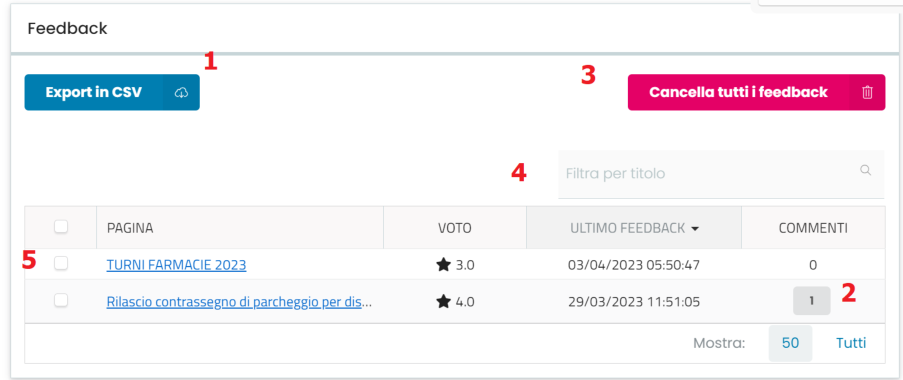

# Customer satisfaction

La customer satisfaction consente ai gestori del sito di ottenere feedback da parte degli utenti finali circa l’utilità dei contenuti impostati dalla redazione.

Operativamente, ogni pagina del sito viene corredata automaticamente da un plugin che permette all’utente anonimo di dare un giudizio secondo un punteggio da 1 a 5 (rappresentato da stelline che consentono la valutazione)

Il plugin si trova tipicamente alla fine di ogni pagina

Cliccando sulle stelline viene espansa l’area in cui è possibile selezionare il feedback: le risposte disponibili variano a seconda che il punteggio attribuito sia inferiore a 4 oppure maggiore/uguale. Il plugin consta di 2 step: nel primo si esprime la valutazione in stelline e l’attribuzione della risposta, nella seconda “schermata” è possibile inserire un commento aggiuntivo testuale (max 200 caratteri)

Non è obbligatorio esprimere un giudizio tra quelli disponibili, né inserire il commento testuale, è possibile anche esprimere semplicemente il punteggio.

Lato amministrazione, l’utente loggato con diritti da amministratore trova nella barra operativa un pulsante supplementare che mostra una console con tutti i commenti e feedback ricevuti

Cliccando sull’icona viene mostrata la lista dei feedback

C’è la possibilità di:

- Esportare in csv tutti i dati **(1)**
- Verificare i commenti pervenuti su una certa pagina **(2)**
- Cancellare tutti i feedback e commenti pervenuti **(3)**
- Filtrare le pagine per nome pagina **(4)**
- Selezionare una determinata pagina, per resettarne i commenti/feedback **(5)**

**Il voto rappresenta una media di tutti i voti pervenuti**

