# Data-element per l’asseverazione PNRR

I data-element sono attributi che il validatore automatico di AgID cerca nelle pagine del sito per le verifiche PNRR. In io-Comune si impostano dall’interfaccia redazionale, scegliendoli da un elenco di valori predefiniti. Questa pagina spiega dove inserirli, sezione per sezione.

## Menu principale

1. Cliccare l’icona **Strumenti** in basso nella barra laterale di sinistra, poi la voce **Configurazione del sito**.

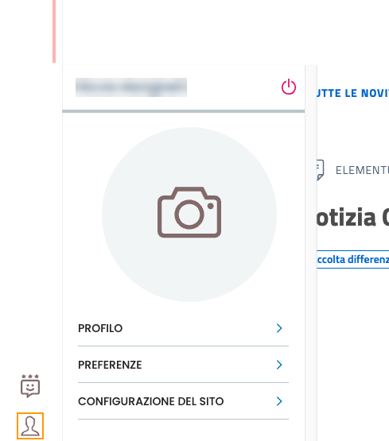

2. Nel pannello di configurazione del sito, cliccare **Impostazioni dropdown menu**.

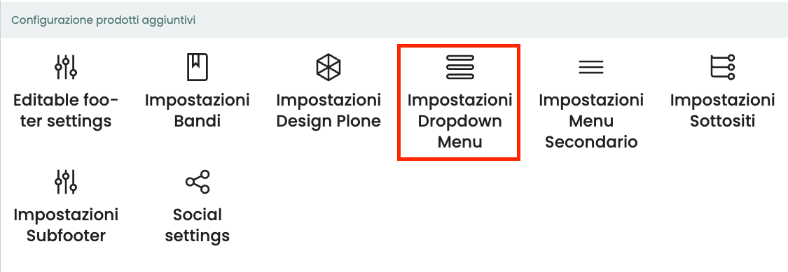

3. Selezionare il menu di navigazione principale impostato per la radice del sito (“/”).

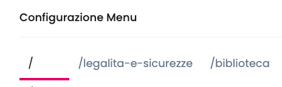

4. Per ogni voce del menu, selezionare nel campo **ID lighthouse** il data-element corrispondente.

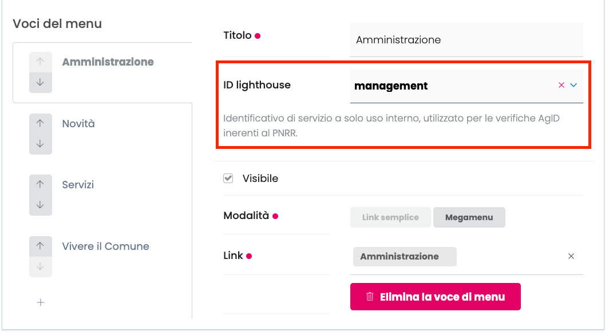

| Voce di menu | data-element |
|---|---|
| Amministrazione | `management` |
| Novità | `news` |
| Servizi | `all-services` |
| Vivere il Comune | `live` |
| Eventuali voci aggiuntive, fino a 3 (sconsigliate) | `custom-submenu` |

5. Al termine salvare le modifiche cliccando l’icona **Salva** in alto nella barra laterale di sinistra.

## Menu secondario

1. Nel pannello di configurazione del sito, cliccare **Impostazioni menu secondario**.

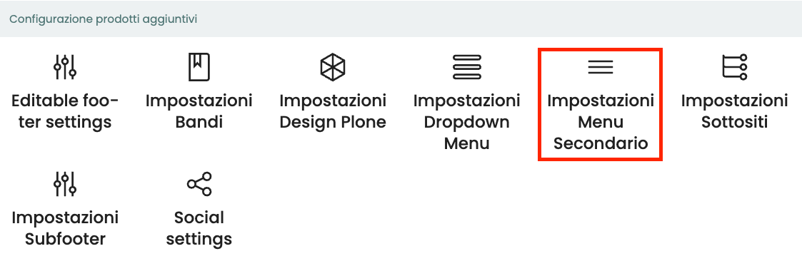

2. Selezionare il menu di navigazione secondario impostato per la radice del sito.


3. Per la voce **Tutti gli argomenti…** selezionare nel campo **ID lighthouse** il data-element `all-topics`.

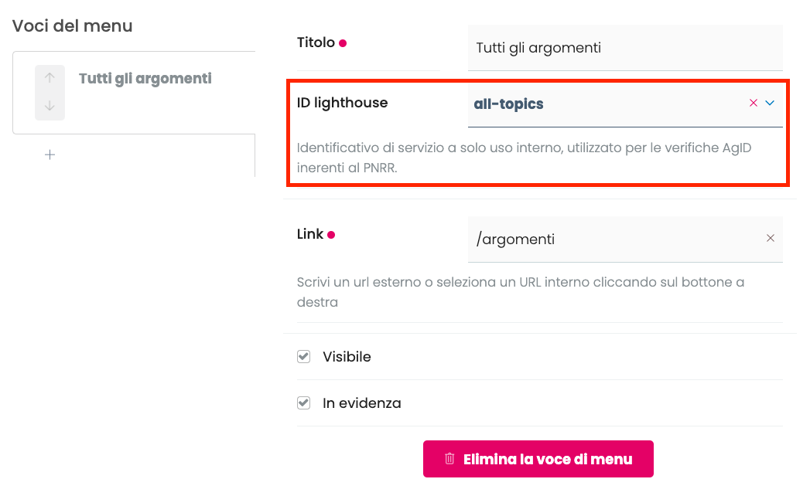

4. Salvare cliccando l’icona **Salva** in alto nella barra laterale di sinistra.

## Pagina Argomenti

La pagina di disambiguazione “Argomenti” deve contenere un blocco elenco con tutti gli argomenti disponibili, a cui va associato il data-element `topic-element`.

1. Posizionarsi sulla pagina “Tutti gli argomenti…”, cliccare l’icona di modifica in alto nella barra laterale di sinistra e selezionare il blocco elenco.
2. Nella barra laterale di destra selezionare il data-element `topic-element` e salvare.

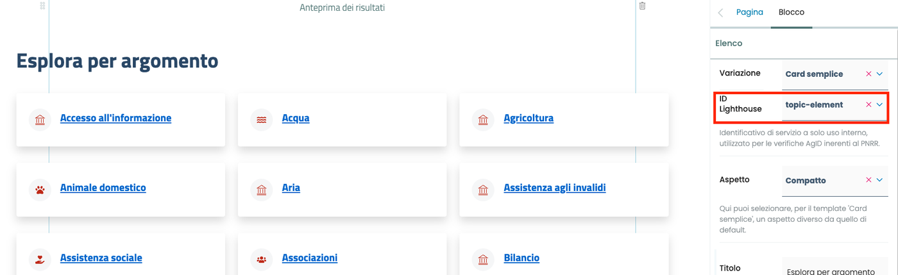

## Footer

1. Cliccare l’icona **Strumenti** in basso nella barra laterale di sinistra, poi la voce **Configurazione del sito**.
2. Nel pannello di configurazione del sito, cliccare **Editable footer settings**.

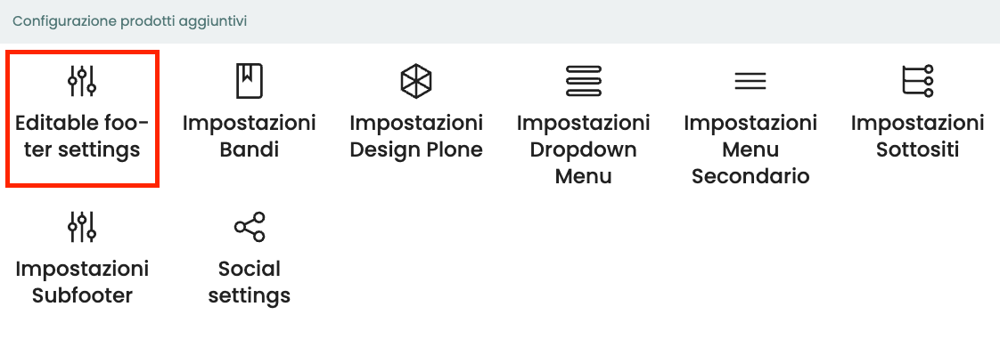

3. Selezionare il footer impostato per la radice del sito.

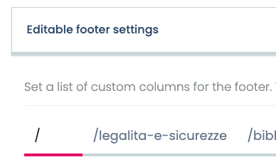

4. Posizionarsi sulla colonna interessata e inserire le voci necessarie. Selezionarle una alla volta con il mouse per associare il link corretto e il data-element.

:::{important}
Una volta inserito il data-element, confermare la modifica cliccando l’icona ➔.
:::

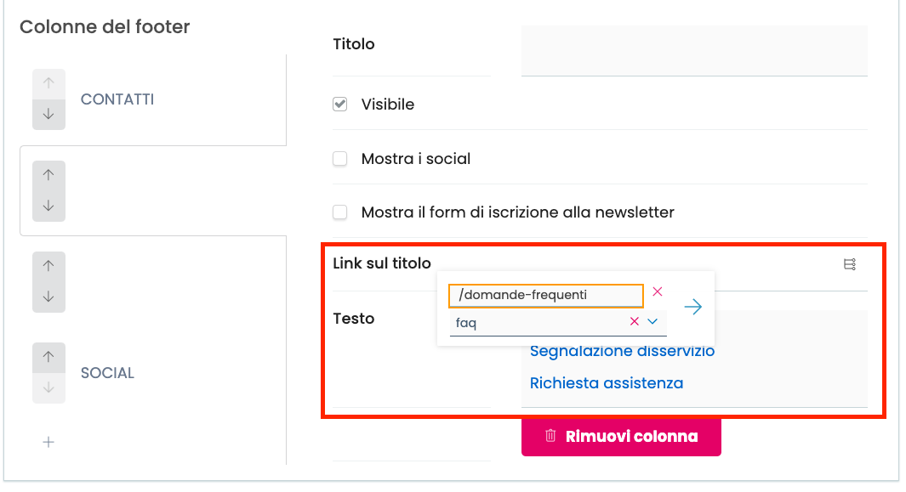

| Voce del footer | data-element |
|---|---|
| Leggi le FAQ | `faq` |
| Prenotazione appuntamento | `appointment-booking` |
| Segnalazione disservizio | `report-inefficiency` |
| Informativa privacy | `privacy-policy-link` |
| Note legali | `legal-notes` |
| Dichiarazione di accessibilità | `accessibility-link` |

## Pagina Servizi

La pagina di disambiguazione “Servizi” deve contenere un blocco elenco con almeno 10 servizi e un secondo blocco elenco con tutte le categorie di servizio attive. A ciascun blocco va associato un data-element specifico.

1. Posizionarsi sulla pagina “Servizi”, cliccare l’icona di modifica in alto nella barra laterale di sinistra e selezionare il primo blocco elenco, quello con l’anteprima dei servizi.
2. Nella barra laterale di destra selezionare il data-element `service-link` e salvare.

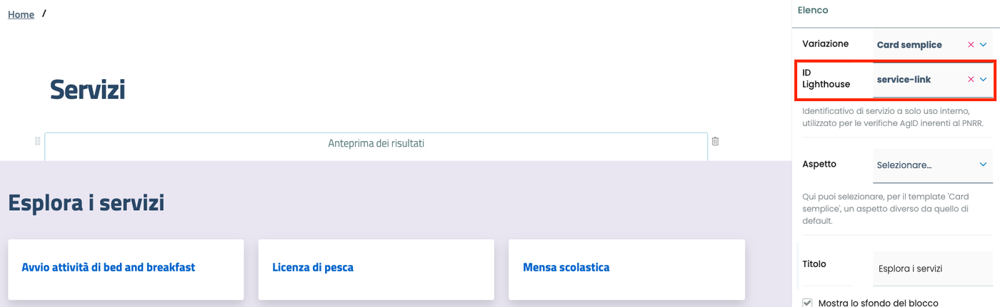

3. Ripetere l’operazione sul secondo blocco elenco, quello con le categorie di servizio, selezionando il data-element `service-category-link`.

### Più di 10 schede servizio

Se le schede servizio pubblicate sono più di 10, il validatore deve poterle leggere tutte. Serve quindi una pagina che le mostri tutte, senza paginazione:

1. Creare una pagina generica “Tutti i servizi” dentro la sezione “Servizi”. Il suo indirizzo sarà `https://<nome_sito>/servizi/tutti-i-servizi`.
2. Prima di pubblicarla, escluderla dalla navigazione.
3. Inserire nella pagina un blocco elenco con variazione **Card semplice**, ID lighthouse `service-link` e criterio **Tipo di contenuto** uguale a **Servizio**. Impostare i **risultati per pagina** uguali al numero di schede pubblicate, così che non ci sia paginazione.

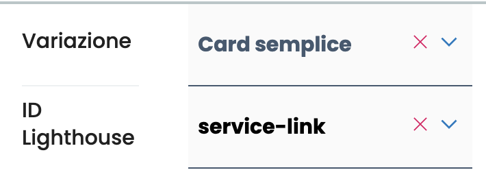

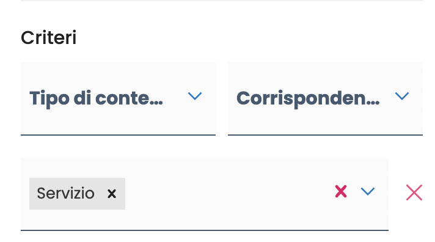

4. Nella sezione “Servizi” (`https://<nome_sito>/servizi/`) inserire un link alla pagina “Tutti i servizi”, con il data-element `pager-link`.

## Altre pagine di secondo livello

Ogni pagina di disambiguazione deve contenere un blocco elenco con tutte le voci di secondo livello attive nella sezione. Per impostare il data-element: posizionarsi sulla pagina, cliccare l’icona di modifica in alto nella barra laterale di sinistra, selezionare il blocco elenco e scegliere il data-element nella barra laterale di destra; poi salvare.

| Pagina | Blocco | data-element |
|---|---|---|
| Amministrazione | Blocco elenco con le voci di secondo livello | `management-category-link` |
| Novità | Blocco elenco con le voci di secondo livello | `news-category-link` |
| Eventuali pagine aggiuntive di primo livello | Blocco elenco con le voci di secondo livello | `custom-category-link` |

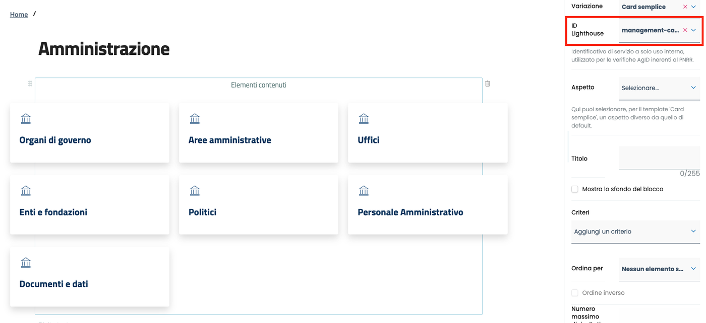

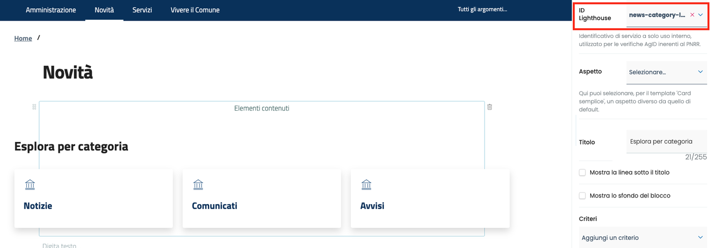

### Vivere il Comune

La pagina “Vivere il Comune” deve contenere due blocchi elenco, uno con gli eventi e uno con i luoghi in evidenza. Entrambi devono avere un bottone con il link alla relativa sezione e il suo data-element.

1. Posizionarsi sulla pagina, cliccare l’icona di modifica e selezionare il blocco elenco degli eventi in evidenza.
2. Nella barra laterale, nella sezione **Link ad altro**, selezionare il data-element `live-button-events` e salvare. Il bottone deve portare alla pagina con l’elenco di tutti gli eventi.

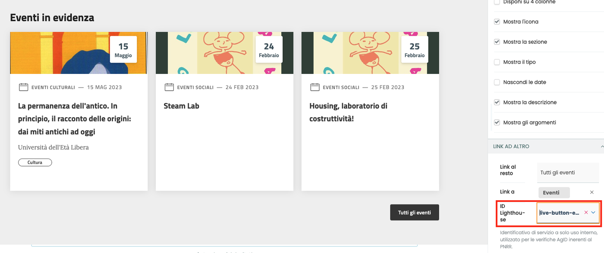

3. Ripetere l’operazione per il blocco dei luoghi in evidenza, con il data-element `live-button-locations`. Il bottone deve portare alla pagina con l’elenco di tutti i luoghi.

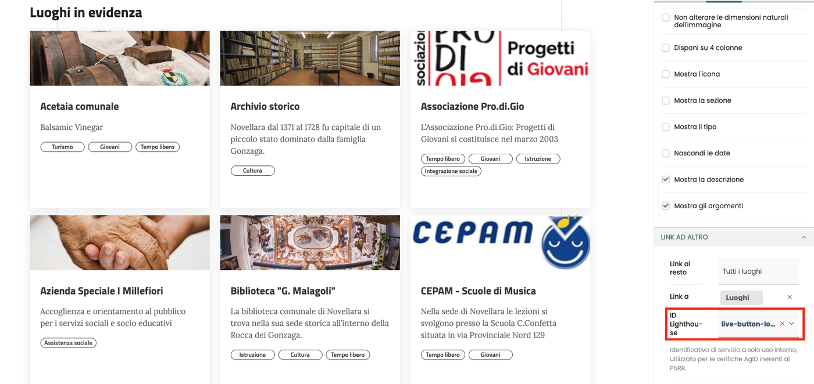

## Area personale

Il data-element `personal-area-login` viene inserito automaticamente quando si attiva l’area riservata.

## Note legali

La pagina Note legali deve contenere un paragrafo sulla licenza dei contenuti.

1. Cliccare l’icona di modifica in alto nella barra laterale di sinistra e inserire, nel punto desiderato, un blocco **HTML**.

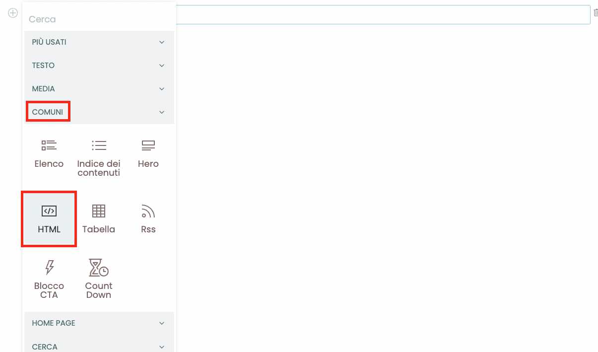

2. Incollare questo codice:

```html
<h3 data-element="legal-notes-section">Licenza dei contenuti</h3>
<p data-element="legal-notes-body">
In applicazione del principio open by default ai sensi dell’articolo 52 del decreto legislativo 7 marzo 2005, n. 82 (CAD) e salvo dove diversamente specificato (compresi i contenuti incorporati di terzi), i dati, i documenti e le informazioni pubblicati sul sito sono rilasciati con licenza CC-BY 4.0. Gli utenti sono quindi liberi di condividere (riprodurre, distribuire, comunicare al pubblico, esporre in pubblico), rappresentare, eseguire e recitare questo materiale con qualsiasi mezzo e formato e modificare (trasformare il materiale e utilizzarlo per opere derivate) per qualsiasi fine, anche commerciale con il solo onere di attribuzione, senza apporre restrizioni aggiuntive.
</p>
```

3. Salvare la pagina.

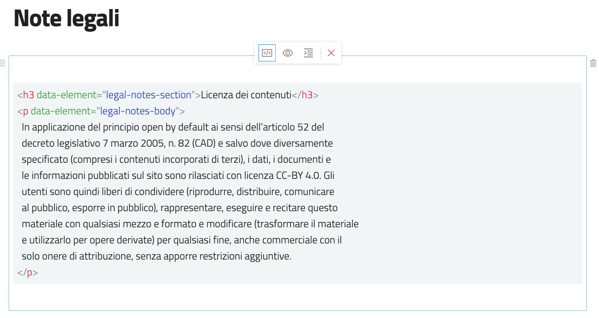

## Scheda servizio

I data-element dell’indice della scheda servizio sono già integrati nel template: non serve nessun intervento redazionale.

Se il servizio prevede la prenotazione online di un appuntamento, il link verso io-Prenoto o verso il servizio di prenotazione dell’Ente deve avere il data-element `appointment-booking`:

1. Posizionarsi sulla scheda servizio e cliccare l’icona di modifica in alto nella barra laterale di sinistra.
2. Nella sezione **Accedere al servizio**, campo **Prenota un appuntamento**, scrivere il testo “Prenota appuntamento”.
3. Selezionare il testo con il mouse, cliccare l’icona del link, inserire l’indirizzo del sistema di prenotazione e selezionare il data-element `service-booking-access`.

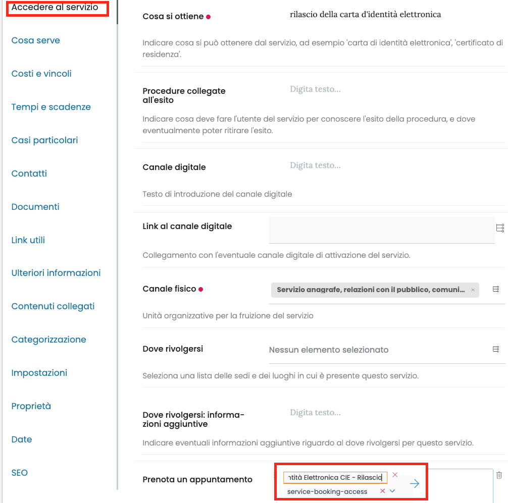

## Verifica delle buone pratiche

Una vista apposita elenca i contenuti a cui mancano campi che AgID indica come obbligatori. Oltre alle schede servizio, controllate in automatico dallo strumento “pa-website-validator”, sono essenziali anche le [buone pratiche per l’asseverazione](https://docs.italia.it/italia/designers-italia/design-comuni-docs/it/versione-corrente/conformita/buone-pratiche-asseverazione.html).

Dalla vista ogni redattore vede tutti i contenuti da rivedere; cliccandone uno si apre il contenuto, pronto per essere modificato. I contenuti vengono raggruppati per cartella di appartenenza e spariscono dall’elenco man mano che vengono completati.

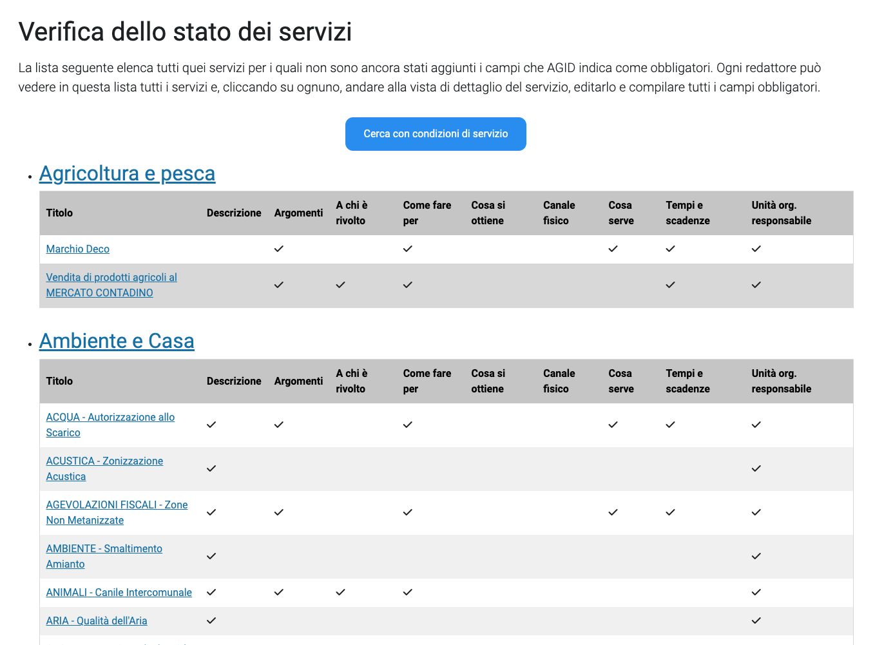

:::{note}
Non è possibile salvare una scheda servizio, o un altro contenuto, finché non sono compilati tutti i campi obbligatori.
:::

Per aprire la vista, autenticarsi e andare a uno di questi indirizzi:

- `https://<nome_sito>/admin/check-servizi`[^admin-api]
- `https://<nome_sito>/admin/check-notizie`
- `https://<nome_sito>/admin/check-eventi`
- `https://<nome_sito>/admin/check-luoghi`
- `https://<nome_sito>/admin/check-documenti`
- `https://<nome_sito>/admin/check-uo`
- `https://<nome_sito>/admin/check-persone`

[^admin-api]: A seconda dell’installazione, l’indirizzo può iniziare con `/api/` invece che con `/admin/`, per esempio `https://<nome_sito>/api/check-servizi`.
