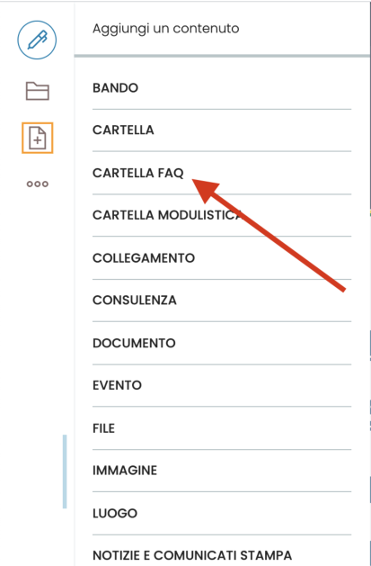
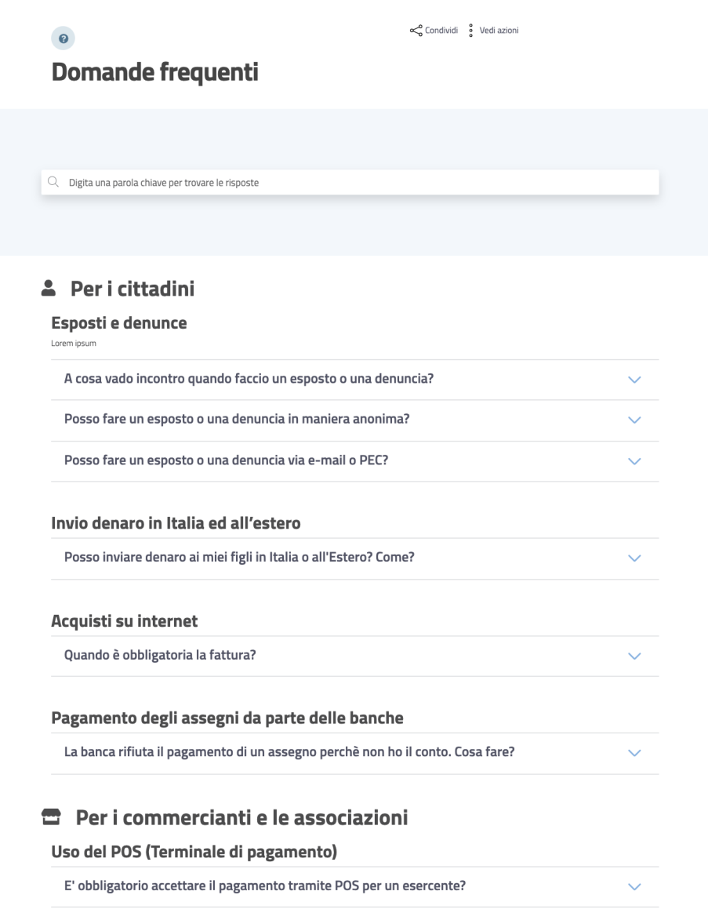

# FAQ

Le faq consentono di gestire e mostrare sul sito le risposte alle domande più frequenti.

Possono essere organizzate su infiniti livelli attraverso il tipo di contenuto ‘Cartella FAQ’ che permette di costruirne l’alberatura. Le domande (con le relative risposte), potranno essere inserite a qualsiasi livello dell’alberatura o ne costituiranno le ‘foglie’, ovvero non potranno avere ulteriori elementi di tipo faq al suo interno.

Vediamo come gestire le FAQ e l’alberatura delle FAQ.

## Cartella FAQ

E’ il tipo di contenuto che ci consentirà di costruire l’alberatura delle FAQ. E’ un ‘contenitore’ e può avere al suo interno ulteriori elementi di tipo ‘Cartella FAQ’ oppure FAQ vere e proprie (domanda con risposta). Aggiungere una Cartella FAQ dall’apposito menu della barra degli strumenti:

Le principali caratteristiche di una Cartella FAQ sono:

- Titolo
- Descrizione (Verrà mostrata sotto al titolo)
- Icona (verrà mostrata a sinistra del titolo). Nel menù a tendina sono presenti delle icone di

default. Se si vuole una maggior personalizzazione, si può inserire una qualsiasi icona di Fontawesome nel campo di testo subito sotto, come riportato nella descrizione. La lista con i nomi delle icone disponibili è presente al seguente indirizzo [https://fontawesome.com/v5/search?o=r&m=free&s=solid](https://fontawesome.com/v5/search?o=r&m=free&s=solid) Ad esempio: **deaf** **child** **arrow-alt-circle-right**

**NOTA** :

Le icone di Fontawesome di base sono quelle del set “ **Solid** ”. Se si vogliono usare le icone del set “Regular” o del set “Brands”, basta aggiungere davanti al nome dell’icona:
- **‘far’** per il set di icone “Regular”
- **‘fab’** per il set di icone “Brands”

Esempio:

-  ‘angry’ (equivale a scrivere ‘fas angry’)

-  ‘far angry’

-  ‘fab accessible-icon’ (Dal set ‘Brands’)

In visualizzazione, la cartella FAQ mostrerà sempre, oltre al titolo e alla descrizione nella testata, anche una fascia contenente un campo di ricerca nel quale l’utente potrà inserire le parole chiave da ricerca nelle FAQ presenti in tutta l’alberatura sottostante. Dopo la fascia di ricerca, verranno sempre mostrate tutte le Cartelle FAQ e le FAQ sottostanti. Cliccando sul titolo di una cartella FAQ sottostante, si accederà alla visualizzazione di quella Cartella FAQ che avrà sempre le stesse caratteristiche descritte fino ad ora. Ecco un esempio di visualizzazione di una Cartella FAQ:

## FAQ

E’ il tipo di contenuto che permette di creare la domanda con relativa risposta. E’ possibile aggiungere questo tipo di contenuto solamente all’interno di un tipo di contenuto Cartella FAQ.

E’ un tipo di contenuto molto semplice, le cui caratteristiche sono le stesse del tipo di contenuto pagina. Ha infatti:

- Titolo
- Descrizione
- Contenuto della faq, editabile con i blocchi
