# Content-type “Argomento”

Si faccia riferimento qui [https://italia.github.io/design-comuni-pagine-statiche/sito/argomento.html.](https://italia.github.io/design-comuni-pagine-statiche/sito/argomento.html)

Gli argomenti connettono le informazioni in modo trasversale rispetto ai content-type tramite TAG: un’alternativa ai siti tematici. I contenuti già presenti nell’architettura del sito, infatti, possono essere raccolti con un argomento in modo da generare una pagina tematica che li presenta. Ad esempio, se utilizziamo l’argomento “raccolta differenziata” avremo una pagina che presenta agli utenti tutti i contenuti relativi: servizi, documenti, notizie, uffici di riferimento…

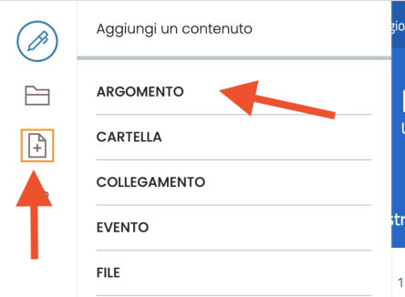

|Titolo|E' costituito da una delle voci della tassonomia "argomenti di interesse per il cittadino"|
|---|---|
|**Immagine**|Immagine in testata[^n6]|
|**Descrizione**|Sintetica descrizione dell'Area/ufficio inferiore a 255 caratteri. Se non gestita dal redattore, compare il default "Servizi comunali, documenti, uffici, notizie ed eventi relativi a "NOME TAG" (es. estate romana")|
|**Icona**|Icona dell’argomento che verrà mostrata nella testata della pagina argomento ed in corrispondenza della anteprima degli elementi riguardanti quell’argomento quando previsto.|
|**Immagine in testata**|Immagine che verrà mostrata nella testata dell’argomento|
|**Immagine di anteprima**|Immagine che verrà mostrata come anteprima nei blocchi elenco|

[^n6]: Si vedano le note sulla dimensione ottimale dell’immagine in testata

|Unità amministrative responsabili|Sono le unità amministrative responsabili dell’argomento. Se compilate, queste verranno mostrate nella testata dell’argomento|
|---|---|
|**Ulteriori informazioni**|Ulteriori informazioni di rilievo per l’argomento. Se compilato, le informazioni verranno mostrate nella testata dell’argomento prima delle unità amministrative responsabili.|

**NOTA BENE: Gli argomenti che vengono creati dall’Ente devono seguire la** **[tassonomia](https://docs.google.com/spreadsheets/d/1D4KbaA__xO9x_iBm08KvZASjrrFLYLKX/edit#gid=428595160)** **[argomenti definita e consigliata da AgID](https://docs.google.com/spreadsheets/d/1D4KbaA__xO9x_iBm08KvZASjrrFLYLKX/edit#gid=428595160)**

I campi utilizzabili per impostare l’header della pagina sono quelli presenti nella sezione “DEFAULT” e “ULTERIORI INFORMAZIONI” delle impostazioni della pagina:

La parte di sinistra dell’header è sempre composta da Titolo e sottotitolo, per impostare la parte a destra dell’header si ha la possibilità di mostrare:

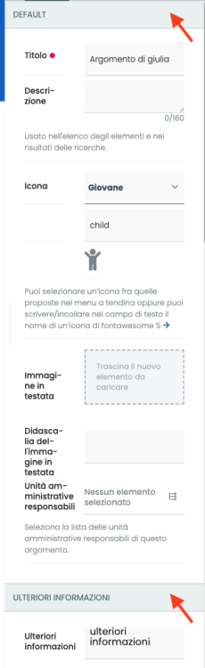

- una card per ogni “Unità amministrativa” selezionata nel campo **Unità amministrative** **responsabili** (campo di scelta multipla)

- un testo inserito nel campo “ **Ulteriori informazioni** ” (rich text)

Se si compilano tutti e due i campi verranno mostrati entrambi: per primo verrà mostrato il testo inserito nel campo “Ulteriori informazioni” e di seguito verranno mostrate le “Unità amministrative responsabili.

E’ possibile inoltre impostare l’icona relativa all’argomento, compilando i seguenti campi:

Nel menù a tendina sono presenti tutte le icone di default per ogni argomento disponibile.

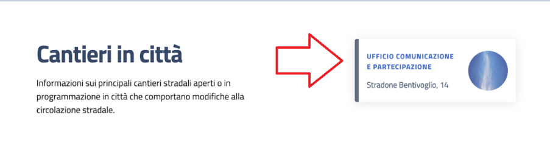

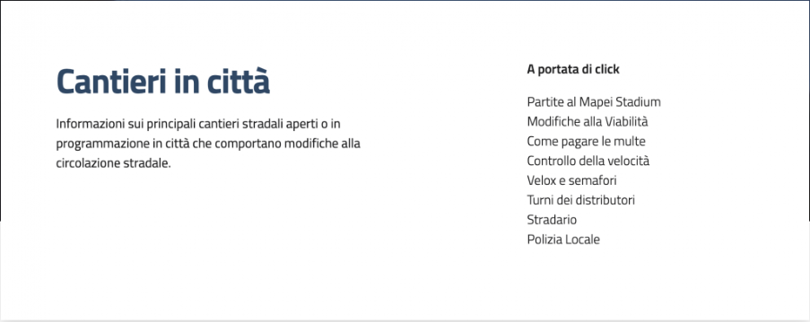

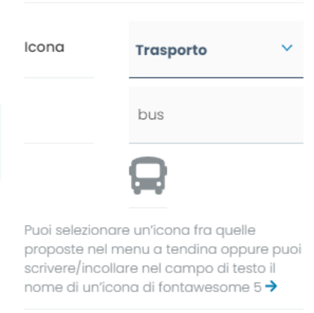

Se si vuole una maggior personalizzazione, si può inserire una qualsiasi icona di Fontawesome nel campo di testo subito sotto, come riportato nella descrizione. La lista con i nomi delle icone disponibili è presente al seguente indirizzo

[https://fontawesome.com/v5/search?o=r&m=free&s=solid](https://fontawesome.com/v5/search?o=r&m=free&s=solid)

Ad esempio: **deaf** **child** **arrow-alt-circle-right**

**NOTA:** Le icone di Fontawesome di base sono quelle del set “ **Solid** ”. Se si vogliono usare le icone del set “Regular” o del set “Brands”, basta aggiungere davanti al nome dell’icona:

- **‘far’** per il set di icone “Regular”
- **‘fab’** per il set di icone “Brands”

Esempio:

- 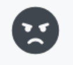 ‘angry’ (equivale a scrivere ‘fas angry’)

- 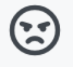 ‘far angry’

- 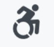 ‘fab accessible-icon’ (Dal set ‘Brands’)

## Blocco “In evidenza” per gli argomenti

Quando si utilizza un blocco elenco, qualsiasi template si selezioni per esso, per fare in modo che ogni blocco visualizzi solo le informazioni dell’argomento voluto bisogna impostare nel filtro del blocco il criterio “Argomenti correlati” indicando l’argomento desiderato.

Ecco un esempio con l’argomento “Ambiente”: l’intento è mostrare i servizi correlati all’argomento “Ambiente”

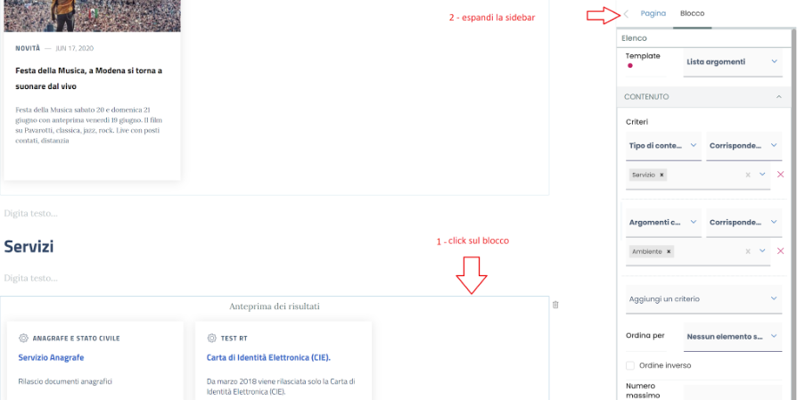

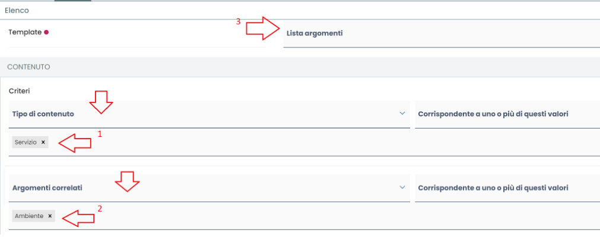

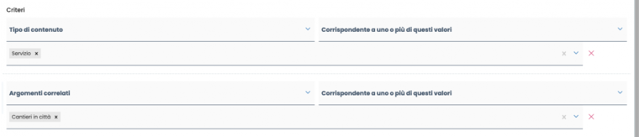

Il primo criterio indica che si vogliono far vedere i soli servizi, il secondo criterio indica che si vogliono solo i servizi correlati con l’argomento corrente (Cantieri in città)

Il significato in linea generale è questo:

- L’argomento è una sorta di “TAG” trasversale che accomuna diversi contenuti
- Se l’argomento X riguarda ad esempio un ufficio, una notizia ed un servizio, occorre che essi abbiano come correlazione (nell’apposito campo) il riferimento all'argomento X

- Quando nell’argomento X vogliamo elencare gli oggetti che lo riguardano, creiamo un blocco elenco che come criteri di selezione abbia i tipi di contenuto che ci interessano (in questo caso, Servizio, Notizia, Unità organizzativa) e come ulteriore criterio il fatto che abbiano l’argomento X come correlazione

Se inoltre vogliamo creare una lista dei contenuti “in evidenza” per un determinato argomento, creeremo un blocco elenco i cui criteri saranno:

- **Categoria = “In evidenza”** (questo implica che tutti i contenuti che si vogliono portare in evidenza devono essere taggati con la categoria “In evidenza”)
- **Argomenti correlati = “Cantieri in città”** (questo implica che verranno selezionati i soli contenuti correlati all’argomento “Cantieri in città”)
- Il risultato congiunto di queste due condizioni mostrerà nel blocco elenco tutti i contenuti “in evidenza” che riguardano l’argomento “Cantieri in città”

### Layout “Griglia a Gallery” per il blocco elenco argomenti

Per l’elenco argomenti, è possibile impostare un blocco listing in cui mostrare tutti i tipi di contenuto “Pagina argomento”, a cui applicare successivamente il layout “ **Griglia a gallery** ” (in generale, il layout è applicabile ad un blocco elenco che mostri qualsiasi tipo di contenuto, anche diverso dagli argomenti, purché abbia un’immagine associata, per una migliore resa grafica.

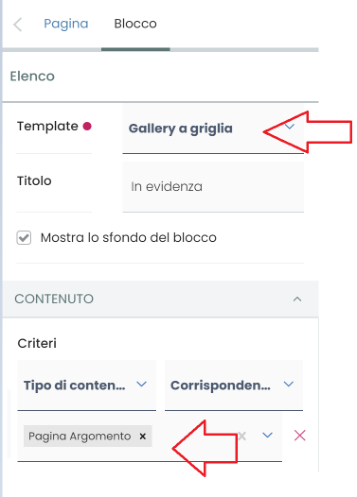

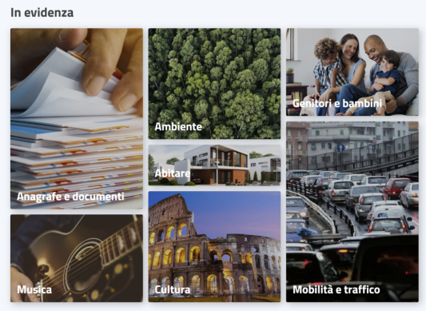
