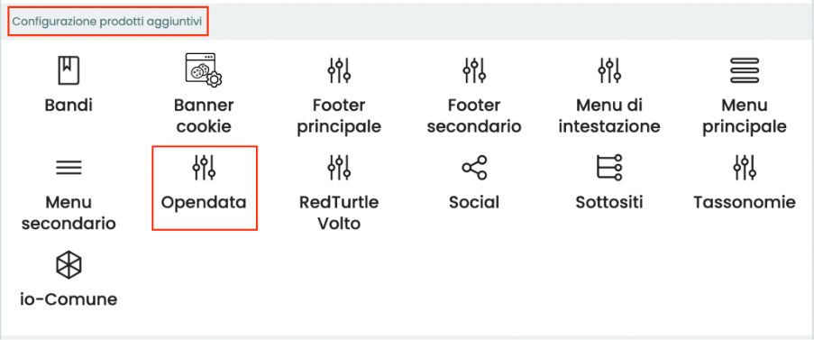
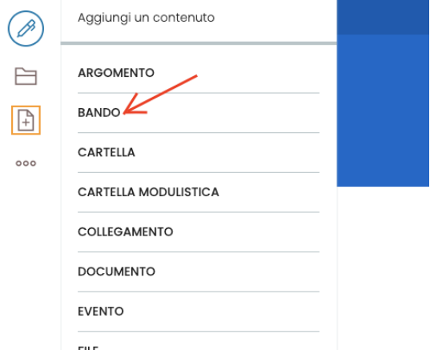
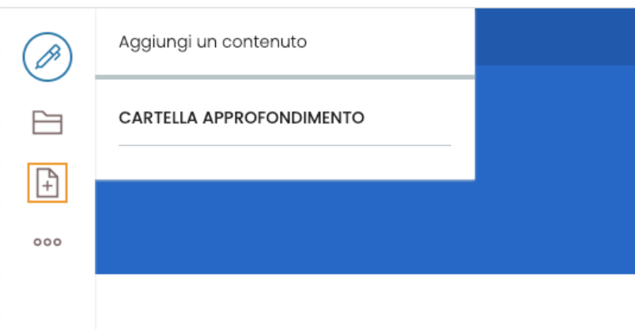
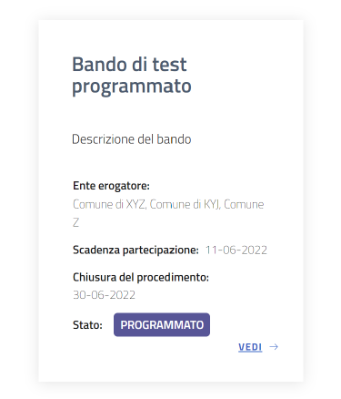
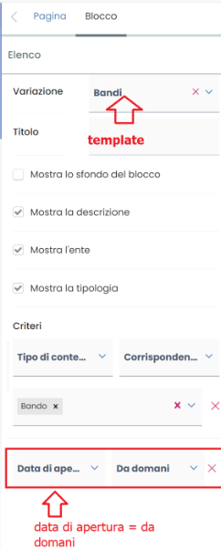
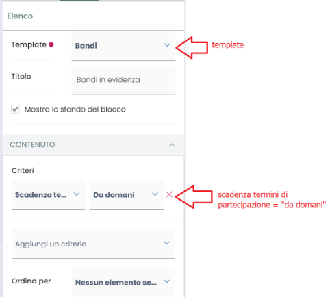
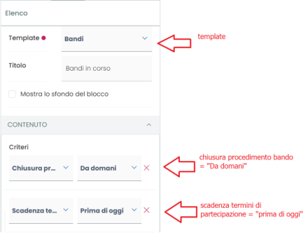
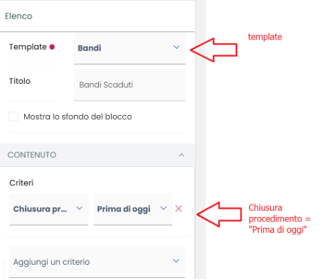

# Content-type “Bando”

Questo tipo di contenuto serve per l’inserimento nel sito di nuovi bandi:

Oltre a titolo e descrizione abbiamo i seguenti campi importanti:

|Testo|Il testo di presentazione del bando|
|---|---|
|**Tipologia di bando**|La tipologia del bando in questione|
|**Destinatari**|I destinatari del bando|
|**Ente**|L'ente proponente del bando.|
|**Data di apertura**|Per impostare una data di apertura specifica. Se non impostato, il bando sarà aperto immediatamente|
|**Termine per la richiesta di chiarimenti**|La data entro la quale è possibile chiedere chiarimento all’erogante|
|**Date e ora di scadenza**|La data entro la quale è possibile iscriversi e partecipare al bando|
|**Data chiusura procedimento**|La data oltre la quale il bando è concluso e si determina l’esito|
|**Ulteriori informazioni**|Ulteriori informazioni messe a corredo della pagina e del bando.|
|**Tassonomia argomenti**|Gli argomenti del sito ai quali si collega questo bando|
|**Correlato in evidenza**|Se impostato, verrà mostrata una fascia dedicata al correlato in evidenza, dopo la fascia dei contenuti correlati|

|Area responsabile del bando|L’area responsabile dell’erogazione del bando|
|---|---|
|**Ufficio responsabile del bando**|L’ufficio specifico responsabile dell’erogazione del bando|
|**Servizi correlati** |I servizi del comune a cui il bando può essere collegato|

Al suo interno sono aggiungibili oggetti di tipo “Cartella approfondimento”:

Questi sono contenitori di collegamenti, file e moduli, che saranno poi mostrati nella visualizzazione del bando nella sezione “Allegati”.

Tornando alla vista del bando, ci sono 4 possibili stati del bando che vanno oltre la sua semplice pubblicazione. Potremo avere bandi che una volta pubblicati sono:

- Programati
- Attivi
- In corso
- Scaduti

Questo stato del bando è determinato dalle date interne al bando. Per la “Data di apertura” abbiamo un **bando “programmato”.** Fra la data di pubblicazione (pubblicazione plone) e la data “Data e ora di scadenza”, abbiamo un **bando “attivo”** . Passata la “Data e ora di scadenza” e prima della data “Data chiusura procedimento” abbiamo un **bando “in corso”** Passata la “Data chiusura procedimento” abbiamo un **bando “scaduto”** .

## Visualizzazione dei Bandi in una pagina

A questo punto può essere necessario visualizzare in appositi blocchi elenco tutti i bandi programmati, attivi, in corso o scaduti

In una pagina è sufficiente creare dei blocchi elenco con opportuni filtri. Ad esempio:

- **Blocco elenco per i bandi programmati (in via di rilascio)**

- **Blocco elenco per i bandi aperti (o attivi)**

- **Blocco elenco per i bandi in corso**

- **Bandi scaduti**

**Nota:** Tra i vari criteri il criterio “ **Scadenza termini partecipazione** ” presenta fra i vari attributi anche i seguenti:

- “dopo la relativa data”: che indica “fra oggi e N giorni fa”
- “prima della relativa data”: che indica “fra oggi e N giorni da oggi”

  - “Oggi” è compreso all’interno del periodo temporale.

