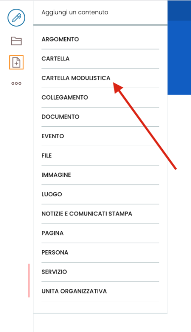
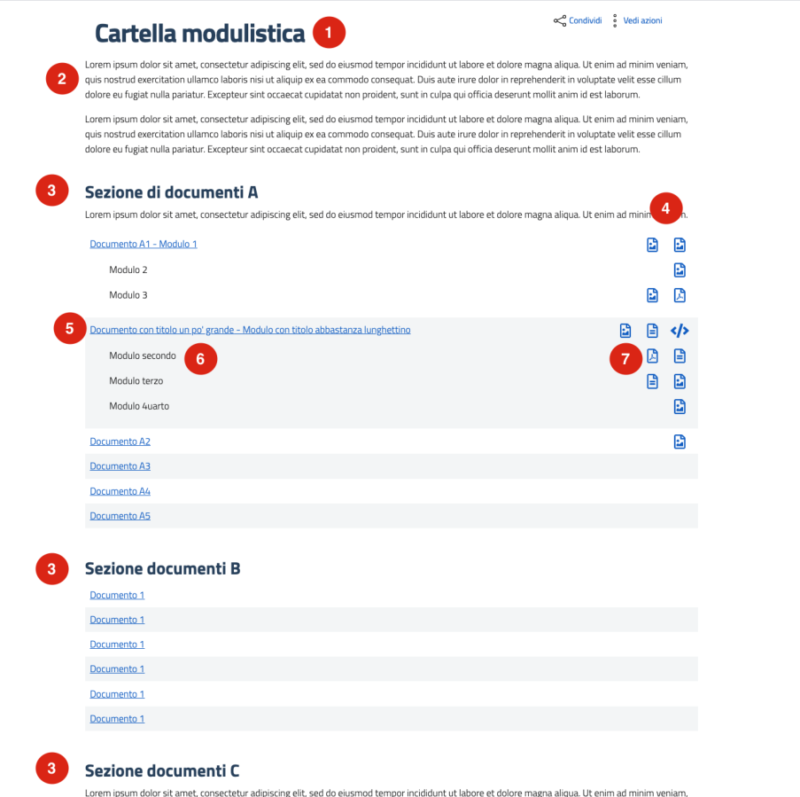
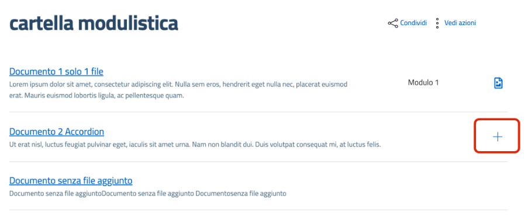
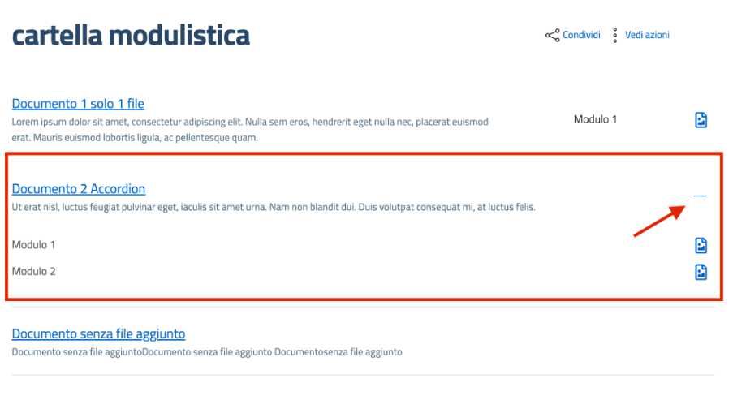
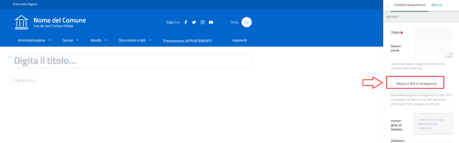

# Content-type “Cartella Modulistica”

Questo tipo di contenuto permette di creare un raccoglitore di modulistica, suddivisa per sezioni. Ogni sezione di una Cartella Modulistica è caratterizzata da un titolo, da una descrizione e da un elenco di documenti scaricabili. Ogni documento scaricabile è un oggetto di tipo Documento (vedi capitolo precedente) al cui interno è possibile caricare più moduli in diversi formati.

Una Cartella Modulistica è editabile come una qualsiasi altra pagina del sito, attraverso i blocchi. In aggiunta, è possibile inserirvi al suo interno pagine e documenti che verranno mostrati automaticamente in un elenco strutturato dopo il contenuto dei blocchi. Concettualmente, si tratta di una cartella “strutturata”, intesa come un contenitore di documentazione scaricabile, che ha il vantaggio di avere di default una visualizzazione “a lista”, in modo tale da mostrare gli eventuali documenti e moduli che sono contenuti come icone dei file scaricabili.

Per aggiungere pagine e/o oggetti di tipo Documento al suo interno, è necessario entrare in modalità di visualizzazione folder_content.

**Pagina** : aggiungendo una oggetto di tipo Pagina all’interno di una Cartella Modulistica, si andrà a creare una sezione di documenti. All’interno della pagina (sezione di documenti) sarà poi possibile

aggiungere degli oggetti di tipo documento che potranno avere a loro volta uno o più moduli con diverso formato.

Vediamo un esempio in cui approfondiamo le varie sezioni:

1)  Titolo della Cartella Modulistica 2)  Contenuto testuale (blocchi) della Cartella Modulistica 3)  Titoli delle sezioni. Ogni sezione corrisponde al blocco testuale di una “pagina” figlia della Cartella Modulistica. 4)  Contenuto testuale (blocchi) della “pagina” figlia (essi vengono visualizzati come separatori) 5)  Oggetto “Documento” figlio della cartella modulistica. Il modulo principale (il primo nell’ordine all’interno del documento) verrà mostrato in corrispondenza del titolo del documento. 6)  Oggetti “Modulo” aggiuntivi, oltre a quello principale

7)  Link con icone per il download dei vari formati dei moduli (sono i file inseriti dentro a ciascun “Modulo”). Nella configurazione della Cartella Modulistica è possibile impostare un parametro che indica se scaricare i file sul PC, oppure visualizzare i PDF in una tab separata utilizzando il visualizzatore integrato del browser. Questa opzione è applicabile soltanto ai file di tipo PDF.

Caso il Documento (5) abbia due o più Moduli (6), un accordion sarà visibile per raggruppare il contenuto al suo interno. Per visualizzarne il contenuto sarà necessario cliccare sull’icona “+” a destra del titolo o sull’icona “-” per chiuderlo.

Esempio accordion chiuso:

Esempio accordion aperto:

Nota bene: sul link nell’icona del file, è possibile impostare se i PDF devono essere aperti in anteprima con il plugin del browser (in una tab separata), piuttosto che scaricati sul PC

