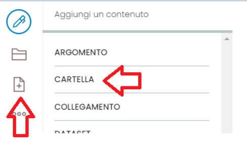

# Content-type “Cartella”

Ricordiamo che nel sistema tutti i tipi di contenuto sono “folderish”, ovvero si comportano anch'essi come se fossero dei contenitori

La cartella è un tipo di contenuto tipicamente di servizio, ovvero solitamente non viene utilizzato per creare contenuti informativi, ma per disporre soltanto degli elementi atti a contenere, ad esempio, immagini utilizzate altrove nel portale, oppure file che vengono allegati alle pagine vere e proprie per il download.

Una cartella, oltre che rappresentare un oggetto contenitore all’interno del CMS, si traduce di fatto in un link di navigazione. Il **titolo** che viene dato alla cartella, ma in generale anche a qualsiasi altro contenuto Plone (ciò che si scrive quindi nel campo “titolo”), sarà di fatto il nome che verrà visualizzato nella URL che lo rappresenta.

NB: la url resterà sempre la stessa, ovvero quella attribuita al momento della creazione, anche se si modifica titolo. Occorre eventualmente **rinominare** l’oggetto.

Nella URL, eventuali spazi bianchi verranno automaticamente sostituiti dal carattere ”-” dal sistema (es. un elemento dal titolo “pagina di prova” nella URL si presenta come “ _pagina-di-prova_ ”). È eventualmente possibile rinominare un elemento attraverso il pulsante ”Rinomina” presente nella folder_contents, una volta selezionato l’elemento. Gli elementi che si creano, da questo punto di vista, sono intrinsecamente “SEO Ready”

