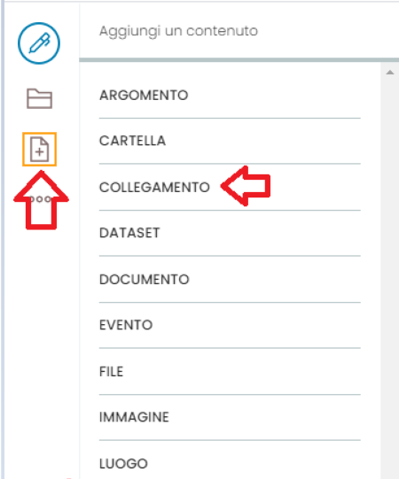

# Content-type “Collegamento”

Un collegamento è sostanzialmente di due tipi:

1.  link ad una risorsa interna
2.  link ad una risorsa esterna

In caso di link ad una risorsa interna è possibile creare collegamenti ad altri contenuti creati all'interno del sistema (cartelle, pagine ecc.). Eventuali spostamenti dell'oggetto linkato non compromettono il link interno creato in precedenza, ovvero il sistema è in grado di mantenere automaticamente il riferimento.

