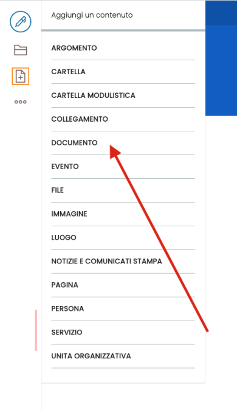
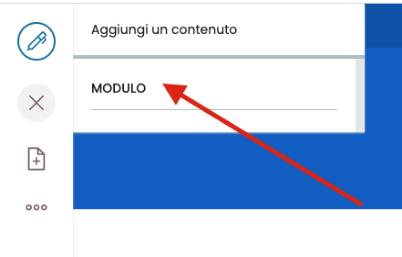
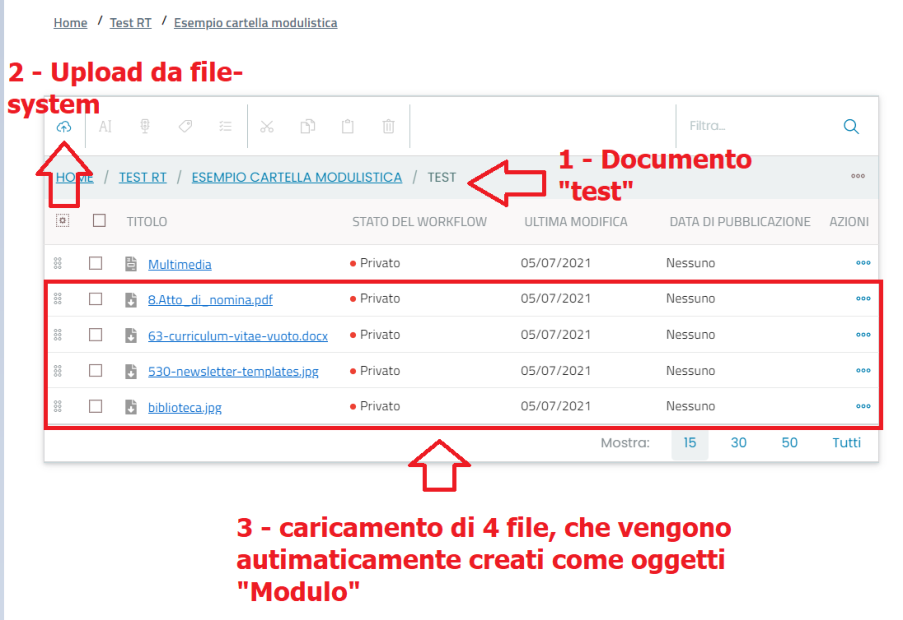

# Content-type “Documento”

[https://docs.google.com/spreadsheets/d/1D4KbaA__xO9x_iBm08KvZASjrrFLYLKX/edit#gid=1322120434](https://docs.google.com/spreadsheets/d/1D4KbaA__xO9x_iBm08KvZASjrrFLYLKX/edit#gid=1322120434)

Struttura delle informazioni utili a presentare un documento pubblico. I documenti pubblici sono presentati nella sezione documenti. I documenti personali sono disponibili nell'area personale utente.

Oltre al titolo e descrizione, gli altri campi del content-type sono:

|Titolo|Nome del documento. Il nome del Documento deve essere facilmente comprensibile dai cittadini.|
|---|---|
|**Descrizione**|Indicare una sintetica descrizione del documento utilizzando un linguaggio semplice che possa aiutare qualsiasi utente a identificare con chiarezza il documento. Non utilizzare un linguaggio ricco di riferimenti normativi.|

|Identificativo del documento|Un numero identificativo del documento (es DOI, ISBN). Non viene mostrato sul sito.|
|---|---|
|**Numero di protocollo**|Numero di protocollo del documento|
|**Data del protocollo**|Data di protocollazione|
|**Formati disponibili**|Lista dei formati in cui è disponibile il documento|
|**Dataset collegati**|Lista alle schede dataset collegate al documento (attualmente non implementato)|
|**Immagine in testata**|Immagine di riferimento del documento. Viene mostrato nella testata della pagina[^n22]|
|**Didascalia dell’immagine in testata**|Viene mostrata sotto all’immagine presentata in testata|
|**Immagine in anteprima**|Immagine alternativa, da mostrare nei blocchi elenco|
|**Didascalia dell’immagine in anteprima**|Non viene visualizzata a front-end|
|**Argomenti**|Collegamento agli argomenti di interesse per un comune|
|**Eventi della vita delle persone**|Life events collegati|
|**Eventi della vita delle imprese**|Business events collegati|
|**Tipologia di Documento albo pretorio**|Secondo la tassonomia prevista (solo se il documento è da albo pretorio)|
|**Tipologia del documento**  **[^n23]**|Indica la tipologia del documento, e quasi sempre coincide con la navigazione di primo livello della sezione ‘Documenti e dati’ .|
|**Ufficio responsabile del documento**|Link alla scheda dell'ufficio responsabile del documento. Verrà mostrato nella sezione ‘Descrizione’|
|**Area responsabile del documento**|Link alla scheda dell'area amministrativa responsabile del documento. Verrà mostrato nella sezione ‘Descrizione’|
|**Autore/i**|Lista autori (persone) che hanno pubblicato il documento. Verrà mostrato nella sezione ‘Descrizione’.|

[^n22]: Si vedano le note sulla dimensione ottimale dell’immagine in testata

[^n23]: Le tipologie di documento possono essere personalizzate dagli amministratori del sito nell’apposita sezione **https://\<sito>/controlpanel/design-plone-settings**

|Licenza di distribuzione|Licenza con il quale il documento viene distribuito. Verrà mostrata nella sezione ‘Descrizione’-|
|---|---|
|**Descrizione estesa**|Descrizione estesa e completa dei contenuti del documento|
|||
|**Immagini**|Galleria di immagini significative relative a un documento, corredate da didascalia. Vanno aggiunte alla cartella ‘Multimedia’ presente all’interno del documento, alla quale si può accedere dalla modalità di visualizzazione ‘folder_content’. Se presenti, verranno mostrati nella sezione ‘Descrizione’.|
|**Link al documento/i vero e proprio**|Bisogna ricordarsi di allegare, alla scheda documento, il documento/i vero e proprio, in un formato scaricabile e stampabile da parte dell'utente. E’ possibile aggiungere link a documenti scaricabili in diversi formati, aggiungendo dalla modalità di visualizzazione ‘folder_content’ un oggetto di tipo Modulo per ogni documento scaricabile. Per ogni modulo è possibile caricare il file nel formato principale ed eventualmente due formati alternativi dello stesso. I link ai moduli verranno mostrati nella sezione ‘Descrizione’.|
|**Riferimenti normativi**|Lista di link con riferimenti normativi utili per il documento. E’ un campo di testo libero.Verrà mostrato nella sezione ‘Ulteriori informazioni’|
|**Documenti allegati**|Lista di documenti allegati: link a quelli strutturati a loro volta come documenti. Verranno mostrato nella sezione ‘Ulteriori informazioni’|
|**Ulteriori informazioni**|Ulteriori informazioni sul documento, ad esempio numero di protocollo, data del protocollo, e/o informazioni generiche utili all’utente. Verrà mostrato nella sezione ‘Ulteriori informazioni’|
|**Contenuti correlati**|Eventuali contenuti correlati al documento|

**Correlato in evidenza**

Se impostato, verrà mostrata una fascia dedicata al correlato in evidenza, dopo la

fascia dei contenuti correlati

Per aggiungere i file veri e propri scaricabili dall’utente all’interno del documento, è necessario accedere alla modalità di visualizzazione folder_content del documento stesso e aggiungere uno o più oggetti di tipo Modulo.

L’oggetto di tipo **Modulo** prevede i seguenti campi:

- Titolo: titolo del modulo che verrà mostrato nel box corrispondente al file.
- Descrizione: breve descrizione del modulo/file. Non è obbligatoria
- File principale: allegato vero e proprio scaricabile. E’ quello principale, questo significa che al click sul titolo del Modulo, verrà scaricato questo file.
- Formato alternativo 1: formato alternativo del file principale. Se presente, verrà mostrata una iconcina per il download del formato alternativo nella parte bassa del riquadro del modulo.
- Formato alternativo 2: ulteriore formato alternativo del file principale. Se presente, verrà mostrata una iconcina per il download del formato alternativo nella parte bassa del riquadro del modulo.

Cartella **‘Multimedia’** : consente di aggiungere delle immagini che verranno poi mostrate nella ‘galleria di immagini’ nella sezione ‘Descrizione’.

:::{warning}
**Attenzione!** Non si devono modificare i nomi di queste cartelle.
:::

## Creazione automatica dei moduli

All’interno del content-type “Documento” è possibile anche fare l’upload massivo di risorse prese esternamente (file-system).

Il caricamento di ogni file genererà automaticamente un oggetto “Modulo”, dove ogni file rappresenterà il formato principale scaricabile.
