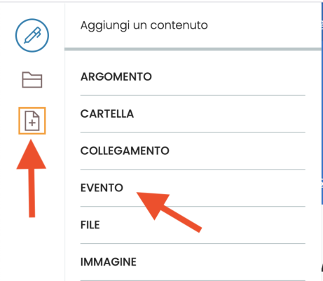
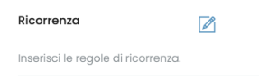
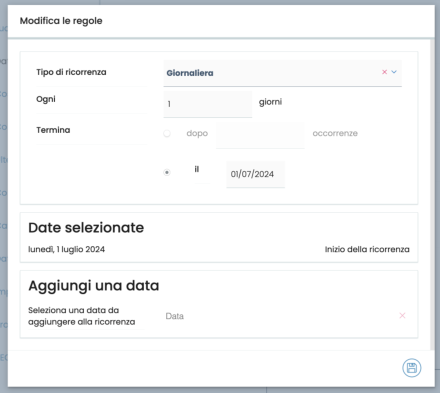
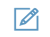
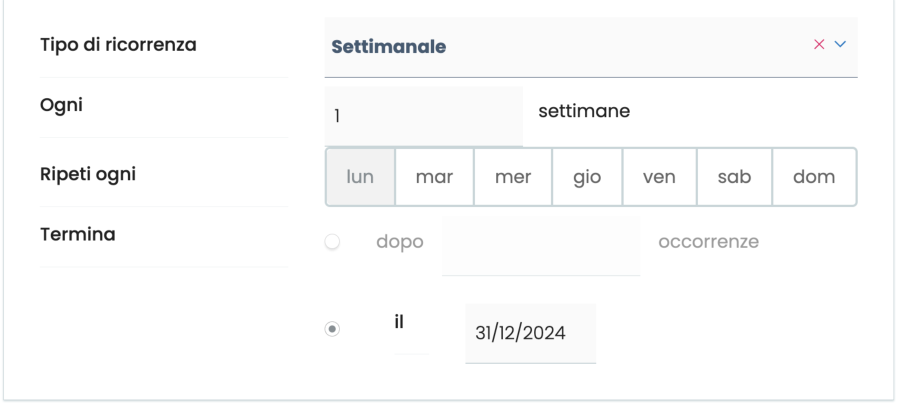
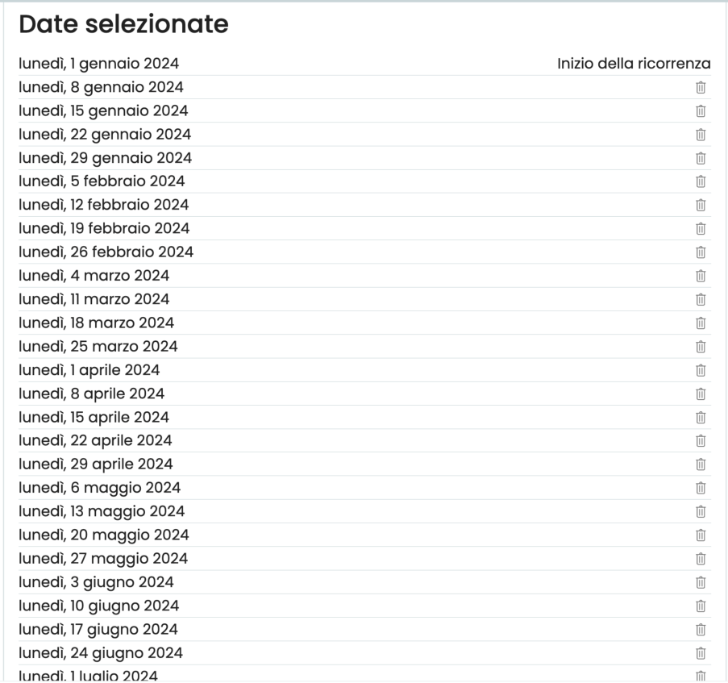

# Content-type “Evento”

Si faccia riferimento qui [https://italia.github.io/design-comuni-pagine-statiche/sito/evento-dettaglio.html](https://italia.github.io/design-comuni-pagine-statiche/sito/evento-dettaglio.html)

Questo tipo di contenuto permette di creare eventi, singoli o ricorrenti, organizzati dal comune o da soggetti esterni all’ente.

E’ un content-type gestito con i blocchi, nel senso che il contenuto informativo dell’evento può essere gestito con la modalità “Pagina a blocchi”. Questo permette di formattare più agevolmente il contenuto, inserendo oltre che il testo, anche altri blocchi (immagini, elenchi di altri contenuti correlati, ecc) In questo caso, i campi del content-type saranno disponibili nella sidebar di destra.

Per tutti gli altri dati dell’evento, si veda la tabella sottostante.

|I dati dell’evento sono i seguenti:||
|---|---|
|**Titolo dell'evento**|Titolo dell'evento|
|**Tipo di evento**|Il tipo di evento secondo la tassonomia specificata|
|**Sottotitolo**|Eventuale sottotitolo o titolo abbreviato dell’evento. Verrà mostrato accanto al titolo|
|**A chi è rivolto**|Descrizione testuale dei principali destinatari dell'Evento|
|**Descrizione**|Descrizione sintetica dell'evento, inferiore a 255 caratteri|
|**Immagine in testata**|Immagine dell'evento che verrà mostrata nella testata[^n7]|
|**Immagine in anteprima**|Immagine che verrà mostrata come anteprima nei blocchi elenco|

[^n7]: Si vedano le note sulla dimensione ottimale dell’immagine in testata

|Argomenti|Argomenti di interesse per il cittadino legati a questo evento. Verranno mostrati nella testata dell’evento|
|---|---|
|**Descrizione dei destinatari**|Descrizione testuale dei principali interlocutori dell'Evento. Questo elenco compare nel frontend.|
|**Parteciperanno (persone)**|Link a persone dell'amministrazione che interverranno all'evento|
|**Luoghi correlati**|Luoghi dell’evento se i luoghi sono presenti sul sito come oggetti di tipo Luogo|
|**Nome sede**|Nome della sede, se non presente tra i luoghi collegabili|
|**Via**|Indirizzo dell'evento. Se l'evento è un macro evento (o un evento diffuso) potrebbe essere difficile identificare un indirizzo univoco. In quest'ultimo caso il campo indirizzo può essere lasciato vuoto.|
|**CAP**|Codice di avviamento postale dell'evento|
|**Città**|Città dell’evento|
|**Quartiere**|Se il territorio è mappato in quartieri, riportare il Quartiere dove si svolge l'evento|
|**Circoscrizione (circoscrizione)**|Se il territorio è mappato in circoscrizioni, riportare la Circoscrizione dove si svolge l'evento|
|**Nazione**|Nazione dell’evento|
|**Coordinate**|Compilando i campi dell’indirizzo soprastanti, cliccando poi sul pulsante ‘Cerca sulla mappa’ verranno determinate le coordinate per la localizzazione del luogo sulla mappa. Se impostate, verrà mostrata la mappa nella pagina dell’evento|
|**Data inizio**|Data di inizio dell'evento.|
|**Data fine dell’evento**|Data di fine dell'evento più eventuali date significative riferite all'evento. Nel caso sia necessario aggiungere una ricorrenza, fare riferimento alla sezione “Widget ricorrenze” per impostare correttamente questo campo|
|**Tutta la giornata**|Se l’evento dura tutto il giorno, spuntare questa casella. Non verranno mostrati gli orari di inizio-fine evento.|
|**Fine aperta**|Se l’evento non ha una data di fine definita|
|**Ricorrenza**|Se l’evento è un evento ricorrente (ad esempio si ripete tutti i sabati e domeniche) è possibile impostare le regole della ricorrenza da qui. Le date effettive in cui si terrà l’evento verranno poi mostrate nella sezione ‘Date e orari’. Per maggiori informazioni, consultare la sezione “Widget|

||ricorrenze”|
|---|---|
|**Informazioni sugli orari**|Informazioni aggiuntive sugli orari dell’evento|
|**Costo**|Indicare il prezzo dell'evento, se presente, specificando se esistono "formati" diversi (prezzo intero, prezzo ridotto, gratuito, convenzioni, sconti, etc. ...). Biglietto intero - prezzo - testo / Biglietto ridotto - prezzo - testo / Biglietto gratuito - gratis - testo. Se è necessaria una prenotazione all'evento, delegare la gestione della prenotazione al content type "Servizio", che darà tutte le indicazioni necessarie sulle modalità di pagamento e/o di prenotazione.|
|**Organizzato da**|Se l’evento è organizzato direttamente dal comune, selezionare l’ente/ufficio che si occupa dell’organizzazione. Se l’evento non è organizzato dal comune o si vogliono aggiungere organizzatori esterni, si possono utilizzare i campi sottostanti.|
|**Organizzatore**|Nome dell’organizzatore esterno|
|**Evento supportato da**|Uffici/Enti che supportano l’evento|
|**Patrocinato da**|Nome dell'ente che patrocina l'evento. Si raccomanda di non usare sigle ma il nome esteso (es. Non "Mise" ma "Ministero dello sviluppo economico").|
|**Punto di contatto**|Relazione con i punti di contatto dell'evento|
|**Ulteriori informazioni**|Ulteriori informazioni sull’evento che verranno mostrate nella sezione dedicata|
|**Struttura politiche coinvolte**|Lista delle strutture politiche coinvolte nell'evento|
|**Contenuti correlati**|Contenuti correlati all’evento|
|**Correlato in evidenza**|Altri contenuti collegati, a cui dare maggiore enfasi e visibilità|
|**Galleria di immagini**|Galleria di immagini dell’evento. E’ possibile costruirla inserendo le immagini nella cartella ‘Multimedia’ presente all’interno dell’evento|
|**Video evento**|Video dell’evento. E’ possibile inserirli aggiungendo degli oggetti di tipo Collegamento all’interno della cartella ‘Multimedia’ presente all’interno dell’evento|
|**Documenti**|Documenti allegati all’evento. E’ possibile inserirli nella cartella ‘Documenti’ presente all’interno dell’evento.|
|**Sponsor**  |Lista sponsor dell'evento. Per mostrarli, è necessario aggiungerli nella cartella ‘Sponsor Evento’ presente all’interno dell’evento. Verranno mostrati nella sezione ‘Ulteriori informazioni’|

**Cartella Multimedia** : i contenuti inseriti qui dentro serviranno per costruire la gallery di immagini e la gallery di video youtube. Gli oggetti di tipo collegamento serviranno per creare una gallery di video. Gli oggetti di tipo immagine serviranno invece per creare una gallery di immagini.

**Cartella Documenti** : gli elementi inseriti in questa cartella verranno mostrati nella sezione ‘ _Documenti allegati_ ’

**Cartella Sponsor Evento** : accetta tipi di contenuto Collegamento; se si inseriscono link (con o senza immagine, se hanno immagine viene mostrata), viene mostrata una fascia dedicata in fondo alla pagina, come prevede agid.

NB: se vogliono metterli all’inizio, faranno un blocco listing, ma non si deve aggiungere nessun contenuto nella cartella Sponsor, altrimenti si avrà un doppione.

:::{warning}
**Attenzione!** Non si devono modificare i nomi di queste cartelle.
:::

## Gestione appuntamenti

Inserendo tipi di contenuto “Evento” all’interno di un evento, è possibile creare una sezione “Appuntamenti”. L’idea è quella di rappresentare per l’evento una sequenza di sotto-eventi (ovvero Appuntamenti) in cui si può diversificare eventualmente l’evento stesso.

Caso tipico ad esempio può essere l’evento “Inaugurazione Sala polivalente”, in cui gli appuntamenti possono essere: “Presentazione del sindaco - ore 9”, “Intervento delle associazioni di quartiere - ore 10”, “Benedizione del parroco - ore 11” ecc.

Visivamente, gli appuntamenti sono evidenziati come card all’interno dell’evento principale, nell’apposita sezione

## Widget ricorrenze

Le ricorrenze vengono impostate tramite il widget apposito:

Per configurare correttamente una ricorrenza, impostare la data e l’orario di inizio e la data e l’orario di fine dell’evento **tenendo conto solo della prima occorrenza dell’evento ricorrente** .

Ad esempio: Evento ricorrente settimanalmente ogni lunedì dal 01/01/2024 al 31/12/2024 dalle 9 alle 11 del mattino. Inizio evento: 01/01/2024 09.00 Fine evento: 01/01/2024 11.00

La logica dietro queste impostazioni è che l’evento si verifica lunedì 1 gennaio dalle 9 alle 11, e poi si ripete uguale in tutte le date impostate tramite il widget ricorrenze.

Per configurare la ricorrenza, aprire il widget ricorrenze con il pulsante apposito  e impostare i dati richiesti per ogni tipo di ricorrenza. I campi necessari verranno mostrati nella finestra dinamicamente in base alla scelta effettuata tramite il menù a tendina “Tipo di ricorrenza”.

Per far sì che la ricorrenza venga calcolata correttamente, occorre popolare il campo “Termina”. Questo può essere impostato

- Dopo TOT. occorrenze → la ricorrenza terminerà dopo un numero specifico di occorrenze
- Il “xx/xx/xxxx” → data assoluta.

Impostando questo campo, verrà calcolato l’elenco di date comprese tra la data della prima occorrenza (impostata nei campi inizio/fine evento) e tra la fine della ricorrenza.

Ad esempio: Evento ricorrente settimanalmente ogni lunedì dal 01/01/2024 al 31/12/2024 dalle 9 alle 11 del mattino. Inizio evento: 01/01/2024 09.00 Fine evento: 01/01/2024 11.00 Fine ricorrenza: 31/12/2024

Una volta calcolate le date comprese, è eventualmente possibile cancellare date specifiche cliccando sull’icona del cestino.

È anche possibile aggiungere delle date che non sono comprese nella ricorrenza tramite il campo “Aggiungi una data”.

N.b. Anche se l’evento ha fine aperta, è comunque obbligatorio impostare una data di fine. In questo caso, impostare la data di fine secondo le informazioni fornite, e poi selezionare il checkbox “Fine aperta”. Questo è necessario per poter permettere al sistema di calcolare correttamente delle ricorrenze.
