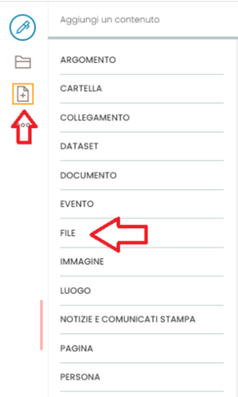

# Content-type “File”

E’ possibile caricare file PDF, documenti Word, archivi zip...- praticamente qualunque cosa. All'interno del sistema, i file vengono trattati semplicemente come tali, e verranno mostrati nelle liste di contenuti delle cartelle all'interno delle quali sono caricati, ma non ci sarà nessuna visualizzazione speciale per loro.

Appariranno con il loro nome nelle liste e sarà possibile scaricarli cliccando sul link costituito dal loro nome.

Oltre che singolarmente, i file possono essere inseriti massivamente (prelevandoli dal file-system) attraverso il pulsante di “upload” presente nella barra dei pulsanti in alto che compare nella visualizzazione in modalità folder_contents

I file tipicamente vengono utilizzati per essere linkati in altri contenuti informativi come risorse disponibili per essere scaricate. **NB: la dimensione massima caricabile di qualsiasi tipologia file (immagini comprese) è di** **100MB**

