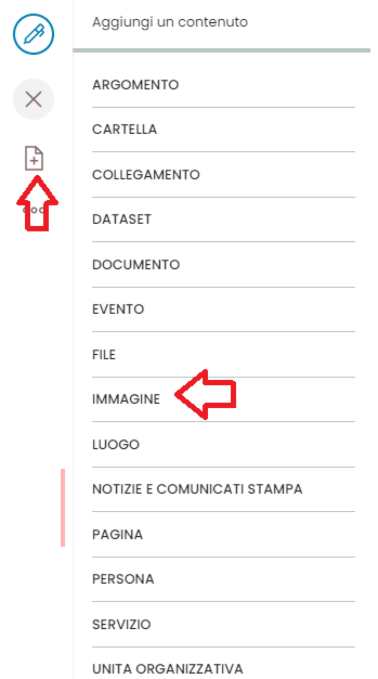

# Content-type “Immagine”

Le immagini sono tipicamente oggetti che vengono utilizzati per essere poi “inclusi” all'interno di un altro contenuto (es.pagina). E' consigliabile creare una cartella apposita che contiene tutte le immagini di servizio che il portale utilizzerà. Ricordiamo che l’immagine, per essere visualizzata correttamente dall’utente anonimo, deve essere posizionata in una cartella immagini che deve avere lo stato “pubblicato” (ovvero non è possibile da utente anonimo visualizzare un'immagine che si trova in una cartella privata).

