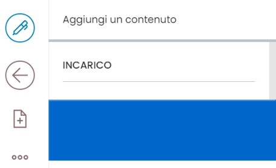

# Content-type “Incarico”

[https://docs.google.com/spreadsheets/d/1D4KbaA__xO9x_iBm08KvZASjrrFLYLKX/edit#gid=238733735](https://docs.google.com/spreadsheets/d/1D4KbaA__xO9x_iBm08KvZASjrrFLYLKX/edit#gid=238733735)

Questa Tipologia descrive la struttura di cariche, incarichi o ruoli salienti per il dominio (sito di un comune), funzionale alla creazione di una scheda persona. E’ un content-type raccomandato da AgID. E’ inseribile esclusivamente all’interno dell’apposito contenitore creato automaticamente dentro al CT Persona pubblica.

I campi dell’incarico sono i seguenti:

|Titolo|Nome dell’incarico|
|---|---|
|**Descrizione**|Breve descrizione dell’incarico. Verrà mostrata nella testata e nell’anteprima dell’incarico.|
|**La persona che ha la carica o l’incarico**|Collegamento alla persona.|
|**Unità organizzativa**|Organizzazione presso la quale svolge l’incarico|
|**Responsabile della struttura**|Se è un incarico di responsabilità, specificare l'organizzazione della quale è responsabile in base all'incarico|
|**Data inizio incarico**|Stabilisce la data di inizio dell’incarico|
|**Tipo di incarico**|Politico/Amministrativo/Altro, secondo la tassonomia  ufficiale AgID[^n15]|
|**Compensi**|Solo per incarico politico: compensi di qualsiasi natura connessi all'assunzione della carica.|
|**Importi di viaggio e/o servizio**|Solo per incarico politico: importi di viaggi di servizio e missioni pagati con fondi pubblici.|
|**Data conclusione incarico**|Allegato per il Curriculum vitae[^n16]|
|**Data insediamento**||
|**Atto di nomina**|Inserire atto di nomina della persona|
|**Contenuti correlati**||
|**Ulteriori informazioni** |Ulteriori informazioni relative alla persona|

[^n15]: Le tipologie di Incarico possono essere personalizzate dagli amministratori del sito nell’apposita sezione **https:/\<sito>/api/@@taxonomy-settings,** selezionando “Tipo di incarico” e premendo sul pulsante “Edit taxonomy data”

[^n16]: Per gli ulteriori curriculum eventualmente da inserire, viene creato un apposito contenitore all’interno della persona “Curriculum vitae”, in cui caricare i file.
