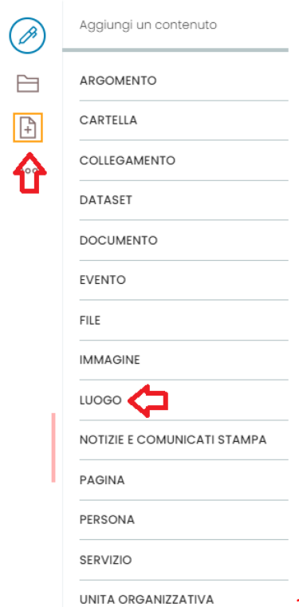
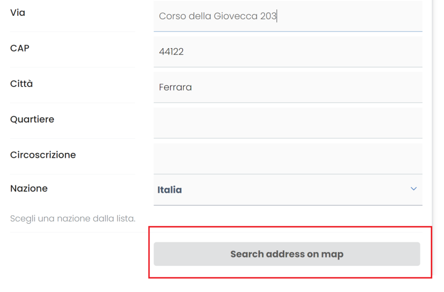

# Content-type “Luogo”

Struttura delle informazioni relative a un luogo che è un punto di interesse pubblico. Nota: I luoghi possono essere sede di eventi, sede di strutture amministrative o politiche.

Questo è un content-type raccomandato da AgID: i luoghi servono per creare riferimenti incrociati all'interno di altri contenuti, come ad esempio le Unità Organizzative, che quindi oltre alle loro informazioni possono referenziare ulteriori luoghi correlati all'unità organizzativa stessa.

Ad esempio, un ufficio (Unità organizzativa) può avere una sua sede, data da informazioni come indirizzo, cap e città, ma referenziare anche un altro luogo, che potrebbe essere per esempio il riferimento ad un'altra sede.

Oltre ai classici campi (titolo e descrizione), per il luogo c'è la possibilità di inserire altri campi interessanti quali **Via, CAP, Città, Nazione**, che permettono attraverso un apposito plugin di ricercare e geolocalizzare il luogo su una mappa.

**Attenzione: se si modificano i dati di localizzazione di un luogo precedentemente creato,** **forzare sempre la generazione delle nuove coordinate attraverso l’apposito pulsante**

NB: esiste la possibilità di configurare un punto geolocalizzato su cui impostare il PIN di default della mappa, centrato su una particolare coordinata geografica (tipicamente quello della propria città). Questo punto è configurabile qui **http:/\<sito>/api/@@geolocation-defaults**

I campi del luogo sono i seguenti:

|Titolo|Nome principale del luogo|
|---|---|
|**Nome alternativo**|Nome alternativo o secondario del luogo (ad es. Anfiteatro Flavio)|
|**Descrizione**|Sintetica descrizione del luogo (inferiore 255 caratteri)|
|**Immagine in testata**|Immagine principale del luogo[^n8]|
|**Immagine in anteprima**|Immagine che verrà mostrata come anteprima nei blocchi elenco|
|**Argomenti**|Argomenti di interesse per il cittadino|
|**Luoghi correlati**|Altri luoghi correlati|
|**Tipo di luogo**|Preso dallatassonomia luoghi|
|**Correlato in evidenza**|Se impostato, verrà mostrata una fascia dedicata al correlato in|

[^n8]: Si vedano le note sulla dimensione ottimale dell’immagine in testata

||evidenza, dopo la fascia dei contenuti correlati|
|---|---|
|**Descrizione completa**|Descrizione del luogo|
|**Elementi di interesse**|Titolo e descrizione di un elemento di interesse presente nel luogo (es. Sala Gherardi / Es. Collina dell'acquapazza) Se l'elemento d'interesse è a sua volta un luogo, link alla scheda luogo. Si ripete per ciascun elemento|
|**Modalità di accesso**|Servizi disponibili sulle modalità di accesso al luogo con particolare attenzione agli accessi per disabili|
|**Via**|Indirizzo del luogo.|
|**CAP**|Codice di avviamento postale del luogo|
|**Città**|Città del luogo|
|**Quartiere**|Se il territorio è mappato in quartieri, riportare il Quartiere dove è situato il luogo|
|**Circoscrizione**|Se il territorio è mappato in circoscrizioni, riportare la Circoscrizione dove è situato il luogo|
|**Nazione**|Nazione del luogo|
|**Geolocalizzazione/Coordinate**|Geolocalizzazione del luogo sulla mappa|
|**Note**|Note addizionali per l’indirizzo|
|**Orario per il pubblico**|Orario di apertura al pubblico del luogo.|
|**Punto di contatto**|Relazione con i punti di contatto del luogo|
|**Struttura responsabile del** **luogo**|Link alla scheda struttura (se è una struttura comunale)|
|**Struttura responsabile**|Nome della struttura e link  al sito web della struttura che gestisce il luogo  se è una struttura privata. Indicarne solo il nome.|
|**Ulteriori informazioni**|Ulteriori informazioni sul Luogo|
|**Galleria di immagini**|Se nella cartella Multimedia presente all’interno del luogo si aggiungono immagini, queste verranno mostrate nella gallery di immagini|
|**Video**|Se nella cartella Multimedia presente all’interno del luogo si aggiungono Collegamenti a video, questi verranno mostrati nella gallery di video|
|**Servizi presenti nel luogo**|Vengono determinati automaticamente dal sistema. Vengono mostrati tutti i servizi che fanno riferimento a questo luogo|
|**Contenuti correlati**  |Lista notizie ed eventi che hanno il tag \<luogo>. Determinate in automatico dal sistema, oppure campo in cui correlare direttamente altri titpi di contenuto|

**Cartella Multimedia:** La creazione di un Luogo genera automaticamente una pagina contenitore “Multimedia”, utile per caricare in modalità folder_content immagini o collegamenti a video. Questa cartella serve per creare gallerie multimediali di immagini e video.

:::{warning}
**Attenzione!** Non si devono modificare i nomi delle cartelle all’interno del luogo.
:::
