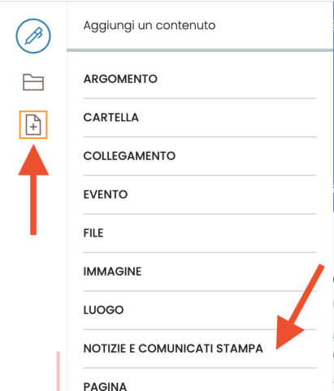

# Content-type “Notizie e comunicati stampa”

Si faccia rifermento qui [https://italia.github.io/design-comuni-pagine-statiche/sito/novita-dettaglio.html](https://italia.github.io/design-comuni-pagine-statiche/sito/novita-dettaglio.html)

Struttura delle informazioni relative a notizie (news), comunicati stampa e avvisi. Notizie e comunicati stampa si differenziano tra loro a seconda di quanto impostato nel campo “Tipologia”. Le tipologie di notizie sono:

- Notizia

- Comunicato stampa

- Avviso[^n9]

E’ un content-type gestito con i blocchi, nel senso che il contenuto informativo della news/comunicato può essere gestito con la modalità “Pagina a blocchi”. Questo permette di formattare più agevolmente il contenuto, inserendo oltre che il testo, anche altri blocchi (immagini, elenchi di altri contenuti correlati, ecc).

[^n9]: Le tipologie di notizie sono configurabili dal pannello di amministrazione all’indirizzo **https://\<sito>/controlpanel/design-plone-settings**

In questo caso, i campi del content-type saranno disponibili nella sidebar di destra.

|I campi sono i seguenti:||
|---|---|
|**Titolo**|Titolo della notizia / comunicato stampa /avviso|
|**Descrizione**|Descrizione breve della notizia. Verrà mostrata nella testata, subito dopo il titolo (max 255 caratteri).|
|**Tipologia notizia**  **[^n10]**|News / Comunicato (stampa) / Avviso, come datassonomia  ufficiale|
|**Numero progressivo del** **comunicato stampa**|Se si tratta di un comunicato stampa, è possibile indicarne un numero progressivo, che verrà mostrato nella testata del comunicato.|
|**A cura di**|link all'ufficio comunicazione responsabile del contenuto|
|**Immagine in testata**|Spazio per impostare un'immagine in evidenza[^n11]|
|**Immagine in anteprima** **(preview image)**|Serve per mostrare un'immagine diversa da quella del dettaglio nell'anteprima dell'oggetto negli elenchi.[^n12]|
|**Persone**|Link a schede persone dell'amministrazione citate nella news|
|**Luoghi correlati**|Link a schede luoghi del sito citati nella news|
|**Notizie correlate**|Notizie correlate alla notizia corrente (o comunicati o avvisi)|
|**Argomenti**|Argomenti (presenti sul sito) di interesse per questa notizia|
|**Correlato in evidenza**|Se impostato, verrà mostrata una fascia dedicata al correlato in evidenza, dopo la fascia dei contenuti correlati|
|**Data di pubblicazione**|Indica la data di pubblicazione della news|
|**Data di scadenza**|Indica un'eventuale data di scadenza dell'avviso pubblicato. Se impostata, dopo quella data la notizia non sarà più visibile.|
|**Contenuti correlati**|Altri contenuti correlati presenti sul sito|

[^n10]: Le tipologie di notizia possono essere personalizzate dagli amministratori del sito nell’apposita sezione **https://\<sito>/controlpanel/design-plone-settings**

[^n11]: Si vedano le note sulla dimensione ottimale dell’immagine in testata

[^n12]: Se sono compilati entrambi i campi, l'immagine del campo 'immagine in testata' verrà mostrata nel dettaglio, mentre l'immagine 'immagine di anteprima' verrà mostrata negli elenchi.

    - se è compilato solamente il campo 'immagine in testata' verrà utilizzata quell'immagine anche per l'anteprima dell'elemento negli elenchi.
    - se è compilato solamente il campo 'immagine di anteprima' nel dettaglio non verrà mostrata nessuna immagine, e negli elenchi verrà usata l'immagine del campo 'immagine di anteprima'.

|Multimedia|Cartella presente all’interno della notizia. I contenuti inseriti in questa cartella permettono di creare una galleria di immagini e/o video nel corpo della notizia.|
|---|---|
|**Documenti allegati**  |Cartella presente all’interno della notizia. I contenuti inseriti in questa cartella permettono di creare la sezione ‘Allegati’ nella notizia con i link ai file allegati.|

Dalla modalità di visualizzazione ‘Folder content’ della notizia è possibile accedere a due cartelle:

- **‘Multimedia’** : se all’interno di questa cartella vengono inserite delle immagini, queste verranno mostrate nella sezione dedicata ‘Galleria di immagini’ che verrà mostrata dopo il corpo della news. In questa cartella è possibile inserire anche dei link a video youtube che verranno mostrati subito dopo la galleria di immagini (se presente).
- **‘Documenti allegati’** : se in questa cartella vengono inseriti degli elementi, questi verranno mostrati nella notizia nella sezione dedicata ‘Allegati’.

:::{warning}
**Attenzione!** Non si devono modificare i nomi di queste cartelle.
:::
