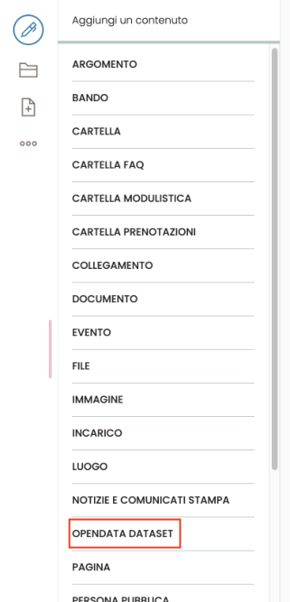

# Content-type “Open-data”

Questo tipo di contenuto permette l’inserimento all’interno del sito di tutti quei dati pubblici ed [aperti, con possibilità di caricamento automatico sul catalogo https://www.dati.gov.it/](https://www.dati.gov.it/)

Oltre al titolo del dato aperto, sono obbligatori i seguenti campi:

|Data di ultima modifica|Inserire l’ultima data di aggiornamento del file|
|---|---|
|**Temi**|Tassonomia precompilata per classificare|

||l’open data, è possibile selezionare più voci|
|---|---|
|**Titolare**|Selezionare tramite object browser l’unità organizzativa responsabile per l’open data|
|**Frequenza di aggiornamento**|Indicare selezionando a tendina la frequenza di aggiornamento del dato|
|**Licenza** |Selezionare a tendina la tipologia di licenza di utilizzo del file|

Nel pannello di controllo, nella sezione “configurazione prodotti aggiuntivi”, e disponibile il pannello admin per configurare il file xml da condividere con il portale ufficiale gestito da AgID:

In questo pannello si potranno quindi configurare tutte le informazioni base per pubblicare automaticamente gli opendata del Comune, l’url da inserire nel portale AgID sarà: https:/\<tuo_sito>.it/opendata-catalog/@@download/rdf.xml

È disponibile un validatore ufficiale AgID: [https://validatore.dati.gov.it/dcat-ap_validator.html](https://validatore.dati.gov.it/dcat-ap_validator.html)

NB: questo tipo di contenuto non è rilasciato di default nelle installazioni SaaS io-Comune, per richiederne l’attivazione contatta il tuo referente.
