# Content-type “Pagina”

Una pagina rappresenta il contenuto informativo di base del sistema, ed ha le stesse regole di workflow di tutti gli altri tipi di contenuto. Può essere utilizzato per creare contenuti foglia, ma anche per creare le pagine di disambiguazione delle varie sezioni e sottosezioni.

Tipicamente le pagine vengono utilizzate per creare contenuti “trasversali” al sito, o per creare delle pagine di disambiguazione.

Oltre ai classici campi titolo e descrizione, nella pagina sono presenti anche i campi per configurare la testata nel caso in cui si voglia costruire una pagina di disambiguazione.

I campi per la gestione della testata sono i seguenti:

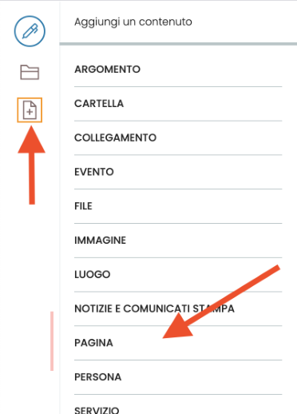

|Immagine per la testata|Se impostata, verrà mostrata l’immagine appena prima del testo inserito nel campo ‘Informazioni aggiuntive per la testata’. Questo campo non è la leadimage, quindi non viene usato come immagine di anteprima della pagina negli elenchi, ma solamente per mostrare un’immagine nella testata.|
|---|---|
|**Immagine in anteprima (preview image)**|Serve per mostrare un'immagine diversa da quella del dettaglio nell'anteprima dell'oggetto|

||negli elenchi.[^n1]|
|---|---|
|**Informazioni aggiuntive per la testata**|Testo libero in cui è possibile inserire informazioni aggiuntive per quella pagina/sezione. Verrà mostrato nella parte di destra della testata|
|**Ricerca in testata**|Se attivato, mostrerà un campo di ricerca nella testata che consentirà all’utente di effettuare una ricerca di contenuti all’interno di quella sezione|
|**Mostra la navigazione**|Se attivato, verranno mostrati i link ai contenuti figli di primo livello della pagina/sezione.|
|**Mostra la data di modifica**|Mostra in fondo alla pagina, la data di ultima modifica della pagina[^n2]|
|**Mostra i bottoni per la condivisione sui social**|Se attivato, abilita i pulsanti di condivisione|
|**Argomenti**<br>|Possibilità di inserire i riferimenti adArgomenti|

La caratteristica principale dell'oggetto pagina è che può essere costruita in modalità “blocchi”: ogni blocco concettualmente può essere visto come un paragrafo (\<p>) di pagina, all'interno del quale è possibile inserire del testo semplice, formattato, a blocchi più complessi, come blocco immagine, blocco RSS, blocchi elenco, ecc.

Vedremo successivamente in rassegna tutti i blocchi disponibili, ed il loro utilizzo.

## Come creare una nuova pagina all’interno di un percorso

Supponiamo di essere in una determinata pagina X, e vogliamo inserirne una pagina (Y) per creare il percorso X -> Y

Da autenticati, posizionandoci su una pagina (es. **Amministrazione -> Uffici** ), ne abbiamo l’anteprima ( **http:/\<sito>/amministrazione/uffici/** )

[^n1]: Se sono compilati entrambi i campi, l'immagine del campo 'immagine in testata' verrà mostrata nel dettaglio, mentre l'immagine 'immagine di anteprima' verrà mostrata negli elenchi.

    - se è compilato solamente il campo 'immagine in testata' verrà utilizzata quell'immagine anche per l'anteprima dell'elemento negli elenchi.
    - se è compilato solamente il campo 'immagine di anteprima' nel dettaglio non verrà mostrata nessuna immagine, e negli elenchi verrà usata l'immagine del campo 'immagine di anteprima'.

[^n2]: La data di ultima modifica è impostabile di default su tutti i tipi di contenuto abilitati ad averla (come ad esempio le pagine) settando l’apposito flag nella sezione **https://\<sito>/controlpanel/design-plone-settings**

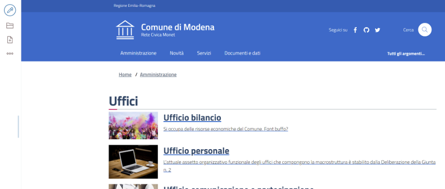

Nella barra di sinistra è presente il pulsante  per inserire la nuova pagina _Test_ (ricordiamo che tutti gli oggetti inseriti hanno di default lo stato “privato”). Se si procede ad inserire la nuova pagina avremo creato il nuovo percorso

**Amministrazione -> Uffici -> Test**

## Pagine di disambiguazione di secondo livello

Le pagine di disambiguazione di secondo livello vengono gestite attraverso il content-type “Pagina”

Quando si crea una pagina, nella sidebar di destra sono disponibili alcuni campi che servono per costruire la testata della pagina. Questi campi sono molto utili soprattutto per costruire le pagine di disambiguazione.

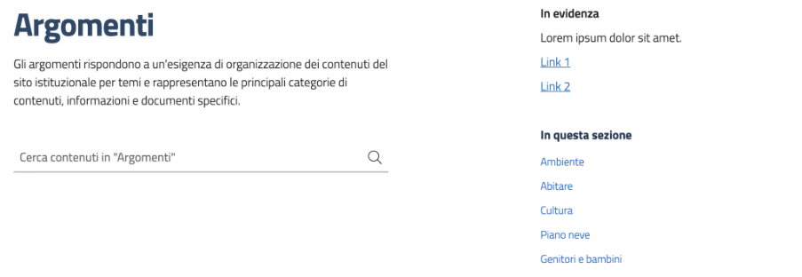

I campi sopracitati, si trovano nella sezione ‘TESTATA’: analizziamoli uno per uno:

- **Informazioni aggiuntive per la testata** : se compilato (utilizzando il rich-text editor che ne consente la formattazione e la creazione di link interni), il testo inserito in questo campo verrà mostrato nella colonna di destra. Per esempio, nell’immagine di esempio presente in alto, il testo inserito è

- Ricerca in testata: se spuntato, verrà mostrata la barra di ricerca subito dopo il titolo e la descrizione della pagina, la quale consente di cercare dei contenuti al di sotto di quella sezione. ( **barra di ricerca** )
- Mostra la navigazione: se spuntato, verrà mostrata sulla colonna di destra la navigazione delle sottosezioni di primo livello della pagina corrente (box “ **In questa sezione** ”)

## Editing di un oggetto a blocchi

I tipi di contenuto che si costruiscono “nativamente” con i blocchi sono:

- Pagina
- Argomento
- Cartella Modulistica
- Sottosito

Questo significa, visivamente, che sulla parte sinistra si presenta l’editor a blocchi, e nella parte destra la sidebar con i campi accessori. Gli oggetti di sistema che **non** si costruiscono attraverso i blocchi, visualmente hanno una disposizione differente dei campi disponibili, rispetto a Pagina, Argomento, Cartella modulistica e Sottosito: se prendiamo ad esempio il “Luogo”, che non è un content-type a blocchi, la sua form di editing è di questo tipo:

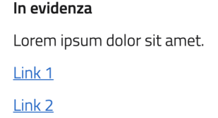

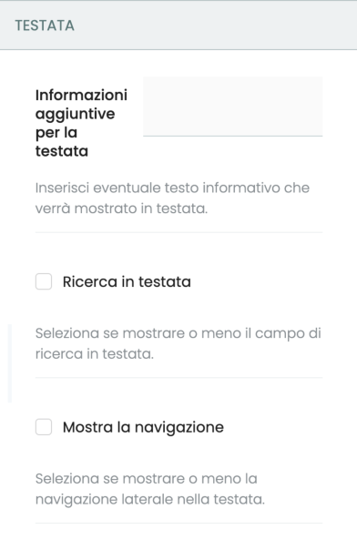

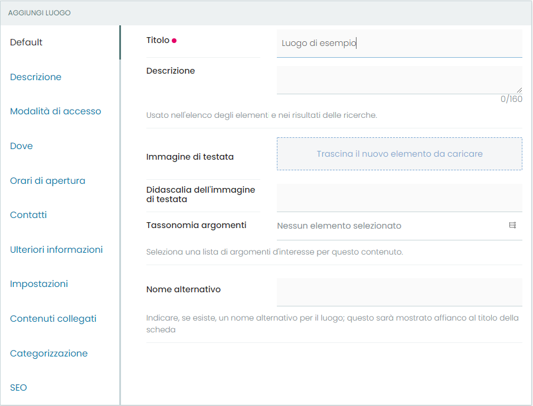

Possiamo notare quindi come nella parte centrale della form siano presenti tutti i campi, organizzati in Tab, necessari all'inserimento dei contenuti e delle diverse proprietà.

Nel caso invece di una pagina a blocchi, la form sarà la seguente:

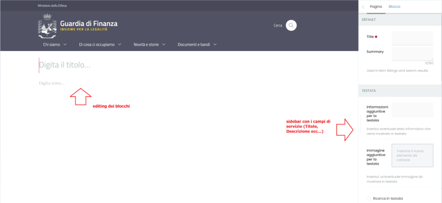

Possiamo notare quindi come nella parte sinistra della pagina siano presenti i blocchi per l'editing dei contenuti della pagina stessa, e nella parte destra è presente una sidebar che racchiude i campi principali quali titolo, descrizione, elementi correlati, data di pubblicazione ecc. I campi sono aggregati logicamente in “sezioni” NB: il titolo che compare nella parte sinistra è lo stesso titolo che viene scritto nella parte destra della toolbar, corrispondente appunto al campo “titolo”.

La sidebar può essere espansa a finestra intera, per una gestione più comoda, utilizzando l’apposito pulsante:

Tuttavia, anche nei content-type che non sono nativamente a blocchi è possibile gestire la maggior parte dei campi attraverso un editor a blocchi: ad esempio, per il content-type “Unità Organizzativa”

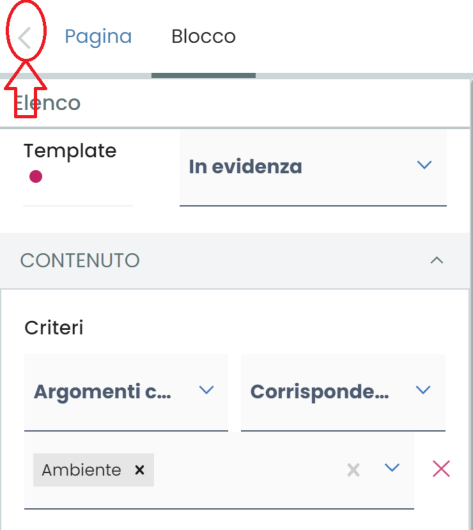

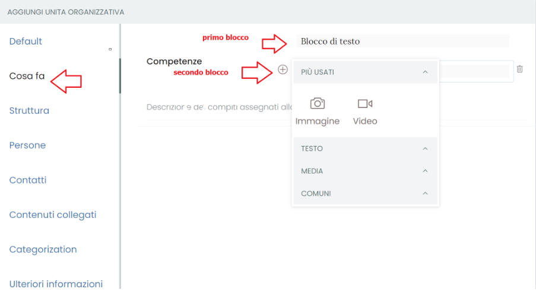

In questo caso, il campo “Competenze” all’interno della tab “Cosa fa” è un campo editabile con i blocchi, come se si trattasse di una pagina. I blocchi disponibili però, in questo caso, saranno meno rispetto a quelli disponibili per un blocco di una Pagina (questo per evitare che la vista di quel contenuto possa risultare sbilanciato, nel caso per esempio si inserissero dei blocchi elenco molto lunghi). Tipicamente è possibile inserire blocchi di testo di diversi formati, immagini, video, tabelle, RSS, campi HTML ecc..)

## Composizione a blocchi

Per aggiungere un nuovo blocco, andare in “Modifica” su una Pagina preesistente (bottone con la matita), oppure aggiungendo una nuova Pagina.

Premere sul **(+)** di fianco all’ultimo blocco, che di default è un blocco di testo vuoto.

Per aggiungere blocchi, in fondo al testo o in mezzo ad altri già impostati, selezionare un blocco presente e premere “Invio”, verrà creato un blocco vuoto sotto a quello selezionato.

**SUGGERIMENTO: se posizionandosi sull’ultimo blocco di una pagina non dovesse** **essere possibile inserire un nuovo blocco sottostante, posizionarsi in edit sul “titolo”,** **premere invio per creare un nuovo blocco, e trascinarlo nella posizione desiderata.**

L’idea è di trattare i blocchi di testo come i paragrafi di un documento, e di utilizzare altri blocchi per formattazioni particolari.

Per eliminare un blocco, non serve altro che cliccare sul cestino presente alla sua destra, una volta selezionato (facendo click al suo interno).

Oltre ad eliminarlo, è possibile ordinarlo tra i blocchi presenti trascinandolo attraverso l’icona alla

sua sinistra  .

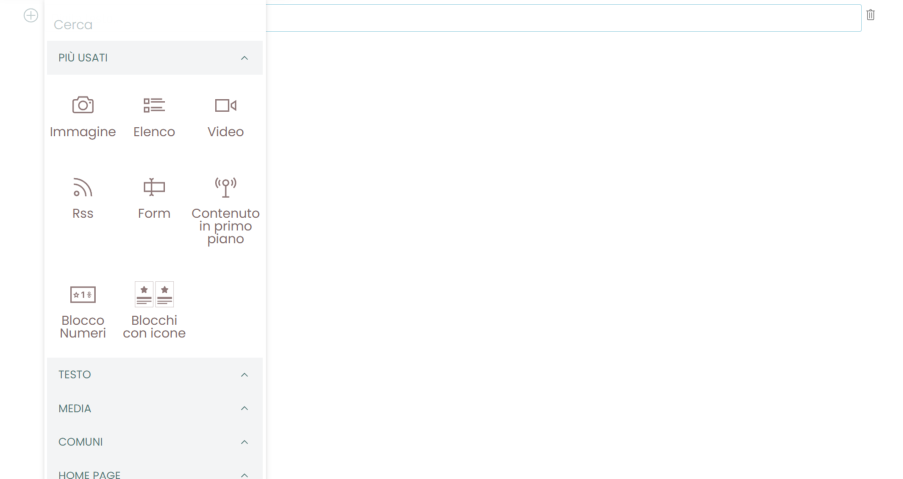

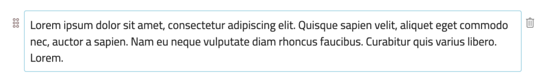

### Blocco Testo

Utilizzando un blocco di testo (ma è applicabile anche al testo di una Notizia o di un Evento), se si seleziona una porzione di testo (o tutto il testo nel blocco) compariranno i bottoni per la

Analizziamo nel dettaglio i vari bottoni di formattazione:

- Il pulsante 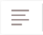 consente di selezionare l’allineamento del testo: a sinistra, a destra, centrato, giustificato.

- Vi sono poi i classici pulsanti di formattazione in stile ‘Word’ per:

  - testo in grassetto 

  - testo in italico 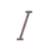

  - testo sottolineato 

  - testo barrato 

- Il pulsante 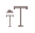 consente di aumentare la dimensione di un testo selezionato

- Il pulsante  permette di applicare uno stile per le intestazioni. Ci sono 5 tipi di intestazioni, con una dimensione del testo dalla più grande alla più piccola.

- Il pulsante 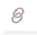 consente di creare un collegamento ad altre pagine interne o esterne al sito, oppure di inserire un indirizzo email.[^n3]

- Il pulsante  trasforma tutti i link in bottoni. Ovvero: se nel testo sono presenti dei link, questi appariranno con lo stile di un bottone.

- Vi sono poi tutti i classici pulsanti di formattazione in stile ‘Word’ per:

  - testo al pedice 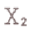

  - testo all’apice 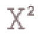

  - punto elenco 

  - elenco numerato 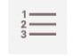

  - citazione e/o sfondo per mettere in evidenza una porzione di testo 

[^n3]: Nel caso di costruzione di un link ad una risorsa scaricabile (ad esempio un file) per il quale si vuole ottenere il download diretto, è sufficiente inserire nel link questo particolare costrutto: https://\<sito>/nomefile.pdf **/@@download/file.** Nel caso si voglia aprire un file utilizzando il plugin integrato nel browser (es. per i pdf), è sufficiente inserire il link nel formato https://\<sito>/nomefile.pdf **/@@display-file/file**

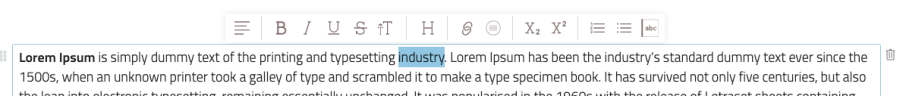

Una menzione particolare per il pulsante “collegamento”: nel campo di testo che appare, si può inserire un link ad un indirizzo esterno al sito, oppure un indirizzo email. Cliccando sull’icona di destra, invece sarà possibile navigare l’alberatura del sito e selezionare una risorsa presente sul sito stesso. Per creare una nuova riga di testo (a capo) all’interno dello stesso blocco, è necessario premere CTRL+Invio.

#### Gestione dei data-element sui link

Il pulsante per la costruzione dei link mostra due campi:

- Il primo per l’immissione del link (interno o esterno)
- Il secondo per l’attribuzione del “data-element” al link

Un **data-element** è un particolare valore che viene attribuito, a livello HTML, al link costruito. E’ impostabile soltanto da un set di valori predefinito. Il data-element serve al validatore automatico di AgID per le verifiche PNRR, quindi deve essere utilizzato soltanto in quell’ambito. Un caso classico è l’attribuzione del data-element ai link presenti nel footer, per i quali AgID deve verificare la presenza al fine della validazione per la conformità PNRR. L’attribuzione dei data-element sarà possibile anche in altre parti dell’applicativo (come ad esempio nella configurazione dei blocchi elenco e nella configurazione del footer)

Il manuale di gestione dei data-element è consultabile a {doc}`questo indirizzo </manuale-io-comune/data-element-pnrr>`

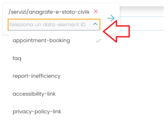

### Blocco Immagine

Consente di inserire un'immagine, prelevandola o da filesystem (2) oppure da un'immagine precaricata a sistema (1)

_NB: se si sta creando una pagina e si vuole inserire un blocco immagine attraverso il pulsante (2), dal_ _momento tale immagine viene caricata sul sistema (e la pagina non è ancora stata salvata), il sistema_ _stesso cerca di salvare la risorsa immagine nella prima posizione disponibile (ovvero, non sarà dentro la_ _pagina stessa, ma ad un livello dell’alberatura immediatamente superiore). Questo potrebbe “sporcare”_ _l’alberatura: si consiglia quindi di salvare sempre preventivamente l’oggetto (anche soltanto con il_ _“titolo”), poi rientrare in modifica e completare la composizione del blocco immagine._

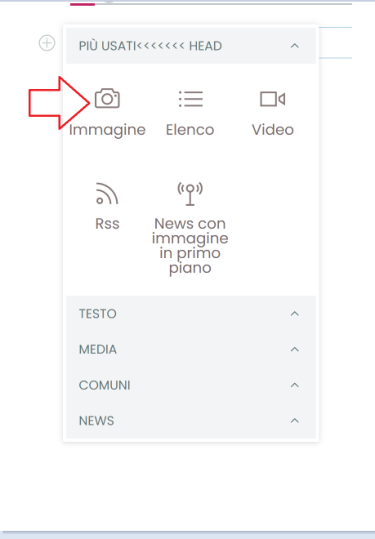

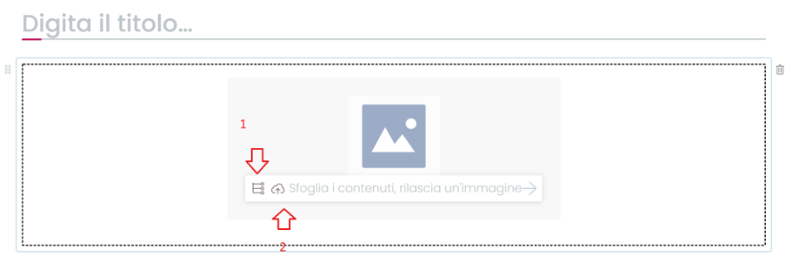

## Dimensioni immagini per blocchi elenco e template

Per le varie tipologie di blocchi elenco e template sono indicate delle dimensioni consigliate. Le trovi nelle singole sezioni del manuale e riassunte nella pagina {doc}`Dimensioni consigliate delle immagini </manuale-io-comune/dimensioni-immagini>`.

## Blocco Elenco

Con questo tipo di blocco, è possibile visualizzare un elenco di oggetti presenti sul sito, definendo i criteri di ricerca degli elementi da visualizzare.

Agli elementi ottenuti dalla ricerca, si possono applicare diverse visualizzazioni ( **Variazioni** ).

Per creare un Blocco Elenco selezionare il tipo di blocco ‘Blocco Elenco’ dal menu di aggiunta di un nuovo blocco.

Di default, verrà mostrato nel blocco il contenuto dell’oggetto in cui ci troviamo in questo momento, con una visualizzazione (template) di default.

E’ possibile, dalla sidebar di destra, impostare i criteri di ricerca degli elementi da visualizzare nel blocco, e altre funzionalità che ora analizzeremo nel dettaglio:

- **Variazione** : serve per cambiare la visualizzazione dei risultati nel blocco

**-** **** **ID Ligthouse:** serve per impostare il valore del data-element che viene assegnato ad ogni link sulla card risultato del blocco

- **Aspetto** : per visualizzare le card in maniera compatta

- **Titolo** : il titolo da attribuire al blocco

**-** **** **Opzioni del blocco** : consentono di agire a livello di card, per modificarne l’aspetto

  - Sfondo del blocco

  - Icona

  - Sezione di appartenenza

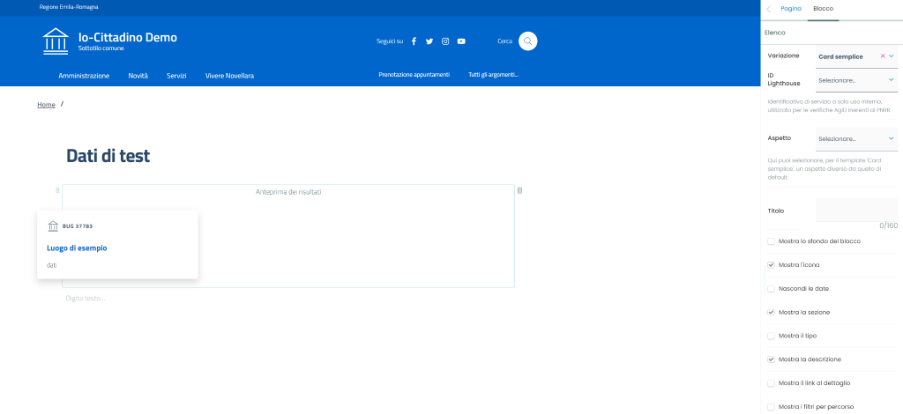

- Tipo di oggetto recuperato (content-type)

- Descrizione dell’oggetto (il campo descrizione impostato su ogni oggetto)

- Link al dettaglio (ulteriore link “vedi” in fondo alla card)

- Filtri per il percorso

- **Contenuto** : qui è possibile impostare uno o più criteri di ricerca degli elementi da visualizzare nel blocco. Ad esempio, se volessimo visualizzare le ultime 10 notizie, imposteremo i seguenti criteri:

- _**Criterio**_ : Tipo di contenuto | Corrispondente a | Notizia

- _**Profondità di ricerca**_ (nel caso di criterio “Posizione”, consente di specificare la profondità di ricerca -> cartelle e sottocartelle a partire dalla posizione in cui si trova la pagina in cui si costruisce il blocco)

    -

- _**Ordina per**_ : data di creazione

- _**Ordine inverso**_ : SI

- _**Numero massimo di risultati**_ : 8

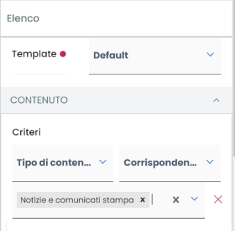

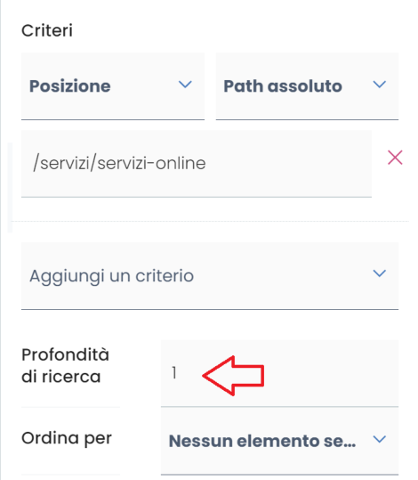

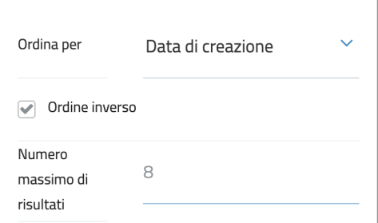

Applicando il template ‘Default’ avremo le ultime 8 notizie, di cui la prima corrisponderà all’ultima che è stata pubblicata, e il risultato sarà il seguente:

In questo caso, se diciamo di applicare soltanto 3 risultati per pagina, il sistema colleziona più di 3 notizie, il blocco si presenterà con lo strumento di paginazione che permette di scorrere le diverse pagine

**NB:** per ordinare gli oggetti secondo la data di pubblicazione, utilizzare nel campo “Ordina per” il valore **“Data effettiva” (è un modo alternativo per indicare la data** **di pubblicazione)** **NB2:** Se si desidera ordinare oggetti di tipo **“Evento”** per data di inizio dell’evento, è possibile scegliere due diversi valori per il campo “Ordina per”

- **Data di inizio evento:** se si tratta di un evento ricorrente, questa data viene calcolata dinamicamente ad ogni occorrenza.

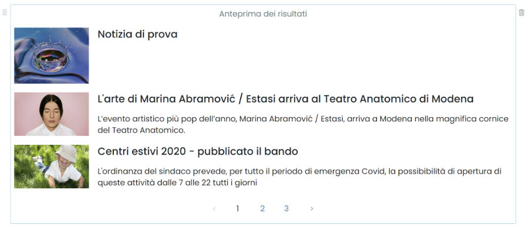

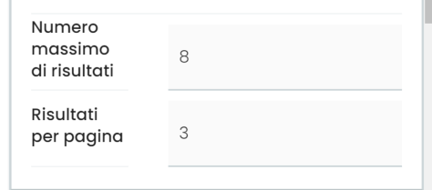

**-** **** **Data effettiva di inizio evento:** fa riferimento alla data di inizio assoluta dell’evento, ovvero la data della prima occorrenza per gli eventi ricorrenti, o la data di inizio generica per gli altri tipi di eventi.

Es.: Evento che si ripete settimanalmente di lunedì da lunedì 01/01/2024 a lunedì 04/03/2024. Data odierna: Lunedì 5 febbraio 2024. Blocco elenco che impostato per far vedere le date dopo:

    - Data di inizio evento: mostra le occorrenze dal 12 febbraio in poi

    - Data di inizio evento effettiva: mostra le occorrenze dal 1° gennaio in poi

- **Link ad altro** : Definisce un link per accedere ad una sezione in cui saranno presenti più contenuti (Link ad altro)

- In questo caso cliccando sul pulsante evidenziato con la freccia, verrà aperto un menù contestuale che permette di navigare all'interno del sito per cercare la risorsa da linkare. In questo caso le risorse disponibili saranno evidenziate con un colore nero (1), mentre le risorse che servono soltanto per scorrere l'alberatura del sito verranno presentate con un colore più chiaro (grigio). Attraverso il pulsante con la lente (2) sarà possibile digitare il nome della risorsa in modo tale che il sistema automaticamente filtri tutti i contenuti che corrispondono a quel criterio di ricerca testuale

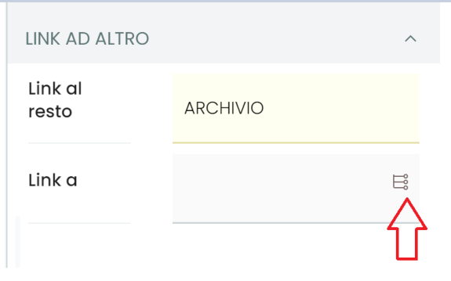

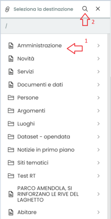

- Tale link è mostrato sotto forma di pulsante

### ID di controllo LightHouse per verifiche PNRR

Nei blocchi elenco è possibile la presenza di un particolare campo a scelta singola, che serve ad attribuire un particolare ID ai link delle card.

L’impostazione di tale valore non ha impatti sulla visualizzazione del blocco, è puramente un campo di servizio necessario ai controlli di AgID per le verifiche inerenti al bando PNRR “ _Avviso_ _Misura 1.4.1 "Esperienza del Cittadino nei servizi pubblici_ ”.

### Filtri supplementari per i blocchi elenco

Nel template del blocco elenco che si chiama 'Card semplice', è stata aggiunta un'opzione per permettere di aggiungere filtri ulteriori applicabili dall'utente.

- In un blocco elenco, impostare i criteri di ricerca per selezionare i contenuti da mostrare in questo blocco.
- Spuntare successivamente l'opzione ' **mostra filtri per percorso** ',
- configurare fino a 5 bottoni di filtro che l'utente potrà utilizzare per filtrare ulteriormente gli elementi mostrati nel blocco “per percorso”, ovvero soltanto nel percorso dell’albero di navigazione configurato per ogni bottone.
- per ogni bottone indicare:
  - l'etichetta che verrà mostrata sul bottone
  - il percorso che verrà usato come filtro aggiuntivo ai criteri base del blocco

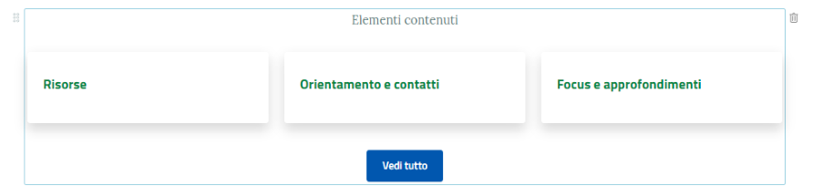

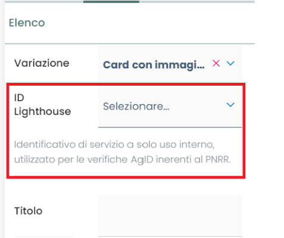

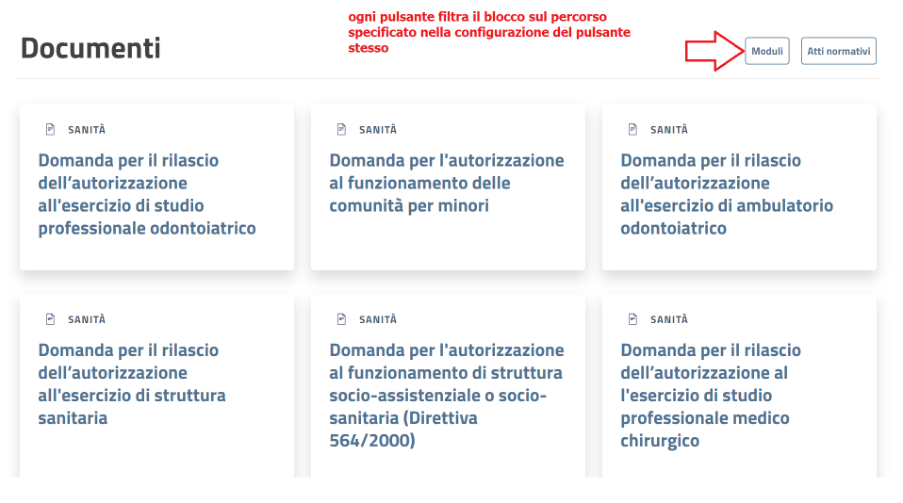

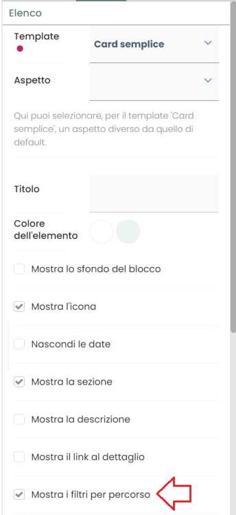

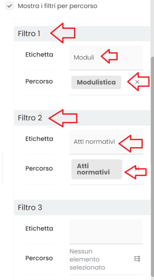

### Variazioni (Template) per il blocco elenco

Nel “blocco elenco” è possibile impostare diversi template di visualizzazione, ovvero il layout che avrà ogni oggetto recuperato nel blocco elenco dal criterio di selezione. Il template del blocco viene impostato nell’apposito campo

In questo esempio, impostiamo il template “ **Photogallery** ” che, se applicato ad una lista di immagini

permetterà di creare un carousel di immagini

**NB:** di default, la creazione di un blocco elenco all’interno di una pagina, non appena lo si inserisce, mostra di default l’elenco degli oggetti (qualunque essi siano) contenuti in quella pagina (ricordiamo che ogni pagina è essa stessa un contenitore “folderish”). Quindi, ad esempio, se una

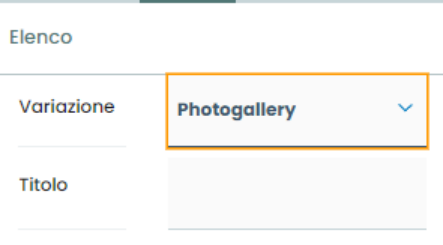

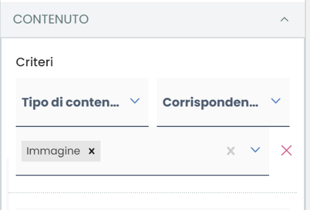


pagina contiene delle immagini e si crea nella pagina un blocco elenco, esso mostrerà immediatamente l’elenco delle immagini. Dal momento che il template di default del blocco elenco, quando lo si crea, è “Card semplice”, questo mostrerà delle card con il nome degli oggetti. Se si tratta di immagini, l’esigenza è quella di fare una gallery di immagini: se si impostasse soltanto il template “Photogallery” al blocco, si può notare come l’anteprima dell’immagine non verrà mostrata. In questo caso (e solo nel caso di un blocco “Photogallery” per mostrare la galleria immagini) è necessario nel blocco impostare anche il criterio posizione (percorso) in cui si trovano le immagini e il criterio “tipo di contenuto = immagine”

Le altre variazioni disponibili, oltre alla sopradescritta “Photogallery”, consentono di visualizzare il risultato del blocco con layout differenti (si consiglia di testare ogni variante)

#### Nota importante per la visualizzazione delle immagini nelle card

Per alcuni tipi di contenuti è possibile inserire un'immagine predefinita: qualora fosse necessario mostrare delle immagini in un blocco elenco è necessario apportare alcune considerazioni. Quando viene creato per la prima volta un **blocco elenco**, il sistema mostrerà automaticamente le card degli oggetti che si trovano all'interno del contenitore in cui si sta creando il blocco elenco. Nel caso in cui fosse necessario visualizzare anche le immagini associate a ciascuna card è necessario impostare almeno un criterio, perché questo fa sì che il sistema riesca ad ottenere le informazioni sulle immagini da mostrare.

Quindi, nella creazione del blocco elenco sarà necessario per esempio dare come tipo di contenuto il tipo che si vuole mostrare (es. _Tipo di contenuto=Persona_ ), e per esempio la posizione uguale al path relativo (es. _Posizione=Path relativo_ ) In questo modo il blocco non recupererà tutti i tipi che se vogliono mostrare, e che sono presenti in tutto il sistema, ma soltanto quelli che si trovano all'interno del contenitore in cui ci si trova. In sostanza

_●_ _Posizione = Path relativo_ _●_ _Profondità di ricerca = 1_

Questo criterio sta dicendo al blocco: “ _Recupera tutti gli elementi che stanno al mio interno, soltanto al_ _primo livello, senza cioè mostrare ulteriori contenuti dentro ai vari oggetti_ ”

E’ tipicamente il criterio che si imposta per i blocchi di navigazione nelle pagine di disambiguazione

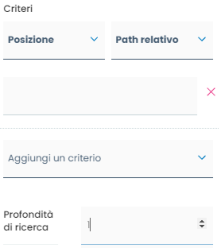

#### Variazione “Bandi”

Una volta scelto il template bandi, occorre impostare i criteri sulle date per avere i bandi necessari in ogni blocco.

- Se filtriamo per “Scadenza termini partecipazione” e impostiamo come criterio “da domani”, avremo tutti i **bandi attivi** nel momento in cui si guarda la pagina.
- Se filtriamo per “Chiusura procedimento bando” e impostiamo come criterio “prima di oggi”, avremo tutti i **bandi scaduti** nel momento in cui si guarda la pagina.
- Se filtriamo per “Chiusura procedimento bando” e impostiamo come criterio “da domani” e filtriamo anche per “Scadenza termini di partecipazione” con criterio “prima di oggi”, avremo i **bandi in corso** .

Questo il template:

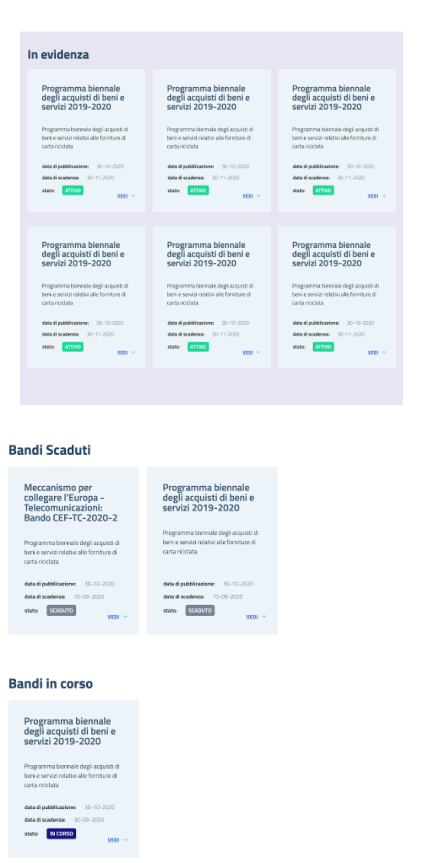

#### Variazione ‘Card con immagine’

Questo template mostra gli elementi sottoforma di ‘card’ con l’immagine sui primi tre elementi (se l’elemento ha una immagine). Dalle opzioni della sidebar è possibile decidere se mostrarla per tutti gli elementi. Nella sidebar, sono disponibili altre opzioni per gli elementi da mostrare o meno nel blocco.

**Dimensione delle immagini:** In questo template l’immagine che viene mostrata ha una proporzione di 1:0,30. Quindi si consiglia di caricare immagini di almeno 700x210px.

E’ inoltre possibile scegliere l’opzione ‘non alterare le dimensioni naturali dell’immagine’. In questo caso, vengono mantenute le proporzioni dell’immagine originale. Rimane comunque valida la dimensione minima di almeno 700px di larghezza. Tutti gli altri parametri del blocco sono definiti nelle opzioni del blocco stesso, e sono autoesplicativi.

#### Variazione ‘Mappa’

Questo template permette di mostrare sulla mappa oggetti che sono geolocalizzati, come ad esempio Luoghi, Eventi e Unità Organizzative. Tali oggetti naturalmente devono prima essere impostati nel criterio di ricerca del blocco elenco.

Una volta selezionato il template ‘Mappa’, è possibile scegliere:

- Se mostrare la mappa a tutta larghezza

- La dimensione (altezza) della mappa (piccola, media, grande)

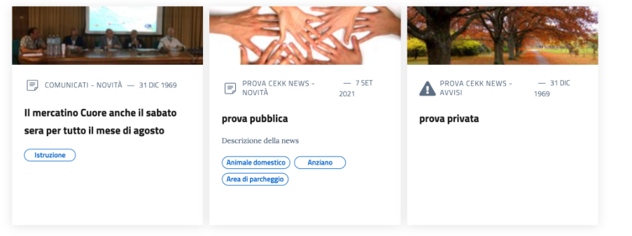

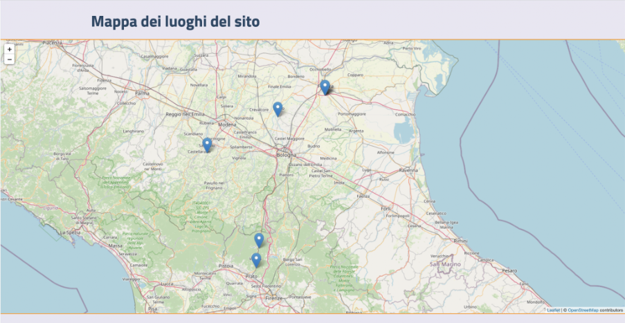

#### Variazione ‘Slider’

Consente di mostrare i contenuti risultanti, sotto forma di slider di immagini, mostrandolo con il layout come in figura

Dalla sidebar laterale è possibile scegliere quante slide mostrare (su mobile ne verrà sempre mostrata una alla volta).

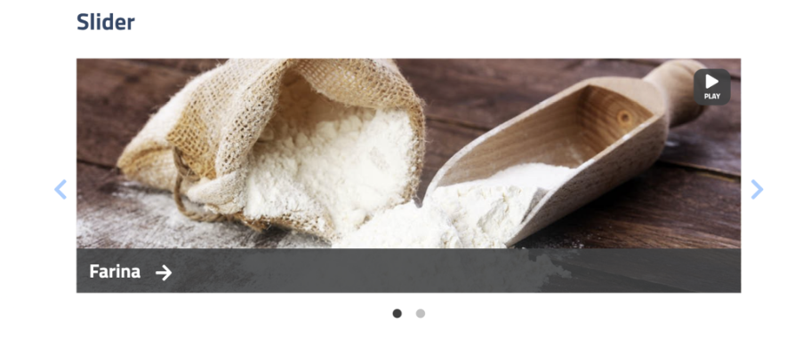

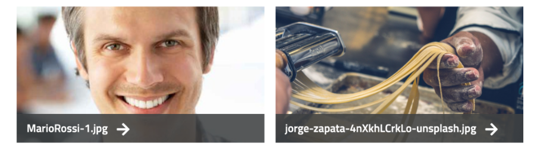

Dimensioni delle immagini:

- Una slide: le proporzioni sono di 1:0,36 e le dimensioni minime consigliate sono di 1080x400px
- Due slide: le proporzioni sono di 1:0,50 e le dimensioni minime consigliate sono di 600x300px.

#### Template ‘In evidenza’

Utilizzato nei blocchi elenco (ad esempio, per le news), mostrerà un blocco in formato 1-2-3, per i primi 6 elementi, come in figura

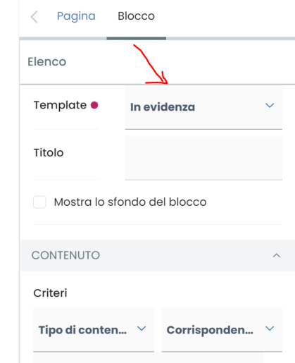

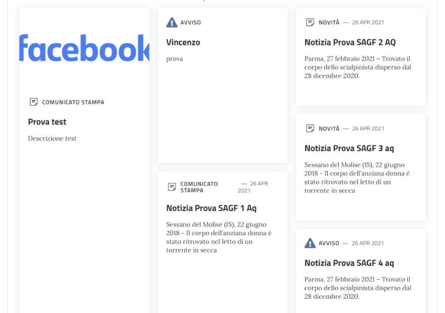

Dimensione delle immagini: L’immagine viene mostrata solo per il primo elemento. Le proporzioni consigliate sono di 1:0,62 e le dimensioni minime sono di 700x434px. Quindi anche un’immagine di 1000x620px va bene.

### Template ‘Contenuto in evidenza’

Ha la stessa funzione del blocco ‘Contenuto in evidenza’ ma con la differenza di caricare dinamicamente il contenuto rispettando i criteri di ricerca impostati.

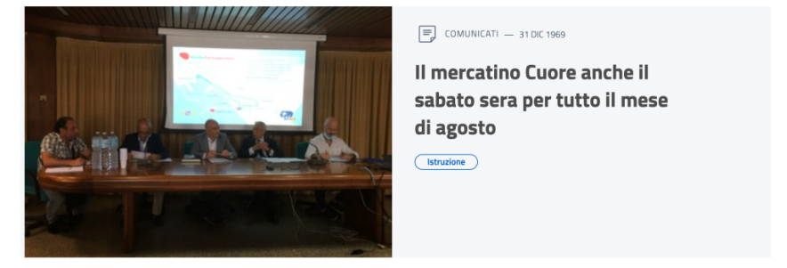

**Dimensione dell’immagine:** Vengono mantenute le proporzioni naturali dell’immagine. La dimensione consigliata è di almeno 700px di larghezza.

### Template ‘Quadratoni con immagine’

Utilizzato nei blocchi elenco (ad esempio, per le news), mostrerà un blocco in formato da una griglia a quadrati (4 colonne), come in figura

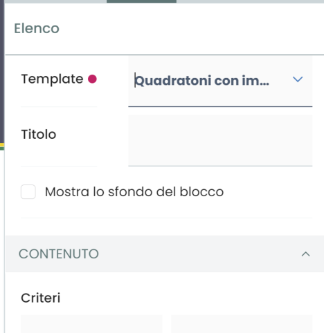

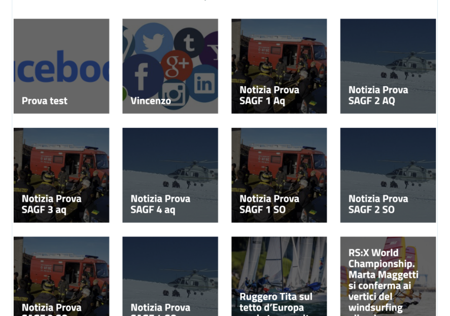

**Dimensioni delle immagini** : Su desktop e su tablet vengono mostrate in formato ‘quadrato’ mentre su mobile vengono impilate e ogni elemento ha un formato rettangolare. Ci sono due strade:

- Caricare l’immagine quadrata per una ottimale visualizzazione su desktop. La dimensione consigliata è di almeno 400px400 px. In questo caso su mobile verrà mostrata solamente la parte centrale dell’immagine e verranno ritagliate le parti sopra e sotto dell’immagine che eccedono lo spazio a disposizone.
- Caricare l’immagine per una visualizzazione ottimale su mobile. La dimensione consigliata è di almeno 500x195 px, ovvero un’immagine con proporzioni 1:0,39. In questo caso, su desktop verranno ritagliate le parti eccedenti lo spazio quadrato centrale.

### Template ‘Card con testo animato’

Mostra i contenuti in questa forma. Posizionando il cursore su un elemento, appare l’eventuale descrizione del contenuto e il link al dettaglio.

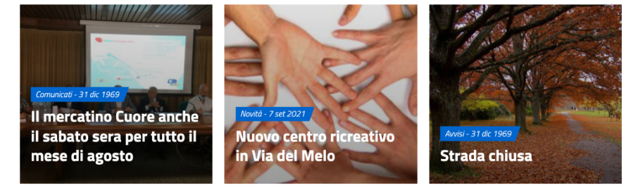

**Dimensioni delle immagini:** L’immagine deve avere proporzioni 1:1 e deve essere di almeno 400x400px. Se viene caricata un’immagine con proporzioni differenti le parti eccedenti verranno ritagliate.

## Template ‘Photogallery’

Consente di creare una galleria di immagini. L’immagine mostrata è quella del singolo elemento risultante dalla ricerca corrispondente ai criteri impostati.

**Dimensione delle immagini:** La dimensione consigliata per le immagini è di almeno 400px di larghezza con una proporzione di 1:0,83. Quindi un’immagine di almeno 400x332px.

## Blocco Video

Consente di caricare un video il cui sorgente è URL (ad esempio preso da YouTube)

[Ad esempio (http://youtube.com/watch?v=uX-zufH5yLY)](http://youtube.com/watch?v=uX-zufH5yLY)

**NB: in seguito alla modifica delle politiche GDPR in materia di privacy, l’utilizzo del blocco** **“Video” è sconsigliato, in quanto recupera direttamente da fonti esterne (server di** **Youtube/Vimeo) alcune informazioni, il che comporta una profilazione dell’utente: si consiglia** **di utilizzare questo blocco unitamente alla specifica di un’immagine in anteprima**

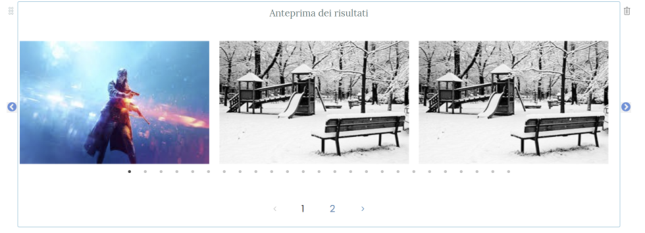


## Blocco “Video gallery”

Consente di inserire un blocco di video, presi da youtube/vimeo


- **“Titolo”:** rappresenta il titolo del blocco
- **“Titolo del canale”:** rappresenta il nome del canale esposto sotto al titolo blocco
- **“Link al canale”:** è il link che viene aperto cliccando sul “Titolo del canale”
- **“Titolo”:** è una label che consente di descrivere il video inserito - non viene visualizzato
- **“Video URL”:** il link al video di Youtube/Vimeo

E’ quindi possibile aggiungere un qualsivoglia numero di video, specificando la URL ed il titolo. Se il numero di video è superiore a 3, allora verrà creato uno slider a scorrimento. **NB: in seguito alla modifica delle politiche GDPR in materia di privacy, l’utilizzo del blocco** **“Video gallery” è sconsigliato, in quanto recupera direttamente da fonti esterne (server di** **Youtube/Vimeo) alcune informazioni, il che comporta una profilazione dell’utente.**

## Blocco Contatti (‘Vuoi parlare con noi’)

Si aggiunge attraverso il seguente blocco


E’ un editor di sottoblocchi; per il blocco generale si imposta:

- Titolo
- Testo e per ciascun sottoblocco si imposta

- Titolo
- Testo

- Numero di telefono
- email

## Blocco “Card semplice”

Consente di inserire un blocco stile “card” con un titolo e del testo. SI ottiene un layout di questo tipo:


## Blocco “Testo in riquadro immagine”

Consente di inserire un blocco stile “card” con un titolo e del testo e un'immagine posizionata a sinistra. SI ottiene un layout di questo tipo:

L’immagine può essere selezionata da file-system nella barra delle proprietà del blocco nella parte destra. Per adempiere alle linee guida per l’accessibilità, è necessario impostare un testo alternativo per gli utenti che utilizzano lo Screen Reader. È possibile impostare il testo alternativo per l'immagine compilando il campo apposito:


**Dimensione dell’immagine** : Viene mostrata la parte centrale dell’immagine. Le parti che eccedono lo spazio in verticale vengono tagliate. Dalla sidebar, è possibile scegliere se mantenere o meno le proporzioni naturali dall’immagine. La dimensione consigliata è di almeno 600px di larghezza.

## Blocco “Contenuto in primo piano”

Consente di selezionare un contenuto da mostrare come contenuto in primo piano. Il contenuto da mostrare, dovrà essere ricercato all'interno del Piano editoriale utilizzando l'apposito menù che consente di scorrere all'interno dell’alberatura, oppure di ricercare direttamente attraverso il nome del contenuto. A tale notizia verrà dato un particolare layout come quello in figura

Dopo avere selezionato il contenuto, sarà possibile decidere se:

- Mantenere le proporzioni originali dell’immagine per evitare che venga ritagliata per adattarsi allo spazio disponibile.

- Decidere se mostrare il tipo e / o la sezione prima del titolo

- Decidere se mostrare o meno un colore di sfondo fra quelli principali del sito

- Decidere se mostrare o meno il link di approfondimento


- Decidere se mostrare o meno la data del contenuto

**Dimensioni dell’immagine** : Nel caso in cui la non venga scelta l’opzione ‘ _non alterare le dimensioni naturali dell’immagine_ ’, verrà mostrata la porzione centrale dell’immagine del contenuto. Verranno rimosse le porzioni di immagine sopra e sotto che sbordano dal contenitore. Le dimensioni consigliate per l’immagine sono indicate qui. Poi dipende sempre dalla scelta che si fa nel blocco per la dimensione dell’immagine.


## Blocco RSS

Consente di creare un blocco a partire da una fonte RSS

Ad esempio se prendiamo come fonte RSS il seguente URL [(https://allertameteo.regione.emilia-romagna.it/compila-allerta-portlet/feed?feed=allerte-bollettini](https://allertameteo.regione.emilia-romagna.it/compila-allerta-portlet/feed?feed=allerte-bollettini) ), definiamo il numero di elementi da mostrare e il tipo di template grafico da utilizzare otterremo questo risultato:


## Blocco “Ricerca nelle sezioni”

Consente di creare un blocco di ricerca rapido che può agire a livello di particolari sezioni presenti all'interno del sistema **(3)** . Ad esempio le sezioni possono essere: Amministrazione, Documenti e dati, Novità (News e comunicati stampa), Servizi. Le sezioni di ricerca si possono impostare nel pannello di controllo 'Impostazioni Design Plone' alla voce 'sezioni ricerca'

C'è Inoltre la possibilità di impostare alcuni link rapidi per andare direttamente a particolari aree del sito **(4)**


## Blocco “Argomenti in evidenza”

Questo blocco può essere configurato in Homepage, o in un qualsiasi content-type che preveda la gestione a blocchi.


Viene proposto un blocco configurabile, nel quale si possono definire quanti si vogliano blocchi interni, ciascuno riferito ad un “argomento”

Per ciascun blocco che si inserisce, nella sidebar laterale è possibile andare a selezionare l’argomento che si vuole mostrare, scorrendo nell’alberatura del sito fino a recuperare l’oggetto argomento desiderato

Il campo “ **Titolo** ” imposta il titolo dell’intero blocco (es. “Argomenti in evidenza”) Il campo “ **Seleziona gli altri argomenti** ” permette di aggiungere nella parte in basso i collegamenti veloci ad altri argomenti di interesse (visualizzate in modalità “chips”)


Il pulsante “ **Aggiungi blocco** ” consente di creare i collegamenti ad altri argomenti, nella stessa modalità. Di default, il blocco viene popolato con “ **Titolo** ” e “ **Descrizione** ”, ma può essere arricchito con altro testo, digitando nell’apposito campo del blocco “Digita testo”

Il link “ **Esplora argomento** ” viene inserito automaticamente, così come il pulsante “ **Vedi tutti** ”, che permette di accedere alla pagina di disambiguazione “Tutti gli argomenti”


## Blocco Alert

Il blocco alert consente di creare una fascia ad alto contrasto, per mettere in evidenza particolari informazioni.

La fascia può essere connotata con un colore (giallo, rosso, arancione) All’interno della fascia, si può inserire del testo formattabile (bold, link, bottoni, elenchi puntati ecc) E’ possibile inserire anche una immagine a sinistra del testo


## Blocco “Interruzione di pagina”

Nel caso in cui sia necessario inserire una “interruzione di pagina”, è possibile utilizzare questo blocco.

Può essere usato, ad esempio, se si vuole mettere un’immagine allineata a sinistra facendo in modo che il testo non venga disposto attorno all’immagine. In questo caso bisognerà quindi:

- Creare un blocco immagine e caricare/scegliere l’immagine
- Impostare l’allineamento dell’immagine a destra (o sinistra) dalla barra laterale di destra delle impostazioni del blocco
- Creare un nuovo blocco di tipo ‘Interruzione di pagina’, dopo il blocco immagine.


## Blocco “Indice dei contenuti”

Qualora in una pagina sia presente testo formattato con intestazioni \<h1>, \<h2> ecc.., sblocco consente di creare immediatamente l'indice di tali contenuti. Ogni voce dell'indice sarà un link cliccabile che con un sistema ad ancore posiziona automaticamente nel punto del testo cliccato

### Creazione di ancore nel testo

In un blocco di testo è possibile inserire “ancore” ad altre parti della pagina: l’ancora si costruisce inserendo su un testo un link che riporti alla fine l’id dell’ancora, come ad esempio:

https://\<sito>/pagina **#id_ancora**

In questo caso l’ID dell’ancora deve essere ricavato attraverso l’inspector della pagina (strumento del browser). Il personale RedTurtle è a disposizione per supportare in questa attività.


## Blocco “Hero” con bottoni per il download dagli store

Consente di inserire un blocco particolare formato da un'immagine a sinistra e del testo sulla destra ed eventualmente i bottoni per il download dagli store.

Immagini deve essere uploadata dalla filesystem, e nella parte destra compilare titolo e descrizione


**Dimensioni dell’immagine** : La dimensione consigliata per l’immagine è di almeno 600px di larghezza. Il comportamento dell’immagine varia a seconda della lunghezza del testo presente nella parte di destra.

Dalla sidebar, è possibile anche scegliere se mostrare o meno lo sfondo del blocco, e se mostrare i link per il download dagli store (AppStore e PlayStore). Se vengono indicati i link per il download, verranno mostrati i rispettivi bottoni dopo la descrizione.


## Blocco “Mappa”

**ATTENZIONE: Il blocco verrà momentaneamente disattivato a causa della violazione delle** **normative GDPR in fatto di profilazione. Si consiglia di rimuovere tale blocco nei contenuti dove** **è stato utilizzato.**

Consente di inserire una mappa (ad esempio Google) attraverso codice di incorporamento. Sulla mappa di Google è sufficiente posizionarsi sulla mappa che si desidera, cliccare sul pulsante di condivisione e copiare il codice di incorporamento come da figura


## Blocco “HTML”

Consente di incorporare codice html


NB: Prestare sempre particolare attenzione alla accessibilità del codice HTML che viene incorporato. Ad esempio, se si inserisce un elemento iframe, ricordarsi di aggiungere l’attributo “title” con un titolo parlante per il contenuto che si va ad inserire. Per tale blocco, è possibile definire anche lo sfondo (eventualmente espandendolo a tutta larghezza), lo sfondo avrà il colore terziario del sito:


## Blocco “Tabella”

Consente di inserire una tabella dati

Questo blocco utilizza un proprio plugin per agire in maniera rapida a livello di righe e colonne, Possibile agire su alcune delle caratteristiche della tabella stesso in termini di layout


## Blocco “Calendario”

Consente di visualizzare un calendario, il contenuto visualizzato è personalizzabile dalla vista di modifica del blocco. Il componente recupererà in automatico tutti gli elementi raggruppati per giorno mostrandoli come da immagine qui sotto:

Il blocco in modifica si presenta come un template di listing ed è possibile quindi personalizzare completamente i dati che si vogliono mostrare.

Modificando la voce “Massimo numero di risultati” si decide il numero di eventi da mostrare nel calendario.


## Blocco “Accordion”

Consiste in un blocco che permette di inserire titoli di sezione “ad espansione“ (collassabili), all’interno dei quali è possibile inserire del testo

Il numero di blocchi espandibili è illimitato: l’aggiunta di un nuovo blocco si ottiene attraverso il pulsante “Aggiungi elemento”

Il testo all’interno di ciascun blocco è formattabile

Nella sidebar di destra, nelle caratteristiche del blocco accordion, è possibile inserire un eventuali link ad altre risorse


## Blocco “Form”

E’ un blocco che consente di creare un form di campi compilabili, con un numero di campi a piacimento di diverso tipo (testo, area di testo, scelta singola, scelta multipla ecc.)

Il blocco si aggiunge in una pagina a blocchi attraverso

Per ogni campo è possibile definirne o meno l’obbligatorietà, attraverso l’apposita checkbox. Inoltre, ogni campo è rappresentato da:

- **Etichetta:** label descrittiva del campo
- **Descrizione:** testo che descrive cosa rappresenta il campo
- **Tipo di campo:** rappresenta la tipologia del campo inserito, è possibile definire:
  - **Testo:** campo testuale singola riga
  - **Area di testo:** campo testuale a righe multiple
  - **Lista:** consente di inserire una lista di valori, che verranno proposti in una lista a discesa (se il valore descritto non è presente, è possibile crearlo cliccando su

  - “Create XXX”


  - **Scelta singola:** consente di creare un radiobutton a scelta singola
  - **Scelta multipla:** consente di creare una checkbox a scelta multipla
  - **Data:** consente di creare un campo data con calendario
  - **Allegato:** consente la selezione di un allegato da inviare
  - **Testo statico:** consente di definire un semplice campo di testo formattabile

- **Univoco:** questa spunta permette di definire l’univocità di quel campo, impedendo così agli utenti di inserire lo stesso valore per più invii del form nello stesso campo. (es. Impedire di mandare lo stesso form più volte per la stessa email)


Al blocco form, è possibile associare due comportamenti, non esclusivi tra loro (queste impostazioni sono presenti nel pannello di configurazione del blocco stesso, cliccando sul blocco) :

- Invio di una email a uno o più destinatari **(1)[^n4]**

- Salvataggio dei dati inseriti in un file csv **(2)** - in questo caso, compariranno i pulsanti per l’esportazione dei dati salvati fino a quel momento **(3)**, oppure la cancellazione dei dati salvati fino a quel momento attraverso quella form **(4)[^n5]**

[^n4]: Il campo “ **Mittente di default** ” può essere scritto ad esempio nel formato “ _No Reply - Comune di_ _io-comune \<sito_no_reply@io-comune.redturtle.it>_

[^n5]: Nel caso la form presenti un campo allegato, l’allegato stesso verrà **solo** inviato via mail, ma non viene salvato nel csv, nè altrove


È possibile impostare un limite di invii del form selezionando il checkbox “Imposta un limite iscrizioni” e inserendo il limite nella casella di testo che appare attivando questa impostazione:

Se questo limite è impostato, una volta raggiunto il limite massimo impostato per l’invio del form, gli invii successivi ritorneranno un messaggio per avvisare l’utente che i dati sono stati inviati correttamente, ma che è stato inserito in lista d’attesa.


Questa informazione viene riportata anche nelle mail al destinatario del form o nel file di estrazione dei dati sotto il parametro “Waiting list: Yes”:


## Blocco “Ricerca Eventi”

Consente di inserire in una qualsiasi pagina a blocchi un blocco per la ricerca eventi

Tale blocco, naturalmente, agirà automaticamente soltanto su oggetti di tipo “Evento” Il blocco deve essere configurato per stabilire i filtri di ricerca (fino a 3 possibili), che sono:

- Testo (cercherà una stringa all’interno del titolo evento)
- Luogo (cercherà tutti gli eventi a cui è stato attribuito un determinato luogo)
- Date (cercherà tutti gli eventi che cadono all’interno del range di date impostato)
  - Possibilità di visualizzare automaticamente i risultati della data odierna


E’ consigliabile non ripetere lo stesso filtro più volte, sebbene sia possibile

La lista dei luoghi possibili verrà alimentata automaticamente in base agli oggetti Luogo presenti sul portale e collegati ai CT evento presenti nel percorso impostato.

Questo ad esempio è il blocco nel caso siano stati impostati tutti e tre i filtri

L’opzione “Di default, mostra i risultati” consente di mostrare da subito il risultato della ricerca (in questo caso, la lista degli eventi), senza necessariamente dover impostare alcun valore nei filtri.

L’opzione “Mostra l’immagine per tutti gli elementi” permette, come nel blocco elenco, di impostare se l’immagine di anteprima deve essere mostrata nelle card di tutti i risultati o solo nelle prime 3.

## Blocco “Ricerca Bandi”

Consente di inserire in una qualsiasi pagina a blocchi un blocco per la ricerca dei bandi.


Tale blocco, naturalmente, agirà automaticamente soltanto su oggetti di tipo “Bando” Il blocco deve essere configurato per stabilire i filtri di ricerca (fino a 3 possibili), che sono:

- Testo (cercherà una stringa all’interno del bando)
- Tipologia (cercherà tutti i bandi a cui è stata attribuita una determinata tipologia)
- Ente (cercherà tutti i bandi di un determinato ente)
- Ufficio responsabile (cercherà tutti i bandi il cui ufficio responsabile è quello indicato)
- Categoria (cercherà tutti i bandi di una determinata categoria)
- Data di scadenza del bando (cercherà tutti i bandi che scadono all’interno del range di date impostato)

E’ possibile ordinare il risultato della ricerca per uno dei criteri disponibili.


E’ consigliabile non ripetere lo stesso filtro più volte, sebbene sia possibile.

La lista degli uffici responsabili e degli enti possibili verrà alimentata automaticamente in base agli oggetti Bando presenti sul portale.

Questo ad esempio è il blocco nel caso siano stati impostati tutti e tre i filtri

## Blocco “Icone”

Consente di creare una fascia composta da un titolo e una descrizione principali (opzionali), un numero infinito di blocchi disposti su 4 colonne, un link ad altro (bottone in basso), un’immagine di sfondo.


Per crearlo, selezionare ‘Blocco icone’ dalla sezione dei blocchi 'Più usati’ oppure dalla sezione ‘Testo’:


Per ogni blocco è possibile definire:

- Icona

- Titolo

- Descrizione

- Testo per il link ad altro

- Link ad altro (può essere un link interno o esterno al sito)

Dalla sidebar laterale è possibile scegliere quindi:

- L’immagine di sfondo del blocco, che verrà opacizzata con il colore principale del sito. **Dimensione dell’immagine:** **** La dimensione dell’immagine di sfondo varia a seconda del numero di card che vengono inserite e alla lunghezza del testo all’interno di ogni card. La dimensione minima consigliata per una buona resa è di almeno 1920px di larghezza.

- Il link ad altro e il testo per il link ad altro, che se presenti verranno mostrati dopo i blocchi delle icone

- Per ogni blocco, sarà possibile scegliere l’icona e il link ad altro. Il titolo e la descrizione del blocco icona sono editabili direttamente sul blocco stesso nella parte di destra.


Blocco “Numeri”

Consente di creare una fascia per mettere in evidenza dei numeri. E’ possibile definire un numero illimitato di “numeri”, nell’esempio qui sopra ne sono stati definiti solamente due. Il primo spazio a sinistra è dedicato al titolo del blocco ed è possibile anche inserire fino a 3 icone prima del titolo.

Per crearlo, selezionare “Blocco numeri” dalla sezione dei blocchi "Più usati” oppure dalla sezione dei blocchi “Testo”:

Nel blocco è possibile definire:

- L’immagine di sfondo da utilizzare. Verrà sempre opacizzata per permettere una corretta lettura del testo in sovrapposizione. E’ possibile selezionare l’immagine dalla sidebar a lato. **Dimensione dell’immagine:** **** La dimensione dell’immagine di sfondo varia a seconda del numero di card che vengono inserite e alla lunghezza del testo all’interno di ogni card. La dimensione minima consigliata per una buona resa è di almeno 1920px di larghezza.


- Fino a 3 icone da mostrare prima del titolo. E’ possibile scegliere le icone dalla sidebar a lato.

- Il titolo del blocco, che verrà mostrato nel primo spazio a sinistra (nell’esempio sopra il titolo del blocco è “I numeri di IO-Comune”).

- Numero illimitato di blocchi con numero, per ognuno dei quali è possibile indicare un titolo (numero) e una descrizione


Quando si è in modifica del blocco, è possibile aggiungere un nuovo “blocco numero” cliccando su “Aggiungi un elemento”. E’ possibile modificare l’ordine dei “blocchi numero” tenendo premuto il primo pulsante azzurro a sinistra e trascinandolo nella posizione desiderata.

## Blocco “CTA” (Call to Action)

Consente di creare una fascia per una Call To Action. E’ possibile definire:
- Titolo
- Descrizione
- Link ad un contenuto (bottone in basso)
- Destinazione
- Testo nel bottone
- Se aprire il link in una nuova scheda
- Immagine di sfondo o lo sfondo tinta unita

Per crearlo, selezionare ‘Blocco CTA’ dalla sezione dei blocchi ‘Comuni’.

Se non si seleziona un’immagine o si deseleziona l’opzione “Mostra l’immagine”, verrà usato come sfondo il colore secondario del sito:


**Dimensione dell’immagine di sfondo** : E’ consigliato caricare un’immagine di sfondo di almeno 1920px di larghezza. A seconda della larghezza del blocco, l’immagine di sfondo si comporta diversamente:

- _Blocco a tutta larghezza_ : le dimensioni consigliate sono di almeno 1920x500px. Meglio se l’immagine è un po’ più alta, l’eccedenza verrà eventualmente ritagliata. Le proporzioni consigliate sono quindi **1:0,27** _●_ _Blocco a larghezza del contenuto:_ La dimensione del blocco varia a seconda del testo inserito nella cta. Le dimensioni consigliate sono di almeno 1200px di larghezza.

## Blocco "Numeri"

Consente di creare una fascia con numeri. E’ possibile definire:

- Icone
- Titolo
- Numeri con descrizione
- Immagine di sfondo

Per crearlo, selezionare ‘Blocco numeri’ dalla sezione dei blocchi ‘Testo’.


Se non si seleziona un’immagine, verrà usato come sfondo il colore secondario del sito:

**Dimensione dell’immagine di sfondo** : E’ consigliato caricare un’immagine di sfondo di almeno 1920px di larghezza. A seconda della larghezza del blocco, l’immagine di sfondo si comporta diversamente:

- _Blocco a tutta larghezza_ : le dimensioni consigliate sono di almeno 1920x500px. Meglio se l’immagine è un po’ più alta, l’eccedenza verrà eventualmente ritagliata. Le proporzioni consigliate sono quindi **1:0,27** _●_ _Blocco a larghezza del contenuto:_ La dimensione del blocco varia a seconda del testo inserito nella cta. Le dimensioni consigliate sono di almeno 1200px di larghezza.

## Blocco "Countdown"

Consente di creare un contatore alla rovescia (giorni-ore-minuti-secondi) riferiti ad una determinata data, per porre evidenza ad una particolare scadenza. E’ possibile definire:

- Immagine di sfondo per il blocco
- Titolo del blocco
- Posizione del contatore rispetto al titolo del blocco
- Ulteriore testo al di sotto del contatore


- Data di scadenza di riferimento (il contatore mostrerà il tempo che resta dal momento in cui si consulta il blocco alla data di scadenza stessa impostata - nel caso di evento passato verrà mostrata la dicitura “Scaduto il GG/MM/AAAA HH:MM”)
- Possibilità di nascondere il contatore di Ore, Minuti, Secondi, se non necessari. Il contatore dei giorni viene sempre mostrato

## Blocco "Callout"

**NB: questo blocco è presente soltanto nel caso in cui l’installazione sia stata aggiornata** **all’utilizzo del nuovo editor Slate.**

E’ possibile verificare se la propria installazione è aggiornata dall’indirizzo **https://\<sito>/release-log**

La versione che comprende questo aggiornamento deve essere almeno la 11.14.0 (21/06/2024)

Consente, in accordo con le indicazioni grafiche di AgID e le componenti del Design Kit di Bootstrap Italia, di creare blocchi di testo con le seguenti formattazioni grafiche:


**Opzioni del blocco:**

- Stile: base, in evidenza
- colore : selezionabile tra 5 colori differenti
- Icona: info, check, help, close

Esempi di blocco callout:

## Blocco "Cerca"


Permette di creare un blocco di ricerca customizzabile.

Fondamentalmente il blocco crea automaticamente i vari strumenti (ricerca per testo), nonchè un numero configurabili di ulteriori criteri, personalizzabili dal redattore.

Ad esempio, se su alcuni elementi sono state applicate delle categorie, si può aggiungere al blocco il criterio di ricerca per tali categorie: automaticamente il sistema propone il filtro contenente i valori di tutte le categorie. Ai risultati della ricerca possono essere applicate le stesse variazioni (layout) già viste nella sezione dei Blocchi Elenco (campo “template dei risultati”), potendo definire inoltre:

- Se mostrare un elemento per riga, oppure no
- Se mostrare la colonna con i criteri di ricerca nella parte destra o sinistra, rispetto ai risultati

Il blocco, nella sezione “RICERCA INIZIALE”, dà la possibilità di impostare un criterio generico in modo da filtrare eventualmente i contenuti che devono essere ricercati da quel blocco (il meccanismo dei criteri è analogo a quello già visto per i blocchi elenco).

Successivamente è possibile aggiungere ulteriori filtri


**Opzioni del filtro:**

- Titolo della sezione filtri
- Etichetta del filtro
- Campo su cui applicare la scelta
- Aspetto del widget di selezione (select, checkbox, Data Range, Toggle, Select con opzioni fisse, Checkbox con opzioni fisse)
- Scelta singola o multipla dei valori del campo del filtro
- Possibilità di nascondere il filtro

### Opzioni per il widget

Il filtro può essere configurato in diverse modalità:

- Select: imposta una tendina a discesa con determinati valori recuperati dal campo di scelta, con valori singoli o multipli a seconda dell’impostazione
- Checkbox: imposta una serie di checkbox con determinati valori recuperati dal campo di scelta, con valori singoli o multipli a seconda dell’impostazione
- Data Range: permette di impostare un date-picker (dal-al) che agisce sulla data su cui si è deciso di filtrare (chiaramente, affinchè il filtro funzioni, occorre che si agisca su un campo di tipo data, come ad esempio la data di creazione, o la data di pubblicazione (data effettiva) di un oggetto

- Toggle: abilita un selettore “on-off”, che può agire solo se il campo selezionato per la ricerca ha valori “Si/No”
- Select con Opzioni fisse: consente di selezionare, a seconda del campo con cui si è impostato il filtro, i valori da mostrare nella select (quindi, di filtrare tutti i possibili valori restituiti di default). Si veda l’esempio che segue
- Checkbox con Opzioni fisse: consente di selezionare, a seconda del campo con cui si è impostato il filtro, i valori da mostrare nella checkbox (quindi, di filtrare tutti i possibili valori restituiti di default). Si veda l’esempio che segue

### Ulteriori controlli per il blocco

- Mostrare o nascondere il campo di ricerca testuale (NB: i risultati vengono automaticamente filtrati man mano che si digitano le lettere)
- Mostrare esplicitamente il pulsante di ricerca (in questo caso la ricerca effettiva non avviene automaticamente, ma soltanto sulla effettiva pressione del pulsante)
- Mostrare o meno il numero totale dei risultati della ricerca


Racchiude tutti i parametri del blocco elenco, a seconda del tipo di variazione

Consente di inserire informazioni nella colonna laterale (sinistra o destra, a seconda dell’impostazione), accanto ai risultati della ricerca


## Blocco "Griglia"

Consente di inserire una griglia, fino a 4 colonne, in cui è poi possibile inserire ulteriori blocchi (immagine, elenco, blocchi di testo)

Può essere utile, per esempio, per creare delle strutture affiancate (ad esempio, 4 immagini allineate sulla stessa riga) Una volta definito il numero di colonne, si inserisce il blocco corrispondente per ogni colonna.


## Blocco "Comuni-chiamo"

```{include} /_snippets/funzionalita-aggiuntiva.md
```

Per usare questo blocco, l’Ente deve aver attivato il servizio di segnalazione con il fornitore [Comuni-chiamo](https://comuni-chiamo.com/).

Questo blocco permette di embeddare in una pagina del sito la funzionalità di [segnalazionedisservizi](https://docs.italia.it/italia/designers-italia/design-comuni-docs/it/versione-corrente/modello-sito-comunale/funzionalita.html#segnalazione-disservizio) prevista da AgID ed implementata da Comuni-chiamo.

E’ utilizzabile al pari di tutti gli altri blocchi di io-Comune, e prevede:

- Titolo del blocco
- API-KEY del widget (fornita da Comuni-chiamo all’Ente in fase di attivazione del servizio)
- Colore del widget (tra un preset di colori preimpostati)
- Eventuale colore personalizzato (codice esadecimale, ad esempio _#0066CC_ )


Una volta impostati i parametri, all’interno della pagina dov’è stato inserito il blocco comparirà il widget, sviluppato per espletare tutti gli step standard previsti per la gestione delle segnalazioni disservizi.

Dal punto di vista dell’utente finale, dopo l’autenticazione al servizio di segnalazioni

verrà proposto il wizard con tutti i passi che consentono al cittadino di fare la sua segnalazione.


A completamento della segnalazione, lo stato di avanzamento della stessa sarà consultabile [direttamente nel portale di Comuni-chiamo](https://app.comuni-chiamo.com/login) utilizzando le credenziali a disposizione.

## Copia/incolla di blocchi tra pagine differenti

E’ possibile copiare la configurazione a blocchi di una pagina, per replicarla velocemente su un’altra pagina a blocchi (NB: naturalmente funziona solo tra pagine a blocchi)

Se per esempio una pagina contiene diversi blocchi e si vogliono replicare tali e quali in un’altra pagina (evitando quindi di dover configurare a mano ogni singolo blocco), è possibile fare una operazione di copia/incolla rapida. E’ possibile copiare blocchi sparsi nella pagina: attenzione che se per esempio si selezionano prima il terzo blocco poi il primo, **esattamente in quest'ordine**, verranno incollati nella pagina rispettando tale ordine. I blocchi vengono sempre incollati in cima, a partire dal secondo blocco, nell’ordine stabilito al momento della copia.

Per utilizzare questa funzionalità occorre:

- Andare in edit della pagina
- Cliccare sul blocco tenendo premuto il tasto CTRL (il primo blocco di una pagina è sempre il blocco riservato al “Titolo”, e risulta potenzialmente selezionabile, ma se si incolla non sortisce effetto)

  - se ad esempio si clicca sul terzo e secondo blocco della pagina, verranno selezionati automaticamente il terzo e il secondo


- i blocchi appariranno evidenziati, e nella barra laterale compariranno nuovi bottoni che permettono di copiare, tagliare o eliminare i blocchi

- A questo punto, andare in edit sulla pagina di destinazione, comparirà un pulsante nella barra laterale degli strumenti per incollare i blocchi

- Premendo il pulsante di incolla, i blocchi verranno copiati dal secondo blocco in poi, rispettando l’ordine di selezione fatto precedentemente


