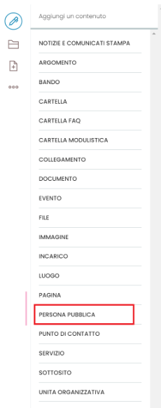
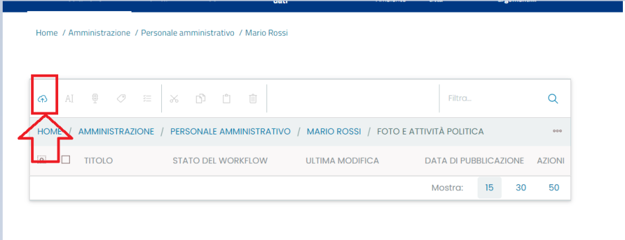
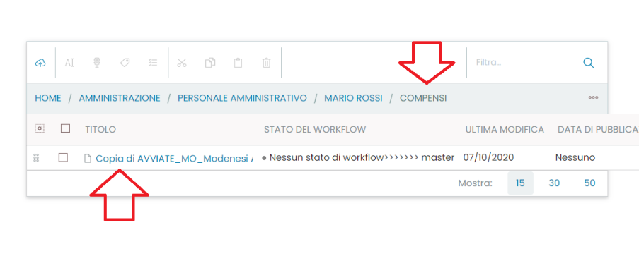
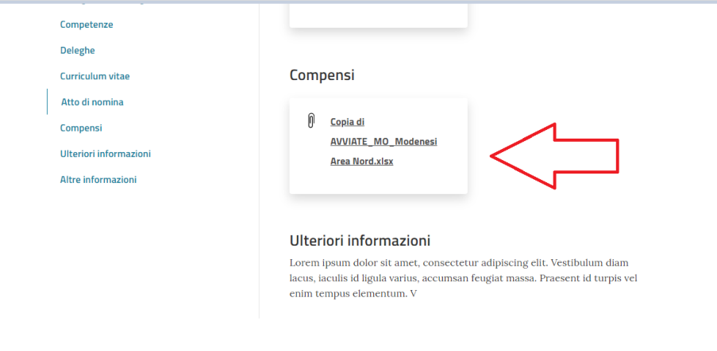

# Content-type “Persona pubblica”

Struttura delle informazioni relative alle persone di un'organizzazione, funzionale alla creazione di una scheda persona (content type "persona").

E’ un content-type raccomandato da AgID: contiene i riferimenti del personale amministrativo e politico che fa parte dell’organigramma dell’ente

|I campi della persona sono i seguenti:||
|---|---|
|**Nome e cognome**|Nome e cognome della persona|
|**Descrizione**|Breve descrizione della persona. Verrà mostrata nella testata e nell’anteprima della persona.|
|**Foto**|Inserire una fotografia che ritrae il soggetto descritto nella scheda|
|**Incarico**|Collegamento all’incarico della persona (Es. Consigliere con delega all’innovazione, Presidente del Consiglio Comunale, direttore sistemi informativi). L’incarico si attribuisce previa preventiva creazione.|
|**Organizzazione di riferimento**|Organizzazione di cui fa parte (es. Consiglio Comunale; es. Sistemi informativi) -> link alla struttura|
|**Competenze**|Se Persona Politica, descrizione testuale del ruolo, comprensiva delle deleghe OPPURE se Persona Amministrativa, descrizione dei compiti di cui si occupa la persona|
|**Deleghe**|Elenco delle deleghe a capo della persona|
|**Biografia**|Solo per Persona Politica: testo descrittivo che riporta la biografia della persona|

|Punto di contatto|Relazione con i punti di contatto della persona|
|---|---|
|**Curriculum Vitae**|Allegato per il Curriculum vitae[^n13]|
|**Atto di nomina**|Inserire atto di nomina della persona|
|**Ulteriori informazioni**|Ulteriori informazioni relative alla persona|
|**Foto attività politica**  |Solo per Persona Politica: gallery dell'attività politica e istituzionale della persona. Le foto sono corredate da didascalia. Per inserire foto, entrare in modalità di visualizzazione folder_content della persona e aggiungerle nella cartella dedicata.|

Alla creazione di una Persona, vengono automaticamente create le seguenti pagine:

- Foto e attività politica
- Curriculum vitae
- Compensi
- Importi di viaggio e/o servizi
- Situazione patrimoniale
- Dichiarazione dei redditi
- Spese elettorali
- Variazione situazione patrimoniale
- Altre cariche
- Incarichi: questo campo conterrà tutti i CT Incarico riguardanti quella persona. L’incarico corrente poi viene collegato all’interno della persona.[^n14]

I file inseriti in queste cartelle (attraverso la modalità di visualizzazione folder contents) verranno mostrati nella sezione ‘Documenti’ della persona.

Dal momento che gli allegati per ognuna di queste sezioni possono essere diversi nel corso del tempo, e potrebbero essere aggiunti in momenti diversi, è potenzialmente utile usare lo strumento di caricamento massivo dei file dalla vista folder_contents, ad esempio:

[^n13]: Per gli ulteriori curriculum eventualmente da inserire, viene creato un apposito contenitore all’interno della persona “Curriculum vitae”, in cui caricare i file.

[^n14]: NB: in caso di collegamento di più incarichi, verrà sempre e solo mostrato il primo

Ogni upload in queste cartelle, popola nel dettaglio della persona l’apposita sezione

:::{warning}
**Attenzione!** Non si devono modificare i nomi delle cartelle all’interno della persona.
:::

