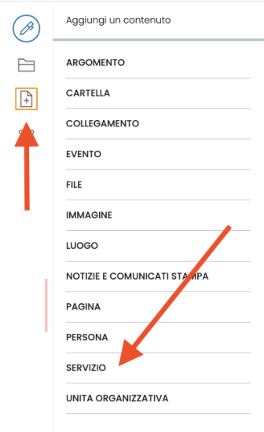
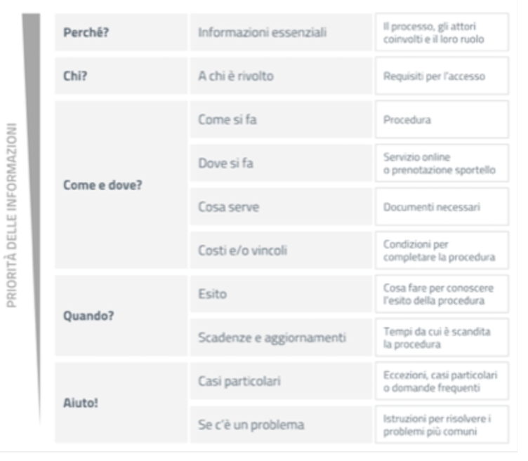
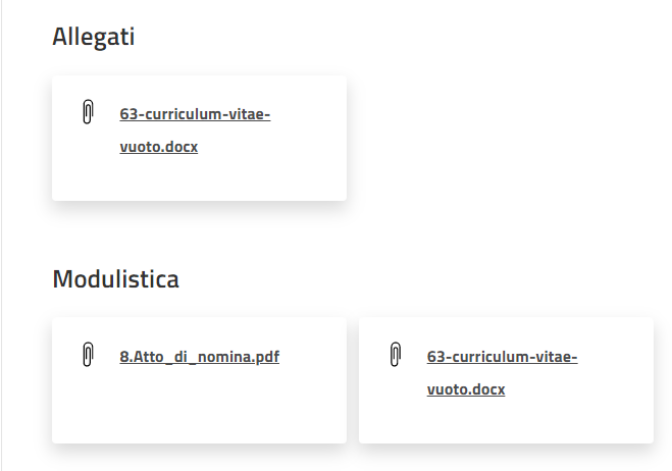
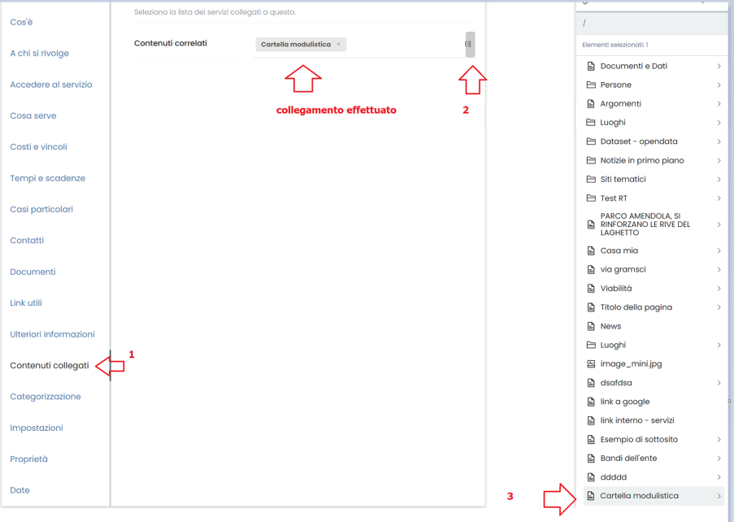
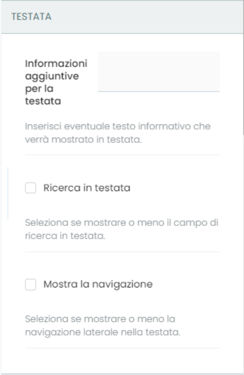
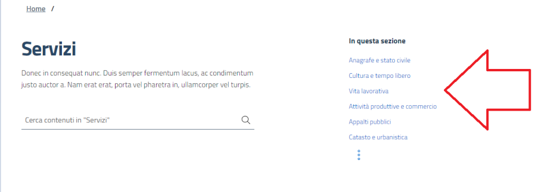

# Content-type “Servizio”

Si faccia riferimento qui [https://italia.github.io/design-comuni-pagine-statiche/sito/servizio-dettaglio.html](https://italia.github.io/design-comuni-pagine-statiche/sito/servizio-dettaglio.html)

Struttura delle informazioni relative a un servizio pubblico, funzionale alla creazione di una scheda servizio (es. Anagrafe e stato civile, Cultura e tempo libero, ecc.). Per usufruire di un **servizio** è necessario completare una **procedura** in cui deve essere chiaro all’utente il processo, gli attori coinvolti e il loro ruolo.

La sezione servizi li raccoglie tutti e fornisce al cittadino le informazioni necessarie su cosa fare, sia quando può fare tutto online, sia quando deve andare fisicamente allo sportello (quindi il sito si limita a descriverli e a prevedere un link al flusso di prenotazione di un appuntamento). Di fatto, i Servizi sono equiparabili concettualmente ai **Procedimenti**

La sezione dedicata ai servizi è il cuore del sito. Tutti i servizi sono introdotti da una pagina di presentazione con una struttura abbastanza definita, che offre le informazioni di base per conoscere e utilizzare il servizio, ovvero: di che cosa si tratta; a chi si rivolge; quanto tempo serve per ottenerlo; che cosa serve per usufruirne ecc... La descrizione dei servizi/procedure ha una struttura a piramide inversa, che permette agli utenti di capire il contenuto anche con una lettura superficiale

I servizi sono identificati solitamente da tipologie che seguono la seguente tassonomia [https://docs.google.com/spreadsheets/d/1bE0Ns0LsU0VDvCBT1WXZ5_yIxJU5AbUYcu_F8yMfpHQ/edit#gid=886074094](https://docs.google.com/spreadsheets/d/1bE0Ns0LsU0VDvCBT1WXZ5_yIxJU5AbUYcu_F8yMfpHQ/edit#gid=886074094)

In io-Comune tali tipologie vengono rappresentate attraverso apposite pagine intermedie, al cui interno sono definiti i servizi veri e propri.

Esempio:

Home (tipo pagina) -> Servizi (tipo pagina) -> **Anagrafe e stato civile (tipo pagina)[^n17]** ->

Pubblicazione di matrimonio (tipo servizio)

|I campi del servizio sono:||
|---|---|
|**Titolo**|Nome del servizio|
|**Descrizione**|Descrizione sintetica del servizio (max 255 caratteri)|
|**Sottotitolo**|Indica un sottotitolo che può avere il Servizio, oppure un nome che identifica informalmente il Servizio. Ad esempio il Servizio "Sistema Unico di Segnalazioni" potrebbe avere come sottotitolo/titolo alternativo "IoSegnalo".  Verrà|

[^n17]: [Queste pagine di disambiguazione si riferiscono alla tassonomia presente qui](https://docs.google.com/spreadsheets/d/1bE0Ns0LsU0VDvCBT1WXZ5_yIxJU5AbUYcu_F8yMfpHQ/edit#gid=886074094)

||mostrato nel titolo.|
|---|---|
|**Servizio non fruibile**|Indica se il servizio è attivo o meno. Se non è attivo verrà mostrato il messaggio informativo nella pagina del servizio.|
|**Motivo dello stato servizio nel caso** **in cui il servizio non sia attivo**|Descrizione testuale del motivo per cui un servizio non è attivo. Es._Servizio momentaneamente disattivato_ _perchè....Servizio attivo dal... _|
|**Condizioni di servizio**|File (tipicamente in formato PDF) in cui si esplicitano le condizioni per usufruire del servizio|
|**Immagine in testata**|Immagine che descrive il servizio[^n18]|
|**Didascalia dell’immagine in testata**|Viene mostrata sotto all’immagine presentata in testata|
|**Immagine in anteprima**|Immagine alternativa, da mostrare nei blocchi elenco|
|**Didascalia dell’immagine in** **anteprima**|Non viene visualizzata a front-end|
|**Tassonomia argomenti utenti**|Vocabolario controllato argomenti d'interesse per gli utenti|
|**Tassonomia argomenti utenti**| di un comune EUROVOC|
|**Eventi della vita delle persone**|Vocabolario controllato (non visibile a front-end) che permette di costruire blocchi elenco filtrati secondo quel valore|
|**Eventi della vita delle imprese**|Vocabolario controllato (non visibile a front-end) che permette di costruire blocchi elenco filtrati secondo quel valore|
|**Descrizione estesa**|Descrizione estesa e completa del Servizio|
|**A chi è rivolto**|Descrizione testuale dei principali interlocutori del Servizio. Questo elenco compare nel frontend.|
|**Chi può presentare**|Chi può presentare domanda per godere del servizio|
|**Copertura geografica**|Indicare se il servizio si riferisce ad una particolare area geografica o all'intero territorio di riferimento.|
|**Come fare**|Procedura da seguire per usufruire del Servizio|
|**Cosa si ottiene**|Indicare uno o più output prodotti dal servizio. Ad es.: "certificato di residenza", o "carta d'identità elettronica"...|
|**Procedure collegate all'esito**|Questo campo indica cosa fare per conoscere l'esito della procedura, e dove eventualmente ritirare l'esito (sede dell'ufficio, orari, numero sportello, etc.)|
|**Canale digitale**|Link per avviare la procedura di attivazione del servizio. Questo campo mette in relazione "Servizio" con il suo|

[^n18]: Si vedano le note sulla dimensione ottimale dell’immagine in testata

||canale digitale di attivazione.|
|---|---|
|**Link al canale digitale**|Collegamento URL al canale digitale di attivazione del servizio|
|**Canale fisico**|Breve testo che segnala la presenza di una o più sedi per fruire il servizio. Es "Il servizio è disponibile in tutte le sedi dell'ufficio anagrafe"|
|**Dove rivolgersi**|Luoghi in cui è possibile rivolgersi per usufruire del servizio|
|**Dove rivolgersi: informazioni** **aggiuntive**|Informazioni testuali aggiuntive per dove rivolgersi|
|**Prenota un appuntamento**|Testo libero con eventuali link che danno informazioni per prenotare un appuntamento per il servizio|
|**Cosa serve**|Vogliamo inserire un campo per ciascuna delle cose che occorrono per attivare il Servizio. (Documenti necessari, o altro) con le relative istruzioni all'uso e, nel caso in cui servano una serie di documenti, vogliamo che per ciascuno di questi documenti presenti nel sito comunale venga proposto il link alla relativa scheda|
|**Costi**|Condizioni e termini economici per completare la procedura di richiesta del Servizio. Ad es. il rinnovo della carta d'identità ha un costo di euro x.|
|**Vincoli**|Specificare anche eventuali vincoli. Non è possibile rinnovare la carta identità x mesi prima della scadenza.|
|**Tempi e scadenze**|Descrizione delle informazioni riguardanti i tempi e le scadenze del servizio|
|**Timeline Tempi e scadenze**|Permette di costruire una visualizzazione a timeline degli step per ottenere l’erogazione del servizio. Timeline tempi e scadenze del servizio: indicare per ogni scadenza un titolo descrittivo ed un eventuale sottotitolo. Per ogni scadenza, selezionare opzionalmente o l'intervallo (Campi "Intervallo" e "Tipo Intervallo", es. "1" e "settimana"), oppure direttamente una data di scadenza (campo: "Data Scadenza", esempio 31/12/2023). Se vengono compilati entrambi, ha priorità il campo "Data Scadenza".|
|**Casi particolari**|Inserire come testo libero, eventuali casi particolari riferiti all'ottenimento del Servizio in questione. Le persone con disabilità (legge 104) possono contattare direttamente l'ufficio e concordare una procedura di rinnovo a domicilio|
|**Uff. Responsabile**|Link dell'ufficio responsabile dell'erogazione di questo Servizio.|

|Area|Link all'area da cui dipende il Servizio.|
|---|---|
|**Contatti**|Collegamento ad uno o più punti di contatto|
|**Documenti**|Link alle schede documenti non funzionali al completamento del servizi, ma di semplice supporto|
|**Link utili**|Inserire eventuali link a pagine web, siti, servizi esterni all'ambito Comunale utili all'erogazione del Servizio descritto. Ad esempio nella pagina servizio "Carta di Identità Elettronica", potrebbe essere utile inserire in questo campo un link al Ministero dell'Interno.|
|**Codice dell’ente erogatore (IPA)**|Specificare il nome dell’organizzazione, come indicato nell’Indice della Pubblica Amministrazione (IPA), che esercita uno specifico ruolo sul Servizio|
|**Settore merceologico**|Classificazione del servizio basata su catalogo dei servizi (Classificazione NACE).|
|**Ulteriori informazioni**|Ulteriori informazioni sul servizio.|
|**Servizi collegati**|Altri servizi collegati|
|**Contenuti correlati**|Eventuali contenuti correlati al servizio|
|**Identificativo**|Eventuale codice identificativo del servizio.|
|**Modulistica**|Elenco di moduli utili per accedere al servizio. Per aggiungerli, inserirli nella cartella Modulistica a cui si può accedere dalla modalità di visualizzazione folder_content.|
|**Allegati** |Elenco di file allegati riguardanti il servizio utili per il cittadino. Per aggiungerli, inserirli nella cartella Modulistica a cui si può accedere dalla modalità di visualizzazione folder_content.|

La creazione di un Servizio predispone automaticamente due contenitori pagina:

- Modulistica
- Allegati che possono essere popolati dalla folder_contents attraverso l’upload di file.

Esse possono essere caricate con modulistica (file) e altri allegati da scaricare

:::{warning}
**Attenzione!** Non si devono modificare i nomi delle cartelle all’interno del servizio.
:::

E’ possibile inoltre inserire all’interno del Servizio un oggetto “Cartella Modulistica”, che si gestisce secondo le indicazioni scritte qui: in questo caso, per mostrare il link a tali cartelle all’interno della vista del servizio, sarà sufficiente creare un link come elemento correlato del Servizio stesso.

Il Servizio è collegabile agli Argomenti, che sostanzialmente rappresentano il sistema di tagging trasversale ai contenuti delle diverse sezioni del sito, secondo la definizione AgID:

_L’argomento raggruppa automaticamente i contenuti "Amministrazione", "Servizi", "Novità", "Documenti"_ _che condividono il tag (argomento) e mostra le aree amministrative responsabili di quell'argomento [...]._

Nello schema suddetto

Home (tipo pagina) -> **Servizi (tipo pagina)** -> Anagrafe e stato civile (tipo pagina) ->

Pubblicazione di matrimonio (tipo servizio)

le pagine di disambiguazione solitamente vengono create importando un apposito flag all'interno della pagina stessa che consente di inserire un box di ricerca in testata ed altre informazioni[^n19]

[^n19]: NB: questi campi sono presenti nel tipo di contenuto base “Pagina”. La ricerca imposta automaticamente la profondità di ricerca, ricercando quindi dalla sezione in cui ci si trova in giù

Il flag “mostra la navigazione” serve per mostrare a fianco del titolo della pagina, l’esplosione delle voci di primo livello contenute nell’albero in cui è posizionata la pagina stessa. Il campo “Informazioni aggiuntive” permette di inserire testo formattato che verrà presentato prima dell’eventuale albero di navigazione impostato: con questo campo sarà possibile per esempio creare dei link diretti ad altre sezioni.

Per l’integrazione del pulsante prenotazioni all’interno del servizio, si rimanda all’apposita sezione
