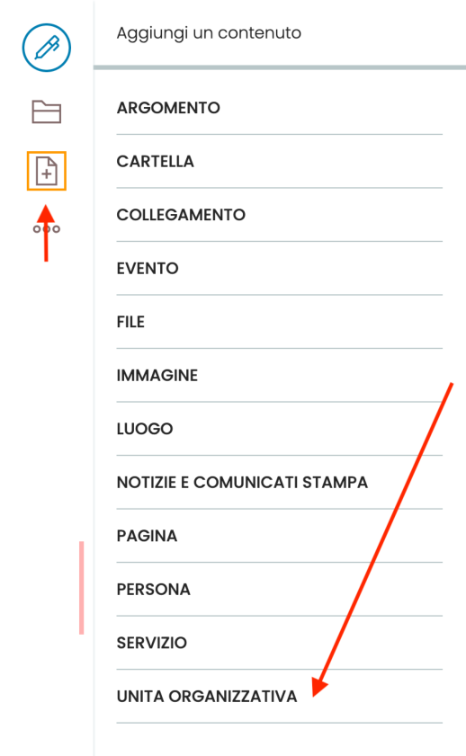
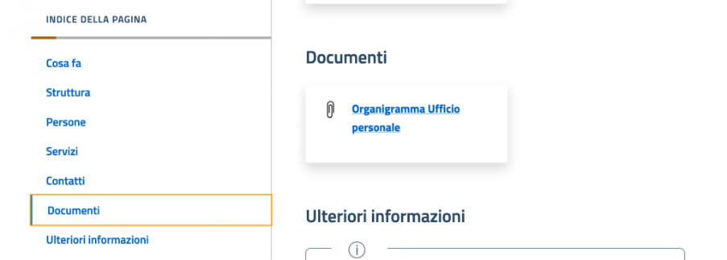

# Content-type “Unità organizzativa”

Struttura delle informazioni relative alla struttura di un'organizzazione comunale funzionale alla creazione di una organizzazione. Normalmente le strutture comunali si suddividono in organizzazioni politiche (giunta, consiglio comunale, collegio dei revisori, etc.), organizzazioni amministrative (uffici e/o aree) e altri tipi di organizzazioni (enti, fondazioni, musei, centri culturali, biblioteche, scuole comunali, etc.).

Oltre al titolo e descrizione, gli altri campi del content-type sono:

**Titolo** Nome del servizio

|Descrizione|Descrizione sintetica del servizio (max 255 caratteri)|
|---|---|
|**Immagine in testata**|Immagine che descrive il servizio[^n20]|
|**Didascalia dell’immagine in testata**|Viene mostrata sotto all’immagine presentata in testata|
|**Immagine in anteprima**|Immagine alternativa, da mostrare nei blocchi elenco|
|**Didascalia dell’immagine in anteprima**|Non viene visualizzata a front-end|
|**Argomenti**|Vocabolario controllato argomenti d'interesse per gli utenti di un comune|
|**Competenze**|Elenco/descrizione dei compiti assegnati alla struttura|
|**Strutture o uffici di riferimento**|Lista di strutture e/o uffici collegati a questa unità organizzativa.|
|**Responsabile**|Link alla scheda dellapersonaresponsabile della struttura (tipicamente una persona politica o un funzionario amministrativo se la struttura è di tipo politico o amministrativo)|
|**Assessore di riferimento**|Inserire l'assessore di riferimento della struttura, se esiste|
|**Tipologia organizzazione**  **[^n21]**|Specificare la tipologia di organizzazione: politica, amministrativa o altro tipo|
|**Persone che compongono la struttura**|Un link alla scheda persona per ciascuno dei componenti della struttura (ad es. lista assessori se la struttura è politica, lista funzionari se la struttura è amministrativa, e così via...)|
|**Punti di contatto dell'unità organizzativa**|Punti di contatto dell'unità organizzativa.|
|**Sede principale**|Nome della sede principale della struttura. Link se la sede è un \<luogo>|
|**Altre sedi**|Lista di eventuali altri luoghi|
|**Orario per il pubblico**|Orario di apertura al pubblico della sede, se la sede è aperta al pubblico (questo campo si ripete per ciascuna delle sedi secondarie collegate alla sede principale)|

[^n20]: Si vedano le note sulla dimensione ottimale dell’immagine in testata

[^n21]: Le tipologie di organizzazione possono essere personalizzate dagli amministratori del sito nell’apposita sezione **https://\<sito>/controlpanel/design-plone-settings**

|Contenuti correlati|Eventuali contenuti correlati al servizio|
|---|---|
|**Documenti pubblici**|Documenti pubblici importanti, collegati a questa Unità Organizzativa|
|**Correlato in evidenza**|Se impostato, verrà mostrata una fascia dedicata al correlato in evidenza, dopo la fascia dei contenuti correlati|
|**Ulteriori informazioni** |Campo per specificare ulteriori informazioni generiche|

L’Unità organizzativa si utilizza per creare ad esempio gli Uffici dell’ente La creazione di una Unità organizzativa crea in automatico una pagina contenitore “Allegati” che può essere popolata allegando file dalla modalità folder_content, la quale popola l’apposita sezione Documenti in visualizzazione dell’Unità organizzativa stessa.

:::{warning}
**Attenzione!** Non si devono modificare i nomi delle cartelle all’interno dell’unità organizzativa.
:::

Come per altri tipi di contenuto, nell’Unità Organizzativa c'è la possibilità di inserire altri campi interessanti quali **Via, CAP, Città, Nazione**, che permettono attraverso un apposito plugin di ricercare e geolocalizzare il luogo su una mappa.

NB: esiste La possibilità di configurare un punto geolocalizzato su cui impostare il PIN di default della mappa, centrato su una particolare coordinata geografica (tipicamente quello della propria città). Questo punto è configurabile qui **http:/\<sito>/api/@@geolocation-defaults**

