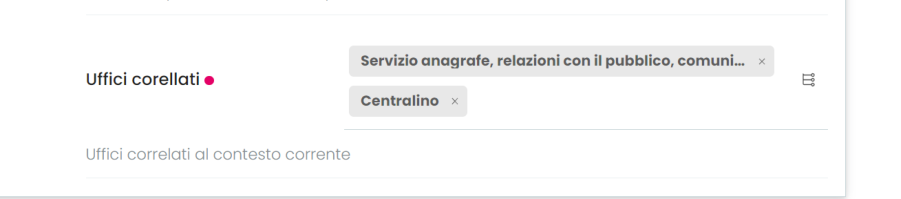
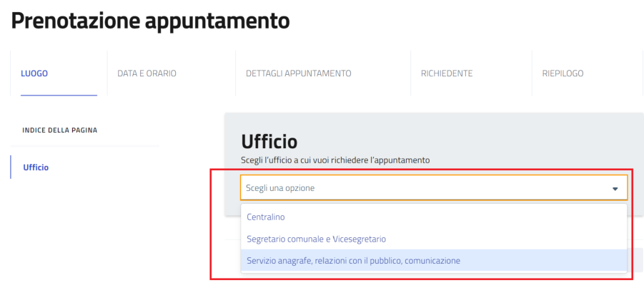
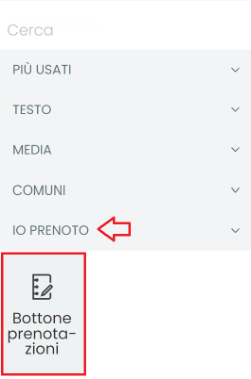
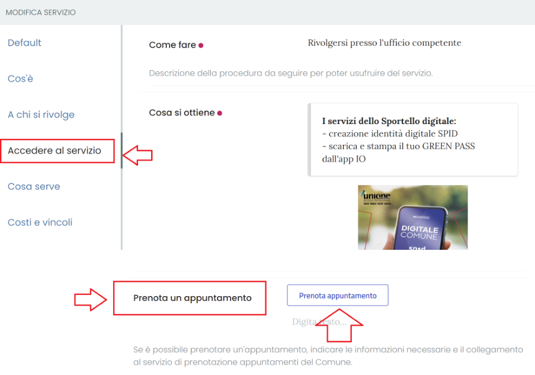
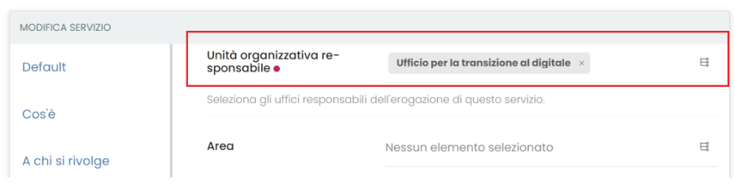
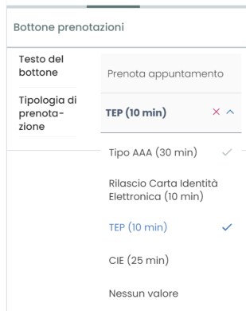
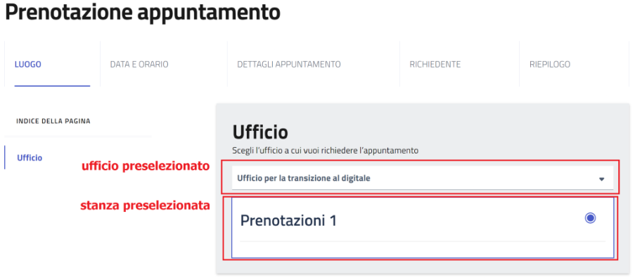
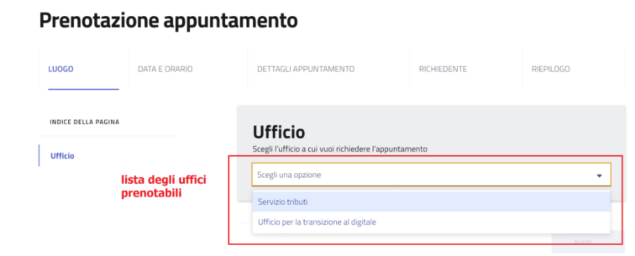

# Gestione di io-Prenoto integrato in io-Comune per il PNRR

```{include} /_snippets/funzionalita-aggiuntiva.md
```

{doc}`Per la configurazione e gestione delle stanze di prenotazione si rimanda all’apposito manuale </manuale-io-prenoto/integrazione-con-io-comune>`

Nel caso sia presente l’integrazione di io-Comune con io-Prenoto (gestione integrata delle prenotazioni nel portale istituzionale), per creare il pulsante di collegamento tra il servizio ed il sistema di prenotazioni, è necessario seguire i seguenti passaggi:

1.  Verificare che le stanze per il servizio siano impostate correttamente nel sistema di prenotazioni, in riferimento alle unità organizzative che se ne occupano

a.  Su CT “cartella prenotazione” (stanza) è disponibile un campo che permette di

collegare alla stanza stessa le Unità Organizzative di riferimento



b.  essendo il Servizio collegato alle Unità organizzative che si occupano di quel

servizio (tipicamente attraverso il campo “canale fisico”, o in alternativa attraverso il campo “Unità organizzativa responsabile”), automaticamente il pulsante di prenotazione appuntamento mostrerà tra gli uffici disponibili solo quelli relativi a quel servizio, e che hanno un collegamento a stanze di prenotazione



2.  identificare il content-type "Servizio" a cui si desidera associare il pulsante per accedere alla stanza di prenotazioni congruente.
3.  Aggiungere il campo del pulsante al content-type "Servizio". Tale pulsante è inseribile in un blocco attraverso l’apposito bottone
4.  Il sistema calcola automaticamente il collegamento alla stanza di prenotazione impostata per l’unità organizzativa responsabile del servizio (vedi punto b. precedente)

a.  La label predefinita per il pulsante (“Prenota appuntamento”) può essere

personalizzata a piacere dal redattore. Questo consente di adattare il testo del pulsante in base alle preferenze e alle esigenze specifiche b.  Attraverso il campo “Tipologie di prenotazione” (campo di testo), indicare quale

tipo di prenotazione specifico viene effettuato dalla stanza. Il valore deve essere tra quelli impostati nella configurazione delle tipologie di prenotazione. Attenzione a rispettare l’esatta sintassi del nome della tipologia prenotazione definita.

## Pulsante personalizzato per la prenotazione appuntamento

Nel caso in cui sia installato io-Prenoto, nel content-type “Servizio” è presente tra i blocchi disponibili un blocco supplementare che consente di gestire agevolmente il collegamento alla sezione delle prenotazioni.

Tipicamente, il pulsante deve essere utilizzato all'interno della sezione “Accedere al servizio”, nel campo “Prenota un appuntamento”

Questo pulsante creerà automaticamente il collegamento all’area di prenotazione (https://\<sito>/prenotazioni-appuntamenti-uffici), preselezionando automaticamente nella lista degli uffici preposti a ricevere le prenotazioni la stanza che è stata configurata per l’ufficio





responsabile di quel servizio (nel campo “Canale fisico” oppure, in sua assenza, nel campo “Unità organizzativa responsabile”)

La label del pulsante può essere eventualmente personalizzata utilizzando l’apposito campo (Testo del bottone) nella toolbar laterale di destra

nel quale è possibile definire anche il nome della Tipologia di prenotazione per preselezionare tale tipologia quando l’utente effettua la prenotazione (se la stanza dovesse erogare tipologie di prenotazioni differenti, con durate diverse).

Riepilogando:

1.  Nel servizio viene collegata la sua “Unità Organizzativa responsabile”, ed il campo “Canale Fisico”. Il canale fisico è l’unità organizzativa per la fruizione da parte del cittadino del servizio.
2.  La stanza di prenotazioni viene creata collegando l’Unità Organizzativa responsabile specificata come “Canale Fisico” nel Servizio (significa sostanzialmente che quella stanza prenotazioni è designata come sportello prenotazioni per quell’ufficio). In assenza del “Canale fisico”, verrà presa come riferimento la UO definita nel campo “Unità organizzativa responsabile”
3.  Il pulsante “Prenota appuntamento” creato linkerà al sistema di prenotazioni, selezionando automaticamente l’ufficio per cui si sta prenotando (ed eventualmente anche la Tipologia), oppure presentando la lista di tutti gli uffici per cui è possibile fare una prenotazione.







Nel caso in cui si acceda al sistema io-Prenoto dal link generale nel footer, anziché dal pulsante “Prenota appuntamento” del servizio, verrà proposta la lista di tutti gli uffici per i quali è stata predisposta una stanza di prenotazione (principio del “ _once-only”_ )

L’indirizzo URL generale per il sistema di prenotazioni è **https://\<sito>//prenotazione-appuntamenti-uffici**

NB: dal momento che il campo Canale Fisico non è obbligatorio sul servizio, nel caso in cui non venga specificato, il sistema sulla creazione del bottone cercherà le stanze di prenotazione collegate a quella UO definita nel canale fisico, e se non è presente, cercherà le stanze di prenotazione collegate alla “UO responsabile” del servizio. Va da sé che in questo secondo scenario, la stanza dovrà essere collegata alla UO Responsabile, poiché sul servizio il Canale Fisico non è stato specificato.

{doc}`Per la configurazione e gestione delle stanze di prenotazione si rimanda all’apposito manuale </manuale-io-prenoto/integrazione-con-io-comune>`


