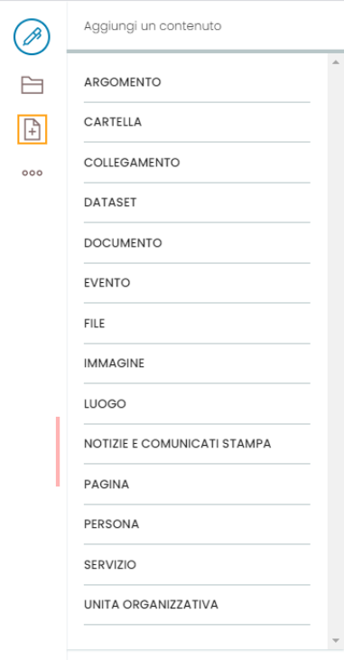

# I tipi di contenuto (content-type)

I tipi di contenuto, o content-type, rappresentano gli oggetti che possono essere inseriti a sistema. Essi possono essere oggetti di servizio, come immagini o file che vengono richiamate in altri oggetti del sito, oppure oggetti che rappresentano il contenuto informativo vero e proprio. I content-type sono inseribili una volta che ci si autentica sul sistema, e possono essere aggiunti sia in modalità folder_contents, sia in modalità visualizzazione, nel punto del piano editoriale in cui ci si trova (quindi anche all’interno di un elemento stesso - es: pagina)

Si rimanda alla sezione Appendice per la descrizione dei campi aggiuntivi per la SEO, presenti su ciascun content-type

NB: ogni oggetto è di tipo “ **folderish** ”, ovvero è esso stesso un contenitore, oltre che un contenuto informativo vero e proprio (quindi potrei avere ad esempio pagine all’interno di pagine)

Per inserire un nuovo content-type, è necessario utilizzare l'apposito pulsante nella barra degli strumenti.

Passiamo in rassegna uno ad uno i diversi content-type.



```{toctree}
:maxdepth: 1

tipi-di-contenuto-specializzati-per-agid
content-type-pagina
undo-redo-sulle-pagine
content-type-cartella
content-type-file
content-type-immagine
content-type-collegamento
content-type-argomento
dimensioni-dell-immagine-in-testata-leadimage
dimensioni-dell-immagine-di-anteprima
content-type-evento
content-type-luogo
content-type-notizie-e-comunicati-stampa
content-type-persona-pubblica
content-type-incarico
content-type-servizio
content-type-unita-organizzativa
content-type-dataset
content-type-documento
content-type-cartella-modulistica
content-type-open-data
content-type-bando
content-type-punto-di-contatto
gestione-di-io-prenoto-integrato-in-io-comune-per-il-pnrr
```
