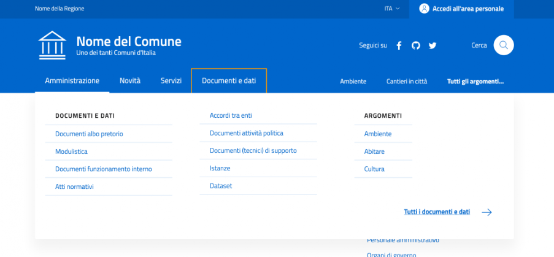
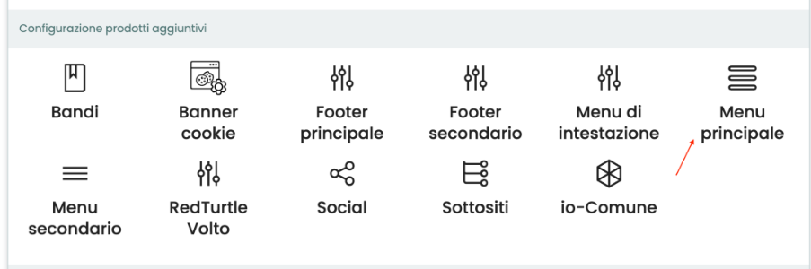
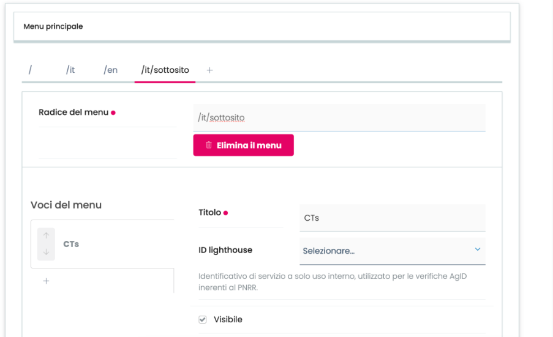
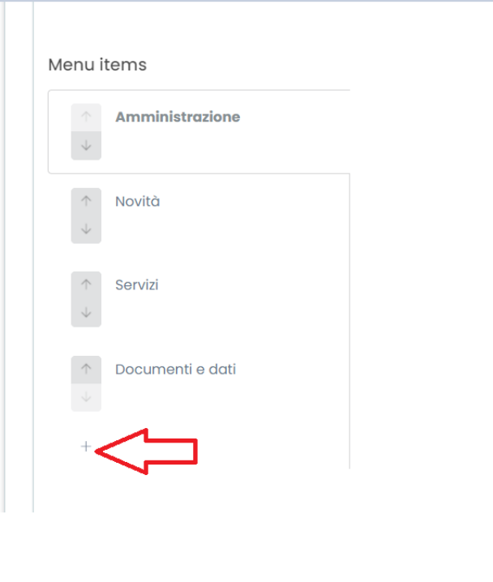
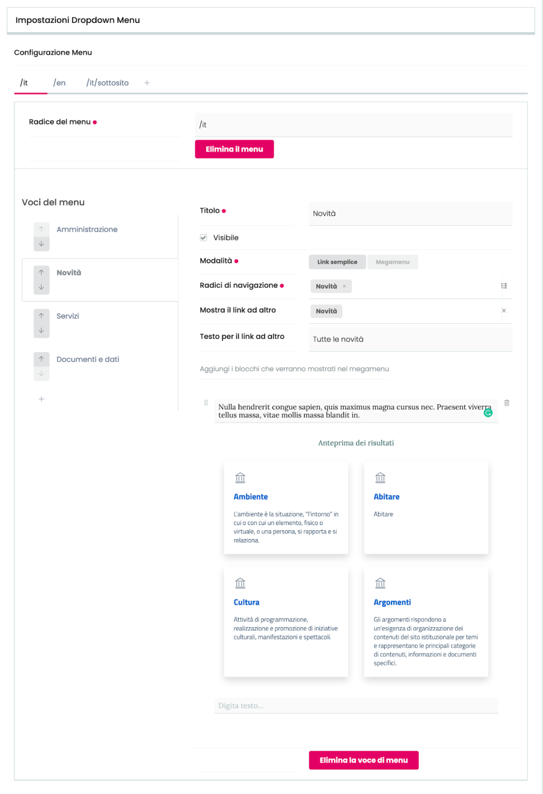
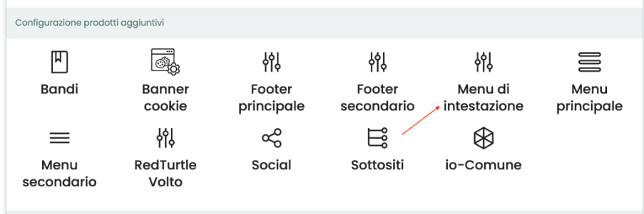

# Menu configurabile

Il menu di navigazione in testata è configurabile. **NOTA: Nel caso in cui l’ente abbia partecipato al PNRR, è necessario seguire le indicazioni per la** **{doc}`configurazione dei data-element </manuale-io-comune/data-element-pnrr>`,** da applicare tipicamente nelle configurazioni generali in diverse parti.

Per configurare il menu, c’è un apposito pannello di controllo: Impostazioni Dropdown Menu.

## Configurazione del menu di testata

Si possono definire più menù in base alla posizione nel sito, in modo tale da avere un **menù** ad hoc per ogni lingua o poter personalizzare le **voci** per un sottosito.

Ogni menu ha una **radice** . Sono mostrati in tab, come si vede nello screenshot (‘/it’, ‘/en’, ‘/it/sottosito’):

Per aggiungere un menu, si clicca sul (+) a lato dei tab.

Il senso è questo: per i siti che non sono multilingua, la radice è sempre ‘ **/** ’, e sarà l’unica da configurare. Per quelli multilingua, le root saranno diverse, a seconda delle lingue impostate (se ad esempio, il sito è in italiano e inglese, le root da impostare saranno rispettivamente **‘/it’** e **‘/en’** ) Se bisogna configurare un menù per un sottosito di un sito non multilingua, la root da impostare sarà **‘/sottosito’[^n26]**, altrimenti sarà **‘/it/sottosito’**

[^n26]: **sottosito** è un nome fittizio, dovrà essere impostato con il nome della cartella che è stata definita come root del sottosito

## Voci di un menu

Ogni menù contiene più voci. Nello screenshot precedente, il menù per la lingua italiana ha le voci “Amministrazione”, “Novità”, “Servizi” e “Documenti e dati”.

Con il (+) sotto le voci possiamo aggiungerne delle nuove, mentre per riordinarle possiamo usare le frecce a lato dei tab. Nota: l’ordine costituito qui è l’ordine con cui verranno mostrate nella testata.

Ogni tab di una voce di menu contiene i dati e le informazioni per quella voce. Ogni voce ha un **titolo** e la possibilità di rendere **visibile** - nascosta una voce. **TIPS:** Il testo del pulsante può essere scritto anche inserendo codice HTML, che verrà interpretato dal sistema. Questo significa che se scriviamo nel testo

**\<b>** DOCUMENTI **\</b>\ ** e dati

il pulsante verrà visualizzato con il testo “DOCUMENTI” in grassetto ed il testo “e dati” nella riga sottostante (quindi il pulsante sarà su due righe successive) **ATTENZIONE:** qualsiasi codice HTML inserito verrà interpretato, quindi la stesura di eventuali direttive HTML sarà a carico completo del cliente

Ci sono due modalità di impostazione: link semplice e megamenu. Nota bene: il valore selezionato sarà rappresentato da un bottone grigio disattivato.

### Link semplice

È il caso dello screenshot precedente e prevede un campo **link** con il quale selezionare un oggetto del sito a cui dirigere la navigazione[^n27].

### Megamenu

L’alternativa è il megamenu: un menu a tendina che può mostrare più voci di navigazione o altri contenuti.

[^n27]: Nel caso si voglia impostare un collegamento esterno al sito, sarà necessario creare un tipo di contenuto **collegamento**, di tipo esterno, e far puntare la voce di menù a quell’elemento

Rispetto al link semplice non ha un oggetto del sito a cui far puntare un link, ma ha un campo per selezionare una o più **radici di navigazione** . Nella tendina della voce di menu, si avranno elenchi di link con i figli diretti di primo livello di tali radici di navigazione.

Se selezionata più di una radice di navigazione, verrà mostrata l’etichetta per ogni radice, non cliccabile, che conterrà ciascuna i propri figli di primo livello, consentendone la navigazione.

Ci sono poi due campi per gestire un link sotto al menu per mandare ad una sezione generica o ad hoc: il **link ad altro** .

Inoltre, per popolare una voce di menu, è possibile anche inserire dei **blocchi[^n28]** come succede per le

Pagine: a tutti gli effetti si tratta di un editor a blocchi componibili. Per questioni di adattabilità e coerenza, è consigliato nel menu il solo uso dei blocchi di testo, dei blocchi elenco ed eventualmente di blocchi immagine (facendo attenzione alle dimensioni della stessa, dal momento che dovrà stare all'interno del navigatore)

## Configurazione header “slim”

Con header slim si intende la fascia che sta immediatamente sopra alla testata del sito

Tipicamente potrebbe essere necessario dover inserire delle voci nella parte destra (in fig. ad esempio, le voci FAQ e Contatti)

Esiste quindi un pannello di controllo, il cui funzionamento logico è del tutto analogo ai pannelli per configurare il menù principale e il subfooter:

La configurazione ragiona per percorso di navigazione, quindi:

- se ipoteticamente si definiscono delle voci per il percorso ‘/’, le voci sono visibili in ogni pagina del sito
- se si definiscono voci per un percorso interno (es. ‘/url-sottosito’), quelle voci saranno

[^n28]: Attenzione: all’interno del configuratore del megamenù, non tutte le funzionalità per i diversi tipi di blocco sono garantite: ad esempio l’upload nel blocco immagine da file system. In questo caso precaricate l’immagine a sistema e utilizzare la selezione dell’immagine nella posizione in cui è stata inserita.

mostrate esclusivamente all’interno del sottosito che sta in quel percorso, e nelle pagine al suo interno
