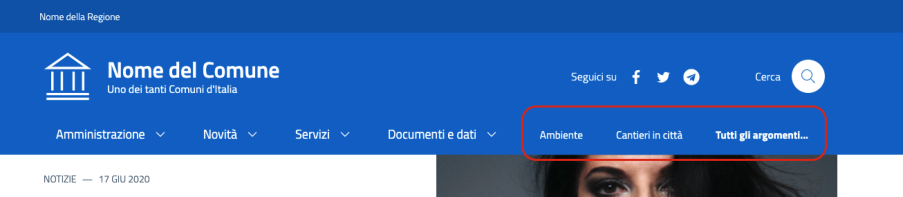
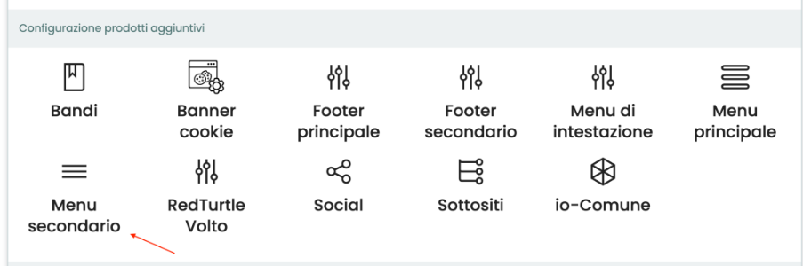
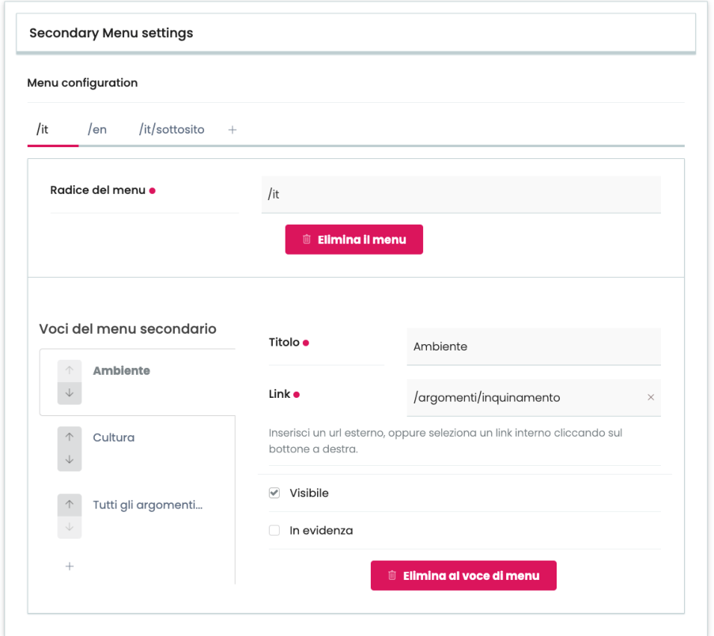
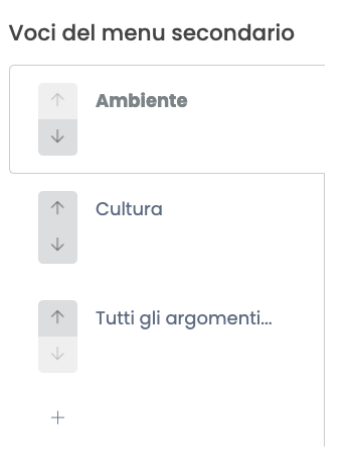

# Menu secondario in testata

Il menu secondario presente nella parte destra della testata, è configurabile.

Per configurare il menu, c’è un apposito pannello di controllo: Menu secondario

Il funzionamento del configuratore è del tutto simile a quello previsto per il menù principale.

**NB:** nel caso di presenza di sottositi, le impostazioni delle voci laterali di destra del sito padre verranno riproposte tali e quali anche nel navigatore dei sottositi: nel caso in cui si vogliano escludere da essi, sarà necessario definire esplicitamente un menu secondario **vuoto** per il percorso di ciascun sottosito

## Configurazione di un menu

Si possono definire più menù in base alla posizione nel sito, in modo tale da avere un **menù** **secondario** ad hoc per ogni lingua o poter personalizzare le **voci del menu secondario** per un sottosito.

Ogni menù ha una **radice** . Sono mostrati in tab, come si vede nello screenshot (‘/it’, ‘/en’, ‘/it/sottosito’):

Per aggiungere una radice di menu, si clicca sul (+) a lato dei tab in alto.

Il senso è questo: per i siti che non sono multilingua, la radice è sempre ‘ **/** ’, e sarà l’unica da configurare. Per quelli multilingua, le root saranno diverse, a seconda delle lingue impostate (se ad esempio, il sito è in italiano e inglese, le root da impostare saranno rispettivamente **‘/it’** e **‘/en’** ) Se bisogna configurare un menù per un sottosito di un sito solo non multilingua, la root da impostare sarà **‘/sottosito’[^n29]**, altrimenti sarà **‘/it/sottosito’**

## Voci di un menu

Ogni menù contiene più voci. Nello screenshot precedente, il menù secondario per la lingua italiana ha le voci “Ambiente”, “Cultura”, “Tutti gli argomenti”.

[^n29]: **sottosito** è un nome fittizio, dovrà essere impostato con il nome della cartella che è stata definita come root del sottosito

Con il (+) sotto le voci possiamo aggiungerne delle nuove, mentre per riordinarle possiamo usare le frecce a lato dei tab. Nota: l’ordine costituito qui è l’ordine con cui verranno mostrate nella testata.

Ogni tab di una voce di menu contiene i dati e le informazioni per quella voce. Ogni voce ha:

- un **titolo**

- la possibilità di rendere **visibile**   - nascosta una voce

- La possibilità di essere messo **in evidenza** (il testo sarà messo in grassetto)

Il link sulla voce può essere un link interno (lo si può scegliere dalla barra di navigazione che compare premendo il pulsante a lato), oppure un link esterno. Il link esterno può essere inserito liberamente a mano nel campo di testo.
