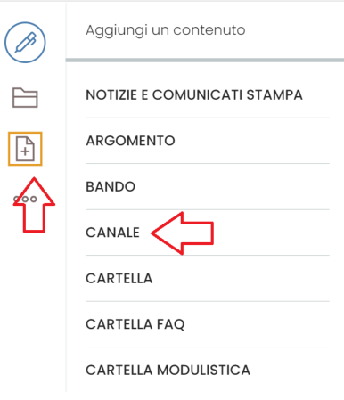
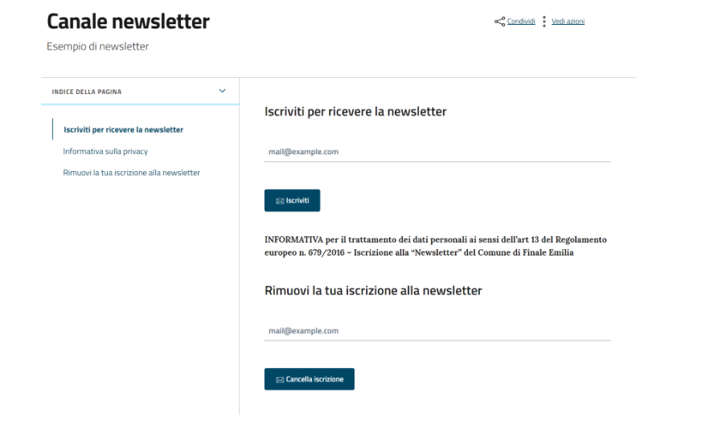
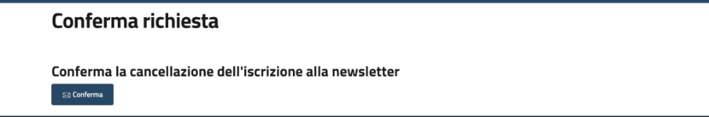
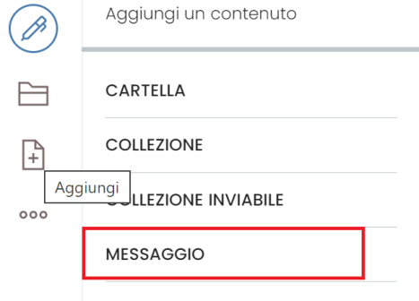
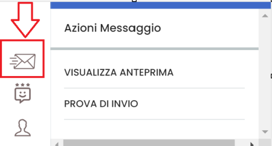
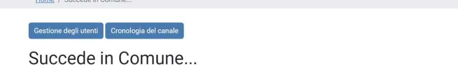
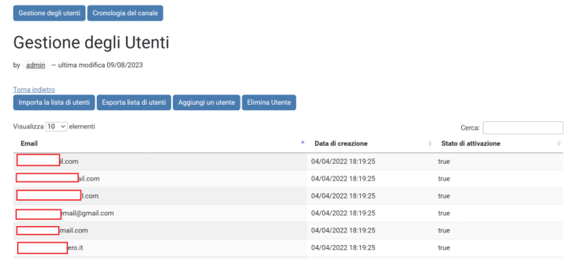
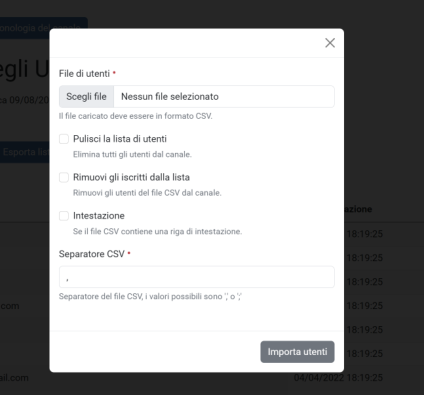
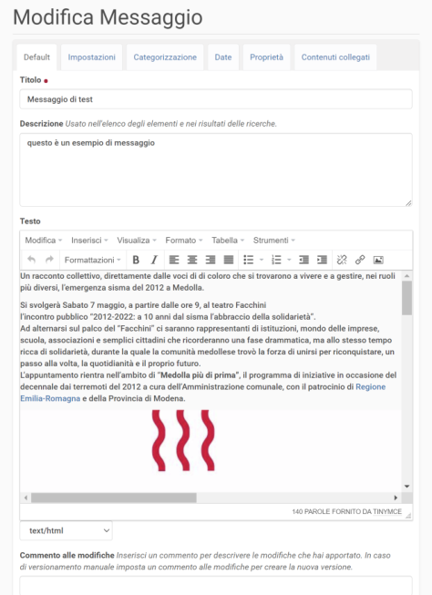
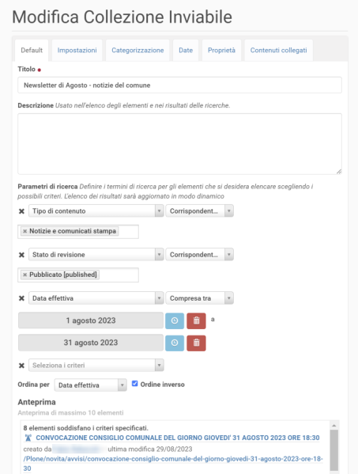

# Newsletter

```{include} /_snippets/funzionalita-aggiuntiva.md
```

L’attivazione del modulo di Newsletter consente di gestire direttamente dal sito l’invio dei contenuti che si intende veicolare attraverso questo strumento.

Operativamente, si avrà la possibilità di inserire dei “Canali”: un canale è paragonabile al tematismo della Newsletter (es. si può creare un canale per gestire la “Newsletter Cultura”, uno per la “Newsletter Istituzionale” ecc).

I campi impostabili per il canale sono:



  - Titolo del canale
  - descrizione
  - Nome completo del mittente
  - Email del mittente
  - Oggetto della mail
  - Email dove rispondere

  - Informativa privacy (campo a blocchi per definire il testo dell’informativa)
  - Intestazione del messaggio
    - è possibile inserire testo HTML, che finirà nella testata della newsletter

inviata
  - Footer del messaggio
    - vale la stessa cosa che abbiamo detto per l'intestazione, il codice verrà

inserito nel footer della newsletter inviata

  - Stili CSS
    - è possibile settare lo stile che sarà poi valido per tutte le email mandate

da questo canale comprese le mail di attivazione e cancellazione di un

utente e tutte le mail di avvenuta attivazione/cancellazione. I codici colore devono essere quelli del sito[^n30]

  - ID del canale
    - è un id univoco auto calcolato, che rappresenta il canale, e che può

anche essere settato dall'utente. Serve per identificare univocamente il canale (campo di servizio)
  - Sottoscrivibile
    - è una checkbox che indica se la newsletter è sottoscrivibile o meno,

quindi verranno conseguentemente mostrati i box per l’iscrizione/disiscrizione.

  - Standard unsubscribe link

    - Checkbox per utilizzare il link standard di disiscrizione: tale link viene inserito nella newsletter inviata

La creazione del canale Newsletter si traduce sul sito in una pagina come questa



dove, in automatico:

- Vengono create le aree per l’iscrizione e la disiscrizione alla newsletter
- Viene riproposto nella parte centrale il testo informativo della privacy

Fondamentalmente, dal punto di vista del sito, la configurazione è completa. Il resto delle attività riguardano gli operatori, che devono opportunamente configurare gli strumenti per la gestione e l’invio vero e proprio della newsletter stessa.

L’iscrizione/disiscrizione alla newsletter comporta un invio mail all’utente iscritto/disiscritto, con un link da cliccare per confermare rispettivamente la sua attivazione/disattivazione.

[^n30]: Si rimanda all’appostita sezione, contenente il codice HTML da incollare e personalizzare

Questo link, nel caso ad esempio di disiscrizione, manderà ad una pagina sul sito come questa:

In caso di conferma disiscrizione, gli utenti presenti su un canale non vengono fisicamente cancellati, ma semplicemente disattivati (e conseguentemente ignorati al prossimo invio newsletter)

## Messaggi inviabili

All’interno di un canale è possibile comporre un messaggio inviabile: esso corrisponde ad una pagina a blocchi.

Una volta composto il messaggio con l’editor a blocchi, nella barra degli strumenti di sinistra corrisponde un nuovo pulsante per gestire il messaggio e la newsletter, in particolare:







### Gestione utenti

Alla gestione degli utenti di un canale si accede dal backoffice, all’indirizzo **https://\<nome-sito>/admin/percorso-del-canale[^n31]**

Si presenta una vista come questa

dove sono presenti due pulsanti, rispettivamente:

- per gestire gli utenti del canale
- per visualizzare la cronologia invii

### Per quanto riguarda la Gestione utenti, viene presentata una schermata come la seguente:





Gli utenti hanno due stati all'interno del nostro sistema:

  - gli utenti iscritti che non hanno confermato l'iscrizione ( _stato attivazione = false_ ).
  - gli utenti iscritti che invece hanno confermato l'iscrizione alla newsletter ( _stato_ _attivazione = true_ ), il messaggio verrà inviato concretamente soltanto a questi utenti.
- all'interno di questa pagina vediamo altri 4 pulsanti, descritti partendo da destra:
  - _Elimina utente_ :
    - cliccando su una riga all'interno della tabella, si noterà che questa rimarrà

selezionata. Una volta selezionata se clicchiamo il tasto "Elimina utente" l'utente selezionato sarà eliminato dagli utenti del canale
  - _Aggiungi utente_ :

[^n31]: A seconda delle installazioni, portrebbe essere necessario sostituire **admin** con **api**

    - cliccando il tasto si aprirà una modale che permetterà di inserire

direttamente un utente attivo all'interno della lista di utenti. Quindi è un utente che non dovrà passare per tutto l'iter di conferme.
  - _Esporta lista di utenti_ :
    - esporta la lista di utenti in un file CSV, i campi di questo file saranno:

    - id utente
    - email utente
    - data di iscrizione/attivazione dell'utente
    - stato dell'utente
  - _Importa lista di utenti_ :
    - cliccando su questo tasto si aprirà una modale con i parametri per



l’importazione

### Gestione dei contenuti della newsletter da inviare

All’interno un canale ci sono due modalità di impostazione della newsletter da inviare:

- Messaggio singolo: **(Aggiungi -> Messaggio)**
- Collezione di oggetti ( **Aggiungi -> Collezione inviabile)**

Nel primo caso ( **Messaggio** ):



- Si compila il testo del messaggio
- una volta creato il messaggio vediamo una pagina con il contenuto del messaggio stesso. Anche qui in alto abbiamo due tasti che sono:

  - _Anteprima del messaggio_ :
    - questa pagina permette di avere un anteprima del messaggio finale
  - _Test del messaggio_ :
    - questa pagina permette di fare un invio di prova del messaggio ad una

mail che sceglie l'utente
- per inviare il messaggio, esso deve essere nello stato “Pubblicato”, quindi:
  - **bozza** : lo stato in cui si trova appena lo si crea
  - **pubblicato** : All'interno della pagina di dettaglio del messaggio, viene visualizzato un altro tasto che è "Invia messaggio"

    - Se è già stato inviato, è possibile rimandare il messaggio con “Rimanda

messaggio”

Nel secondo caso ( **Collezione inviabile)** :

  - Le collezioni si inseriscono all’interno del canale (Aggiungi -> Collezione inviabile)
  - Si configura la collezione, che segue la logica dei “blocchi elenco” nella sua impostazione (si ragiona quindi per parametri, filtri ecc..), ad esempio questa

collezione recupera “tutte le notizie” create “nel mese di Agosto”

  - Il funzionamento della collezione inviabile è in tutto per tutto similare a quello del messaggio, per quanto riguarda le modalità di invio (sia di test, che invio ufficiale). L’unica differenza è che il template del messaggio va fatto completamente a mano, mentre il template della collezione non è customizzabile per quanto riguarda i contenuti.

## Configurazione dell’HTML del canale

**A CURA DI REDTURTLE:** [Nella vista https://nome-sito/admin/@@channel-settings](https://nome-sito/admin/@@channel-settings) impostare gli indirizzi sorgente e destinazione corretti, ad esempio

### Intestazione del messaggio

\<tr class="header">
\<td align="left" valign="middle" colspan="2">
\
\</td>
\</tr>
\<tr>
\<td class="divider" colspan="2">\</td>
\</tr>

(nb: il percorso del logo evidenziato si può recuperare direttamente dal sito ispezionando con gli strumenti del browser l’indirizzo del logo)



### Footer del messaggio

\<tr class="footer">
\<td align="center" valign="middle" class="footer-main" colspan="2">
\
\</td>
\</tr>
\<tr class="footer">
\<td class="contacts" align="center" colspan="2">
Via Nino Bixio 4, 44122 Ferrara (FE) Tel. 0532 1915958
\</td>
\</tr>
\<tr class="footer">
\<td class="footer-disclaimer" colspan="2">
È sempre possibile esercitare i diritti previsti dall'Art. 7 del Codice della Privacy inviando un messaggio di posta elettronica alla casella \<a href="mailto:newsletter@io-comune.it">newsletter@io-comune.it\</a>
\</td>
\</tr>
\<tr class="footer">
\<td class="footer-smallprints trademark">
© Comune di io-Comune
\</td>
\<td class="footer-smallprints unsubscribe" align="right">
\<a href="https://www.io-comune.it/nome-del-canale[^n32]">Disiscriviti\</a>

\</td>
\</tr>

[^n32]: Il pulsante per la disiscrizione si trova all’interno della vista del canale, quindi è necessario impostare il percorso del canale creato

### Stili CSS

NB: sono evidenziati i codici colore che tipicamente dovranno essere sostituiti con il codice colore principale del proprio sito

```
html {
width: 100%;
font-family: 'Titillium Web', sans-serif;
font-size: 16px;
}

body {
max-width: 600px;
margin: auto;
}

table {
max-width: 600px;
margin: auto;
border-collapse: collapse;
}

td {
padding: 0;
}

.header {
width: 100%;
}

.header img {
height: auto;
}

.divider {
width: 100%;
padding-top: 32px;
background-color: #003766;
background-image: linear-gradient(# 003766, # 003766) ;
}

.newsletterTitle {
padding: 24px 24px 32px 24px;
}

.newsletterTitle h1 {
margin-top: 0;
margin-bottom: 0;
}

.newsletterTitle h4 {
margin-top: 12px;
margin-bottom: 12px;

```

```
font-weight: 400;
}

article.tileItem {
margin-bottom: 40px;
}

article.tileItem .tileImage,
article.tileItem .tileImageNoFloat {
overflow: hidden;
height: 230px;
}

article.tileItem .tileImage img,
article.tileItem .tileImageNoFloat img {
width: 100%;
height: 230px;
object-fit: cover;
}

article.tileItem .content {
padding: 16px 24px;
background-color:# ccc
}

article.tileItem .content h2 a {
color: # 003766;
text-decoration: none;
}

article.tileItem .content .tileBody {
padding-bottom: 20px;
}

article.tileItem .content a.readMore {
color: # 003766;
font-size: 14px;
font-weight: 600;
text-transform: uppercase;
}

.footer {
background-color: #28523D
}

.footer a{
color: #FFFFFF
}

.footer td.footer-main {
padding: 48px 0 32px 0;
}

.footer td.footer-main img {

```

```
height: auto;
vertical-align: middle;
}

.footer td.contacts {
padding: 8px 112px 0;
font-size: 16px;
text-align: center;
}

.footer td.footer-disclaimer {
padding: 48px 24px 16px;
font-size: 14px;
}

.footer td.footer-smallprints {
padding: 12px 24px 44px;
}

.footer td.footer-smallprints .trademark {
display: inline-block;
float: left;
}

.footer td.footer-smallprints .unsubscribe {
display: inline-block;
float: right;
}

@media only screen and (max-width: 480px) {
.header td {
padding: 16px 0 16px 0 !important;
}

h1 {
font-size: 28px !important;
}

.newsletterTitle h4 {
font-size: 14px !important;
}

article.tileItem .content .tileBody .description {
font-size: 14px !important;
}

.footer {
padding: 16px 16px !important;
}

.footer td.footer-main {
padding: 48px 0 16px 0 !important;
}

```

```
.footer td.contacts {
padding: 16px 40px 0 40px !important;
margin-top: 0 !important;
font-size: 16px !important;
font-weight: 300 !important;
line-height: 24px !important;
}

.footer td.footer-disclaimer,
.footer td.footer-smallprints {
padding: 12px 16px !important;
}

.footer td.footer-disclaimer {
padding-top: 52px !important;
}

.footer td.footer-smallprints {
font-size: 14px !important;
}
}

@media only screen and (max-width: 339px) {
.footer td.contacts {
padding: 16px 16px 0 16px !important;
font-size: 16px !important;
font-weight: 300 !important;
line-height: 24px !important;
}
}

@media (prefers-color-scheme: dark) {
.newsletterTitle h1,
.newsletterTitle h4.newsletterDate,
.content h2 a,
.content .tileBody .description,
.content a.readMore,
.footer td.contacts,
.footer td.contacts a,
.footer td.footer-disclaimer,
.footer td.footer-disclaimer a,
.footer td.footer-smallprints,
.footer td.footer-smallprints a {
color: white !important;
}
}

### Invio della newsletter attraverso sistemi esterni [TBD]

```
