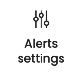
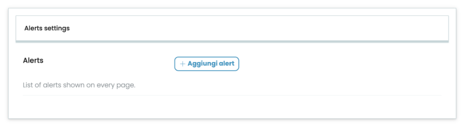
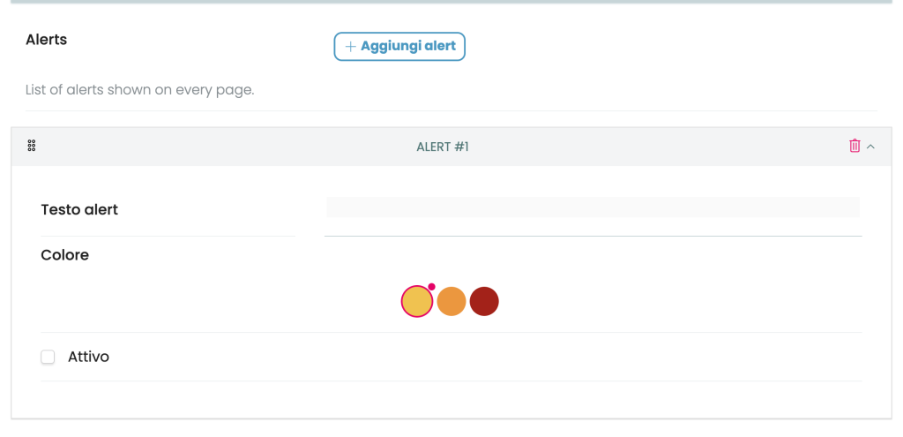

# Volto Alerts

```{include} /_snippets/funzionalita-aggiuntiva.md
```

L’attivazione del modulo volto-alerts consente di inserire automaticamente degli _alerts_ su tutte le pagine configurandoli da pannello di controllo.

Per impostare gli alert, aprire il pannello di controllo e cliccare sul bottone “Impostazioni alert”.

Nel pannello dedicato, cliccare su “Aggiungi alert” per inserire un nuovo alert.

Per ogni alert, è possibile impostare:







- Testo alert → Campo Slate → editor che consente di inserire contenuto testuale editabile e formattabile

- Colore → Colore dello sfondo dell’alert

- Attivo → Checkbox che imposta se l’alert sarà visibile o meno sulle pagine. Questa impostazione consente di impostare l’alert una volta sola e di mostrarlo o meno se necessario sulle pagine, senza necessità di doverlo ricreare nuovamente ogni volta.

Se sono stati creati più alert, con il tasto a sinistra è possibile cliccare e trascinare per cambiarne l’ordine. Il tasto a destra invece consente di eliminare un alert qualora non fosse più necessario. Cliccando sulla fascia grigia con scritto “Alert#n” è invece possibile espandere o chiudere il contenuto dell’alert.

Una volta creato l’elemento, l’alert verrà quindi visualizzato in tutte le pagine pubbliche (non verrà dunque visualizzato in edit, nei pannelli di controllo, etc.)

L’alert verrà sempre visualizzato in cima alla pagina, subito dopo la fascia del menu.
