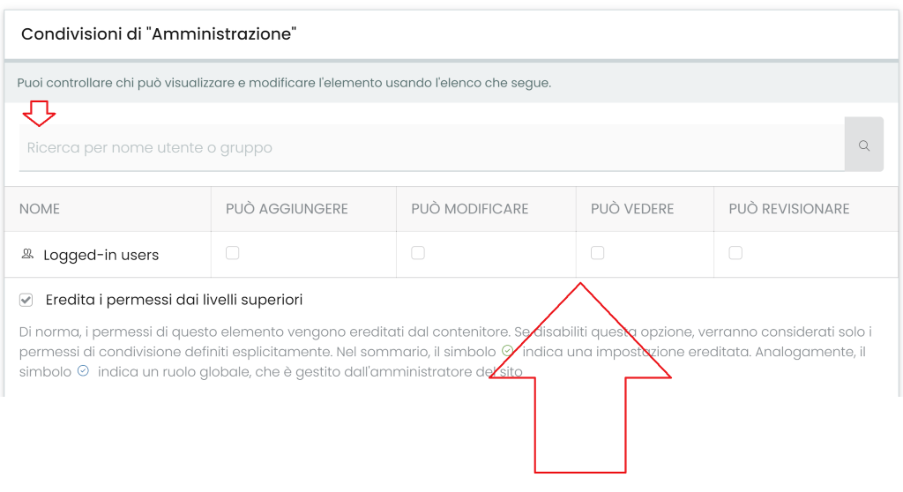
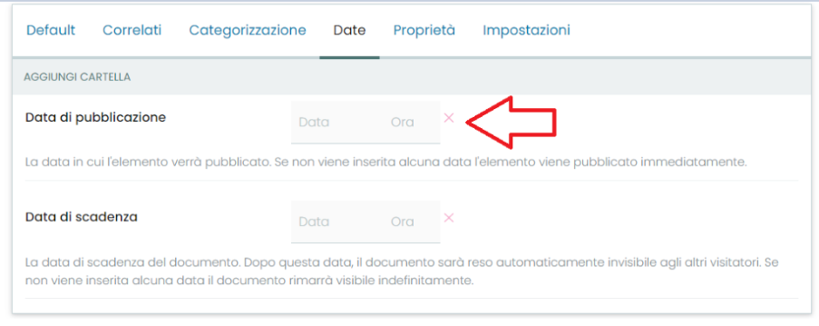

# Workflow

Ogni contenuto è sottoposto ad un processo di workflow, questo significa che qualsiasi contenuto che viene creato, di qualsiasi tipo, è inizialmente sempre nello stato **bozza.** Un contenuto in bozza è sempre visibile nel caso di utente autenticato (nella vista “folder_contents” o nel suo dettaglio), viceversa l’utente anonimo non lo vede. Per pubblicare un contenuto è sufficiente metterlo allo stato **pubblicato**

Esiste un ulteriore stato di workflow, denominato **“sottoponi per la pubblicazione“** (o Revisione), che mette il contenuto in uno stato intermedio, ovvero predisposto per la pubblicazione.

Nel caso di redazione allargate, può essere utile utilizzare questo stato per inviare agli utenti “revisori di bozza” i contenuti da validare prima della pubblicazione. Se un determinato insieme di utenti fa parte del gruppo dei revisori, essi si vedranno recapitare nella loro Dashboard personale i contenuti da revisionare e, una volta verificati, potranno decidere di pubblicare ( e quindi rendere visibile all'utente anonimo) i contenuti, piuttosto che rimandare in stato bozza i contenuti stessi, per essere aggiustati prima della pubblicazione. Si possono eventualmente abilitare notifiche via mail per recapitare ai revisori i contenuti che vengono via via sottoposti.

Il passaggio allo stato intermedio di revisione non è obbligatorio, quindi un contenuto può passare direttamente dallo stato privato allo stato pubblico. Naturalmente i passaggi di stato sono bidirezionali, quindi ad esempio si può passare dallo _stato_ _privato_ allo _stato pubblico_ e viceversa.

**Privato <-> Revisione <-> Pubblicato**

La pubblicazione di un elemento può avvenire anche in maniera differita, agendo su una particolare proprietà che si trova nel dettaglio di ciascun elemento (tab “ **Date** ”)

Impostando una data di pubblicazione e una data di scadenza, il sistema in automatico renderà visibile in quel giorno il contenuto pubblico (quindi sarà visibile dall’utente anonimo) e, alla data di scadenza impostata, il contenuto verrà automaticamente nascosto (pur rimanendo pubblicato). NB: **lo stato del documento deve essere comunque PUBBLICO**, le date ne regolano soltanto la visibilità per l’utente anonimo. Il documento, se indicizzato dai motori di ricerca, continuerà ad essere ricercabile

