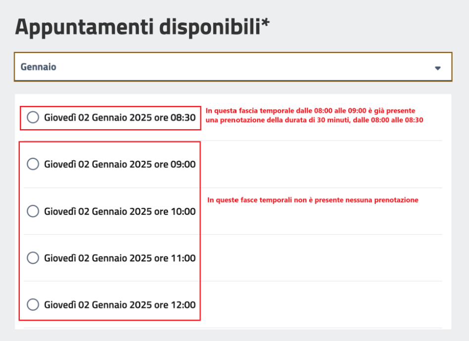
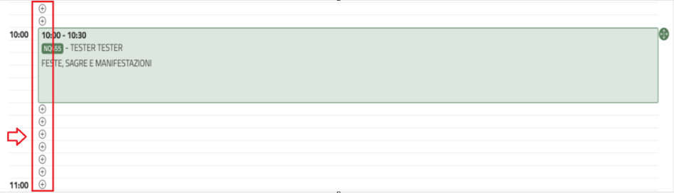

# Criteri di presentazione degli slot di prenotazione - cittadino vs operatore

Una volta configurata la stanza con tutti i parametri necessari, e una volta pubblicata, essa è disponibile all’utente anonimo per prenotare. Allo stesso modo, la stanza è disponibile agli operatori.

Fondamentalmente c’è distinzione sugli slot prenotabili nel caso si tratti di un cittadino piuttosto che un operatore, questo perchè, per gli utenti anonimi, lo scopo del sistema è gestire le prenotazioni affinché non siano presenti buchi temporali tra una prenotazione e l‘altra (per efficientare il più possibile il lavoro degli operatori, ed evitare inutili pause)

Viceversa, l’operatore possiede una maggiore libertà nella prenotazione di uno slot temporale dell’agenda rispetto al cittadino.

Supponiamo di avere una stanza che accetta prenotazioni della durata di 30 minuti

Sostanzialmente:

- al cittadino vengono sempre presentati slot temporali di 1 ora, se non presente nessuna prenotazione, oppure il primo orario disponibile nel caso in cui in uno slot temporale di 1 ora siano già presenti altre prenotazioni

In questo modo il cittadino sceglie lo slot orario che preferisce (quello delle 08:30, quello delle 09:00, quello delle 10:00 ecc), e il sistema trova in automatico il primo orario disponibile di quello slot più contiguo possibile con le prenotazioni già presenti.

Quindi, nell’esempio in immagine, un cittadino non può decidere in autonomia di prenotare alle 09:30, perché il sistema riconosce che nello slot delle 09:00 non c’è nessuna prenotazione, e quindi assegna automaticamente quello delle 09:00. Allo stesso modo, nello slot delle 08:00, può prenotare soltanto alle 08:30 perchè c’è disponibilità dalle 08:30 alle 09:00

Per l’operatore invece c’è massima libertà nella scelta dell’inizio prenotazione (infatti all’operatore vengono presentati slot temporali di 5 minuti)

Sarà a discrezione dell’operatore inserire appuntamenti contigui ai precedenti (per evitare buchi/pause),

- decidere comunque in autonomia l’orario che preferisce.

