# Integrazione con io-Comune

Una Stanza di Prenotazione (di seguito, “Cartella Prenotazioni”) è lo strumento con cui in io-Comune si crea la rappresentazione digitale dello sportello virtuale, attraverso il quale il cittadino può inserire le sue richieste di appuntamento.

Un appuntamento è sostanzialmente una sorta di form online, suddiviso in step, attraverso il quale vengono sottomessi i dati che poi vengono elaborati dagli operatori prenotazioni del Comune che li ricevono.

## Attori coinvolti nel processo

I principali attori coinvolti nella costruzione, utilizzo e manutenzione delle pratiche sono:

- **Redattore** : colui che crea le nuove Cartelle prenotazione (form), grazie agli appositi strumenti redazionali
- **Cittadino:** colui che utilizza le form di richiesta appuntamento
- **Operatore:** utente o gruppo di utenti dell’Ente che si occupa della gestione degli appuntamenti nelle diverse Cartelle prenotazioni

## Content-type “Cartella prenotazioni”

Essendo la Cartella Prenotazioni la rappresentazione digitale di uno sportello, è di fatto un tipo di contenuto del CMS aggiungibile.

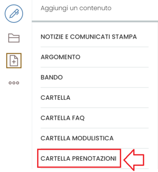

Il CT Cartella prenotazioni consiste nei seguenti campi:

### [Tab Default]

- **Titolo:** nome della stanza
- **Descrizione:** descrizione della stanza
- **Descrizione agenda:** campo testuale che viene riproposto all’utente anonimo al momento della

prenotazione

- **Postazioni preposte:** campo testuale libero (una o più occorrenze) per definire il nome degli sportelli preposti per la stanza prenotazioni. Idealmente, ciascuna postazione moltiplica le disponibilità degli orari della stanza nella giornata.
- **Conferma automatica delle prenotazioni[^n1]:** consente di confermare automaticamente una

prenotazione pervenuta, senza che sia necessaria una conferma manuale da parte dell’operatore prenotazioni
- **Conferma automatica delle prenotazioni ai gestori:** consente, per le prenotazioni prese direttamente da un operatore, di gestire il fatto che vengano automaticamente accettate, indipendentemente dal fatto che lo siano o meno per i cittadini
- **Numero massimo delle prenotazioni:** utilizzato per impostare un numero massimo di prenotazioni possibili per lo stesso utente, per la stessa tipologia, su una stessa stanza. Alla data di prenotazione, il sistema controlla se nel futuro sono già presenti prenotazioni per quell’utente (NB: sarà necessario richiedere obbligatoriamente all’utente il campo ‘Codice Fiscale’ per effettuare i controlli), e in base al numero impostato, verifica se la sua richiesta per ogni tipologia eccede tale valore. Ad esempio se una stanza ha 3 tipologie di prenotazione (CIE, Passaporto, Certificato) ed un limite a 1, significa che lo stesso utente potrà prenotare nel futuro fino ad un massimo di 3 appuntamenti (uno per ciascuna tipologia), ma non potrà prendere 2 appuntamenti per la stessa tipologia (esempio, CIE). Gli appuntamenti già avvenuti (nel passato) non concorrono al calcolo della limitazione.

[^n1]: Si veda la sezione “Workflow delle prenotazioni”

![Schermata: [Tab Default]](img/p005-0.png)

- **Orario di apertura:** campo che viene presentato all’utente finale con le indicazioni sugli orari dello sportello

- **Ufficio di riferimento:** campo di collegamento all’ufficio per cui la stanza presta il servizio di prenotazione. Utilizzato dall’utente finale per scegliere, in caso di più sportelli collegati all’ufficio, a quale intende recarsi (nel caso di una sola stanza, viene preselezionata di default dal sistema). In figura, un esempio di due stanze prenotazione collegate allo stesso ufficio

### [Tab Date Validità]

- **Data di inizio validità:** data in cui la stanza inizia a ricevere prenotazioni
- **Data di fine validità:** data in cui la stanza cessa di ricevere prenotazioni (se vuoto, la stanza è valida sempre nel futuro a partire dalla data di inizio validità)
- **Disabilita la prenotazione per lo stesso giorno:** consente di bloccare la possibilità di inserire prenotazioni il giorno stesso
- **Festività:** campo testuale multiplo in cui è possibile definire le festività (giornate non prenotabili), nel formato GG/MM/AAAA. Nel caso in cui un giorno sia ripetuto su più anni, è possibile utilizzare la wildcard “\*” (es. 25/12/\*, significa il 25 Dicembre di ogni anno)
- **Massimi giorni nel futuro:** campo numerico che stabilisce, a partire dalla data in cui si fa la prenotazione, entro quale intervallo nel futuro è possibile prenotare (ad esempio, anche se la stanza ha una validità di 2 anni, si inibisce la possibilità di prenotare oggi più in là di 2 settimane) - 0 nel caso non si vogliano mettere limiti

![Schermata: [Tab Date Validità]](img/p006-0.png)

![Schermata: [Tab Date Validità]](img/p006-1.png)

- **Giorni da cui si può effettuare la prenotazione:** permette di inibire, alla data odierna, le prenotazioni fino al numero di giorni specificato. Ad esempio, impostando 2, posso prenotare solo appuntamenti tra 2 giorni a partire da oggi.
- **Applica le restrizioni al Gestore Prenotazioni:** se attivato, inibisce la possibilità anche per l'operatore di inserire prenotazioni prima e dopo i giorni minimi e massimi impostati (in pratica ha gli stessi poteri del cittadino)

### [Tab Schedulazione settimanale]

Per ogni giorno della settimana (da lunedì a domenica) si impostano gli orari di apertura/chiusura al mattino e pomeriggio. Definisce di fatto le fasce orarie prenotabili.
- **Schedulazione delle pause:** consente di stabilire orari di pausa all’interno delle diverse giornate. Di fatto, non è possibile per l’utente prenotare in quelle fasce temporali

### [Tab Personalizzazioni schedulazione settimanale]

- **Personalizzazioni schedulazione settimanale:** con la stessa logica della schedulazione settimanale (che agisce a livello globale di stanza, per il periodo di validità indicato), consente di definire periodi temporali come eccezioni degli orari standard (es. per impostare un orario estivo diverso dall’orario invernale). E’ possibile definire, per questi periodi “eccezione”, anche le pause e gli sportelli disponibili (selezionabili tra quelli impostati nella schedulazione standard)[^n2]

Nell’esempio in figura, due periodi con personalizzazioni di orario prenotazioni. La modalità di compilazione delle eccezioni è la medesima del setup generale della stanza (orari di inizio-fine per ogni giorno della settimana necessario)

[^n2]: Il nome della postazione a cui viene applicata la personalizzazione viene visualizzata a fianco del periodo

![Schermata: [Tab Personalizzazioni schedulazione settimanale]](img/p007-0.png)

![Schermata: [Tab Personalizzazioni schedulazione settimanale]](img/p008-0.png)

### [Tab Campi prenotazioni]

- **Campi da visualizzare:** in base all’elenco dei campi predefiniti, specifica quali campi si vogliono rendere visibili all’utente finale per la compilazione (solitamente sono un sovrainsieme o uguali ai campi specificati al punto precedente)
- **Campi obbligatori:** elenco di campi predefiniti che si vogliono rendere obbligatori durante la compilazione dell’appuntamento. L’elenco campi è pre-configurato e non modificabile

### [Tab Gestione delle notifiche]

- **Email del responsabile:** campo ad occorrenze multiple in cui definire uno o più indirizzi email degli operatori che devono essere notificati quando viene inserita una prenotazione in quella stanza
- **Promemoria prenotazione** : Indica quanti giorni prima della data di prenotazione, inviare un promemoria agli utenti a seconda del canale di comunicazione attivato (email, SMS, appIO, di base invia una notifica email)
- **Notifiche:** Permette di impostare le attivazioni automatiche dell’invio email al verificarsi di determinate condizioni:

  - Prenotazione creata (flag “notifica alla creazione”)
  - Prenotazione confermata (flag “notifica alla conferma”)
  - Prenotazione spostata (flag “notifica allo spostamento”)
  - Prenotazione rifiutata (flag “notifica se viene rifiutata”)[^n3]

[^n3]: NB: la cancellazione da parte dell’utente può essere effettuata fino alle 23:59 del giorno precedente la data della prenotazione

![Schermata: [Tab Gestione delle notifiche]](img/p008-1.png)

### [Tab Notifiche Email/SMS/AppIO]

- Nel caso di **Notifica Email**, è presente un campo che consente di modificare il mittente (indirizzo email) con cui vengono inviate le notifiche (potrebbe essere utile diversificarli a seconda delle stanze relative ad uffici differenti, nel caso in cui l’utente risponda alla notifica che riceve, oppure nel caso in cui si voglia specificare un mittente _noreply_ )[^n4]
- sezione con i testi delle email che vengono inviate al verificarsi delle condizioni attivate. Il testo delle mail può contenere testo a piacimento arricchito da particolari tag di markdown che vengono dinamicamente rimpiazzati con i dati della prenotazione o altre informazioni. Il testo della mail deve essere formattato usando tag HTML. L’elenco dei tag disponibili è il seguente

|Variabile|Sostituzione|
|---|---|
|**Dettagli prenotazione**|**Dettagli prenotazione**|
|${booking_type}|Il nome della tipologia di appuntamento|
|${booking_code}|Il codice di prenotazione|
|${booking_gate}|Sportello a cui viene assegnata la prenotazione|
|${booking_user_details}|Informazioni che il cittadino inserisce nel campo “Dettagli”|
|${booking_requirements}|Informazioni inserite dall’operatore nel campo “Cosa serve”|
|${prenotazioni_folder_title}|Nome della agenda di prenotazioni|
|${unita_organizzativa_title}|Nome dell’ufficio associato all’agenda|
|${booking_human_readable_start}|La data di prenotazione|
|${booking_print_url}|L'url per stampare la prenotazione|
|${booking_print_url_with_delete_token}|L'url per la cancellazione della prenotazione|
|${booking_time}|L'orario di prenotazione|
|${booking_time_end}|L'orario di fine prenotazione|
|**Dettagli dell’utente che ha prenotato**|**Dettagli dell’utente che ha prenotato**|
|${title}|Nome e cognome dell’utente che ha prenotato|
|${booking_user_fiscalcode}|Codice fiscale dell’utente che fa prenotato|
|${booking_user_email}|Indirizzo email dell'utente che ha prenotato|
|${booking_user_phone}|Il numero di telefono dell'utente che ha prenotato|
|${booking_refuse_message}|Motivo del rifiuto di una prenotazione|
|**Altri dettagli**|**Altri dettagli**|
|${portal_title}|Titolo del sito web in cui si ha prenotato|
|${portal_url}<br>|URL del sito in cui si ha prenotato|

[^n4]: AppIO disponibile solo in caso di attivazione dell’integrazione con il canale, SMS disponibile nel caso di integrazione con un SMS Gateway

**Un esempio di formattazione della mail di conferma:**

```
La prenotazione ${booking_type} per ${title} è stata confermata! <br>
Se non hai salvato o stampato il promemoria, puoi visualizzarlo su <a
href=${booking_print_url}>questo link</a><br>
Se desideri cancellare la prenotazione, accedi a <a
href=${booking_print_url}>questo link</a><br><br>
<strong>Ufficio:</strong><br> ${unita_organizzativa_title}<br><br>
<strong>Agenda/sportello:
</strong>${prenotazioni_folder_title}<br><br>
<strong>Dettaglio della
prenotazione:</strong><br>${booking_user_details}<br><br>
<strong>Cosa serve:</strong><br>${booking_requirements}

```

Per quanto riguarda le notifiche SMS e AppIO, saranno disponibili soltanto se viene abilitata tale funzionalità. Tali notifiche saranno gestite in aggiunta alle classiche notifiche email, nel caso in cui il rispettivo flag sia abilitato.

In caso di attivazione della comunicazione con l’AppIO, sarà cura di Redturtle abilitare le funzionalità necessarie all’utilizzo dello strumento. Lato operatore delle stanze di prenotazione, questo si tradurrà nella possibilità di:

- gestire a livello di stanza un'ulteriore sezione con l’abilitazione e i messaggi per l’appIO

- gestire a livello di tipologia di prenotazione il campo apposito nel quale specificare il codice del servizio appIO (attraverso il suo identificativo) abilitato.

```{include} /_snippets/funzionalita-aggiuntiva.md
```

Dove sono previste integrazioni specifiche con totem eliminacode, attivando il check “Allega QR code", si invierà via email l’immagine del codice da scansionare per il “ticket appuntamento” in loco.

![Schermata: [Tab Notifiche Email/SMS/AppIO]](img/p010-0.png)

![Schermata: [Tab Notifiche Email/SMS/AppIO]](img/p010-1.png)

### Gestione delle tipologie di prenotazione

Le tipologie di prenotazione sono gestite diversamente. In quella più recente, le tipologie vengono gestite separatamente dalla stanza come content-type “Tipologia prenotazione” a sé stante.

Fondamentalmente:

- Tale Content-Type si inserisce solamente quando ci si trova in una Stanza Prenotazioni

  - Le Tipologie Prenotazioni di una stanza quindi sono tutti i CT tipologia prenotazione figlie della stanza
- Lo stato (privato/pubblico) della tipologia prenotazione stabilisce se è una tipologia prenotabile solo dagli operatori (privata), oppure sia dagli operatori che dagli utenti esterni (pubblica). Questo comportamento sostituisce il flag pubblico/privato presente nella vecchia impostazione delle tipologie direttamente all’interno della stanza

All’interno del content-type, sono stati riportati i campi che riguardano prettamente il setup della tipologia prenotazione, ovvero:

- **Titolo**
- **Descrizione**
- **Durata**
- **Cosa Serve**
- **Istruzioni per campo dettaglio nella prenotazione**
- **Campi aggiuntivi**

Come detto precedentemente, il fatto che la tipologia sia ad uso esclusivo degli operatori di sportello si traduce nello stato di workflow “Privato” della tipologia stessa.

Il campo “ **Cosa serve** ” consente, per sportelli polifunzionali predisposti per gestire potenzialmente decine di tipologie differenti, di impostare le indicazioni di “Cosa serve” soltanto per quella determinata tipologia. Il valore del campo “Cosa serve” viene proposto nell’ultima schermata di conferma della prenotazione, per la specifica tipologia selezionata. Tale campo può essere formattato, inserendo caratteri tipografici, link ecc.. Il campo “ **Durata** ” permette di determinare la durata (in minuti) da un preset di valori (con granularità 5 minuti). Significa che ogni prenotazione che verrà effettuata per quella tipologia, riserverà uno slot temporale (se disponibile) di quella durata. Il campo “ **Istruzioni per campo dettaglio nella prenotazione** ” permettere di personalizzare il testo di aiuto che compare al cittadino nel campo “ **Dettagli** ” in fase di prenotazione. Sarà quindi possibile diversificare le istruzioni al cittadino, in base alla tipologia di prenotazione che esso seleziona.

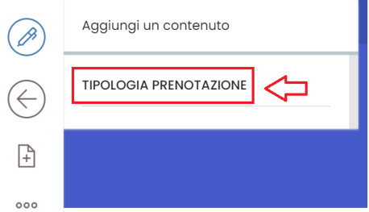

La sezione **Campi aggiuntivi** consente di aggiungere un numero a piacere di campi supplementari, che seguono il campo “Dettagli”, per permettere l’inserimento di ulteriori campi compilabili. Al momento è possibile inserire soltanto campi di tipo “testo”

### Workflow delle prenotazioni

Gli stati per una prenotazione possono essere:

- **In attesa:** quando la prenotazione è stata creata, e necessita di conferma da parte di un operatore (nel caso di “conferma automatica”, questo stato viene saltato direttamente)
- **Confermata:** quando un operatore accetta manualmente la prenotazione, oppure è attivata la “conferma automatica”
- **Rifiutata:** quando la prenotazione viene rifiutata dall’operatore (visibili soltanto dalla vista di ricerca)

## Gestione delle prenotazioni pervenute da parte degli operatori

Per gli utenti operatori del sito, è possibile accedere alla visualizzazione delle prenotazioni pervenute, in modo da

- gestirle (confermarle, rifiutarle, spostarle)
- ricercare le prenotazioni di una certa giornata o periodo
- verificare lo stato di allocazione delle diverse stanze in una certa giornata
- scaricare le prenotazioni della giornata o di un certo periodo, per uso interno (es. La gestione quotidiana degli operatori allo sportello)

Per poter gestire una stanza di prenotazioni, l’utente deve avere il permesso appropriato sulle diverse stanze. Questo si ottiene condividendo il permesso direttamente sulla stanza. Se per esempio la stanza si chiama https://\<sito>/stanza-prenotazioni, andando all'indirizzo https://\<sito>/stanza-prenotazioni/ **sharing**, oppure accedendo dal dettaglio della stanza attraverso l’apposito pulsante

ed impostare poi il permesso di gestore delle prenotazioni. L’assegnazione del permesso può essere fatta indipendentemente per persona singola, oppure per gruppo. Si veda la {doc}`sezione dedicata alla gestione dei permessi sugli oggetti </manuale-io-comune/account-e-ruoli>`.

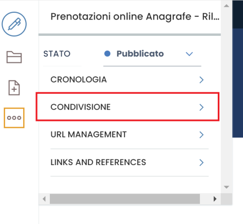

### Suddivisione ruoli “operatore prenotazioni” e “manager prenotazioni”

Con la seguente impostazione, ovvero selezionando tutti i check disponibili, operatore avrà il controllo sia sulla cartella prenotazioni (modifica degli orari, tipologie, ecc) che sulle prenotazioni stesse:

Selezionando solo i check “Può gestire le prenotazioni” e “Può vedere”, l’utente (o il gruppo di utenti) potrà lavorare esclusivamente le prenotazioni senza la possibilità di editare la cartella prenotazioni (disponibile dalla versione 1.8.3 del prodotto, si veda la sezione https://\<sito>/ **release-log** -sezione “io-Prenoto”- per verificare la propria versione installata).

### Gestione della cartella prenotazioni

Alla gestione della stanza da parte degli operatori si accede direttamente cliccando in visualizzazione nella stanza stessa. Il cruscotto è suddiviso in due pannelli:

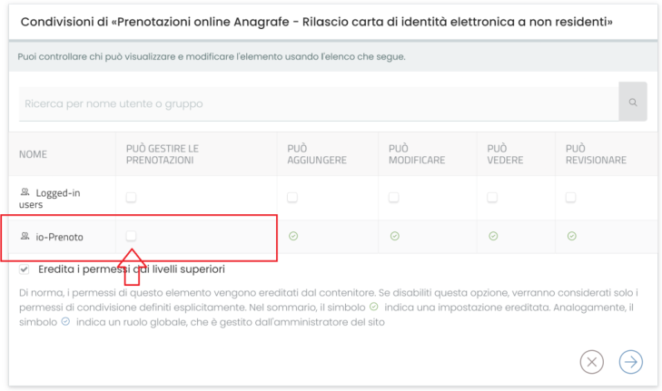

#### Vista “Ricerca”

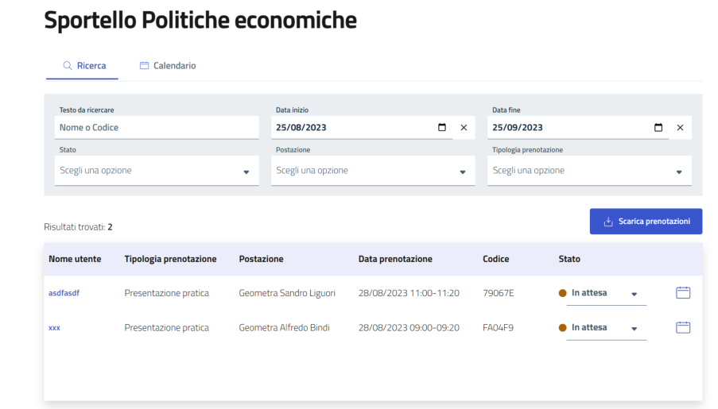

Il pannello di ricerca consente di recuperare prenotazioni per :

- testo da ricercare (nome dell’utente che ha effettuato la prenotazione, oppure codice prenotazione)
- periodo in cui sono presenti prenotazioni
- stato della prenotazione
- Postazione
- Tipologia di prenotazione

Inoltre, sempre in questa vista, è possibile:

- Gestire lo stato della prenotazione (“Conferma” se in attesa, “Rifiutarla” se già confermata)
  - Nel caso di “Rifiuto” l’operatore può inserire anche una motivazione nell’apposita popup, testo che verrà inviato nella mail di notifica al cittadino

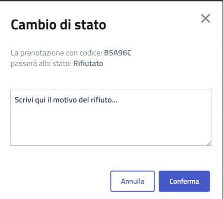

- Spostare la data di una prenotazione (pulsante “Cambia slot”), che manderà l’operatore sulla vista calendario, in corrispondenza della giornata, per scegliere a quale ora/sportello posizionarla. Sarà eventualmente possibile cambiare anche la giornata.
- Scaricare la lista delle prenotazioni visibili al momento nel pannello di ricerca (dipendentemente da eventuali filtri impostati)

### Vista “Calendario”

La vista calendario consente di mostrare la situazione della stanza di prenotazione nelle specifiche giornate. E’ dotata di:

- Campo calendario in cui è possibile sia selezionare un giorno, sia spostarsi velocemente con le frecce tra le diverse giornate. La data preimpostata è sempre quella odierna
- Per la stanza vengono presentate tante colonne quante sono le postazioni (gate) impostate per la stanza; per ognuna di esse vengono mostrate le prenotazioni e/o gli eventuali “blocchi risorsa” presenti, nonchè le pause (in giallo). Cliccando su una prenotazione già presente se ne vede il dettaglio in popup. Cliccando sull’accordion in testa ad ogni colonna

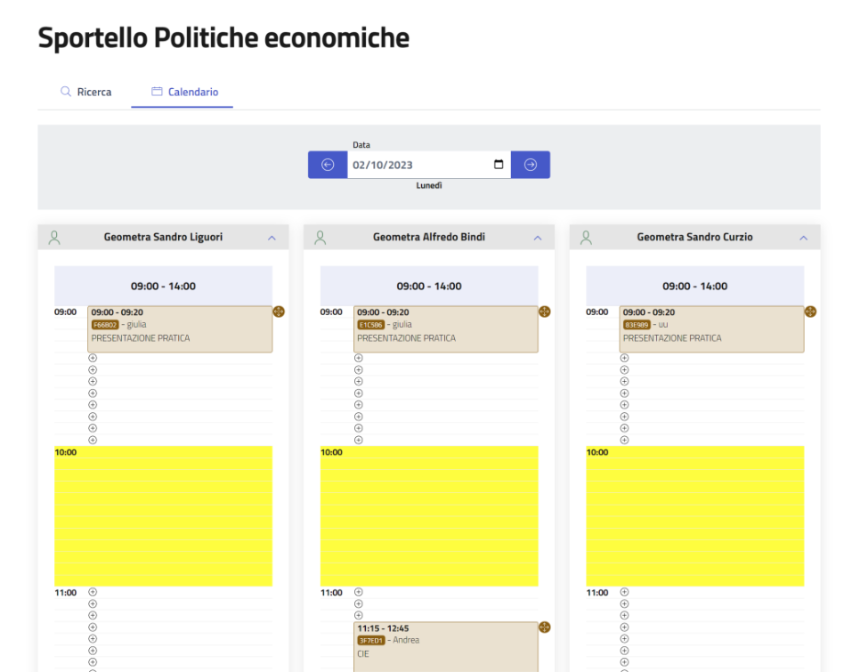

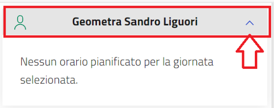

sarà possibile escludere dalla visualizzazione quella colonna (utile nel caso in cui ci siano più postazioni, e si voglia mantenere il focus soltanto su una postazione particolare)

- Cliccando su singolo slot orario (intervalli di 5 minuti, pulsante 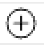 ) l’operatore può inserire manualmente una prenotazione, a partire dall’orario scelto e per la durata che dipende dalla tipologia prenotazione selezionata (chiaramente una prenotazione non potrà essere inserita nel caso in cui, a partire dall’ora di inizio e dipendentemente dalla sua durata, dovesse accavallarsi ad una prenotazione già presente, sia confermata che non)

  - Con questo stesso stesso strumento, l’operatore può inserire sia la prenotazione (pubblica o privata), sia il “Blocco risorse”

Nel caso si intenda inserire un “Blocco risorsa”, sarà possibile indicare la durata e il testo descrittivo del

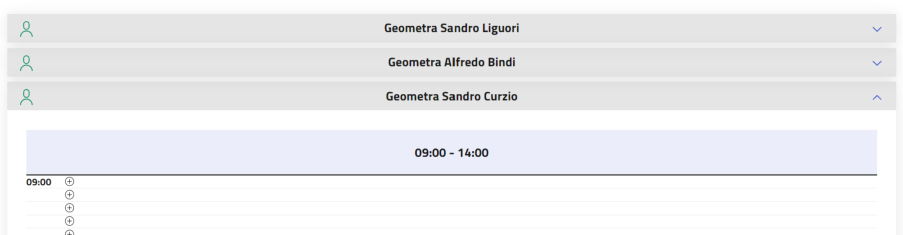

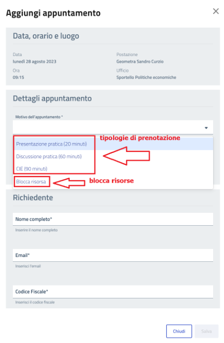

blocco

La granularità della prenotazione o del blocco risorse è di 5 minuti. L’operazione di “blocca risorse” fatto dall’operatore è esente dalla configurazione della stanza per il campo “Massimi giorni nel futuro”: di conseguenza l’operatore ha massima libertà temporale per l’inserimento dei blocca risorse.

Dalla stessa vista è possibile spostare direttamente la prenotazione in un giorno/ora/sportello desiderato:

- Cliccare sul pulsante “ **Sposta”**
- Spostarsi con il mouse sull’orario/sportello desiderato (viene proposto il vecchio orario barrato, e quello nuovo in base allo slot orario su cui si è posizionati)

- Cliccare “conferma” 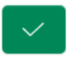 o “annulla”  per confermare/annullare l’operazione

NB: non sarà possibile spostare e sovrapporre una prenotazione al posto di una prenotazione già presente

Cliccando sulla singola prenotazione (da qualsiasi vista) sarà possibile visualizzare il dettaglio della

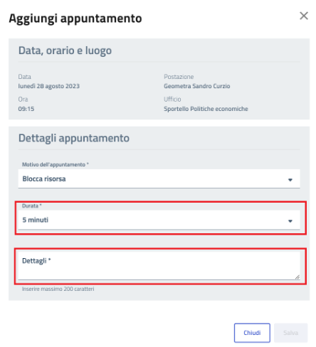

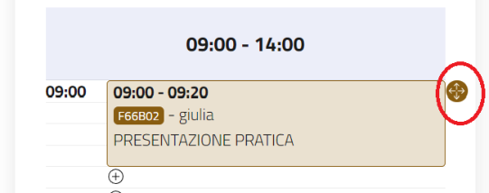

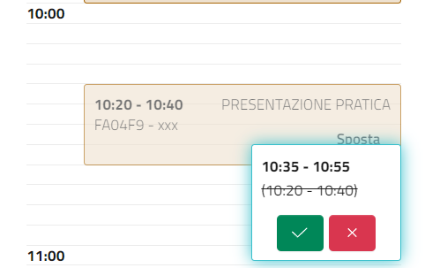

prenotazione, con la possibilità di inviare nuovamente il messaggio di promemoria (email) al cittadino.

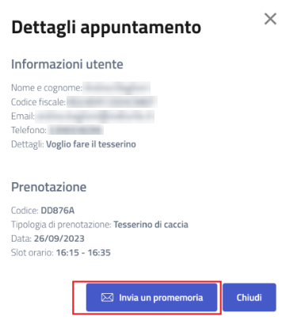

### Ricerca del primo slot disponibile

All’interno della vista calendario è presente una funzionalità che consente di trovare il primo slot disponibile per una determinata tipologia di prenotazione gestita dalla stanza.

Tale funzionalità permette di:

- specificare una data di partenza da cui cercare la prima disponibilità
- specificare per quale tipologia di prenotazione si intende ricercare (a seconda delle tipologie impostate)

Selezionando la data e la tipologia, il sistema trova automaticamente la prima giornata disponibile, posizionando automaticamente il calendario su tale giornata, e mostrando a video il riferimento della data/ora trovata

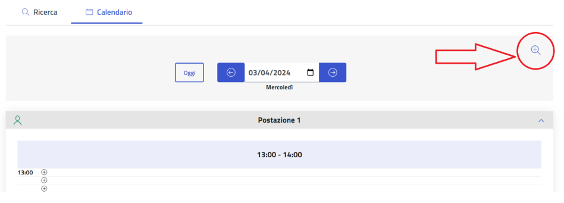

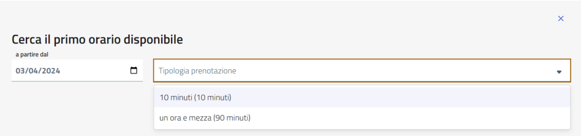

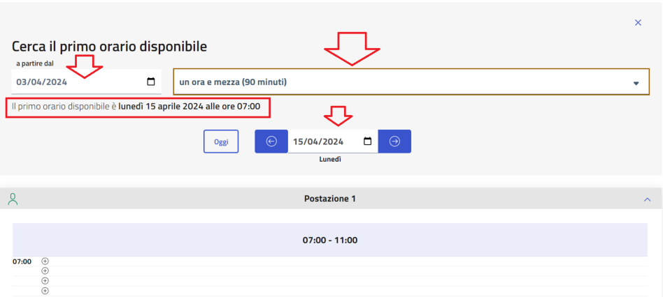

### Shortcut tastiera

Sia per questioni di accessibilità, sia per agevolare l’operatività degli utenti, da tastiera sono disponibili queste combinazioni per velocizzare alcune operazioni:

- **Alt + Freccia Destra, Alt + Freccia Sinistra** : consentono di passare velocemente da una vista all’altra (vista Ricerca, vista Calendario)

- **Esc** : se attivo lo spostamento di una prenotazione, annulla l’operazione di spostamento.
