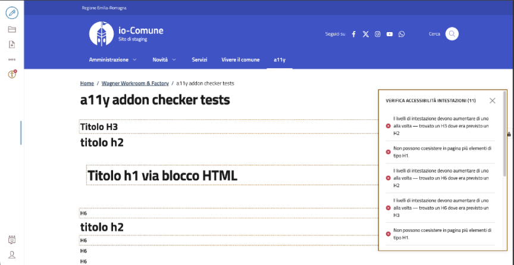
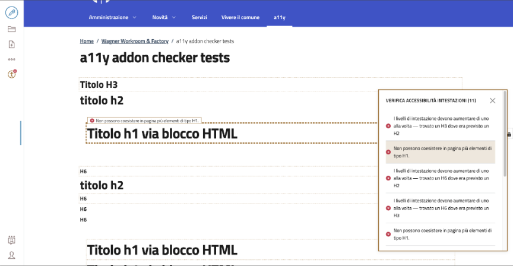
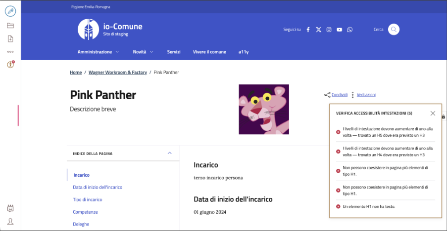

# Accessibility checker

```{include} /_snippets/funzionalita-aggiuntiva.md
```

L’attivazione del modulo permette di verificare se l’ordinamento dei titoli all’interno della pagina è gestito in maniera corretta. Per l’accessibilità, e per favorire il posizionamento sui motori di ricerca, è essenziale utilizzare i titoli secondo il loro ordine gerarchico e di importanza. Questo tool segnala se gli H sono inseriti in pagina correttamente.

## Come si usa

Aprire una pagina in modalità vista (non in modifica) con un utente che ha il ruolo admin o editor. Attendere il caricamento completo della pagina: la scansione parte da sola una volta che i blocchi si sono stabilizzati. Osservare l'icona nella toolbar: Nessun problema: icona normale. Problemi rilevati: icona di avviso/errore.

Cliccare sull'icona per aprire il pannello con l'elenco dei problemi trovati, nell'ordine in cui compaiono in pagina.




Cliccare su una voce dell'elenco per far scorrere la pagina fino all'intestazione interessata: viene evidenziata con un contorno tratteggiato, mentre le altre si affievoliscono.

Chiudere il pannello cliccando sulla x oppure premendo Esc. Lo strumento funziona sia sui content type a blocchi sia su quelli a form (es. Persona).




