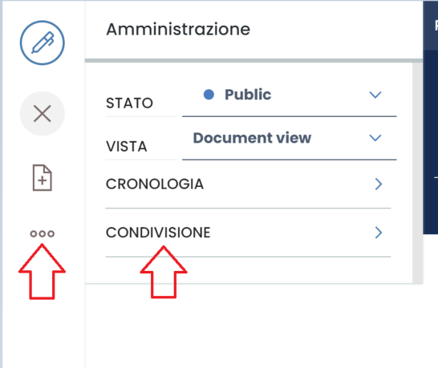

# Account e ruoli

La gestione degli utenti e dei ruoli può essere effettuata attraverso questa URL: **https://\<sito>/admin/@@usergroup-userprefs** previa autenticazione con diritti di amministratore

La differenza tra navigazione autenticata e navigazione anonima è facilmente intuibile: in generale, l‘utente anonimo vede tutti e soli i contenuti pubblicati dalla redazione, l’utente autenticato ha invece la possibilità di accedere alla parte di _backend_ in cui è possibile la gestione vera e propria degli stessi, anche dei documenti ancora in stato privato, sempre comunque in base ai permessi attribuitigli. Non tutti gli utenti autenticati però possono fare le stesse cose: esistono ruoli che permettono di gestire soltanto i propri documenti, altri che permettono solo di intervenire per la pubblicazione (si veda la sezione _**Workflow**_ ), altri ancora che permettono un accesso completo. Soltanto il ruolo Admin ha la possibilità di definire nuovi utenti/permessi oppure _gruppi_ di utenti (sostanzialmente un gruppo è un aggregato di utenti che di conseguenza hanno gli stessi diritti). I ruoli sono i seguenti:

|RUOLO|DESCRIZIONE|RIFERIMENTI|
|---|---|---|
|**Collaboratore**|Utente autenticato che aggiunge e modifica soltanto i suoi contenuti||
|**Lettore**|Utente autenticato che vede anche i documenti in stato privato||
|**Contributore (Utente)**|Utente base, solo autenticato, ovvero dotato di username/password per l’autenticazione||
|**Editor**|Utente autenticato che vede e modifica qualsiasi contenuto, anche in stato_privato_||
|**Revisore**|Utente autenticato che agisce solo sullo stato di pubblicazione o meno dei contenuti||
|**Admin**|Utente autenticato che gestisce tutto il sito||
|**Manager**|Come admin, ma ruolo di servizio|Accede anche all’area riservata di configurazione a basso livello del sito(riservato  a RedTurtle)|

E’ possibile collegare gli utenti del sito a basi dati LDAP/ActiveDirectory aziendali. Per maggiori informazioni contattare il team RedTurtle.

## Gestione utenti a livello di cartelle o particolari contenuti

E’ possibile riservare accessi utente soltanto a particolari cartelle/contenuti singoli del piano editoriale Questo è possibile attraverso l’apposito pulsante “ **Condivisione** ” presente per ogni elemento

Ricercando l’utente/gruppo, esso comparirà nella tabella, e ad esso sarà possibile assegnare il potere desiderato per quell’oggetto specifico o per quella cartella (NB: in questo caso i permessi

vengono ereditati anche dagli oggetti contenuti nella cartella
