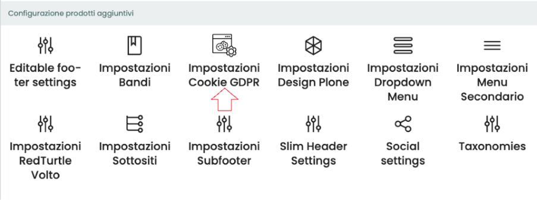
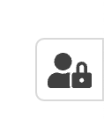
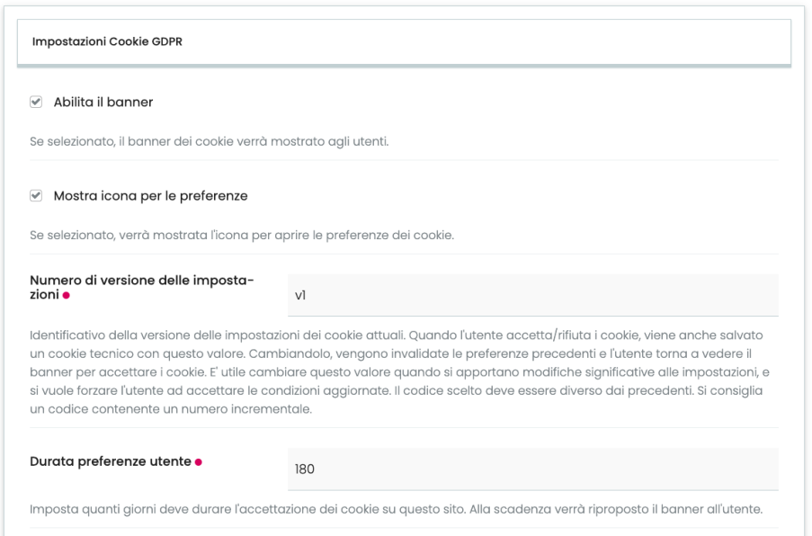
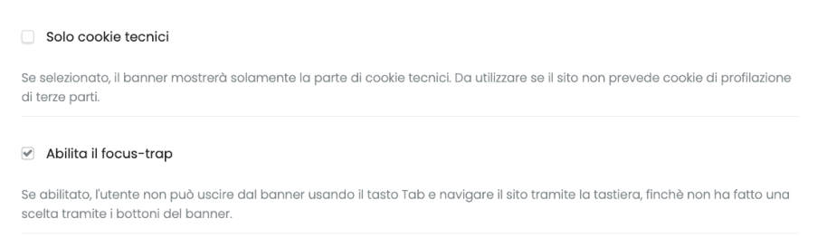
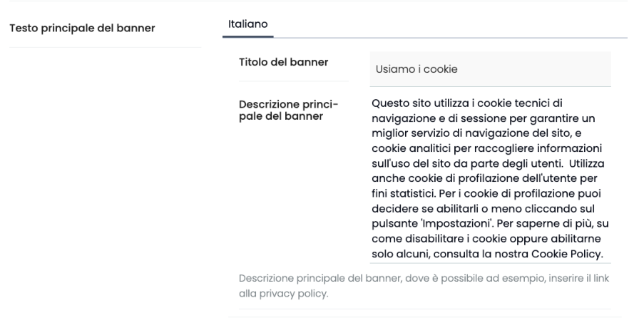
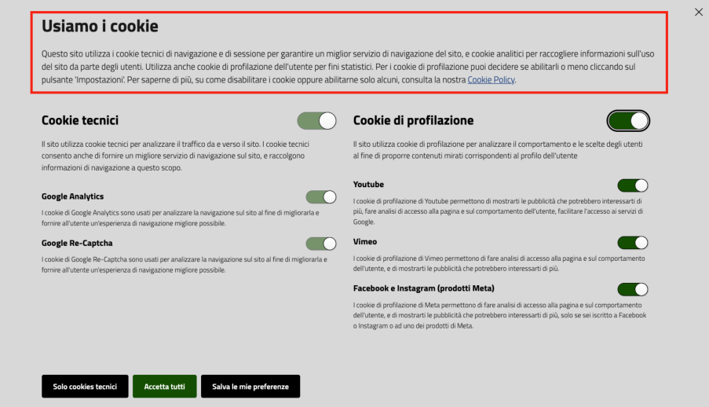
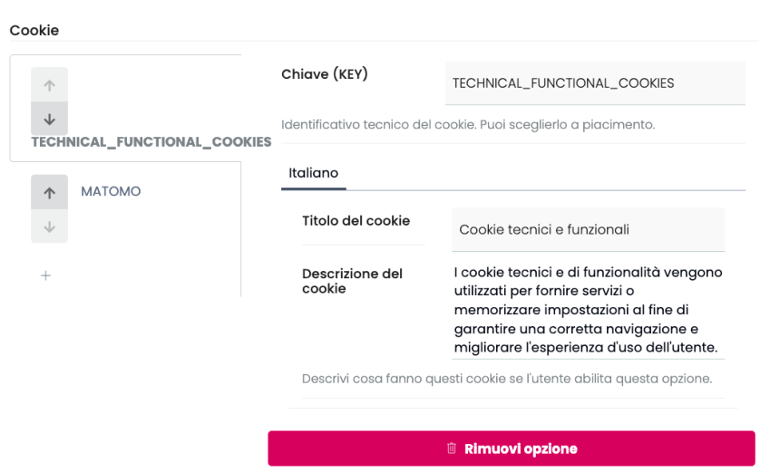
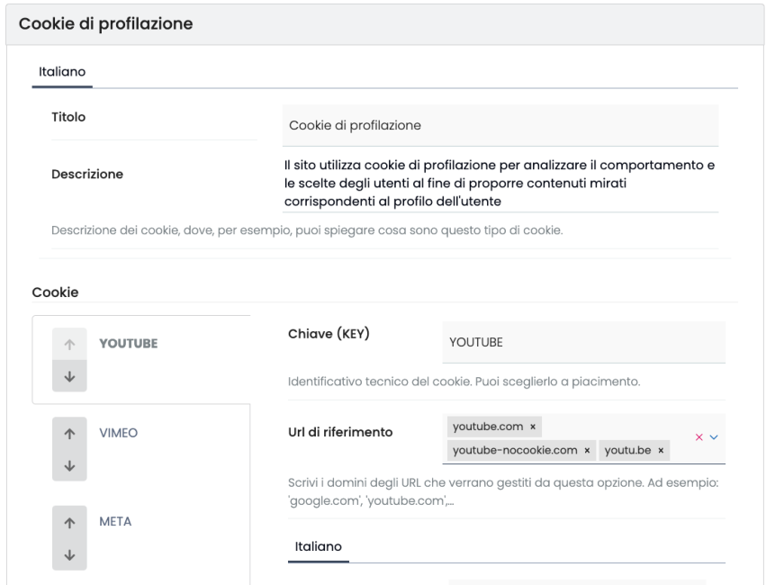
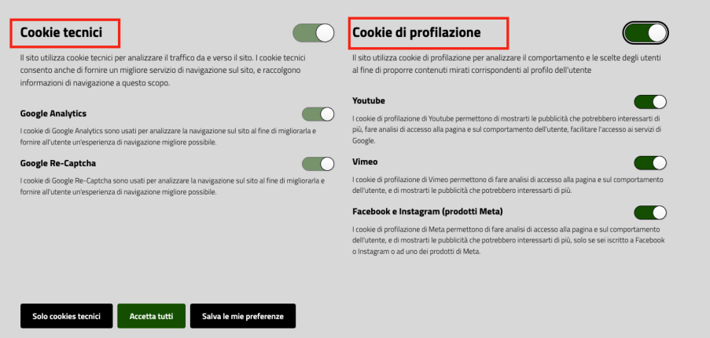

# Configuratore Cookie Banner

La configurazione dei Cookie Banner del sito è possibile attraverso l’apposito pannello di configurazione, raggiungibile da parte dell’amministratore del sito nella sezione “Configurazioni prodotti aggiuntivi”:

Arrivati sulle impostazioni per il Cookie Banner sono disponibili diverse sezioni.

Troverete i campi già compilati, controllare che corrispondano all’attuale cookie banner.

**Impostazioni generali:** I primi campi rispecchiano i setting generali e possono essere lasciati così per il momento:

- **Abilita il banner:** se selezionato, il banner dei cookie verrà mostrato agli utenti.
- **Mostra icona per le preferenze:** se selezionato, verrà mostrata l'icona per aprire le preferenze dei cookie

- **Numero di versione delle impostazioni (campo obbligatorio):** lasciare invariato, modificare solo se vengono modificate le impostazioni descritte sotto del cookie banner, in modo che il banner venga ri-presentato all’utente (azzera così le preferenze precedentemente selezionate).

- **Durata preferenze utente** **(campo obbligatorio):** lasciare invariato, imposta quanti giorni deve durare l'accettazione dei cookie su questo sito. Alla scadenza verrà riproposto il banner all'utente.

- Selezionare “ **solo cookie tecnici** ” qualora il vostro sito presenti solo “cookie tecnici”.
- **Abilita il focus-trap:** Se abilitato, l'utente non può uscire dal banner usando il tasto Tab e navigare il sito tramite la tastiera, finché non ha fatto una scelta tramite i bottoni del banner.

Inserire/controllare i testi relativi al **titolo** del banner e **descrizione** nello stesso:

Questa è la parte di testo che compare sul banner nella parte in alto:

**Impostazioni Cookie tecnici:**

Compilando questa sezione, inserendo una “Chiave (KEY)” identificativa a piacimento, titolo e descrizione del cookie, si andrà a settare e popolare la parte del banner relativa ai cookie tecnici.

È possibile aggiungerne diversi e modificare l’ordinamento tra di loro tramite le frecce.

**Impostazioni Cookie di profilazione:**

Come per i cookie tecnici, compilando questa sezione, inserendo una “Chiave (KEY)” identificativa a piacimento, titolo e descrizione del cookie, si andrà a settare e popolare la parte del banner relativa ai cookie di profilazione.

È possibile aggiungerne diversi e modificare l’ordinamento tra di loro tramite le frecce.

I testi dei bottoni: “solo cookie tecnici”, “accetta tutti” e “salva le mie preferenze” non sono modificabili.
