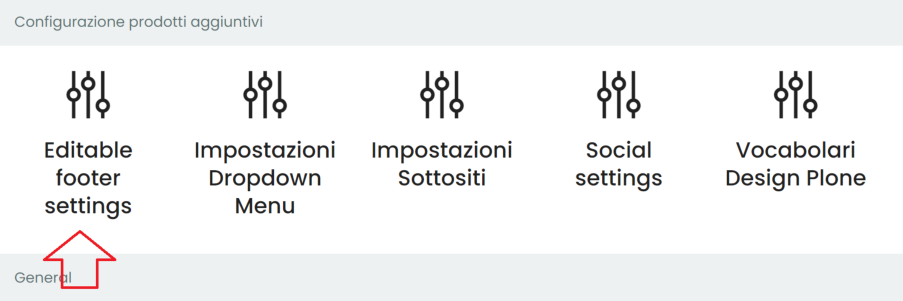
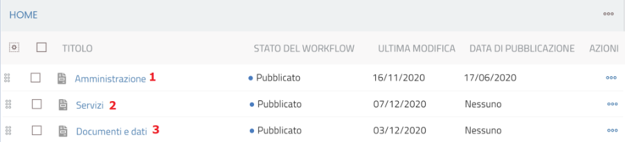
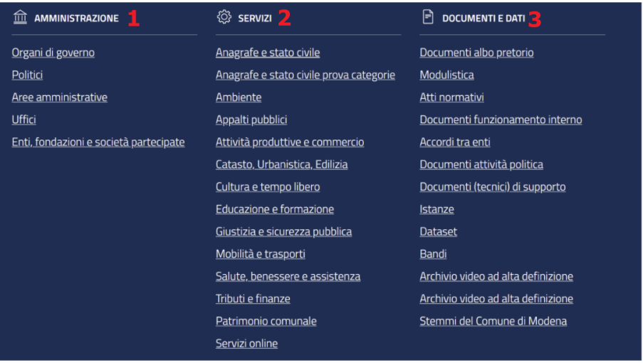
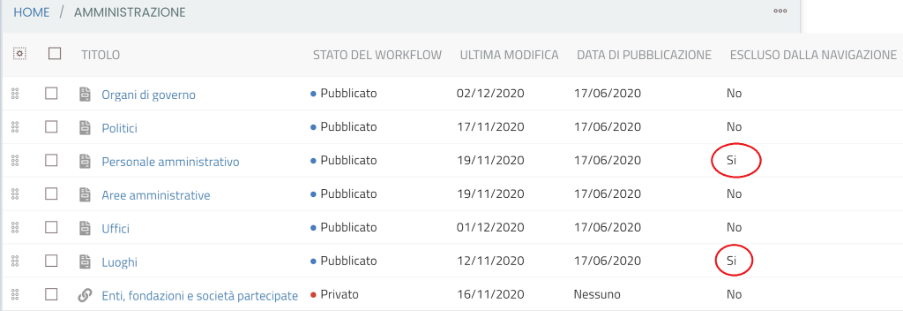
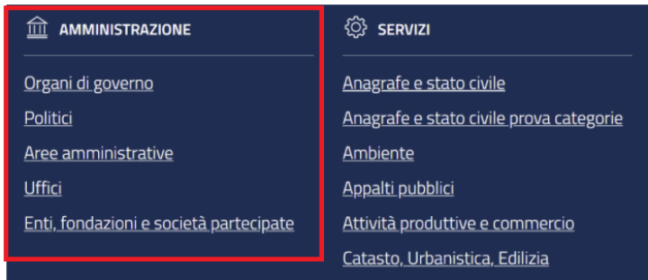
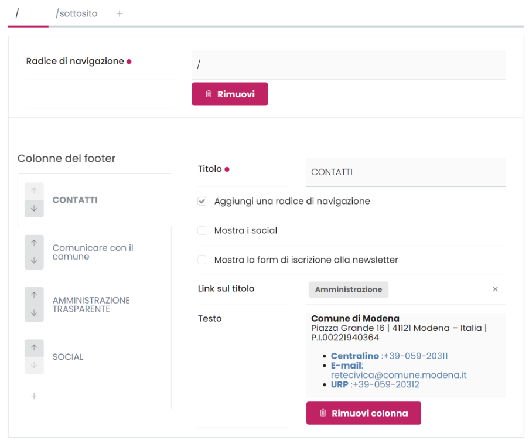
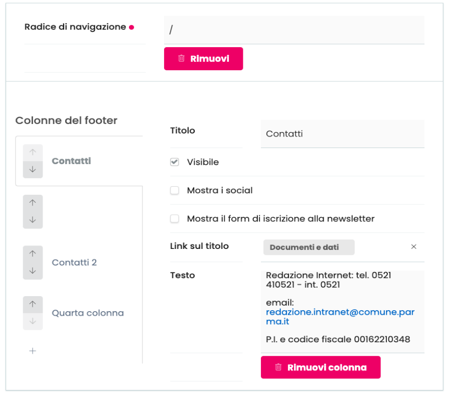
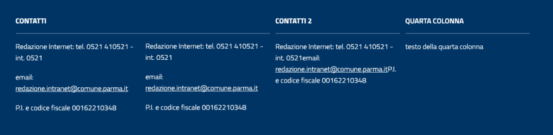

# Configuratore del footer

La configurazione del footer del sito è possibile attraverso l’apposito pannello di configurazione, raggiungibile da parte dell’amministratore del sito nella sezione:

**Configurazione del sito -> Configurazione prodotti aggiuntivi -> Editable footer settings**

Questa sezione permette di configurare i box più in basso del footer, mentre tutte le altre voci vengono automaticamente impostate dal sistema recuperando i contenitori (voci di primo livello, mostrate come etichette del box) che si trovano nell’alberatura del sito, ed esplodendo automaticamente per ciascuna di esse le voci in esse contenute, all'interno di ciascun box.

Ad esempio, se nella radice del sito abbiamo le seguenti voci:

la prima parte del footer (generata automaticamente) sarà la seguente

Le icone associate a ciascun titolo del box sono attribuite automaticamente dal sistema. Le voci all’interno di ciascun box, come detto sopra, sono gli oggetti contenuti all’interno di ogni sezione, per esempio, per il box “Amministrazione”:

NB: la proprietà “ **Escludi alla navigazione** ” fa si che la voce non venga mostrata, pur essendo pubblicata

La parte finale del footer è configurabile con uno strumento analogo a quello utilizzato per impostare il megamenù

In caso di sottositi, è possibile configurare footer differenti per ciascuno di essi, a seconda della **Radice di navigazione** selezionata

Le **colonne del footer** rappresentano i box che verranno configurati ( _NB: è possibile affiancare_ _orizzontalmente fino a 4 box, in caso di numero superiore, gli altri box a partire dal quinto verranno_ _disposti su una riga differente_ )

Il check “ **Visibile** ” consente di rendere visibile il box

Il check “ **Mostra i social** ” consente di elencare le icone dei social configurati (si veda l’apposita sezione)

Il check “ **Mostra la form di iscrizione alla newsletter** ” consente di mostrare il box per l’iscrizione (nel caso di integrazione con una newsletter interna)

**“Link sul titolo”** consente di inserire un link interno sul titolo del box

**“Testo”** consente di inserire ulteriori informazioni attraverso un editor di testo configurabile

**Configurazioni avanzate** Esiste la possibilità di non compilare il campo **titolo** di ogni colonna del footer configurabile: in questo caso verrà mostrato il testo della colonna **senza titolo** e il **link sul titolo** **non sarà visibile o** **cliccabile.** Questo utilizzo è atto a creare colonne contigue contenenti testo affine, come ad esempio dei contatti o dei riferimenti, **ed è puramente stilistico** . Per ottenere questo stile basterà **compilare una colonna con titolo e testo, seguita da una o più** **senza titolo.** In ogni caso, **se una colonna senza titolo è seguita da una col titolo, queste saranno** **visibilmente separate** .

