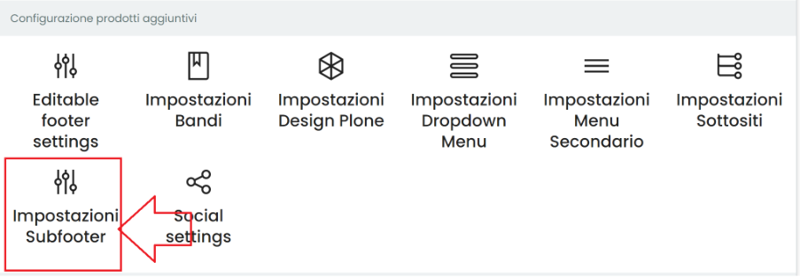

# Configuratore subfooter

Consente di configurare le voci che si trovano sotto il footer del sito

Il funzionamento del plugin di configurazione è analogo al comportamento del plugin per il megamenù

