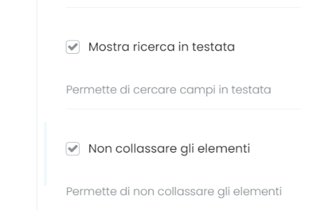
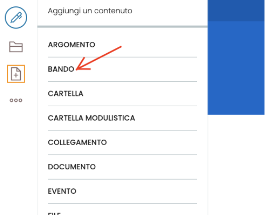
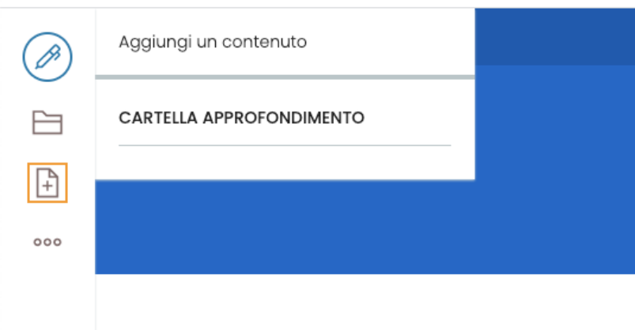
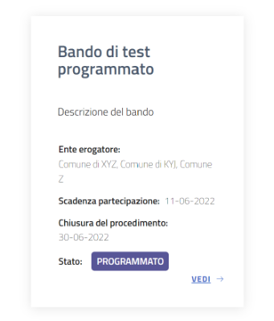
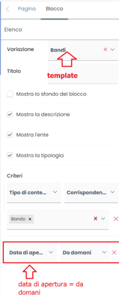
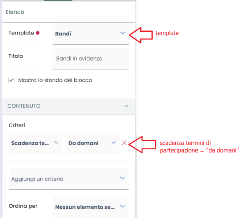
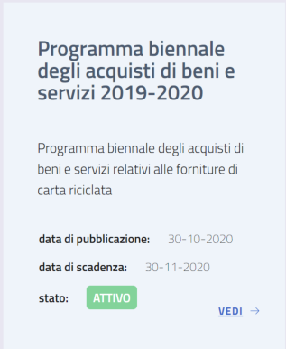
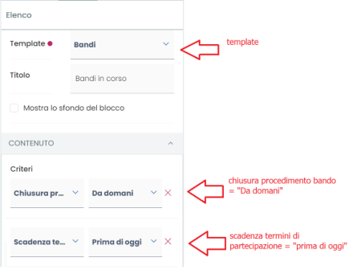
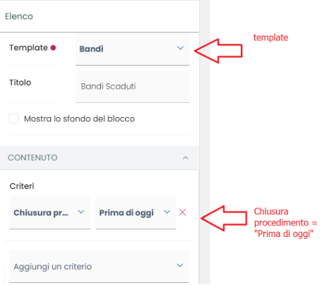

# Content-type “Bando”

Questa Tipologia descrive un bando o un concorso rivolto a coloro che vogliono lavorare per l'ASL (principalmente rivolto a fornitori e specialisti del settore sanitario).

Oltre a titolo e descrizione abbiamo i seguenti campi (in giallo i campi obbligatori):

Elemento **Descrizione**

|Titolo del bando o concorso|Il titolo del bando o del concorso. In interfaccia, questo elemento apparirà nella Hero della pagina.|
|---|---|
|**Data di pubblicazione**|Data in cui il bando o il concorso è stato pubblicato dall'ente competente. In interfaccia, questo elemento apparirà nella Hero della pagina.|
|**Data di scadenza**|Data ultima per presentare la candidatura per la partecipazione al bando o al concorso. In interfaccia, questo elemento apparirà nella Hero della pagina.|
|**Stato del bando o concorso**|Indicare se il bando o il concorso è aperto o chiuso. In interfaccia, questo elemento apparirà nella Hero della pagina.|
|**Cos'è**|Descrizione sintetica del bando o del concorso, con collegamento al file scaricabile ufficiale o alla piattaforma esterna dove è presente il documento ufficiale.|
|**A chi è rivolto**|Descrizione testuale degli utenti a cui è rivolto il bando o il concorso e gli eventuali requisiti di accesso.. Se utile, aggiungere l'indicazione delle voci della Tassonomia Utenti associabili a questo bando o concorso. Non usare i tag Utenti se l'evento è rivolto a tutti gli utenti dell'ASL.|

|Come partecipare|Descrizione delle modalità di partecipazione al bando o al concorso e collegamento, tramite pulsante "Partecipa", al flusso di candidatura online, se disponibile.|
|---|---|
|**Modalità di selezione**|Informazioni sulle modalità di selezione, ad esempio da quante prove e di che tipo è composta la selezione.|
|**Graduatoria**|Collegamento alla graduatoria, una volta pubblicata. Può essere un link a un portale esterno o download diretto di un file. Se la graduatoria non è stata ancora pubblicata, indicare quando è prevista la pubblicazione.|
|**Altri allegati**|Lista di altri documenti importanti, con collegamento alle relative pagine foglia documento o download diretto dell'allegato.|
|**Adempimenti consequenziali**|Lista degli adempimenti consequenziali legati al bando o concorso come da normativa.|
|**Parliamo di**  |Indicazione degli argomenti con cui il contenuto di pagina è stato taggato. Al click, l'utente atterra sulla relativa Pagina aggregatrice Argomento.[^n12]|

Al suo interno sono aggiungibili oggetti di tipo “Cartella approfondimento”:

Questi sono contenitori di collegamenti, file e moduli, che saranno poi mostrati nella visualizzazione del bando nella sezione “Allegati”.

[^n12]: Si veda la sezione di ricerca dedicata

Tornando alla vista del bando, ci sono 4 possibili stati del bando che vanno oltre la sua semplice pubblicazione. Potremo avere bandi che una volta pubblicati sono:

- Programmati
- Attivi
- In corso
- Scaduti

Questo stato del bando è determinato dalle date interne al bando. Per la “Data di apertura” abbiamo un **bando “programmato”.** Fra la data di pubblicazione (pubblicazione plone) e la data “Data e ora di scadenza”, abbiamo un **bando “attivo”** . Passata la “Data e ora di scadenza” e prima della data “Data chiusura procedimento” abbiamo un **bando “in corso”** Passata la “Data chiusura procedimento” abbiamo un **bando “scaduto”** .

## Visualizzazione dei Bandi in una pagina

A questo punto può essere necessario visualizzare in appositi blocchi elenco tutti i bandi programmati, attivi, in corso o scaduti.

In una pagina è sufficiente creare dei blocchi elenco con opportuni filtri. Ad esempio:

- **Blocco elenco per i bandi programmati (in via di rilascio)**

- **Blocco elenco per i bandi aperti (o attivi)**

- **Blocco elenco per i bandi in corso**

- **Bandi scaduti**

**Nota:** Tra i vari criteri il criterio “ **Scadenza termini partecipazione** ” presenta fra i vari attributi anche i seguenti:

- “dopo la relativa data”: che indica “fra oggi e N giorni fa”
- “prima della relativa data”: che indica “fra oggi e N giorni da oggi”

  - “Oggi” è compreso all’interno del periodo temporale.

