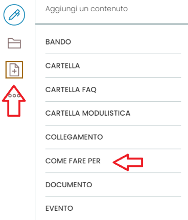
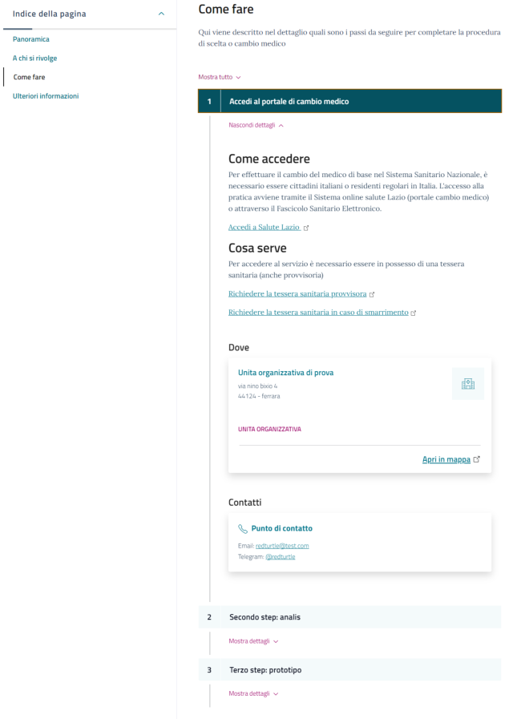
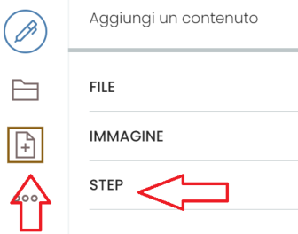
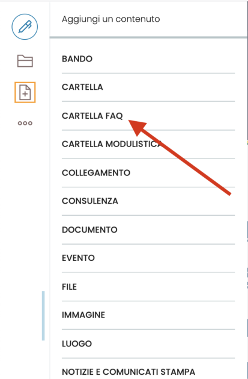
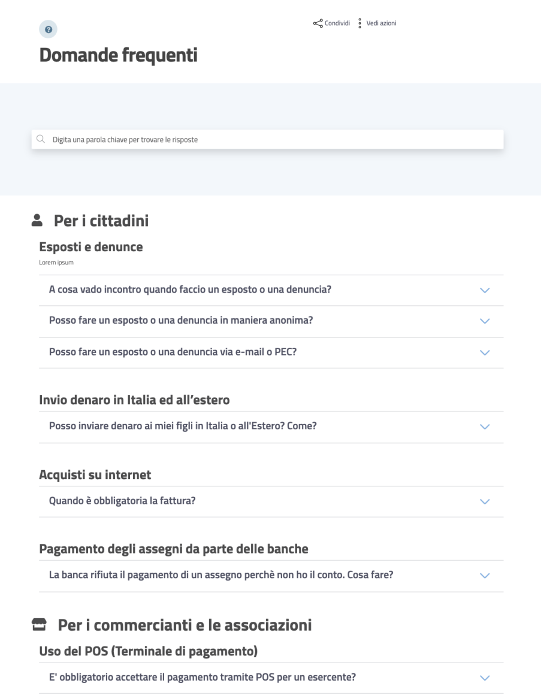

# Content-type “Come fare per”

Tipologia che descrive i passi di una procedura che gli utenti delle ASL devono seguire per ottenere qualcosa, generalmente una procedura amministrativa (Prenotare servizi e prestazioni, Ritirare referti, Cambiare o scegliere il medico di base, etc.)

Oltre a titolo e descrizione abbiamo i seguenti campi (in giallo i campi obbligatori):

**Elemento** **Descrizione**

|Titolo del Come fare per|Il titolo relativo alla della procedura passo per passo per la quale si vogliono dare indicazioni. In interfaccia, questo elemento apparirà nella Hero della pagina.|
|---|---|
|**Sottotitolo**|Eventuale sottotitolo della procedura, ad esempio un nome che la identifica informalmente. Si differenzia dalla descrizione breve perché aggiunge ulteriori informazioni identificative (come ad esempio un altro nome che può essere usato), ma non basta per descriverla e far capire di cosa si tratta a un utente che non ne ha mai sentito parlare. In interfaccia, questo elemento apparirà nella Hero della pagina.|
|**Descrizione breve**|Descrizione sintetica, con un linguaggio semplice, che possa aiutare qualsiasi utente a identificare con chiarezza di che tipo di procedura si tratta e il contenuto di pagina. Non utilizzare un linguaggio ricco di riferimenti normativi, amministrativi o scientifici. In interfaccia, questo elemento apparirà nella Hero della pagina.|
|**Immagine**|Immagine che rappresenta la procedura descritta. In interfaccia, questo elemento apparirà nella Hero della pagina.|
|**Panoramica**|Descrizione più estesa della procedura di cui viene descritto il processo di usufruizione con questa scheda.|
|**A chi è rivolto**|Descrizione testuale degli utenti dell'ASL a cui è rivolta la procedura. Se utile, aggiungere l'indicazione delle voci della Tassonomia Utenti associabili a questa procedura. Non usare i tag Utenti se la procedura è rivolta a tutti gli utenti dell'ASL.|
|**Come fare**|Descrizione passo per passo del processo da seguire per effettuare la procedura. Ogni passo può includere diverse informazioni, come costi, vincoli, tempistiche, indirizzi, collegamenti tramite card ad altre pagine del sito, contatti, documenti allegati.|

|Ulteriori informazioni|Eventuali ulteriori dati e informazioni utili allo svolgimento della procedura che non sono principali o legate a un passo specifico.|
|---|---|
|**Parliamo di**|Indicazione degli argomenti con cui il contenuto di pagina è stato taggato. Al click, l'utente atterra sulla relativa Pagina aggregatrice Argomento.[^n13]|
|**Ultimo aggiornamento**  |Data in cui è stato effettuato l'ultimo aggiornamento ai contenuti della pagina. Inserire almeno la data, scritta per esteso (ad esempio, 22 dicembre 2023)|

Oltre ai campi descritti nella tabella, particolare menzione viene data al campo “come fare”, che nel dettaglio del CT “Come fare per” viene rappresentato attraverso una sequenza di step:

[^n13]: Si veda la sezione di ricerca dedicata

Ogni step è rappresentato da un apposito CT che può essere creato soltanto all’interno di un CT “Come fare per”. Di default, gli step all’interno del dettaglio del “Come fare per” sono collassati, sull’espansione mostrano i dati di dettaglio di ciascun passo.

All’interno di un CT “Come fare per” è possibile inserire CT Pagina. L’effetto finale sul CT è quello di

avere una sezione dal titolo “Approfondimenti” con le card che rappresentano i link a tali oggetti

## Content-type “Step”

Passo rappresentato nell’accordion della sezione “Come fare” del CT “Come fare per”

Si può inserire soltanto all’interno di un CT “Come fare per”

|I campi del CT sono:||
|---|---|
|**Titolo**|Titolo dello step|
|**Testo**|Campo a blocchi formattabili, che verranno presentati all’espansione dello step|
|**Dove**|Collegamento ad eventuali Unità organizzative|
|**Contatti** |Collegamento ad uno o più punti di contatto|

Alla creazione dello Step, viene creata automaticamente al suo interno una pagina contenitore “Allegati” all’interno della quale è possibile inserire file, che verranno mostrati nel dettaglio dello step con l’apposita card con link per scaricare la risorsa

:::{warning}
**Attenzione!** Non si devono modificare i nomi delle cartelle all’interno dello step.
:::

## Content-type “FAQ”

Le faq consentono di gestire e mostrare sul sito le risposte alle domande più frequenti.

Possono essere organizzate su infiniti livelli attraverso il tipo di contenuto ‘Cartella FAQ’ che permette di costruirne l’alberatura. Le domande (con le relative risposte), potranno essere inserite a qualsiasi livello dell’alberatura o ne costituiranno le ‘foglie’, ovvero non potranno avere ulteriori elementi di tipo faq al loro interno.

Vediamo come gestire le FAQ e l’alberatura delle FAQ.

## Cartella FAQ

E’ il tipo di contenuto che ci consentirà di costruire l’alberatura delle FAQ. E’ un ‘contenitore’ e può avere al suo interno ulteriori elementi di tipo ‘Cartella FAQ’ oppure FAQ vere e proprie (domanda con risposta). Aggiungere una Cartella FAQ dall’apposito menu della barra degli strumenti:

Le principali caratteristiche di una Cartella FAQ sono:

- Titolo
- Descrizione (Verrà mostrata sotto al titolo)
- Icona (verrà mostrata a sinistra del titolo). Nel menù a tendina sono presenti delle icone di default. Se si vuole una maggior personalizzazione, si può inserire una qualsiasi icona di

Fontawesome nel campo di testo subito sotto, come riportato nella descrizione. La lista con i nomi delle icone disponibili è presente al seguente indirizzo [https://fontawesome.com/v5/search?o=r&m=free&s=solid](https://fontawesome.com/v5/search?o=r&m=free&s=solid) Ad esempio: **deaf** **child** **arrow-alt-circle-right**

**NOTA** :

Le icone di Fontawesome di base sono quelle del set “ **Solid** ”. Se si vogliono usare le icone del set “Regular” o del set “Brands”, basta aggiungere davanti al nome dell’icona:
- **‘far’** per il set di icone “Regular”
- **‘fab’** per il set di icone “Brands”

Esempio:

-  ‘angry’ (equivale a scrivere ‘fas angry’)

-  ‘far angry’

-  ‘fab accessible-icon’ (Dal set ‘Brands’)

In visualizzazione, la cartella FAQ mostrerà sempre, oltre al titolo e alla descrizione nella testata, anche una fascia contenente un campo di ricerca nel quale l’utente potrà inserire le parole chiave da ricerca nelle FAQ presenti in tutta l’alberatura sottostante. Dopo la fascia di ricerca, verranno sempre mostrate tutte le Cartelle FAQ e le FAQ sottostanti. Cliccando sul titolo di una cartella FAQ sottostante, si accederà alla visualizzazione di quella Cartella FAQ che avrà sempre le stesse caratteristiche descritte fino ad ora. Ecco un esempio di visualizzazione di una Cartella FAQ:

