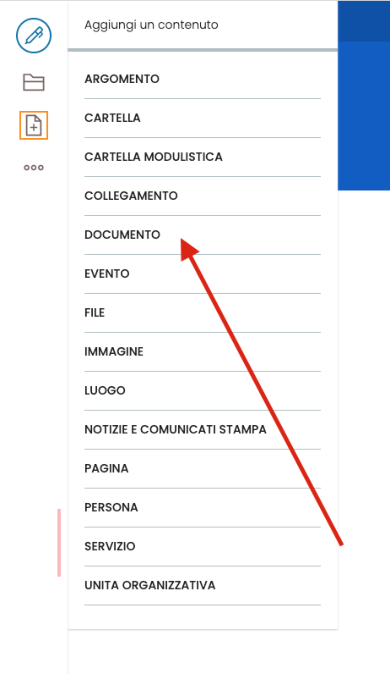
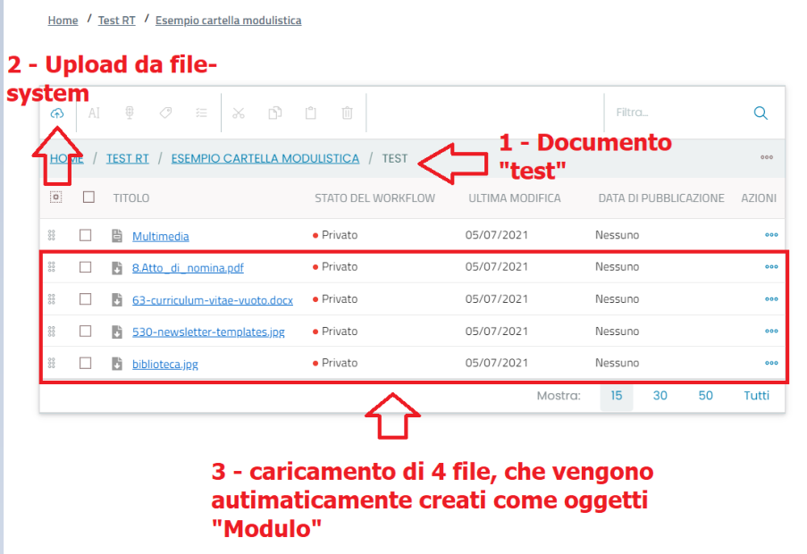

# Content-type “Documento”

Struttura delle informazioni relative utili a presentare un documento.

Oltre al titolo e descrizione, gli altri campi del content-type sono (in giallo i campi obbligatori):

**Elemento** **Descrizione**

|Titolo del documento|Nome del documento. Il nome del Documento deve essere facilmente comprensibile dagli utenti. Titolo della struttura. In interfaccia, questo elemento apparirà nella Hero della pagina.|
|---|---|
|**Descrizione breve**|Descrizione sintetica, con un linguaggio semplice, che possa aiutare qualsiasi utente a identificare con chiarezza di che tipo di documento si tratta e il contenuto di pagina. Non utilizzare un linguaggio ricco di riferimenti normativi, amministrativi o scientifici. In interfaccia, questo elemento apparirà nella Hero della pagina.|

|Protocollo|Numero di protocollo del documento. L'elemento è necessario se la tipologia di documento prevede protocollazione da normativa vigente. In interfaccia, questo elemento apparirà nella Hero della pagina.|
|---|---|
|**Data protocollo**|Data di protocollo del documento. L'elemento è necessario se la tipologia di documento prevede protocollazione da normativa vigente. In interfaccia, questo elemento apparirà nella Hero della pagina.|
|**Immagine**|Immagine di riferimento del documento. In interfaccia, questo elemento apparirà nella Hero della pagina.|
|**Cos'è**|Descrizione estesa del documento, utilizzando un linguaggio semplice che possa aiutare qualsiasi utente a identificarlo con chiarezza. Non utilizzare un linguaggio ricco di riferimenti normativi.|
|**Vai al documento**|Il collegamento al file del documento nel formato principale con download diretto.|
|**Formati alternativi**|Il collegamento a eventuali formati alternativi del documento, con download diretto.|
|**Servizio di riferimento / Procedura** **di riferimento**|Indicazione del servizio, la prestazione o la procedura (Come fare per) a cui fa riferimento il documento, con collegamento alle relative pagine foglia. Questo elemento è necessario se il documento fa riferimento a un servizio, una prestazione o una procedura (Come fare per). La label cambierà per adattarsi alla casistica: "Servizio di riferimento" o "Procedura di riferimento".|
|**Responsabile del documento**|Indicazione dell'unità organizzativa responsabile del documento, con collegamento alla relativa pagina foglia.|
|**Autore/i**|Indicazione dell'autore o degli autori del documento, con collegamento alle relative pagine foglia persona.|
|**Parliamo di**|Indicazione degli Argomenti e dei tag Utente con cui il contenuto di pagina è stato taggato. Al click, l'utente atterra sulla relativa Pagina aggregatrice Argomento o Utente.[^n11]|

[^n11]: Si veda la sezione di ricerca dedicata

## Creazione automatica dei moduli

All’interno del content-type “Documento” è possibile anche fare l’upload massivo di risorse prese esternamente (file-system).

Il caricamento di ogni file genererà automaticamente un oggetto “Modulo”, dove ogni file rappresenterà il formato principale scaricabile.

