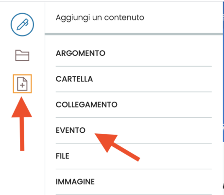

# Content-type “Evento”

Tipologia che descrive un evento di interesse pubblico organizzato da una ASL

E’ un content-type gestito con i blocchi, nel senso che il contenuto informativo dell’evento può essere gestito con la modalità “Pagina a blocchi”. Questo permette di formattare più agevolmente il contenuto, inserendo oltre che il testo, anche altri blocchi (immagini, elenchi di altri contenuti correlati, ecc) In questo caso, i campi del content-type saranno disponibili nella sidebar di destra.

Per tutti gli altri dati dell’evento, si veda la tabella sottostante.

I campi sono i seguenti (in giallo i campi obbligatori):

**Elemento** **Descrizione**

|Titolo dell'evento|Titolo dell'evento. In interfaccia, questo elemento apparirà nella Hero della pagina.|
|---|---|
|**Tipo di evento**|Il tipo di evento secondo la tassonomia prevista. In interfaccia, questo elemento apparirà nella Hero della pagina.|
|**Data e ora di inizio**|La data e l'ora in cui inizia l'evento. In interfaccia, questo elemento apparirà nella Hero della pagina.|

|Data e ora di fine|La data e l'ora in cui finisce l'evento. In interfaccia, questo elemento apparirà nella Hero della pagina.|
|---|---|
|**Descrizione breve**|Descrizione sintetica, con un linguaggio semplice, che possa aiutare qualsiasi utente a identificare con chiarezza di che tipo di evento si tratta e il contenuto di pagina. Non utilizzare un linguaggio ricco di riferimenti normativi, amministrativi o scientifici. In interfaccia, questo elemento apparirà nella Hero della pagina.|
|**Immagine**|Immagine dell'evento. Non usare locandine o immagini con testo. In interfaccia, questo elemento apparirà nella Hero della pagina.|
|**Cos'è**|Descrizione estesa dell'evento.|
|**Fa parte di**|Indicare se questo evento è parte di un altro evento che ne è "genitore" (ad esempio, un webinar che fa parte di "Settimana della salute"), con collegamento alla relativa pagina foglia evento. Questo elemento è necessario se l'evento fa parte di un evento genitore.|
|**Parteciperanno (Persone)**|Lista delle persone che parteciperanno all'evento, come eventuali relatori. Se si tratta di persone dell'ASL, includere collegamento alle relative pagine foglia persona.|
|**Galleria**|Una o più immagini o uno o più video corredate da didascalie|
|**A chi è rivolto**|Descrizione testuale degli utenti dell'ASL a cui è rivolto l'evento. Se utile, aggiungere l'indicazione delle voci della Tassonomia Utenti associabili a questo evento. Non usare i tag Utenti se l'evento è rivolto a tutti gli utenti dell'ASL.|

|Dove|Nome e indirizzo del luogo dove si svolge l'evento. Se è una struttura dell'ASL, includere collegamento con la relativa pagina foglia struttura. Se l'evento è un webinar, specificare che è online e includere il link alla piattaforma di streaming.|
|---|---|
|**Costo**|Indicazione del costo dell'evento. Se gratuito, specificare che l'evento è gratuito. Se disponibile, predisporre un link al flusso di acquisto online dei biglietti.|
|**Appuntamenti**|Lista degli eventi figlio, con collegamenti alle relative pagine evento. Questo elemento è necessario se l'evento è un evento genitore.|
|**Contatti**|Contatti degli organizzatori o della struttura organizzatrice dell'evento|
|**Documenti**|Elenco dei documenti correlati, con collegamento alle relative pagine foglia documento (se documenti ufficiali dell'ASL) o download diretto degli allegati|
|**Organizzato da**|Indicazione di chi ha organizzato l'evento. Se si tratta di un'Unità organizzativa dell'ASL, includere collegamento alla relativa pagina foglia.|
|**Patrocinato da**|Nome dell'ente che patrocina l'evento.|
|**Sponsor**|Lista degli sponsor dell'evento.|
|**Ulteriori informazioni**|Ulteriori informazioni sull'evento, FAQ ed eventuali riferimenti normativi|

|Eventi correlati|Elenco di altri eventi simili o collegati, con collegamento alle relative pagine foglia struttura.|
|---|---|
|**Parliamo di**  |Indicazione degli argomenti con cui il contenuto di pagina è stato taggato. Al click, l'utente atterra sulla relativa Pagina aggregatrice Argomento.[^n7]|

**Cartella Immagini** : i contenuti inseriti qui dentro serviranno per costruire la gallery di immagini e la gallery di video youtube. Gli oggetti di tipo collegamento serviranno per creare una gallery di video. Gli oggetti di tipo immagine serviranno invece per creare una gallery di immagini.

**Cartella Video:** Consente di specificare link a video esterno (es. YouTube, Vimeo), automaticamente viene creata una gallery Video integrati nei player

**Cartella Documenti** : gli elementi inseriti in questa cartella verranno mostrati nella sezione ‘ _Documenti allegati_ ’

**Cartella Sponsor Evento** : accetta tipi di contenuto Collegamento; se si inseriscono link (con o senza immagine, se hanno immagine viene mostrata), viene mostrata una fascia dedicata in fondo alla pagina.

NB: se si vogliono metterle all’inizio, faranno un blocco listing, ma non si deve aggiungere nessun contenuto nella cartella Sponsor, altrimenti si avrà un doppione.

:::{warning}
**Attenzione!** Non si devono modificare i nomi delle cartelle all’interno dell’evento.
:::

## Gestione appuntamenti

Inserendo tipi di contenuto “Evento” all’interno di un evento, è possibile creare una sezione “Appuntamenti”. L’idea è quella di rappresentare per l’evento una sequenza di sotto-eventi (ovvero Appuntamenti) in cui si può diversificare eventualmente l’evento stesso.

Caso tipico ad esempio può essere l’evento “Inaugurazione Sala polivalente”, in cui gli appuntamenti possono essere: “Presentazione del sindaco - ore 9”, “Intervento delle associazioni di quartiere - ore 10”, “Benedizione del parroco - ore 11” ecc.

[^n7]: Si veda la sezione di ricerca dedicata

Visivamente, gli appuntamenti sono evidenziati come card all’interno dell’evento principale, nell’apposita sezione
