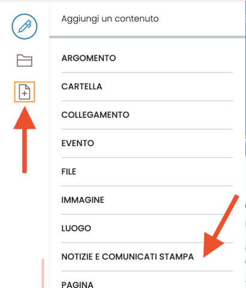

# Content-type “Notizie e comunicati stampa”

Tipologia che presenta notizie, avvisi e comunicati stampa

Notizie e comunicati stampa si differenziano tra loro a seconda di quanto impostato nel campo “Tipologia”. Le tipologie di notizie sono:

- Notizia

- Comunicato stampa

- Avviso[^n8]

E’ un content-type gestito con i blocchi, nel senso che il contenuto informativo della news/comunicato può essere gestito con la modalità “Pagina a blocchi”. Questo permette di formattare più agevolmente il contenuto, inserendo oltre che il testo, anche altri blocchi (immagini, elenchi di altri contenuti correlati, ecc). In questo caso, i campi del content-type saranno disponibili nella sidebar di destra.

I campi sono i seguenti (in giallo i campi obbligatori):

[^n8]: Le tipologie di notizie sono configurabili dal pannello di amministrazione all’indirizzo **https://\<sito>/controlpanel/design-plone-settings**

**Elemento** **Descrizione**

|Titolo della notizia|Il titolo della notizia, del comunicato o dell'avviso. In interfaccia, questo elemento apparirà nella Hero della pagina.|
|---|---|
|**Tipo di notizia**|Il tipo di notizia secondo la tassonomia prevista. In interfaccia, questo elemento apparirà nella Hero della pagina.|
|**Descrizione breve (abstract)**|Descrizione sintetica della notizia. In interfaccia, questo elemento apparirà nella Hero della pagina.|
|**Data della notizia**|Data di pubblicazione della notizia. In interfaccia, questo elemento apparirà nella Hero della pagina.|
|**Data di scadenza**|Eventuale data di scadenza (in caso di avviso pubblicato). In interfaccia, questo elemento apparirà nella Hero della pagina.|
|**Numero progressivo comunicato** **stampa**|Se è un comunicato stampa, indicare un eventuale numero progressivo del comunicato stampa. In interfaccia, questo elemento apparirà nella Hero della pagina.|
|**Immagine**|Immagine principale della notizia. In interfaccia, questo elemento apparirà nella Hero della pagina.|
|**Testo completo della notizia**|Testo principale della notizia, che può includere anche contenuti multimediali.|
|**Documenti**|Elenco dei documenti correlati, con collegamento alle relative pagine foglia documento (se documenti ufficiali dell'ASL) o download diretto degli allegati|
|**Galleria**|Una o più immagini o uno o più video corredate da didascalie|

|Persone|Elenco delle persone dell'ASL citate nella notizia, con collegamento alle relative pagine foglia persona. L'elemento è necessario se nella notizia sono citate persone dell'ASL che hanno una pagina persona.|
|---|---|
|**Strutture**|Elenco delle strutture dell'ASL citate nella notizia, con collegamento alle relative pagine foglia struttura. L'elemento è necessario se nella notizia sono citate strutture dell'ASL.|
|**Servizi e prestazioni**|Elenco dei servizi e delle prestazioni dell'ASL citati nella notizia, con collegamento alle relative pagine foglia servizio. L'elemento è necessario se nella notizia sono citati specifici servizi o prestazioni dell'ASL.|
|**A cura di**|Ufficio che ha curato il comunicato (presumibilmente l'ufficio comunicazione)|
|**Notizie correlate**|Elenco di altre notizie simili o collegate, con collegamento alle relative pagine foglia notizia.|
|**Parliamo di**  |Indicazione degli Argomenti e dei tag Utente con cui il contenuto di pagina è stato taggato. Al click, l'utente atterra sulla relativa Pagina aggregatrice Argomento o Utente.[^n9]|

Dalla modalità di visualizzazione ‘Folder content’ della notizia è possibile accedere a due cartelle:

- **‘Multimedia’** : se all’interno di questa cartella vengono inserite delle immagini, queste verranno mostrate nella sezione dedicata ‘Galleria di immagini’ che verrà mostrata dopo il corpo della news. In questa cartella è possibile inserire anche dei link a video youtube che verranno mostrati subito dopo la galleria di immagini (se presente).
- **‘Documenti allegati’** : se in questa cartella vengono inseriti degli elementi, questi verranno mostrati nella notizia nella sezione dedicata ‘Allegati’.

:::{warning}
**Attenzione!** Non si devono modificare i nomi delle cartelle all’interno della notizia.
:::

[^n9]: Si veda la sezione di ricerca dedicata
