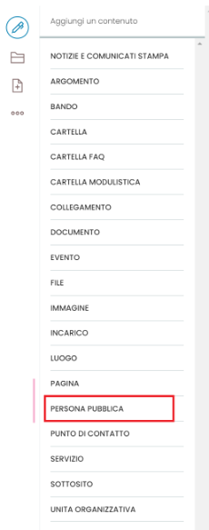
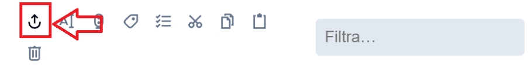

# Content-type “Persona”

Struttura delle informazioni relative alle persone di un'organizzazione, funzionale alla creazione di una scheda persona (content type "persona").

Questa Tipologia permette di descrivere le persone fisiche che sono salienti per il dominio (sito di un ASL), funzionale alla creazione di una scheda persona (content type "persona"). Nota: Questo Content type può essere utilizzato sia per realizzare la scheda dei direttori delle varie strutture organizzative che dei medici che operano nelle strutture. Questa Tipologia permette di descrivere le persone fisiche che sono salienti per il dominio (sito di un ASL), funzionale alla creazione di una scheda persona (content type "persona"). Nota: Questo Content type può essere utilizzato sia per realizzare la scheda dei direttori delle varie strutture organizzative che dei medici che operano nelle strutture.

I campi della persona sono i seguenti:

|Elemento|Descrizione|
|---|---|
|**Titolo di pagina (Nome e cognome della persona)**|Titolo (opzionale), Nome e Cognome (obbligatori) della persona. In interfaccia, questo elemento apparirà nella Hero della pagina.|
|**Sottotitolo**|Indicazione dell'Incarico principale della persona all'interno dell'ASL, ad esempio "Dirigente sanitario". La Tassonomia Incarichi può essere un punto di partenza per stabilire nomenclature standard degli incarichi. In interfaccia, questo elemento apparirà nella Hero della pagina.|
|**Descrizione breve**|Descrizione sintetica, con un linguaggio semplice, che possa aiutare qualsiasi utente a identificare con chiarezza la persona e il contenuto di pagina. Non utilizzare un linguaggio ricco di riferimenti normativi, amministrativi o scientifici. In interfaccia, questo elemento apparirà nella Hero della pagina.|
|**Foto della persona**|Fotografia che ritrae la persona descritta nella scheda. In interfaccia, questo elemento apparirà nella Hero della pagina.|
|**Incarichi**|Indicazione degli incarichi della persona all'interno dell'ASL. Questo elemento è necessario se la persona ha più incarichi oltre quello principale specificato nel sottotitolo di pagina.|
|**Competenze**|Descrizione testuale del ruolo e dei compiti di cui si occupa la persona|
|**Unità organizzativa di** **appartenenza**|Elenco delle unità organizzative di cui fa parte la persona (ad esempio Dipartimento Oncologico, Unità Operativa Urologia, Direzione Generale), con collegamento alle relative pagine foglia. Questo elemento è necessario per le persone interne all'ASL, opzionale per i medici di base e pediatri.|
|**Orari di ricevimento**|Orari durante i quali è possibile incontrare la persona descritta, se effettua ricevimento. Questo elemento è necessario per i medici di base e pediatri.|
|**Dove**|Se la persona fa ricevimento, specificare dove. Questo elemento è necessario per i medici di base e pediatri. Specificare la via con il numero civico, il CAP e la città. Se disponibili, specificare anche quartiere o circoscrizione. Includere un link "Apri in mappa" per portare gli utenti a visualizzare la posizione della struttura su un servizio terzo di locazione. Se la struttura di ricevimento è una struttura dell'ASL, includere collegamento alla relativa pagina foglia struttura.|

|Contatti|I contatti della persona, come telefono ed email. Se la persona non dispone di contatti lavorativi personali, specificare i contatti dell'unità organizzativa per la quale opera.|
|---|---|
|**Strutture in cui opera**|Elenco delle strutture fisiche dell'ASL (Ospedali, Ambulatori etc.) in cui opera la persona, con collegamento alle relative pagine foglia struttura. Questo elemento è necessario per le persone interne all'ASL, opzionale per i medici di base e pediatri.|
|**Biografia**|Testo descrittivo che riporta la biografia della persona|
|**Galleria**|Eventuale galleria multimediale con foto e video che ritraggono l'operato della persona.|
|**Documenti**|Elenco dei documenti relativi alla persona con download diretto, come Curriculum Vitae e Atti relativi al conferimento dell'incarico.|
|**Ulteriori informazioni**  |Ulteriori informazioni relative alla persona non previste dagli altri campi.|

Alla creazione di una Persona, vengono automaticamente create le seguenti pagine:

- Immagini
- Curriculum vitae
- Video
- Documenti

I file inseriti in queste cartelle (attraverso la modalità di visualizzazione folder contents) mostreranno rispettivamente:

- Galleria immagini
- Link al file del curriculum
- Galleria video (inserendo un oggetto collegamento interno o a risorse esterne come YouTube/Vimeo)
- Link a documenti vari

Dal momento che gli allegati per ognuna di queste sezioni possono essere diversi nel corso del tempo, e potrebbero essere aggiunti in momenti diversi, è potenzialmente utile usare lo strumento di caricamento massivo dei file dalla vista folder_contents, ad esempio:

Ogni upload in queste cartelle, popola nel dettaglio della persona l’apposita sezione

:::{warning}
**Attenzione!** Non si devono modificare i nomi delle cartelle all’interno della persona.
:::
