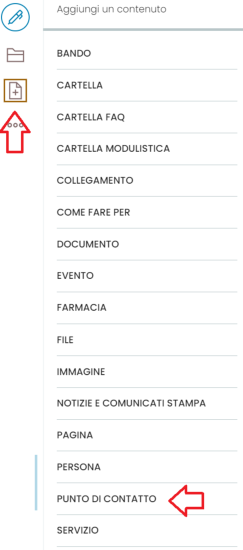

# Content-type “Punto di contatto”

Il punto di contatto è un tipo di contenuto che rappresenta le informazioni quali Telefono, Email, Fax ecc. relativi ad altri tipi di contenuto.

Il concetto di base è, nella fattispecie, quello di evitare di inserire stesse informazioni ripetute in differenti tipi di contenuto.

Ad esempio, due unità organizzative potrebbero condividere gli stessi dati di contatto come Telefono e Fax, inutile quindi ripeterli tali e quali su entrambi. In questo caso si crea un unico “punto di contatto” con le informazioni, e si collega ad entrambe le Unità organizzative.

I tipi di contenuto che presentano un collegamento ai tipi di contatto sono:

- Struttura
- Evento
- Unità organizzativa
- Persona
- Servizio

Nel dettaglio di ciascun tipo di contenuto di cui sopra, qualora sia collegato un punto di contatto, i suoi dati verranno mostrati nella card descrittiva del punto di contatto stesso.

I campi sono:

|Titolo del punto di contatto|La label del punto di contatto (es. Potrebbe essere il nome dell’ufficio, oppure Telefono, Mail ecc..)|
|---|---|
|**Tipo di punto di contatto**|Un punto di contatto può avere tipi diversi, secondo una tassonomiadefinita|
|**Valore del punto di contatto**|Il valore del punto di contatto: il numero compreso di prefisso internazionale (se telefono), l'account (se social network), l'URL (se sito o pagina web), l'indirizzo email (se email)|
|**Unità organizzativa correlata**|Se il Punto di contatto è associato ad una Persona, allora quella persona avrà questi contatti nell'Unità organizzativa selezionata.|
